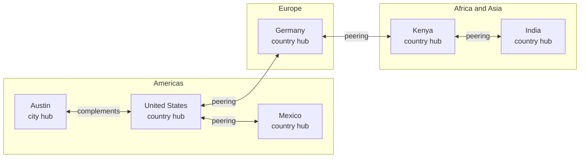

# Trustwork

**An open engine for the place where the construction industry meets.**

*Created and maintained by [Contribuddha](https://contribuddha.com).*

Read the news that matters to your trade. Meet people at events, or host your own. Learn something useful on a Tuesday evening. Find the subcontractor, supplier or client who actually fits, and see why. Buy and sell with quotes that can never be quietly changed. Keep an agent that represents you in the industry, works under your direction, and never steps outside the limits you set.

And run all of it for your own country or your own city, connected to every other hub in one worldwide mesh.

Trustwork is free software (AGPL-3.0-only). It is young, it is honest about what works today, and it is looking for people who want to build it with us.

---

## Why we are building this

Construction is one of the oldest crafts we have and one of the most fragmented industries in the world. A facade is designed by one firm, fixed by a second, clad by a third and maintained for decades by someone who never met any of them. Knowledge lives in the heads of site foremen. Reputation travels by phone calls between people who already know each other. A talented young contractor in a regional city can stay invisible for years to the very client who needs them.

We think the industry deserves a **gathering point**: a place people come back to because it is useful, where your professional story belongs to you, where trust is earned with evidence instead of bought with advertising, and where software helps people deal with each other more clearly and more fairly. Better communication makes better buildings.

## What you can do on a Trustwork hub

| | |
|---|---|
| **Read** | Topical news with named sources and honest dates, practical articles by practitioners, and a curated weekly magazine you can read on your phone or download as a properly laid-out PDF. Corrections are always visible. |
| **Meet** | Find conferences, site visits, webinars and meetups, register in a minute, and book meetings with the people you want to talk to. Host your own events, with tickets, check-in and materials. |
| **Learn** | Short, practical courses on real site work, and certificates anyone can check by number. |
| **Be found** | A personal profile that is yours for life, independent of your employer. A company page with its people, projects, catalogue and reputation. |
| **Find partners** | Publish what you need or what you offer. Matching explains *why* a candidate fits, shows what is unknown, and never sells positions. Introductions are double-opt-in. |
| **Buy and sell** | Turn a vague need into a clear request, collect quotes that are frozen once sent, compare them honestly, negotiate, and agree on terms both sides can prove are identical. |
| **Build a reputation** | Reputation comes from evidence of what actually happened: deliveries, acceptance, payment discipline, cooperation, and reviews tied to real work. Every score shows its method, sample sizes and what was excluded. Nobody can buy one. |
| **Delegate to your agent** | Your agent looks for partners, presents your services, negotiates and pursues your goals, under mandates you can read, change and revoke at any moment. It talks to other people's agents through structured offers, never through tricks. |

## Run it for your country or your city

Trustwork is not one website. It is something people run for a place they care about: an industry association, a trade publisher, a chamber of commerce, a university, a community of engineers. We call that a **hub**.

- **Configured for local reality.** Country packs carry each country's registration numbers, regions, currencies, languages and legal facts, every one with a source. Hub operators connect local registers to verify companies, register news and data sources, choose payment and e-signature providers, and publish legal documents reviewed by their counsel. Engine code stays country-agnostic.
- **Lawful by design.** Operators comply with local law; the engine gives them the controls, the audit trail and the guard rails. Nobody, not even staff, can read private data without a scoped, time-limited, second-person-approved case grant.
- **Any country, any language.** Pick any country that is not under sanctions and, independently, any language the engine speaks. Six languages work today, Spanish is next, and eleven more are on the [roadmap](#languages-and-countries).

## Languages and countries

Trustwork is international by default ([ADR 012, decision 30](docs/adr/012-integrator-decisions-2026-10-31.md#owner-decision-of-2026-10-31-international-by-default)). Our own reference hub will be in the United States; no other region is privileged, and every country and language is welcome.

**Languages**

| Status | Languages |
|---|---|
| **Live** | English (reference) · Russian · Uzbek · Georgian · Armenian · Azerbaijani |
| **Next** | Spanish |
| **Planned** | Portuguese · French · German · Italian · Polish · Ukrainian · Turkish · Arabic (right to left) · Chinese (Simplified) · Hindi · Japanese |
| **Yours** | Any language you bring: [add a language](docs/engine/localization.md#adding-a-language) |

Translations may start as machine drafts. Each one says honestly whether it is a machine draft, community reviewed or native reviewed; Uzbek, Georgian, Armenian and Azerbaijani are machine drafts waiting for native speakers.

**Country packs**

| Status | Countries |
|---|---|
| **Live** | Uzbekistan · Georgia · Armenia · Azerbaijan (pack v1: identifiers, regions, currency, formats, sourced legal notes) |
| **Next** | United States, for our reference hub |
| **Planned** | Canada · Mexico · Brazil · United Kingdom · Ukraine · Türkiye · United Arab Emirates · India · Australia, and an EU layer shared by Germany · France · Spain · Italy · Poland |
| **Everywhere else** | Any country that is not a restricted place works today with a generic profile (currency, calling code, time zone) until someone contributes its pack |

Package IDs, review status and what each pack will cover: [Languages and countries](docs/engine/localization.md#languages-and-countries).

## One mesh for the whole world

Every deployment can join one network. Someone opens Trustwork for a country, someone else opens it for a city in that country, and **they complement each other**: the city's meetups appear in the national calendar, the national magazine reaches city readers, a client in one hub hires a contractor in another, and two parties on different hubs hold provably identical agreements.

Each node keeps its own data, its own operator and its own law.



*Public news, events and directories flow both ways between hubs; a deal travels only between the hubs of the parties involved, and private data never leaves its home. This is an illustration: no hub is running yet, and any country or city that is not a restricted place can join.*

## What works today

We would rather under-promise:

| | Status |
|---|---|
| Accounts, sign-in, sessions, companies, memberships, projects with transfers and participants | **Implemented** on PostgreSQL with row-level security and tests |
| Full public site and workspace (news, articles, magazine, events, directories, search, onboarding, assistant, procurement and sales views) | **Demo** on synthetic data, in six languages |
| Commerce, agent mandates, billing, administration, retrieval | **Frozen contracts and designs**, ready to implement |
| Events, learning, matching, agent negotiation, hubs, verification, federation | **Designed** in the handbook, open for contribution |
| Production deployments, real users, real companies | **None yet.** Demo data is synthetic and labelled. |

Details per area: [docs/engine/status.md](docs/engine/status.md).

## Try it in five minutes

You need Node 24.18.0 and npm 11.16.0 (`nvm install && nvm use`).

```sh
npm ci
npm run check      # lint, types, tests, docs, builds, smoke test
npm run dev:web    # http://localhost:3000 on demo data
```

Try `?persona=mixed` for someone who buys and sells, `?persona=reader` for a reader, and `?country=GE&lang=ka` for Georgian. The live API, the local database and browser tests are described in the [agent onboarding guide](docs/engine/agent-onboarding.md#3-install-and-run), which is just as useful for humans.

## Read more

- **[The engine handbook](docs/engine/README.md)**: every module, implemented and designed.
- [Vision and principles](docs/engine/vision.md) · [Concepts](docs/engine/concepts.md) · [Roadmap](docs/engine/roadmap.md)
- [Hubs](docs/engine/hubs.md) · [Hub administration](docs/engine/hub-administration.md) · [Country specifics](docs/engine/country-specifics.md) · [Federation](docs/engine/federation.md)
- [Your agent](docs/engine/agents.md) · [Partners and matching](docs/engine/partners-and-matching.md) · [Events](docs/engine/events.md)
- [Architecture for contributors](docs/engine/architecture.md) · [Architecture decisions](docs/adr/README.md)

## Come build it with us

There is room for everyone who cares about this industry:

- **Developers**: run `npm run work` to see work packages you can pick up today, each with its goal, acceptance criteria and the paths it owns.
- **Native speakers**: review Uzbek, Georgian, Armenian or Azerbaijani today, or help with Spanish, Portuguese, French, German and the rest of the [language roadmap](#languages-and-countries). Any other language is welcome too.
- **People who know a country**: add sourced facts to a country pack (the United States, Canada, Mexico, Brazil, the EU layer and more are [planned](#languages-and-countries)), so every hub there gets it right.
- **Lawyers**: help us make the legal templates better starting points for operators.
- **Construction practitioners**: tell us what hurts, review the designs for your field, write, teach.
- **Designers**: the hub console, the magazine PDF, check-in on a phone in bright sunlight.
- **Future hub operators**: open an issue and tell us about your territory.
- **AI coding agents and the people who run them**: start with [AGENTS.md](AGENTS.md) and the [agent onboarding guide](docs/engine/agent-onboarding.md).

Read [How to help](docs/engine/how-to-help.md) and [CONTRIBUTING.md](CONTRIBUTING.md). Every commit carries a Developer Certificate of Origin sign-off; there is no contributor licence agreement.

## Who builds Trustwork

Trustwork is created and maintained by **[Contribuddha](https://contribuddha.com)**. We build it in the open because an industry this important deserves shared, honest infrastructure, and because the best ideas will come from people who know their own country, city and trade.

Work with us if you want to:

- **launch a hub** for your country or city, with help on configuration, local registers, legal templates and federation;
- **adapt the engine** to your organisation, or build a product on top of it;
- **join the team** or contribute regularly as a maintainer of an area or a country pack.

Get in touch at [contribuddha.com](https://contribuddha.com). Contribuddha does not provide services to persons in the places listed in [NOTICE](NOTICE).

## What we promise each other

- People first: one lifelong identity, no employee surveillance.
- Truth is labelled: sourced, claimed and verified always look different; unknown is never shown as failure.
- Reputation cannot be bought, by anyone.
- Private stays private, including from staff, search, other hubs and agents.
- Agents work for you, under rules you can read.
- No fakes: no invented users, reviews, ratings or traffic.
- Every language, every country, accessible to everyone.

## Licence, brand and sanctions

- **Licence**: AGPL-3.0-only ([LICENSE](LICENSE)). Run it, change it, build services around it; if you offer a modified engine as a network service, publish your modifications.
- **Brand**: Trustwork in every language; the Russian interface shows «Строй Репутация». The engine ships without photographs. To use your own name, lettering and licensed images, see [docs/oss/BRAND.md](docs/oss/BRAND.md).
- **Sanctions**: the project's owner is subject to US sanctions and export-control law, so Contribuddha and the maintainers do not provide services, support, accounts, hosting or collaborator rights to persons in the places listed in [NOTICE](NOTICE). This is information about how we work, not a restriction in the licence.
- **Security**: report vulnerabilities privately as described in [SECURITY.md](SECURITY.md).
- **Governance**: [GOVERNANCE.md](GOVERNANCE.md) · **Conduct**: [CODE_OF_CONDUCT.md](CODE_OF_CONDUCT.md)

---

*Build reputation. Build it honestly. Build it together.*
