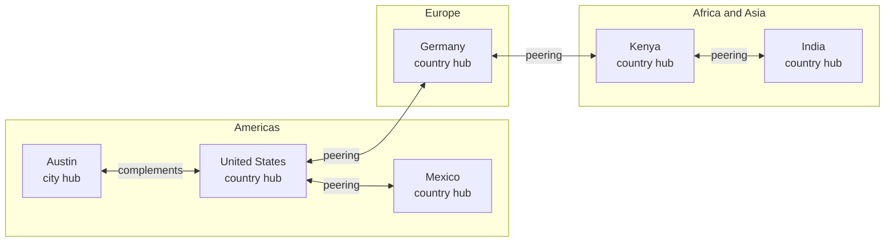

# Trustwork

**An open engine for the place where the construction industry meets.**

*Created and maintained by [Contribuddha](https://contribuddha.com).*

Read the news that matters to your trade. Meet people at events, or host your own. Learn something useful on a Tuesday evening. Find the subcontractor, supplier or client who actually fits, and see why. Buy and sell with quotes that can never be quietly changed. Keep an agent that represents you in the industry, works under your direction, and never steps outside the limits you set.

And run all of it for your own country or your own city, connected to every other hub in one worldwide mesh.

Trustwork is free software (AGPL-3.0-only). It is young, it is honest about what works today, and it is looking for people who want to build it with us.

---

## Why we are building this

Construction is one of the oldest crafts we have and one of the most fragmented industries in the world. A facade is designed by one firm, fixed by a second, clad by a third and maintained for decades by someone who never met any of them. Knowledge lives in the heads of site foremen. Reputation travels by phone calls between people who already know each other. A talented young contractor in a regional city can stay invisible for years to the very client who needs them.

We think the industry deserves a **gathering point**: a place people come back to because it is useful, where your professional story belongs to you, where trust is earned with evidence instead of bought with advertising, and where software helps people deal with each other more clearly and more fairly. Better communication makes better buildings.

## What you can do on a Trustwork hub

What a hub is for, and how much of it runs today. **Live** means implemented end to end on PostgreSQL with automated tests (nothing is deployed to production anywhere); **Demo** means the screens exist on synthetic data; **Contract** means frozen schemas; **Designed** and **Proposed** mean written down, not built. The details are in [What works today](#what-works-today).

| | What it means | Today |
|---|---|---|
| **Read** | Topical news with named sources and honest dates, practical articles by practitioners, and a curated weekly magazine. Corrections are always visible. | Publications, corrections, retractions and numbered magazine issues are **Live** in the API; the public news and magazine pages do not read them yet (they show demo content in demo mode); the PDF layout is designed |
| **Meet** | Find conferences, site visits, webinars and meetups, register in a minute, book meetings. Host your own events, with tickets, check-in and materials. | **Demo** (event pages, registration, a demo ticket); organizer tools are proposed |
| **Learn** | Short, practical courses on real site work, and certificates anyone can check by number. | **Demo**; course authoring is proposed |
| **Be found** | A personal profile that is yours for life, independent of your employer. A company page with its people, projects and catalogue. | **Live**: consent-based public profiles, companies, memberships and directories, in the browser |
| **Plan a project** | Your agent turns a project, such as building a house, into a plan of phases, trades, permits, budget ranges and risks; plan items become requests to experts and trades. | Plans and scoped tasks from plan items are **Live** in the API; the plan editor and consultations are proposed |
| **Find partners** | Publish what you need or what you offer. Matching explains *why* a candidate fits, shows what is unknown, and never sells positions. | Directories are **Demo**; explainable matching is proposed |
| **Buy and sell** | Turn a need into a clear request, collect quotes that are frozen once sent, compare them honestly, negotiate, and agree on terms both sides can prove are identical. Route decisions through your company's approvals and keep your own supplier base. | **Live**: needs, RFQs, quotes, agreements and orders with procurement and sales screens; approval routes and the supplier base in the API |
| **Build a reputation** | Reputation comes from evidence of what actually happened: deliveries, acceptance, reviews tied to real work, credentials, a portfolio and confirmations from counterparties. Every summary shows its method, samples and exclusions. Nobody can buy one. | **Live** in the API, with no public score; builder screens and a portable passport are proposed |
| **Delegate to your agent** | Your agent pursues your goals, presents your services and negotiates under mandates you can read, change and revoke at any moment. It talks to other people's agents through structured offers, never through tricks. | Mandates, the action workflow, goals and negotiation sessions are **Live** in the API and worker with fake providers; no AI model is connected |
| **Use your own AI chat** | Connect Claude, ChatGPT or another chat to your one Trustwork agent over MCP, with consent you can withdraw. | The authorization server is **Live** in the API; the MCP tools and consent screens are designed |

## Run it for your country or your city

Trustwork is not one website. It is something people run for a place they care about: an industry association, a trade publisher, a chamber of commerce, a university, a community of engineers. We call that a **hub**.

- **Configured for local reality.** Country packs carry each country's registration numbers, regions, currencies, languages and legal facts, every one with a source. Hub operators connect local registers to verify companies, register news and data sources, choose payment and e-signature providers, and publish legal documents reviewed by their counsel. Engine code stays country-agnostic.
- **A hub is a real object.** Territories, versioned configuration with second-person activation of sensitive settings, legal document versions and launch gates that block a public launch until every check passes are **Live** in the API; the operator's console runs today on synthetic data.
- **Lawful by design.** Operators comply with local law; the engine gives them the controls, the audit trail and the guard rails. Nobody, not even staff, can read private data without a scoped, time-limited, second-person-approved case grant.
- **Any country, any language.** Pick any country that is not under sanctions and, independently, any language the engine speaks. Seven languages work today and eleven more are on the [roadmap](#languages-and-countries).

## Languages and countries

Trustwork is international by default ([ADR 012, decision 30](docs/adr/012-integrator-decisions-2026-10-31.md#owner-decision-of-2026-10-31-international-by-default)). No region is privileged, and every country and language is welcome.

**Languages**

| Status | Languages |
|---|---|
| **Live** | English (reference) · Russian · Uzbek · Georgian · Armenian · Azerbaijani · Spanish |
| **Planned** | Portuguese · French · German · Italian · Polish · Ukrainian · Turkish · Arabic (right to left) · Chinese (Simplified) · Hindi · Japanese |
| **Yours** | Any language you bring: [add a language](docs/engine/localization.md#adding-a-language) |

English pages have no language prefix and every other language has its own address (`/es/news`), with `hreflang` links between them. Translations may start as machine drafts, and each one says honestly whether it is a machine draft, community reviewed or native reviewed: Uzbek, Georgian, Armenian, Azerbaijani and Spanish are machine drafts waiting for native speakers.

**Country packs**

| Status | Countries |
|---|---|
| **Live** (pack v2, sourced facts) | United States: every state, DC and the territories, with California and San Diego County in depth · Uzbekistan · Georgia · Armenia · Azerbaijan, kept as examples of other countries |
| **Live** (shared layer) | European Union layer: GDPR, eIDAS, VAT, Eurocodes, construction products, procurement directives, SEPA and more, inherited by member-state packs; no member pack yet |
| **Planned** | Canada · Mexico · Brazil · United Kingdom · Ukraine · Türkiye · United Arab Emirates · India · Australia, and Germany · France · Spain · Italy · Poland on the EU layer |
| **Everywhere else** | Any country that is not a restricted place works today with a generic profile (currency, calling code, time zone) until someone contributes its pack |

Facts that cite only secondary sources are marked as pending official confirmation inside each pack. Package IDs, review status and what each pack covers: [Languages and countries](docs/engine/localization.md#languages-and-countries).

**Our reference hub: San Diego, United States.** The project's own reference hub will be a United States hub with San Diego, California as its home territory, English first and Spanish second ([Hubs](docs/engine/hubs.md#the-reference-hub-united-states-decided)). It is decided, not open: the demo shows a synthetic, labelled San Diego dataset, and real sign-ups open only after the platform release candidate, counsel review of the US questions and the owner's switch. The release candidate (QA-002) now passes on the container stack with synthetic data; nothing is deployed for real use.

## One mesh for the whole world

Every deployment can join one network. Someone opens Trustwork for a country, someone else opens it for a city in that country, and **they complement each other**: the city's meetups appear in the national calendar, the national magazine reaches city readers, a client in one hub hires a contractor in another, and two parties on different hubs hold provably identical agreements.

Each node keeps its own data, its own operator and its own law.



*Public news, events and directories flow both ways between hubs; a deal travels only between the hubs of the parties involved, and private data never leaves its home. This is an illustration: no hub accepts real users yet, and any country or city that is not a restricted place can join. The wire protocol, [`trustwork-mesh/1`](docs/engine/federation-protocol.md), is frozen as contracts with conformance vectors; no node implements it yet.*

## What works today

We would rather under-promise. **Live** means implemented end to end on PostgreSQL with automated tests, including negative authorization tests; **Live in the API** means there is no screen for it yet. Nothing is deployed to production, and no real user, company, review or rating exists.

| Area | Status |
|---|---|
| Identity: sign-up with e-mail verification, sign-in, recovery, sessions, two-step verification with an authenticator app and recovery codes, elevated staff sessions | **Live**, in the browser on the live API |
| Companies, memberships with one active employer, consent-based public profiles, people, company and project directories | **Live**, in the browser |
| Projects with transfers and participants; plans with versions, dependencies, permits and a diary; scoped tasks from plan items | Projects **Live** in the browser; plans and tasks **Live in the API** |
| Commerce: catalogue, needs, RFQs, quotes, negotiation, agreements and orders | **Live**, with procurement and sales screens on the API |
| Approval routes with segregation of duties and delegation; the company's private supplier base | **Live in the API** |
| Execution evidence, disputes and appeals, reviews of completed work, explainable reputation snapshots without a public score, and the reputation builder (credentials, portfolio, confirmations, contributions, timeliness) | **Live in the API** |
| Publications with immutable versions, visible corrections and retractions; numbered magazine issues | **Live in the API**; the public pages do not read them yet |
| Communications: threads on work objects (no generic inbox), notifications, versioned templates, mail through the outbox and the worker | **Live**; no deployment has a mail server configured, so mail goes to a recording fake |
| Hubs as first-class objects: territories, versioned configuration, second-person activation, legal versions, launch gates | **Live in the API** |
| Platform administration: scoped staff roles, second-person approvals, case grants instead of impersonation, audit, moderation | **Live in the API**; the hub console (`/admin`) is a **Demo** on synthetic US and Samarkand data |
| Sanctions compliance: visitor gate and holds, OFAC baseline lists ingested from files, screening of people and companies with two-person review, re-screening on every list version, deployment-location attestation | **Live** in the API and worker; the admission check for our own services is a **Contract**; gates on money and commitments are in progress |
| Your agent: mandates confirmed only by the person, the action workflow with budgets, reconciliation of unknown outcomes, goals, agent-to-agent negotiation, the company's one representative | **Live** in the API and worker with fake providers; no AI model or live provider is connected; the assistant screens are a **Demo** |
| Agent safety suite: deterministic attack scenarios mapped to the OWASP Top 10 for LLM and agentic applications | **Live** as a test suite that asserts structural defences |
| Connect your own AI chat: the hub's OAuth authorization server for MCP (metadata, PKCE, resource indicators, tokens, consent records) | **Live in the API**; the MCP tools and the consent screens are **Designed** |
| Federation: the mesh protocol `trustwork-mesh/1` | **Contract** with conformance vectors; no node implements it |
| Public pages: one address per language, `hreflang`, a strict per-request Content Security Policy, lighter pages with Web Vitals budgets | **Live** |
| Countries and languages: seven languages, five pack v2 countries, the EU layer, any other country with a generic profile | **Live**; translations other than English and Russian are machine drafts |
| The United States demo hub (San Diego, synthetic data) and the platform release candidate on the container stack | **Demo** and release-candidate evidence ([QA-002](docs/quality/release/platform.md)); nothing deployed for real use |
| Events, learning, matching, billing and payments, consultations, cited search answers | **Demo** screens, **Contracts** and **Proposed** designs |
| Production deployments, real users, real companies | **None yet.** Demo data is synthetic and labelled. |

Every area, with the work packages behind it: [docs/engine/status.md](docs/engine/status.md).

## Try it in five minutes

You need Node 24.18.0 and npm 11.16.0 (`nvm install && nvm use`).

```sh
npm ci
TRUSTWORK_DEMO_MODE=1 TRUSTWORK_DEFAULT_COUNTRY=US npm run dev:web    # http://localhost:3000, the San Diego demo hub
npm test -- tests/content                                              # focused tests for one area
```

Without `TRUSTWORK_DEFAULT_COUNTRY=US` the demo opens the original Uzbekistan example. In the demo, try `?persona=mixed` for someone who buys and sells, `?persona=reader` for a reader, and `/es/` or `?country=GE&lang=ka` for Spanish or Georgian. Without `TRUSTWORK_DEMO_MODE=1` the web app runs on the live API (`npm run dev:api`). `npm run check` runs the full gate (lint, types, every test suite, docs, builds, smoke); it is heavy, and continuous integration runs it on every pull request. The live API, the local database and browser tests are described in the [agent onboarding guide](docs/engine/agent-onboarding.md#3-install-and-run), which is just as useful for humans.

## Read more

- **[How it works for you](docs/guides/README.md)**: short step-by-step guides for homeowners and clients, professionals and contractors, experts and mentors, companies, suppliers and manufacturers, event organizers, authors and editors, and hub operators, with an honest status for every step; and [connect your own AI chat](docs/guides/connect-your-ai-chat.md).
- **[The engine handbook](docs/engine/README.md)**: every chapter, implemented and designed.
- **[The full system specification](docs/engine/modules/README.md)**: numbered requirements for every module, current and future, each with an honest status and its work packages; [participants and their journeys](docs/engine/participants/README.md); [the capability registry](docs/engine/capability-registry.md) that gives your agent and the interface the same powers; [ideas ranked by impact](docs/engine/ideas.md) from a [worldwide study of competitors](docs/research/competitive-landscape-2026-11.md).
- [Vision and principles](docs/engine/vision.md) · [Concepts](docs/engine/concepts.md) · [Roadmap](docs/engine/roadmap.md)
- [Hubs](docs/engine/hubs.md) · [Hub administration](docs/engine/hub-administration.md) · [The hub console](docs/engine/hub-console/README.md) · [Country specifics](docs/engine/country-specifics.md) · [Federation](docs/engine/federation.md) · [Mesh protocol](docs/engine/federation-protocol.md)
- [Your agent](docs/engine/agents.md) · [The MCP server](docs/engine/mcp-server.md) · [Partners and matching](docs/engine/partners-and-matching.md) · [Buying and selling](docs/engine/commerce.md) · [Procurement and supply](docs/engine/procurement-and-supply.md) · [Events](docs/engine/events.md)
- [Sanctions compliance](docs/engine/modules/sanctions-compliance.md) · [Security, trust and privacy](docs/engine/trust-safety-privacy.md)
- [Architecture for contributors](docs/engine/architecture.md) · [Architecture decisions](docs/adr/README.md) · [Operations runbook](docs/operations/runbook.md)

## Come build it with us

There is room for everyone who cares about this industry:

- **Developers**: pick up a work package (see [Contributing](#contributing) below).
- **Native speakers**: review Uzbek, Georgian, Armenian, Azerbaijani or Spanish today, or help with Portuguese, French, German and the rest of the [language roadmap](#languages-and-countries). Any other language is welcome too.
- **People who know a country**: add sourced facts to a country pack (Canada, Mexico, Brazil, the EU member states and more are [planned](#languages-and-countries)), so every hub there gets it right.
- **Lawyers**: help us make the legal templates better starting points for operators.
- **Construction practitioners**: tell us what hurts, review the designs for your field, write, teach.
- **Designers**: the hub console, the magazine PDF, check-in on a phone in bright sunlight.
- **Future hub operators**: open an issue and tell us about your territory.
- **AI coding agents and the people who run them**: start with [AGENTS.md](AGENTS.md) and the [agent onboarding guide](docs/engine/agent-onboarding.md).

## Contributing

Work is organised as **work packages** in [`docs/engine/work-packages.json`](docs/engine/work-packages.json), each with a goal, acceptance criteria, the paths it owns and one GitHub issue titled `[WP <ID>] <title>`.

1. `npm run work` lists the packages you can pick up now; `npm run work:context -- <ID>` prints one with its reading list, owned paths and a prefilled claim comment.
2. Claim it with a `/claim` comment on its issue. A claims bot accepts or refuses within minutes, labels the issue and assigns you; heartbeat every 3 days, release when you stop. A person holds at most 3 active claims, however many agents they run (a maintainer claiming for themselves, for example to conduct a coordinated wave of agents, up to 20).
3. Work on your own branch inside the package's paths. Run focused tests for your area locally; the full `npm run check` runs in continuous integration.
4. Open a pull request from the template: what and why, the package id and issue, the commit SHA and results the checks ran on, and the `Agent:` line if an AI agent helped. Every commit carries a Developer Certificate of Origin sign-off (`git commit -s`); there is no contributor licence agreement.
5. A maintainer reviews and adds approved pull requests to the merge queue, which runs the required checks once more on the combined change; you do not need to rebase a branch that is merely behind `main`.

Details: [How to help](docs/engine/how-to-help.md), [CONTRIBUTING.md](CONTRIBUTING.md) and the [agent onboarding guide](docs/engine/agent-onboarding.md#5-picking-up-work).

## Who builds Trustwork

Trustwork is created and maintained by **[Contribuddha](https://contribuddha.com)**. We build it in the open because an industry this important deserves shared, honest infrastructure, and because the best ideas will come from people who know their own country, city and trade.

Work with us if you want to:

- **launch a hub** for your country or city, with help on configuration, local registers, legal templates and federation;
- **adapt the engine** to your organisation, or build a product on top of it;
- **join the team** or contribute regularly as a maintainer of an area or a country pack.

Get in touch at [contribuddha.com](https://contribuddha.com). Contribuddha does not provide services to persons in the places listed in [NOTICE](NOTICE).

## What we promise each other

- People first: one lifelong identity, no employee surveillance.
- Truth is labelled: sourced, claimed and verified always look different; unknown is never shown as failure.
- Reputation cannot be bought, by anyone.
- Private stays private, including from staff, search, other hubs and agents.
- Agents work for you, under rules you can read.
- No fakes: no invented users, reviews, ratings or traffic.
- Every language, every country, accessible to everyone.

## Licence, brand and sanctions

- **Licence**: AGPL-3.0-only ([LICENSE](LICENSE)). Run it, change it, build services around it; if you offer a modified engine as a network service, publish your modifications.
- **Brand**: Trustwork in every language; the Russian interface shows a Russian-language name and wordmark, defined in `apps/web/brand` and shown only there. The engine ships without photographs. To use your own name, lettering and licensed images, see [docs/oss/BRAND.md](docs/oss/BRAND.md).
- **Sanctions**: the project's owner is subject to US sanctions and export-control law, so Contribuddha and the maintainers do not provide services, support, accounts, hosting or collaborator rights to persons in the places listed in [NOTICE](NOTICE). This is information about how we work, not a restriction in the licence.
- **Security**: report vulnerabilities privately as described in [SECURITY.md](SECURITY.md).
- **Governance**: [GOVERNANCE.md](GOVERNANCE.md) · **Conduct**: [CODE_OF_CONDUCT.md](CODE_OF_CONDUCT.md)

---

*Build reputation. Build it honestly. Build it together.*
