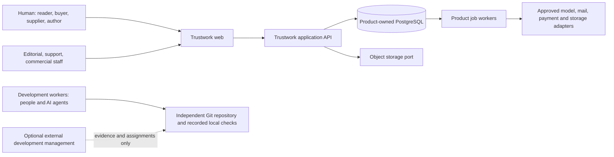
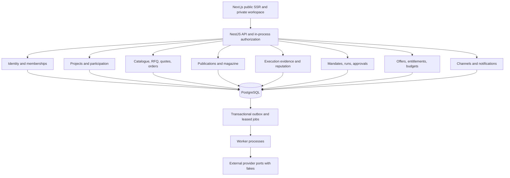

# System architecture

## Decision and implementation status

Use a TypeScript modular monolith, with web, API and workers as separate processes. Domain logic belongs to the API/application modules and pure shared domain code, not page components or provider prompts. PostgreSQL provides transactions, constraints and durable intent. Required RAG uses pgvector plus native full-text/exact search as designed in ADR 007; no retrieval runtime is installed yet. A separate message broker, external vector database, external policy service and microservices are not justified at foundation scale. ADRs record reconsideration triggers.

Implemented today (2026-10-30): the `identity` module (accounts, verification, sessions, step-up, recovery, Google/Apple provider linking with a fake provider, companies and memberships) and the `projects` module (ownership, leadership, publication, consented transfer, participants) on PostgreSQL with forced row-level security; the web app runs the full public site and workspace on synthetic demo data; the worker is a fake policy demonstration. Status per area is in the [engine handbook](../engine/status.md). Module names below are planned boundaries, not empty folders pretending implementation; ADR 010 adds `events`, `learning`, `matching`, `hubs`, `verification` and `federation`. A task creates a module only with useful code, tests and an owned public interface.





## Module contracts and ownership

| Module / future API path | Owns | Exposes; may depend on |
|---|---|---|
| identity | Person, credentials, sessions, memberships, grants | Principal/permission checks; no commercial decisions |
| projects | Ownership/leadership, participants, baseline/revised plans | Scoped project access and lifecycle; identity |
| catalogue | Reusable offering/version/options/capacity | Public selected projection and private author view |
| procurement | Needs, RFQ versions, discovery, eligibility and comparison | RFQ invitations and comparison explanations; projects/catalogue |
| sales | Leads, quotes/versions, negotiation | Immutable sent snapshots and candidate agreements |
| transactions | Shared agreements, orders, changes, obligations | Accepted snapshot and participant projection; no private floor |
| execution | Milestones, delivery/work, acceptance/defects | Evidence-linked events; projects/transactions |
| trust | Claims/evidence/disputes/reviews/aggregates | Versioned explainable public scores; not raw private evidence |
| content | Publications, authorship, topics, issues, corrections | Public version projection and editorial operations |
| assistant | Mandates, runs, actions, approvals, reconciliations | Structured authority and action states; never raw superuser DB |
| channels | Grants, threads, messages, provider receipts | Contextual communication port and notification intents |
| billing | Offers/prices, accounts, subscriptions, entitlements, usage/budgets | Versioned charges and atomic reservation/settlement |
| platform-admin | Scoped editorial/moderation/support/commercial controls | Calls normal module use cases with audited staff authority |

Each module may read another through an explicit query/service contract; it cannot write another's tables directly. Cross-module transactional use cases use one application transaction and outbox. Do not duplicate the rule engine in Next server actions. Public projections have explicit allowlists and their own cache/search indexing policy.

## Persistence and asynchronous work

Start with reviewed SQL migrations and parameterized PostgreSQL access behind repository ports; ORM choice is not inherited from legacy TypeORM. SQL constraints carry critical uniqueness/ownership/immutability. The data lane chooses the typed query adapter in a follow-up ADR. Hybrid semantic and lexical retrieval is required from the first product implementation: PostgreSQL + pgvector + native full-text, optional trigrams and structured resolvers. Private exact authorized subsets and public-only measured ANN are the initial plan; see [retrieval architecture](retrieval.md). An external vector service requires measured evidence and a reviewed ADR.

Persist aggregate state changes, audit event and outbox intent in the same transaction. Workers lease jobs with `FOR UPDATE SKIP LOCKED`, bounded lease/heartbeat and fencing version. Consumers deduplicate by event/operation key. Retry recoverable pre-effect failures with bounded backoff and dead-letter review. Provider side effects are at-least-once attempts: do not claim exactly-once delivery. Persist the stable operation ID and dispatch attempt before calling the provider. A timeout OR a worker crash after possible external effect but before saving the result means `outcome_unknown`; an expired executing lease enters reconciliation rather than ordinary replay. Keep the reservation, query the provider or reconcile with a person, and settle/release only from action-specific final evidence. Document each provider idempotency key scope and retention window. Local fencing cannot stop an old in-flight external request; provider guarantees or explicit proof of no effect are required before a replacement worker retries. A transport acknowledgement/accepted receipt means pending, not final success; accepted-then-rejected operations retain/release the appropriate reservation based on final evidence. A product task's state is not inferred from chat text.

Long-running assistant workflows persist each step/checkpoint and evidence, pause for approval, and resume on structured events. A worker crash never loses authority checks or budget reservations. Cancellation blocks future steps, while already submitted external effects may need compensation rather than deletion. Model/provider adapters implement `prepare`, `execute`, `lookupOutcome` capability interfaces with fake implementations until approved connection.

```mermaid
sequenceDiagram
  participant H as Human or assistant
  participant A as Application policy
  participant D as PostgreSQL
  participant W as Worker
  participant P as External provider
  H->>A: Exact action, mandate version, idempotency key
  A->>D: Check rights, conditions, both applicable budgets
  A->>D: Atomic reservation + intent + audit + outbox
  D-->>A: Committed action ID
  W->>D: Lease action with fencing token
  W->>D: Recheck current authority and approval digest
  W->>D: Persist operation ID and dispatch attempt
  W->>P: Submit with stable provider idempotency key
  alt Final result proven
    P-->>W: Action-specific final evidence
    W->>D: Save final outcome and settle reservation
  else Acknowledgement only
    P-->>W: Accepted for processing
    W->>D: Save pending state and retain reservation
  else Timeout or worker crash after possible effect
    W->>D: Mark outcome_unknown; retain reservation
    W->>P: Lookup outcome using stable reference
    Note over W,P: No blind second order or payment
  end
```

## Trust boundaries

Browser -> application: one public origin serves the web app and proxies `/v1/*` to the API (no CORS for first-party traffic; `__Host-` cookies, custom mutation header, `Sec-Fetch-Site`/`Origin` check per ADR 002 amendment); the application validates authenticated session, CSRF/origin, shape (strict Zod schemas from `packages/contracts`), action, object and fields. Application -> database uses a restricted runtime role, never schema owner/superuser. Worker -> provider validates exact capability and egress target; imported web/email/file/model content cannot authorize calls. Public CDN/search/export/notifications cannot include private values just because a parent project is published. Development workers do not use customer credentials. Optional management adapter is outside startup and customer request processing.

## Extensibility and tradeoffs

Next SSR supports public discovery/SEO and responsive magazine views; private pages disable inappropriate shared caching. Nest module/guard/application conventions support explicit API and workers; the legacy ecosystem offers familiarity but grants no code reuse permission. Separate worker processes isolate slow document/model jobs from HTTP latency. One database simplifies cross-domain transactions at the cost of disciplined module ownership. Extract a service only after an independently scalable boundary and operational benefit are measured. Provider choice, production infrastructure and jurisdiction remain open.
