# RAG and hybrid search architecture

Status: **required product capability; architecture/contracts and deterministic fixtures only**. No embedding model, pgvector extension, retrieval endpoint, index, paid provider or production RAG runtime is installed by this preparation. The explicit human requirement makes RAG first-class now; it does not require a separate vector database. [ADR 007](../adr/007-hybrid-retrieval.md), [knowledge model](../data/knowledge-model.md), [contract](retrieval-api.md), [evaluation](../quality/retrieval-evaluation.md), [operations](../operations/retrieval.md) and primary evidence (kept in the project archive, not in this repository) form one implementation contract.

## Two planes, one accountable answer

Transactional PostgreSQL is the source of truth. Versioned retrieval projections are disposable derived data. Exact company identifiers, prices/currencies/taxes/units, quantities, dates/status/availability, current memberships/permissions, budgets, calculations and quote comparisons come from allowlisted authorized structured queries. A vector similarity score cannot establish any of these facts or decide a legal/commercial commitment. An imported email/document is a source assertion until the domain validates it; extraction is not confirmation.

Use PostgreSQL 18 plus pgvector, native full-text search, pg_trgm for optional typo suggestions, exact indexes and relational edges. Native `ts_rank`/`ts_rank_cd` are not BM25. Maintain Russian/other-language text configurations and an unstemmed field for names, identifiers, technical grades and standards. Query expansion may add synonyms for discovery, never relax mandatory grade, region, certification, quantity or delivery constraints. Preserve original spelling and units for display and citations. No graph database or GraphRAG is required: governed person-company-project-need-quote relations use relational joins with authorization at every node and edge.

```mermaid
flowchart LR
  Sources[Versioned domain objects and permitted files] --> Tx[Source transaction plus outbox and policy epoch]
  Tx --> Ingest[Rights check, extraction, quarantine, chunking]
  Ingest --> Derived[(Generation-specific lexical and vector projections)]
  Query[Authenticated query] --> Plan[Intent and typed constraints]
  Plan --> Policy[Current object and field authorization]
  Policy --> Exact[Structured resolver]
  Policy --> Hybrid[Authorized lexical and semantic retrieval]
  Derived --> Hybrid
  Hybrid --> Hydrate[Reauthorize and hydrate source versions]
  Exact --> Context[Fact and evidence context assembly]
  Hydrate --> Context
  Context --> Model[Optional approved answer or rerank provider]
  Model --> Gate[Final authorization and citation gate]
  Gate --> Answer[Cited answer, qualified result or abstention]
```

The retrieval repository is inside the trusted application/data boundary. Raw candidates, vectors and policy failures never leave it for the browser, external reranker, model, logs or caller-visible counts. Before any optional external provider receives text, authorized field projection and that provider's separate data-egress permission must pass. Embedding and generation providers have independently assessed region, retention, training and contractual eligibility; permission for one does not authorize the other.

## Query plans

| Intent | Exact source/constraint plan | Retrieval and answer plan |
|---|---|---|
| Exact company identifier or quoted name | Canonical identifier lookup with appropriate public/object access; no fuzzy ID substitution | Return exact permitted entity; optional separately labelled spelling suggestions for names only |
| Supplier for supply + installation in a region by a date | Catalogue type, current capacity/availability timestamp, region, required certification/spec, goods/works/services eligibility | Russian/multilingual description retrieval inside eligible set; lexical + dense fusion; explain matches/missing facts; no invented availability |
| Person with relevant expertise | Published/consented profile and permitted person-company-project edges; current audience and employment state | Retrieve expertise/contributions, cite public versions; no employer private history, hidden people counts or inferred verification |
| Relevant projects and needs | Current project participation or public projection, need/RFQ state, date/region/category; pin RFQ version | Semantic matching of narrative scope; distinguish open/current from closed/historical; each supplier invitation/quote pins exact RFQ version |
| Compare quotes / affordability | Fetch exact quote + RFQ versions, normalize structured quantities/currency/tax/terms with approved rules; budget check through billing port | Retrieval may locate explanatory specifications/evidence; it cannot calculate price or rank unlike quantities as equivalent |
| Explain a project event / prepare a cited answer | Identify allowed project/party/source scope and requested temporal mode | Retrieve evidence, preserve claim/disputed/superseded status, resolve structured facts, generate only supported claims or abstain |
| Multi-intent question | Decompose into bounded typed subqueries, retain mandatory constraints and the same current principal | Join only permitted entities/edges; report partial/no-answer if any required evidence missing; no model-generated SQL |

Default temporal mode is **latest eligible current version**, with a source freshness policy. Historical queries explicitly select immutable versions/as-of context and still use **current** access rights. Neither old membership nor old public visibility restores access. RFQ amendments mark earlier quotes stale for the current RFQ; an old response to quantity 10 is not a response to quantity 100. Historical evidence may remain citeable only under a current grant and clear historical labelling. Availability has observed/valid-until timestamps and is re-read before recommending a current option or executing an action.

## Initial safe retrieval and index strategy

1. **Exact filters first.** Resolve the current authorized object/field set in PostgreSQL using restricted roles and current policy. For private personal/company/project/deal-party data, begin with exact vector distance over that already authorized materialized subset plus lexical candidates from the same subset. Bound expensive requests and return an honest partial/timeout response; never fall back to a global mixed-tenant ANN index.
2. **Physical isolation for ANN.** A dedicated public-only eligible projection can use generation-specific HNSW after benchmarking. Future private ANN must use a genuinely homogeneous permission cohort, separate table/partition/index and proven physical pruning; `company_id` is not a sufficient cohort because projects, counterparties, fields and people have different grants. Prefer exact authorized scans for small/selective scopes. Do not create one partition per arbitrary ACL combination without a measured operational plan.
3. **Filtered recall is a separate correctness concern.** pgvector ANN filtering can underfill results; bounded iterative scanning/overfetch may improve recall but cannot promise top-k completeness. Strict ordering orders found results; it is not exact nearest-neighbor recall. Test filter selectivity, explain plans and exact-oracle recall. On exhausted budget, use permitted exact fallback when bounded, or report incomplete results; never weaken filters or imply absence from underfilled ANN.
4. **Mixed-index inference matters.** Other parties' vectors must not influence caller-visible ordering/counts/autocomplete or practical private search timing. Initial private exact subsets avoid shared ANN topology influence. Public-to-private/deletion transitions mark the affected public ANN generation tainted in the same authoritative policy update: route to exact permitted retrieval until cleanup/rebuild is certified. Hydration denial alone cannot remove an old vector's effect on ANN recall. Future cohort indexes require the same taint/fallback mechanism and threat-modelled timing limits.
5. **Fusion after permission and mandatory constraints.** Build lexical/dense ranked lists within the permitted scope; deduplicate by source-version/projection/chunk. Start with reciprocal-rank fusion `sum(1/(60 + rank))`, then source diversification and deterministic tie-break. This is an initial tuning choice, not a measured optimum. Exact identifier hits bypass semantic competition. Optional reranking only sees already permitted text, respects token/cost limits and cannot resurrect rejected candidates or change facts/filters.

An implementation candidate for selective private queries materializes authorized chunk IDs/projections first, then computes exact distance in an outer query. The data lane must prove the actual PostgreSQL plan and runtime-role policy in integration tests; this document does not claim an SQL planner fence merely because the application filtered an array. Do not export unrestricted scores/counts for later frontend filtering.

## Authorization and revocation linearization

Effective access is the intersection of current person, employer membership where relevant, object participation, project and deal-party grants, field projection, source rights/consent, and current lifecycle. Buyer private notes and seller margin/negotiation floors have separate projections from shared accepted terms. Embeddings inherit the projection's sensitivity; a vector is not anonymized text.

Three mandatory checks: (A) before candidate identifiers/snippets leave the trusted retrieval repository, (B) at source hydration/context assembly and before provider egress, (C) immediately before response/citation admission. Each uses the authoritative current policy epoch, source-version/tombstone state and field projection, not a long-lived authorization snapshot. Failure to reach that authority fails closed. RLS is defense in depth, not a checkbox: restricted runtime role, FORCE RLS where appropriate, no owner/BYPASSRLS/superuser, transaction-local identity with pool reset, and tested policy-table races/views/security-definer functions. A trusted service setter must bind DB identity to authenticated server context, not a client-supplied setting.

**Admission semantics:** buffer protected answers initially. A final delivery gate serializes admission with policy-revocation fencing for the affected scopes; revocation prevents new admissions after its authoritative linearization point. A final preflight read alone is insufficient because revocation may occur between read and dispatch. Implement a bounded shared admission lease/epoch fence and exclusive revocation operation; test concurrent API nodes. Cancel queued/unadmitted responses, stale cache entries, citation resolutions and provider requests where possible. Bytes already admitted/delivered cannot be recalled and may arrive after revocation due to transport buffering; do not promise otherwise. No unbounded protected streaming in the first slice; any later streaming must re-gate each batch and document this limit.

Cache keys bind principal, effective object/field scope fingerprint, current policy epoch, source revision/freshness watermark, query/filters/temporal mode, embedding generation, reranker and answer-template/model versions. No private cross-user answer, semantic-response, autocomplete or embedding cache. Public shared caches admit only certified currently public projections and invalidate synchronously through the same epoch/taint gate. Every cache hit is reauthorized; invalidation events are cleanup, not the security boundary. Citation endpoints and previous conversation turns recheck current rights. Company exit does not copy private employer history into personal assistant memory.

## Ingestion, provenance and authority

The source mutation and outbox/tombstone/epoch intent are atomic. Ingestion checks permitted purpose and source rights before reading; isolate malware scanning/parsing/OCR with time/memory/type/size limits. Preserve original bytes hash, extraction/parser/OCR versions, language, page/table/row/offset mapping and uncertainty. Chunk headings/paragraphs/tables without mixing audiences; preserve table headers/units and explicit row references. Suggested starting chunk size 300–700 model tokens with bounded overlap is a research setting, not a universal guarantee; tune by document type and citation evaluation. Do not truncate a financial table into invented totals.

Idempotency keys cover source version + projection + extractor/chunker revision + embedding configuration/generation. Duplicate delivery updates nothing twice. Rights/ACL changes invalidate eligibility even when text hash is unchanged. Entity resolution uses exact identifiers when validated; fuzzy matches remain proposals with confidence/evidence, never auto-merge people/companies or create verified facts. Retries checkpoint; malformed/ambiguous extraction enters quarantine/dead-letter with bounded metadata. Reconciliation compares canonical source versions to active projections and reports missing/stale/orphaned chunks.

Retrieved text, including instructions inside an email, PDF, webpage or chunk, is untrusted evidence only. Delimiters/scanners reduce exposure but do not neutralize injection. The answer model has no direct database or action authority. Cited assertions must match actual accessible source versions/locators and support the specific claim; a model-supplied citation ID is not proof. Separate fact resolver outputs from attributed source claims and conflicts. Unsupported/conflicting answers qualify or abstain; do not cite an irrelevant trusted publication to launder a fabricated conclusion. Existing action-specific mandates still allow authorized autonomous buying/selling: retrieval cannot grant, broaden or revoke those mandates, and this design adds no blanket confirmation requirement.

## Derived artifacts and complete-domain answers

Audience separation happens before embedding, reranking and generation. Never embed a shared deal together with buyer budget or seller floor and rely on answer-time redaction. Multi-source summaries and saved assistant answers inherit the INTERSECTION of permitted audiences, never the union. Track every dependency through postprocessing, caches, provider retention/logs and old generations. A revoked/unavailable dependency denies reading or regenerating the old artifact; a newly grounded authorized recomputation gets a new artifact and dependency set. Personal assistant history must not preserve employer-only data after employment ends.

Top-k does not establish all overdue commitments, a total, or the minimum compliant price. Use authorized complete-domain structured queries with explicit as-of/version semantics, scope and completeness; report unknown/partial if the domain cannot be enumerated. No aggregate may be inferred from nearest neighbors.

The admission linearization contract applies separately to NEW embedding/rerank/generation provider dispatches, answer delivery and citation access. Committed revocation prevents new admissions; already admitted bytes cannot be recalled. Missing database identity denies access, including reused pool connections after commit/rollback/savepoint. Test transaction-local trusted setters; RLS and exact subset scans do not promise constant-time or absence of all side channels. Threat-model shared-resource contention and pad/limit exposure where justified by measurements.

Implementation ownership: BE-001 implements and verifies the common admission/revocation primitive in packages/data, including identity revocation integration and multi-node dispatch races. RAG-201 depends on accepted BE-001 and reuses that gate before any embedding adapter dispatch. RAG-301 reuses it for query embeddings, reranking, answer generation and response/citation delivery; it does not create the first gate or a competing implementation.
