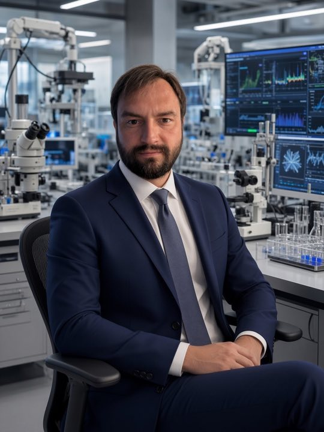

<!-- Generated by npm run book from docs/book/chapters/26-author.html. Edit the chapter, not this file. -->

*Part X · Reference*

# 26. The author, our projects and how to reach us

*Trustwork has many authors, people and agents, and one person who answers for it. This page introduces that person, lists the projects that share its makers and its discipline, and gives the addresses where a conversation can begin.*

## Dmitry Parshkov

**Dmitry Parshkov**. Founder of Contribuda and Trustwork. Systems architect, founder and engineering leader, based in San Diego, California.

Dmitry Parshkov has spent twenty-three years where software, electronics, mechanics, physics, artificial intelligence, operations and people must work as one system rather than as separate departments. The work connects product strategy, system architecture, multidisciplinary engineering, manufacturing, customer delivery and commercialisation, and is most useful where a problem crosses the boundaries between disciplines.

Over that career Dmitry Parshkov has contributed to more than two hundred product and system efforts, led organisations of up to 175 people, led the architecture and development of a platform that grew past 250,000 deployed devices, and closed eight commercial transactions, among them the sale of a company and of an intellectual-property portfolio. The working method joins life-cycle discipline (ISO/IEC/IEEE 15288), model-based systems engineering, TRIZ and evidence-first experiment: the plan should become the thing that runs. Since 2013 the author's company, Parshkov Inc, has been a platform for multidisciplinary product realisation; in 2026 it joined forces with Promwad, a European electronics design house, to give its portfolio a path from first sketch to mass production.

The same conviction runs through Contribuda and Trustwork: complex work becomes trustworthy when the plan, the work and the evidence stay connected, and when every decision that matters carries a person's word.

## How to reach us

- Dmitry Parshkov [mail@parshkov.com](mailto:mail@parshkov.com)
- LinkedIn [linkedin.com/in/parshkov](https://www.linkedin.com/in/parshkov/)
- Contribuda [contribuddha.com](https://contribuddha.com)
- Security reports [security@contribuddha.com](mailto:security@contribuddha.com)
- Trustwork, the engine [github.com/Contribuda/trustwork](https://github.com/Contribuda/trustwork)

Vulnerabilities are reported privately: through GitHub's private vulnerability reporting on the repository, or by e-mail to security@contribuddha.com, never in a public issue. Contribuda was formerly named Contribuddha; its contact addresses keep the domain contribuddha.com until the move to the new name is complete.

To open a hub, to join as a partner or to propose a first case, write with who you are, the country or city you have in mind and the case you would want to run first. The invitation on the previous page says what happens next.

## The Contribuda family

Trustwork is one engine in a family of systems built by the same people under the same rules: evidence, not claims; a person decides; delivered in the client's name.

- **Contribuda** (Project operating system): Lets a person with an idea have it built, launched and kept alive by a real team of people and agents: one counterparty, one plan, one living record of the work, the result delivered in the client's own name.
- **Trustwork** (Open engine): The engine of this book: a gathering point for the people who build, run as hubs for countries and cities and joined in one mesh, free software under the AGPL-3.0-only licence.
- **HumanGate** (Participant product): Where people take the gates of real projects: the studio, the work board, gates, accounts and money, agents, and the worker channel over MCP.
- **Pulse** (Partner in the product): Frames a project from one conversation, works out the detail in the background, writes the morning report and turns every gap it finds into a development task.
- **Meet** (The project's conversation): Groups with topics, a channel, agents, direct chats, departments and roles: people and agents working in the open, in one place.
- **Flode** (The core): Flow and node in one word: a graph that can itself be a node of another, to any depth, under one law; a visual language for modelling a business or a system as connected typed blocks before committing resources.
- **Orbit** (Design system): One component package and one workshop behind every Contribuda interface, light and dark as equals.
- **ADOR** (Governed engineering runtime): The Autonomous Development and Orchestration Runtime: an executable engineering plan in which goals, requirements, tasks, people, agents, artefacts, decisions and budgets stay connected as a typed causal graph.

## Parshkov Inc

Two current systems of Parshkov Inc share the engineering discipline that shaped Contribuda and Trustwork.

- **NovaECAM** (Current · manufacturing): A new manufacturing architecture for building metal structures through controlled electrochemistry and patterned energy; the core process is covered by patents in registration.
- **DeepSense** (Current · sensing): A multimodal edge-sensing architecture that turns many imperfect signals into one useful interpretation, close to the source.

> Different products, one discipline: the plan, the work and the evidence stay connected.

---

Previous: [25. An invitation](25-an-invitation.md) · [Contents](README.md) · Next: [27. This book is part of the engine](27-this-book-is-part-of-the-engine.md)
