# Entity-relationship diagrams

Conceptual maps of the [data dictionary](model.md), one per domain plus a cross-domain overview. They show identity and main relationships, not every column, and they are not an authorization proof: participation rows and projection serializers qualify every arrow. Two arrows from a person and a company to the same entity mean **XOR ownership**, never two owners. Entities marked Live exist as tables today; everything else follows the status in the dictionary.

Notation: `||--o{` one to many, `||--||` one to one, `o|--o{` optional one to many, `}o--o{` many to many through a link record.

## Cross-domain overview

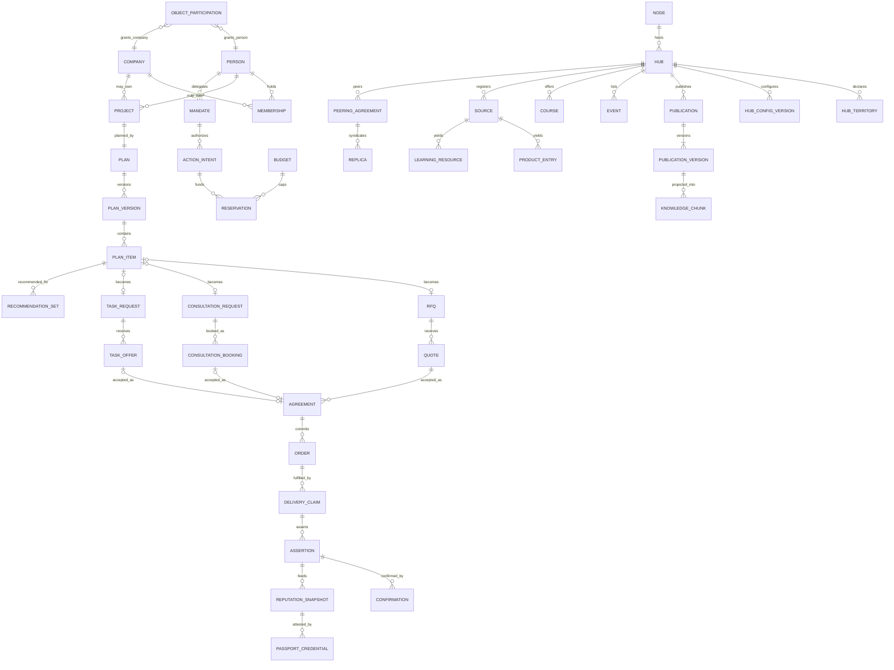

## Identity, people and access

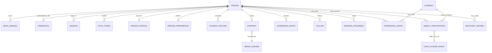

## Companies and verification

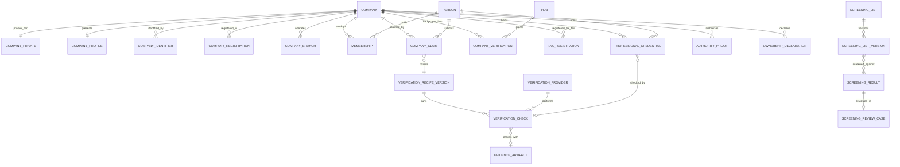

## Projects and plans

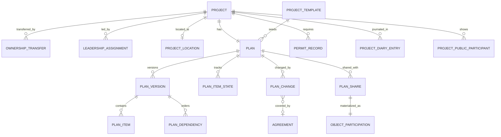

## Consultations, tasks, mentoring and knowledge sharing

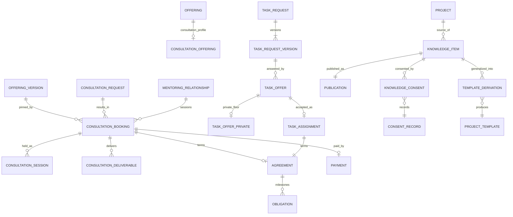

## Content and magazine

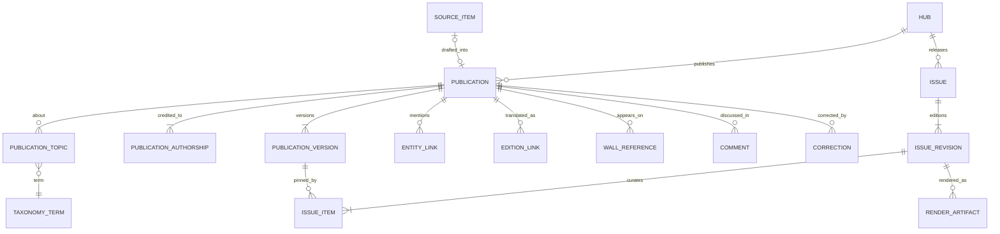

## Events

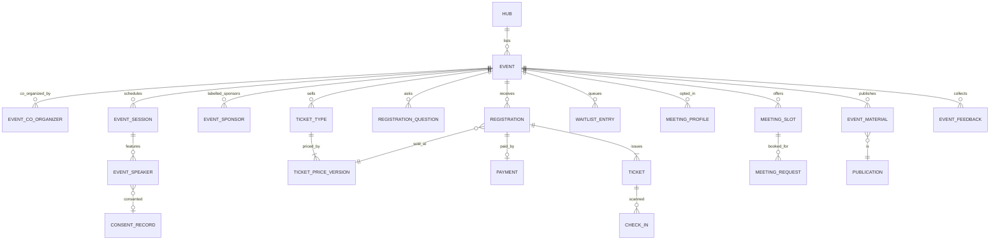

## Learning

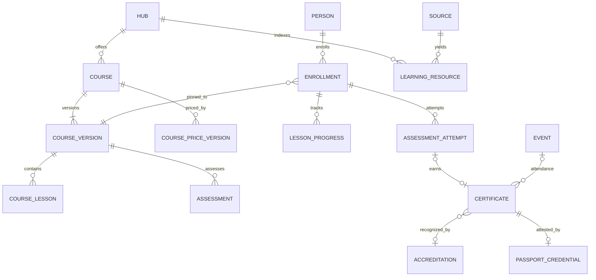

## Partners, matching and recommendations

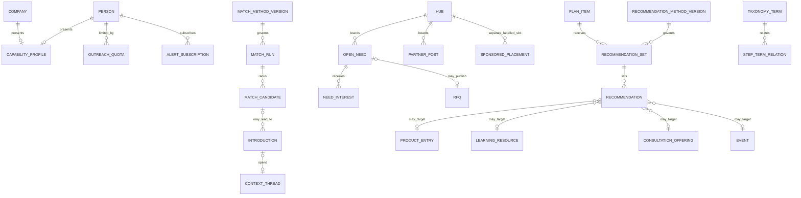

## Catalogue, procurement, sales and transactions

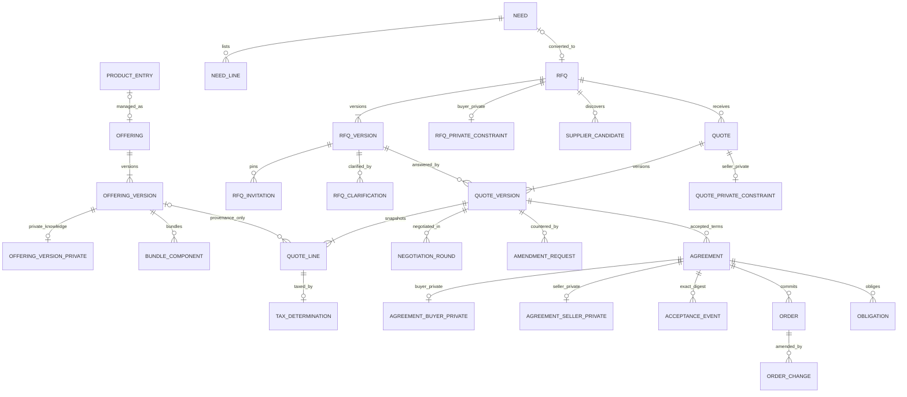

## Execution, evidence and reputation

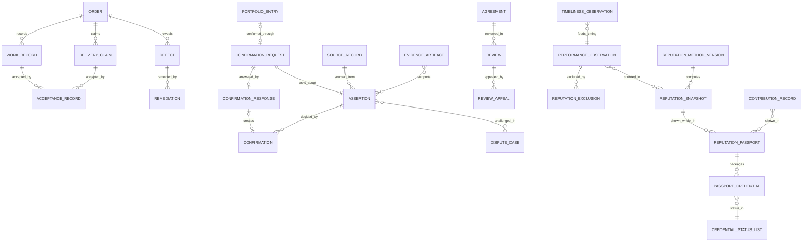

## Assistant and agents

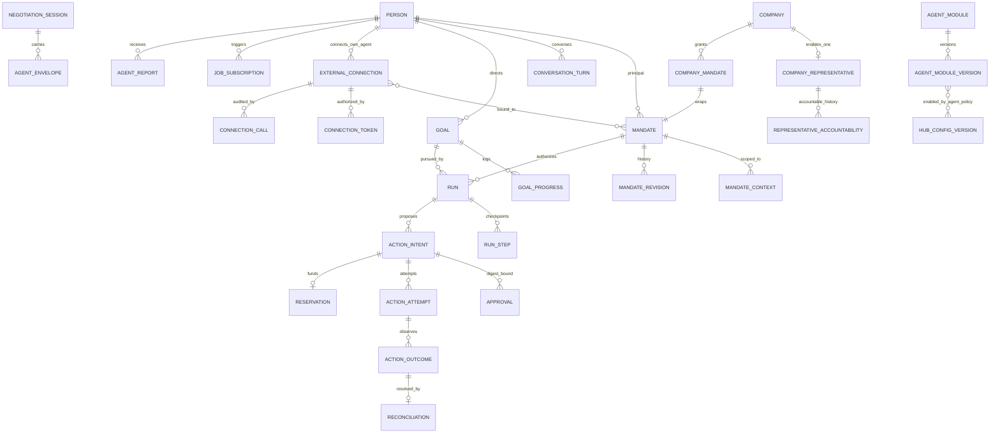

## Communications

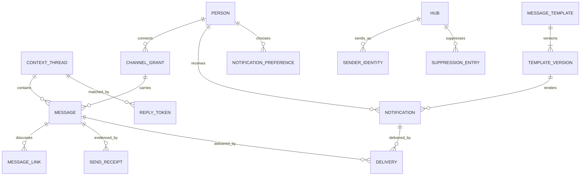

## Billing, budgets and payments

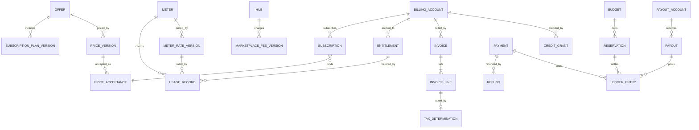

## Hubs, sources and pipelines

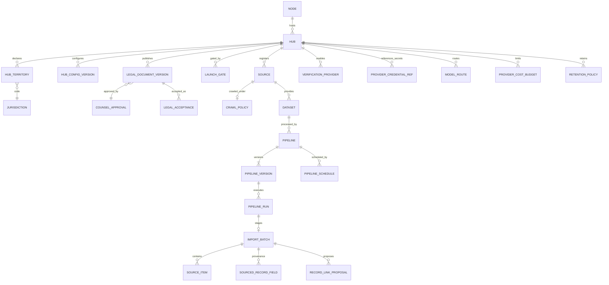

## Search and knowledge

See [knowledge model](knowledge-model.md) for the retrieval diagram (source versions, projections, chunks, generations, embeddings, tombstones and answer dependencies); `SAVED_ANSWER` depends on `ANSWER_DEPENDENCY` rows and survives only while every dependency remains permitted.

## Federation

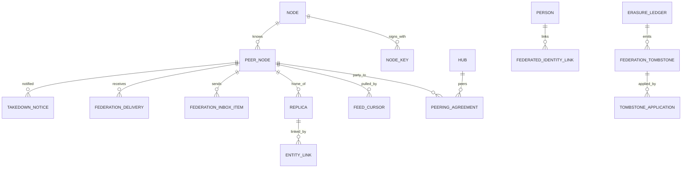

## Administration, support and privacy

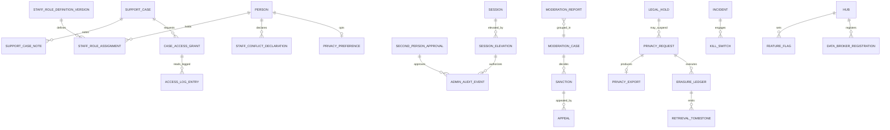
