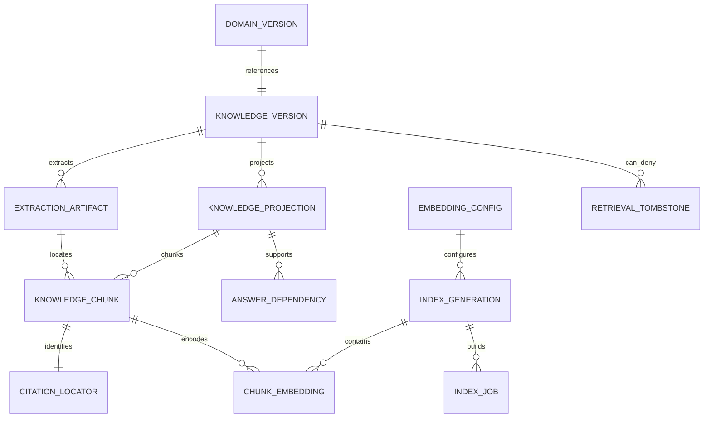

# Knowledge records, lineage and retrieval projections

Proposed logical schema only. No business/retrieval migrations are applied. Canonical domain tables remain authoritative; derived retrieval is reproducible, versioned and deletable. See [base model](model.md), [ADR 007](../adr/007-hybrid-retrieval.md) and [contract](../architecture/retrieval-api.md).

## Source eligibility and field projection matrix

| Source | Eligible searchable content | Structured resolver / citation | Exclusions and boundary |
|---|---|---|---|
| Company | Permitted public description, capabilities, sourced publication/claim labels; explicit member-private projection when needed | Exact identifiers, legal/claim status, regions and current record/version | Credentials, unrelated private staff fields, unsupported verification assertions |
| Person | Consented/published expertise, own public contributions; explicit personal-private material only for that person | Public identity and permitted relationship edges with validity times | Corporate private history, unconsented profiles/portraits, hidden contact details, sensitive inference |
| Catalogue offering/version | Permitted goods/works/services specs, options, service scope, installation/maintenance descriptions | Current availability/capacity, prices/taxes/units and referenced immutable version | Seller margin/floor and unpublished internal knowledge never in public/shared projection |
| Need/RFQ version | Scope/specification and permitted attachments under current invitation/project/public audience | Immutable published RFQ version, quantities/units/deadlines/status | Internal buyer priorities/budget and private candidate evaluation excluded from supplier view |
| Quote version / shared agreement | Allowed technical line descriptions and shared accepted terms projection | Exact quote_version_id -> rfq_version_id, line/terms hash, amounts, currency, validity, acceptance | No catalogue update rewrites snapshot; stale RFQ response not current; party-private notes/floors separate |
| Project / plan | Explicit public story/open needs OR separately scoped participant narrative | Owner/leader, baseline/change version, milestones and authoritative status | Public flag never releases prices/files/messages/commitments; personal project uses person grants |
| Publication/issue | Released permitted versions with source/date/author/correction; private editorial draft only editorial scope | Publication/issue version and stable section/paragraph locator | Retracted/deleted versions absent from latest mode; history needs current rights |
| Execution/evidence | Permitted evidence excerpts with claim/confirmed/disputed/superseded labels | Artifact/version locator, assertion/confirmation lineage and attribution | Evidence import is not truth; restricted dispute/support material not general assistant context |
| Email/files | Explicit connected-account scope and purpose, object-linked permitted extracts | Original message/file identity, attachment hash, source/observed timestamps and extraction confidence | No whole-mailbox indexing by company default; secrets and unrelated personal content excluded |
| Assistant conversation | Optional user-private, deliberately retained source-backed notes only | Source dependencies and current access at every reuse | No raw chain-of-thought index, no implicit employer-data copy, no permanent authority from chat |

Never concatenate fields with different audiences into one embedding or chunk. Price/quantity text from a document remains an attributed extraction claim; canonical comparisons use typed structured facts, not extraction/vector guesses. Public/private duplicates have separate projection IDs, eligibility and erasure paths. Content-hash equality does not authorize cross-party cache/dedup reuse.

## Logical dictionary and ownership

| Record | Required fields / identity | Invariants / owner |
|---|---|---|
| `knowledge_source` | source_id, entity_kind/id, canonical owner, source connector, purpose, rights/consent reference, classification | Domain/source owner decides eligibility; not a second canonical entity store |
| `knowledge_version` | source_version_id, canonical revision, immutable original hash, source/event/observed times, validity interval, evidence state, deletion sequence | Unique source+version; exact quote and RFQ version links; historical version is not current authorization |
| `extraction_artifact` | artifact_id, source_version_id, bytes hash, parser/OCR/version/language, layout/table map, confidence/errors, quarantine state | Reproducible extraction; original bytes and parser output separate; malformed/ambiguous output not auto-confirmed |
| `knowledge_projection` | projection_id, source_version_id, field_set_id, audience policy reference, permission-cohort descriptor, authz epoch, rights version, eligibility state | Audience/field-specific allowed representation; epoch is a stale-work detector, not a lasting capability |
| `knowledge_chunk` | chunk_id, projection_id, extraction_id, chunker revision, content hash, text artifact reference, token count, language, locator | Stable deterministic ID from source version + projection + chunker + locator/hash; no cross-audience chunk |
| `citation_locator` | source version, extraction revision, page + bounding box OR table/sheet + row/cell OR text code-point offsets + heading path | Locator points to immutable original/extraction; edited documents create new citations, not silently moved anchors |
| `embedding_config` | provider policy, model revision, tokenizer, query/document prefix, pooling, dimensions, metric, normalization, precision, license hash | Immutable configuration; same dimension does not mean compatible model space |
| `index_generation` | generation_id, config_id, projection/chunker/schema revisions, build watermark, status, policy/erasure watermark, manifest/hash | Building -> validated -> active -> draining -> retired; single explicit active pointer per compatible corpus/scope |
| `chunk_embedding` | chunk_id, generation_id, config_id, vector, vector hash, created_at | Unique chunk+generation/config; finite correct dimensions/nonzero; worker cannot publish incompatible model output |
| `lexical_projection` | chunk_id, generation_id, language config/dictionary revision, weighted tsvector, unstemmed exact tokens | Same eligible source/version and deletion semantics as vectors; native ranking not BM25 |
| `knowledge_edge` | source node/version, relation, target node/version, evidence/source, confidence, valid interval, audience | Every node/edge authorized; fuzzy entity merge remains proposed; edges cannot launder hidden relationships |
| `index_job` | outbox_event_id, source_version/projection/config/generation, expected epoch, attempt/fence, checkpoint, state/retry | Idempotent key; stale job cannot reactivate revoked/deleted/superseded material |
| `retrieval_tombstone` | source/projection ID, deletion/deny sequence, reason category, scope epoch, effective_at | Durable monotonic deny/replay; minimum metadata retained under policy, no deleted raw content |
| `retrieval_receipt` | principal pseudonym, request ID, policy stamp, plan/generation/config, allowed source-version IDs, latency/cost counters | Restricted audit; no raw text/vector/query by default; retention policy needed |
| `answer_dependency` | answer/artifact ID, source-version/projection/locator IDs, policy stamp, generation, expiry | Invalidation/recheck across caches, saved answers and conversation memory; never an access token |

The data integrator owns migrations and invariants. The backend authorization owner owns grants, current epochs and admission fencing. The indexer owns only derived records through typed ports and cannot promote an assertion to confirmed fact, alter ACL or revise accepted terms.

## Constraint and query requirements

- Enforce referential integrity for exact source/projection/config/generation; never a free-text source URL as citation authority. Citation route resolves an opaque ID server-side and rechecks current source/field rights; inaccessible/not-found share a non-enumerating response.
- Published RFQ and sent quote versions are immutable. Quote projections require the exact referenced RFQ version, independently of catalogue provenance. Current-mode eligibility compares those pins against the canonical context; historical-mode queries never silently satisfy a current request.
- Exact amounts use existing Money/decimal-unit types. No vector equality, approximate neighbors or model text changes typed facts. Availability is refreshed from canonical records and labelled with observation/expiry; unknown stays unknown.
- Keep token/dimension/type limits validated per embedding configuration; maintain separate indexes for incompatible model spaces and generations. Source hashes and evidence state survive extraction but are not authorization secrets or automatic verification.
- Grant/consent withdrawal, source visibility change or deletion bumps current policy/deny state transactionally before asynchronous cleanup. Tombstones prevent restored/backfilled embeddings or lexical rows from returning. A restore must not roll back the external erasure/control watermark.
- Derived storage access obeys the same restricted roles and field policy as canonical data. Bulk embedding/index workers have scoped service identity and purpose; they cannot return raw indexed material through an administrative endpoint.

Multi-source derived records store every source-version/projection dependency and the intersection of audiences. No cached/saved answer survives a now-denied dependency without fresh authorized recomputation. This applies to personal assistant memory, postprocessing, old generations, logs and provider-held copies under approved retention contracts.

Common admission storage/migrations and revocation integration belong to BE-001 after DATA-001; exclusive data ownership then transfers to RAG-201 for derived indexes. All provider inputs, including private search questions, carry explicit classification and source/scope dependencies independent of the searched corpus.
