# Aggregate and evidence lifecycles

All transitions are commands with current authority, expected revision, idempotency and audit; arrows below omit error branches only for readability. They are domain plans, not implemented state machines.

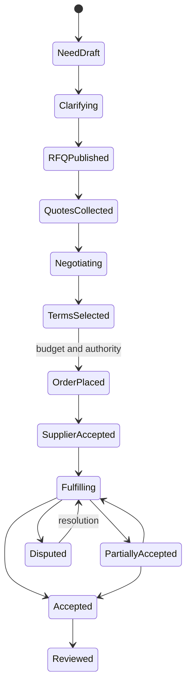

RFQ may close/expire/cancel without an order (`rfq.status ∈ {draft, published, closed, cancelled, expired}`; `rfq_version.status ∈ {draft, published, superseded}`). Published requirement versions are immutable. Invitation and quote version reference exact RFQ version; an amendment sets `stale_reason = rfq_amended` on prior responses (a flag beside the unchanged status, never a `stale` status) and requires explicit supplier revalidation/new version (`revalidated_from`) before comparing as equivalent or accepting changed scope. Quote `draft -> sent -> superseded | withdrawn | expired | accepted`. Sent content is immutable in all terminal states. Buyer selection is not supplier acceptance (`agreement.status ∈ {proposed, accepted_by_buyer, accepted_by_both, declined, withdrawn, superseded}`). Agreement/order amendments append jointly accepted versions, never mutate history. Cancel/refund/compensation depends on actual external effects and obligations. Guards: `rfqVersionMutable`, `quoteVersionMutable`, `isQuoteStale`, `checkAcceptance`, `comparableQuoteVersions` in `packages/contracts`.

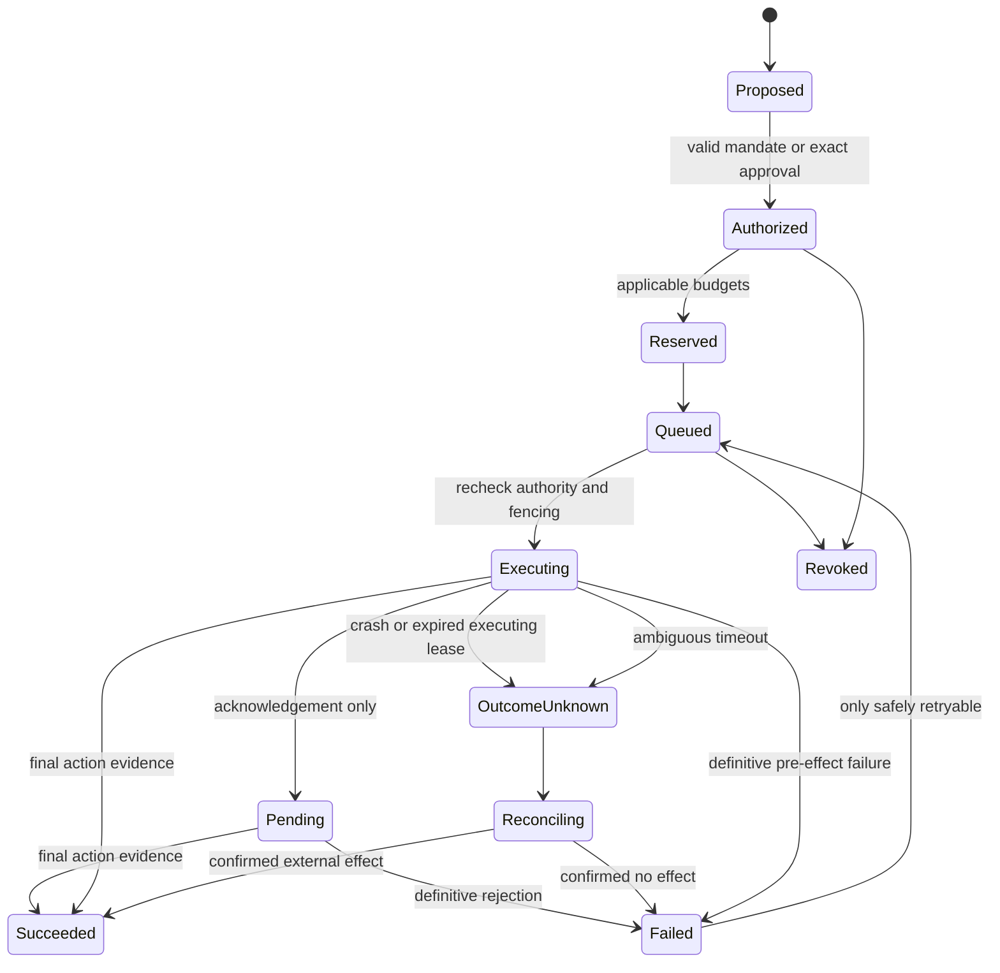

Persist operation/attempt identity before the external call. A crash after external commit but before result persistence requires a new worker to reconcile; local fencing cannot cancel the previous in-flight call. Provider key scope/retention and lookup guarantees must be documented, and replay is forbidden without valid provider deduplication guarantees or proof of no effect. An acknowledged operation remains pending until action-specific final success/failure evidence; test accepted-then-rejected as well as crash-after-effect-before-save.

`outcome_unknown` does not release money or trigger a duplicate order. Revocation blocks subsequent actions but cannot undo a provider's completed commitment. Approvals expire or invalidate on action digest change. Each attempt has a separate attempt ID but reuses stable effect correlation/idempotency key. Contract names: action states `proposed, authorized, reserved, queued, executing, pending, succeeded, failed, outcome_unknown, reconciling, revoked` (`actionTransitionAllowed`; `failed -> queued` only when explicitly safely retryable); external outcome kinds `unknown | acknowledged | final` (`outcomeTransitionAllowed`; `unknown -> final` only through a `Reconciliation` record); mandate states `draft, active, suspended, revoked, expired`; reservation states `reserved, settled, released, expired`.

Publication: draft -> in_review (if policy) -> scheduled/published -> corrected/retracted (`publicationTransitionAllowed`). Retraction keeps a permitted explanatory record; legal erasure may require further redaction. Issue draft -> curated -> review -> released -> corrected edition (`issueTransitionAllowed`; released items are frozen); archive preserves edition identity. Project planned -> active -> suspended/completed/cancelled; project publicity is independent. Ownership transfer `proposed -> accepted_by_recipient -> effective` or `rejected | expired | withdrawn` (`ownershipTransferTransitionAllowed`); leader reassignment independent. Membership `invited -> active -> ended` or `declined | expired | withdrawn`; one active employer per person (`canActivateMembership`). Index generation `building -> validated -> active -> draining -> retired`, plus `failed` and `tainted` (`generationTransitionAllowed`).

Assertion: claimed -> evidence_attached -> confirmed/disputed -> superseded/reversed. Confirmation is a recorded decision by an authorized actor with supporting evidence, not a source import. Reputation snapshots reference methodology and permitted facts; disputes may exclude/annotate observations until resolution. A corrected baseline must retain reason and responsibility so client changes are not counted as unexplained supplier delay.

[Retrieval operations](../operations/retrieval.md) specifies outbox indexing, current-policy revocation, public-to-private taint, stale RFQ versions, erasure and restore replay. Saved multi-source answers require the intersection of current source permissions.

## Lifecycles of the extended model (proposed 2026-10-31)

The state machines below cover the aggregates added by the [complete data model](model.md). They are **proposed** designs, not implemented; each work package freezes them as contract transition tables (`<aggregate>TransitionAllowed`) with tests before storage. Every transition is a command with current authority, expected revision, idempotency key and audit; terminal states never change; "expired" transitions are run by the worker from stored deadlines.

### Plans and plan items

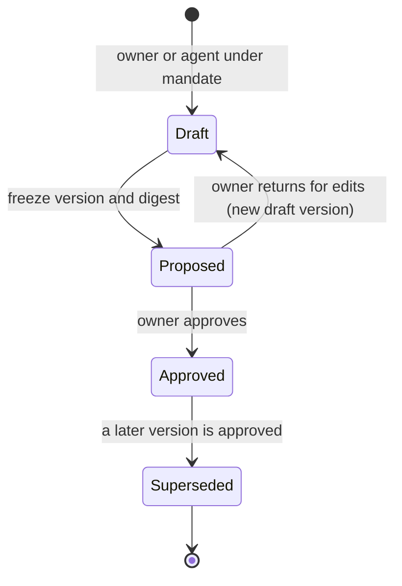

`plan_version.status ∈ {draft, proposed, approved, superseded}`; a proposed version is frozen, and edits create a new draft version. An agent may draft and propose, never approve. `plan_item_state.status`: `proposed → accepted → requested → in_progress → done`, with `blocked` reachable from `requested` or `in_progress` and returning to the previous state, and `cancelled` or `skipped` from any non-terminal state. `requested` is entered only when the item is linked to an RFQ, consultation request or task request; the link never edits the frozen item. `plan_change`: `proposed → approved | rejected | withdrawn`; approval approves the target version in the same transaction.

### Consultations, tasks and mentoring

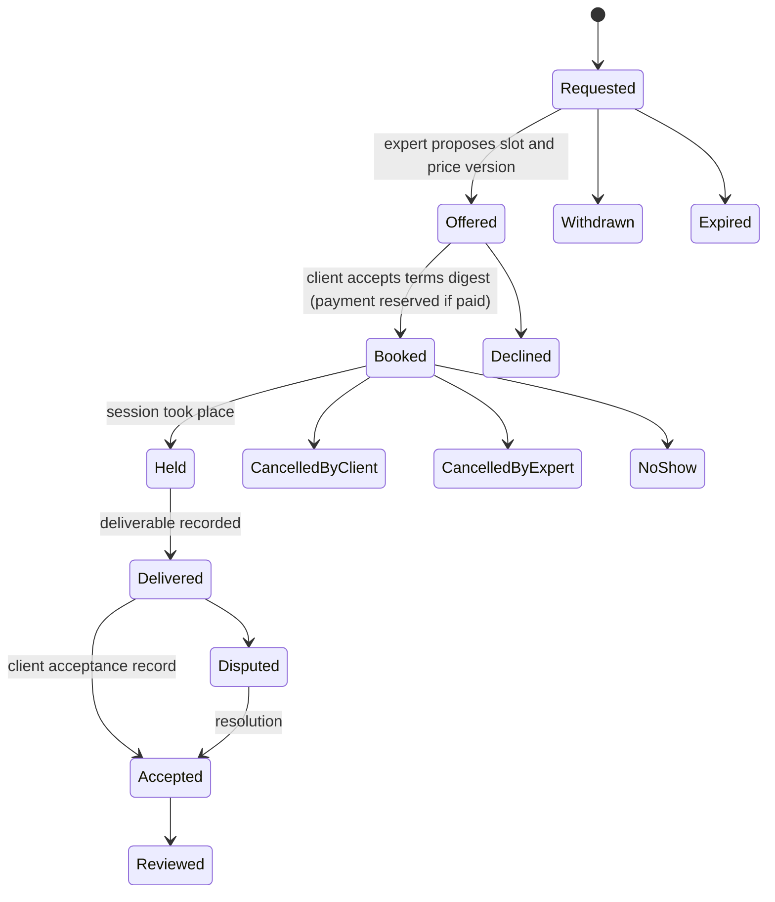

`consultation_request.status ∈ {requested, offered, booked, withdrawn, expired, declined}`; `consultation_booking.status ∈ {booked, held, delivered, accepted, disputed, cancelled_by_client, cancelled_by_expert, no_show, reviewed}`. Cancellation and no-show money follows the expert's terms frozen in the booking; refunds go through billing reconciliation. A review of a consultation exists only after `accepted` and cites the deliverable.

Task requests follow the RFQ pattern: `task_request.status ∈ {draft, published, closed, cancelled, expired}`; `task_request_version.status ∈ {draft, published, superseded}`, and an amendment flags pinned offers stale. `task_offer.status`: `draft → sent → superseded | withdrawn | expired | declined | accepted`. Acceptance creates an agreement (`terms_kind = task`) and a `task_assignment`: `assigned → in_progress → delivered → accepted`, with `disputed` from `delivered` back to `in_progress` or forward to `accepted` on resolution, and `cancelled` from `assigned` or `in_progress` with compensation decided by the obligations. `mentoring_relationship`: `proposed → active ⇄ paused → ended`, or `proposed → declined`; either side may end.

### Events, registrations and tickets

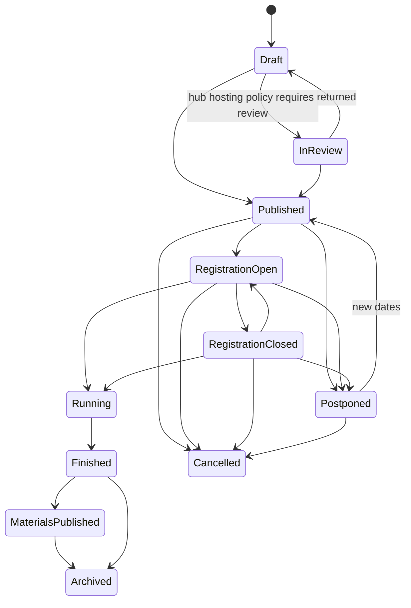

Postponement keeps registrations and offers each registrant a refund; cancellation refunds automatically through the provider. Registration:

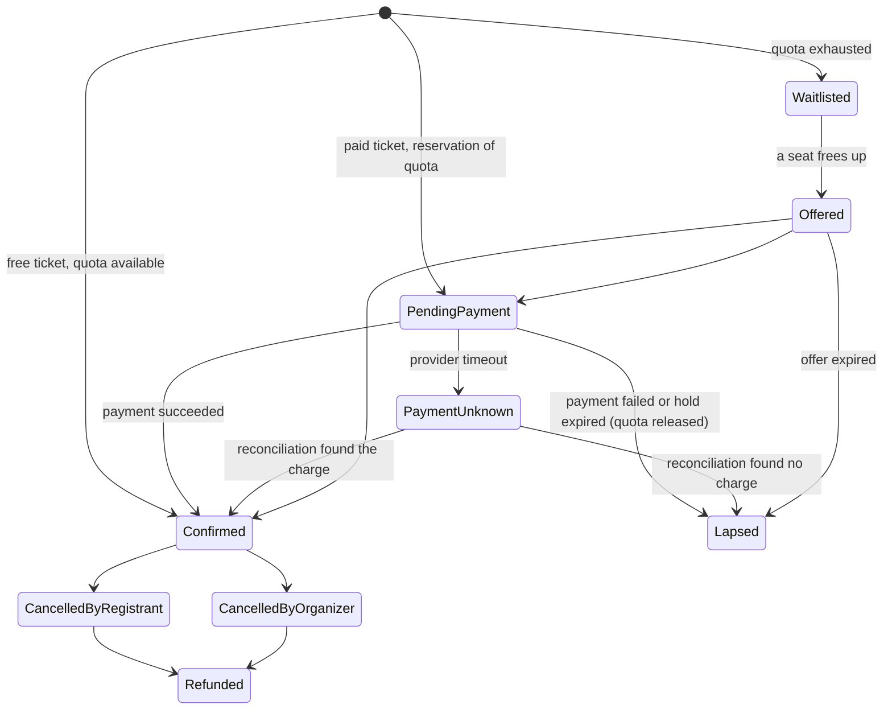

`PaymentUnknown` keeps the quota held and never charges again. Ticket: `issued → checked_in`, `issued → void` (registration cancelled), `issued → transferred` (a new ticket is issued to the new attendee). `check_in` rows are append-only; a second scan is recorded with `duplicate = true`. `meeting_request`: `requested → accepted | declined | cancelled | expired`; the requester sees `declined` and `expired` both as "not accepted".

### Courses, enrollments and certificates

`course.status`: `draft → in_review (hub policy) → published → withdrawn | archived`, with `in_review → draft` on return. `course_version.status`: `draft → published → superseded`; published versions are frozen. Enrollment: `active → completed | withdrawn`; an enrollment stays pinned to the version it started on unless the learner moves to a newer version, which starts a new enrollment.

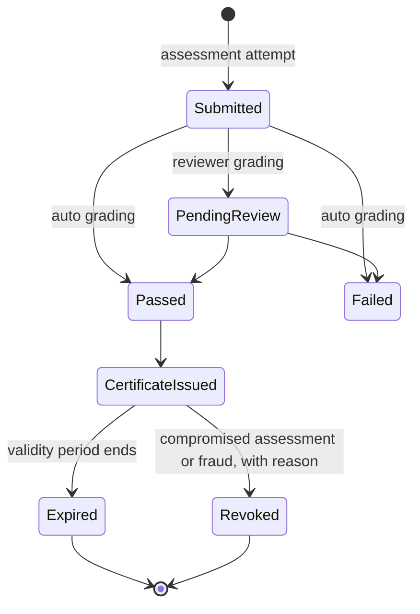

A certificate never changes after issue; `valid → expired | revoked` are status changes with time and reason, published to the public check page, the credential status list and peers. Attendance certificates are issued from checked-in tickets.

### Open needs and introductions

`open_need.status`: `draft → published → closed | expired`, with `outcome ∈ {filled, cancelled, postponed}` on close; `published → draft` is not allowed (an edit after publication creates a corrected need and keeps history).

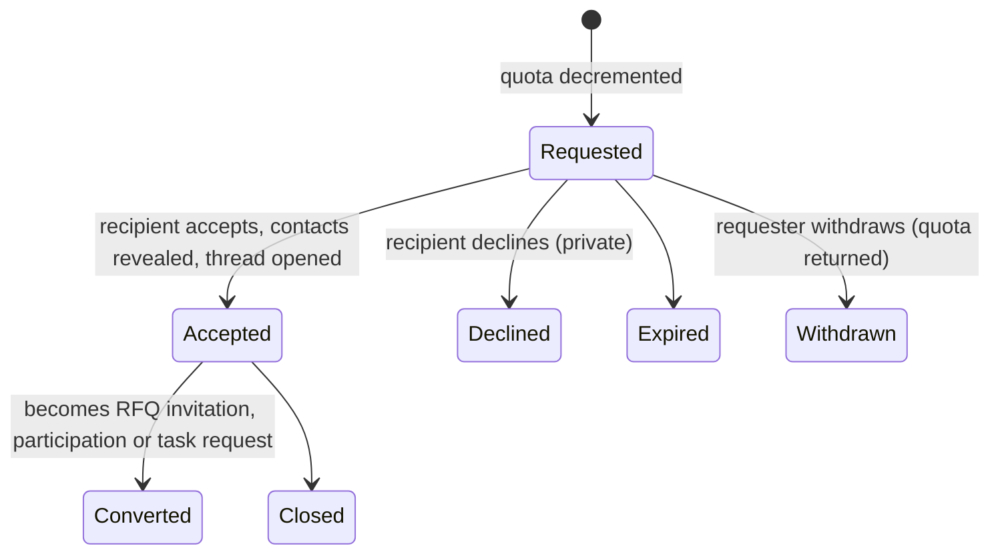

The requester sees `Declined` and `Expired` as "not accepted". Repeated declines lower the requester's quota temporarily. Agent-generated requests carry the mandate and are labelled.

### Agent goals

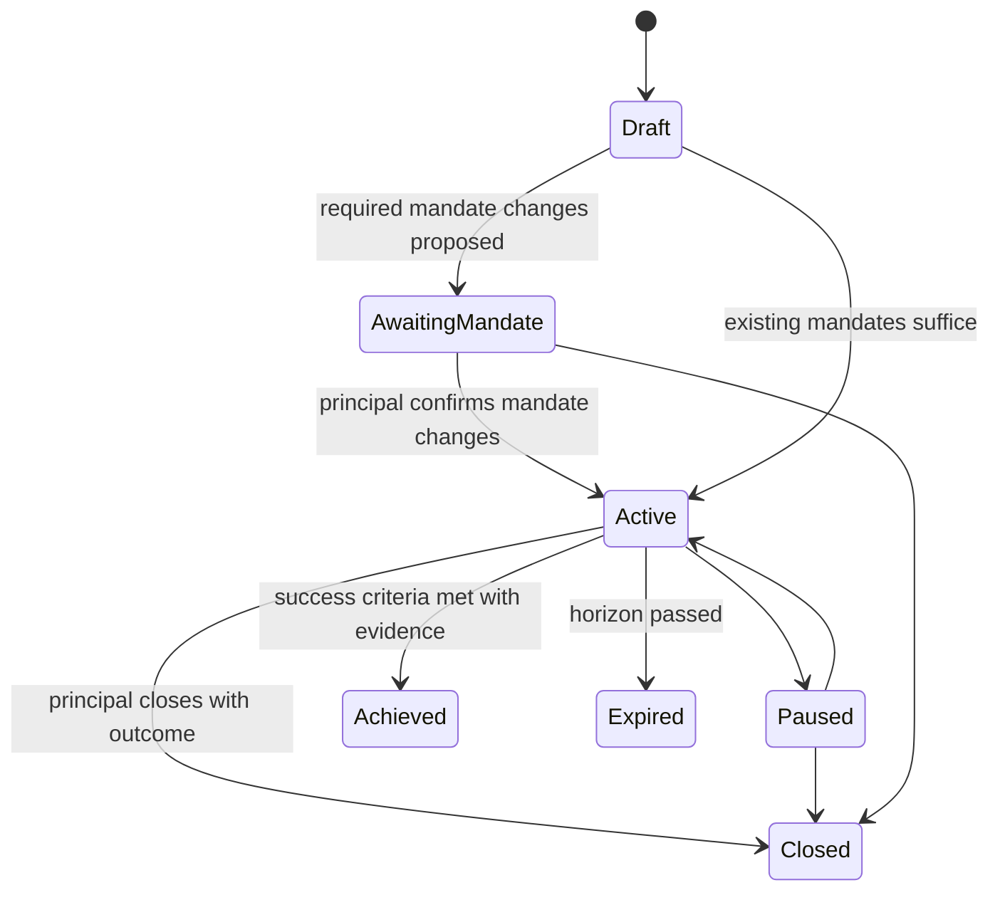

A goal never widens authority: if its mandates are revoked or suspended, it moves to `Paused` with a reason. Company representative: `pending_acceptance → active ⇄ suspended → disabled`; suspension is automatic when no accountable person or no confirmed mandate remains, on a company administrator's stop, or on a kill switch. Company mandate: `active → awaiting_reconfirmation → active | suspended`, and `revoked` from any state; awaiting reconfirmation lasts at most 7 days. Negotiation session: `open → agreed | deadlocked | expired | withdrawn`, with `deadlocked → escalated` to humans.

### Pipelines, runs and import batches

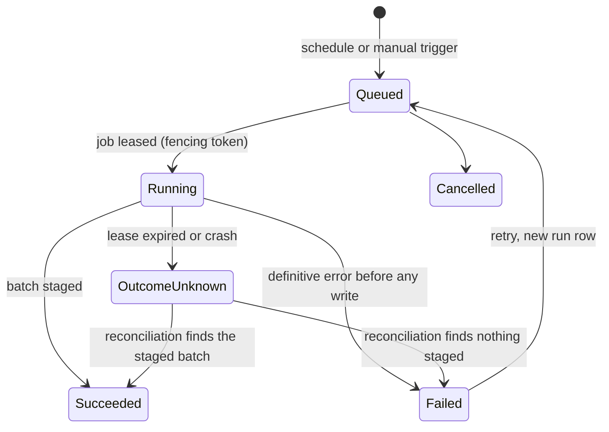

`pipeline.status`: `draft → active ⇄ paused → retired`; a robots or terms change on a `website_crawl` source, a source takedown or a hub kill switch moves it to `paused`. `pipeline_version`: `draft → active → superseded`; activating a live adapter needs a second person. Import batch: `staged → in_review → activated | rejected`, and `activated → rolled_back` (records deactivated, tombstones emitted). A run never publishes: publication of news and activation of directory records are separate human decisions.

### Company claims and verification

`company_claim`: `submitted → claimed` (verified login plus one company tie) `→ under_review → verified | rejected`; `withdrawn` from any non-terminal state; `verified → revoked` with a reason. `company_verification`: `active → expired | revoked`, recheck creates a new row. `verification_check`: results are immutable; expiry is computed; a `potential_match` opens a screening review case.

### Confirmation requests and issued credentials

`confirmation_request`: `requested → confirmed | declined | expired | withdrawn`, and `confirmed → disputed` when an appeal is lodged. `issued_credential`: `valid → suspended ⇄ valid`, `valid | suspended → revoked`, `valid → expired`; every change updates the status list before the response returns.

### Support cases and case grants

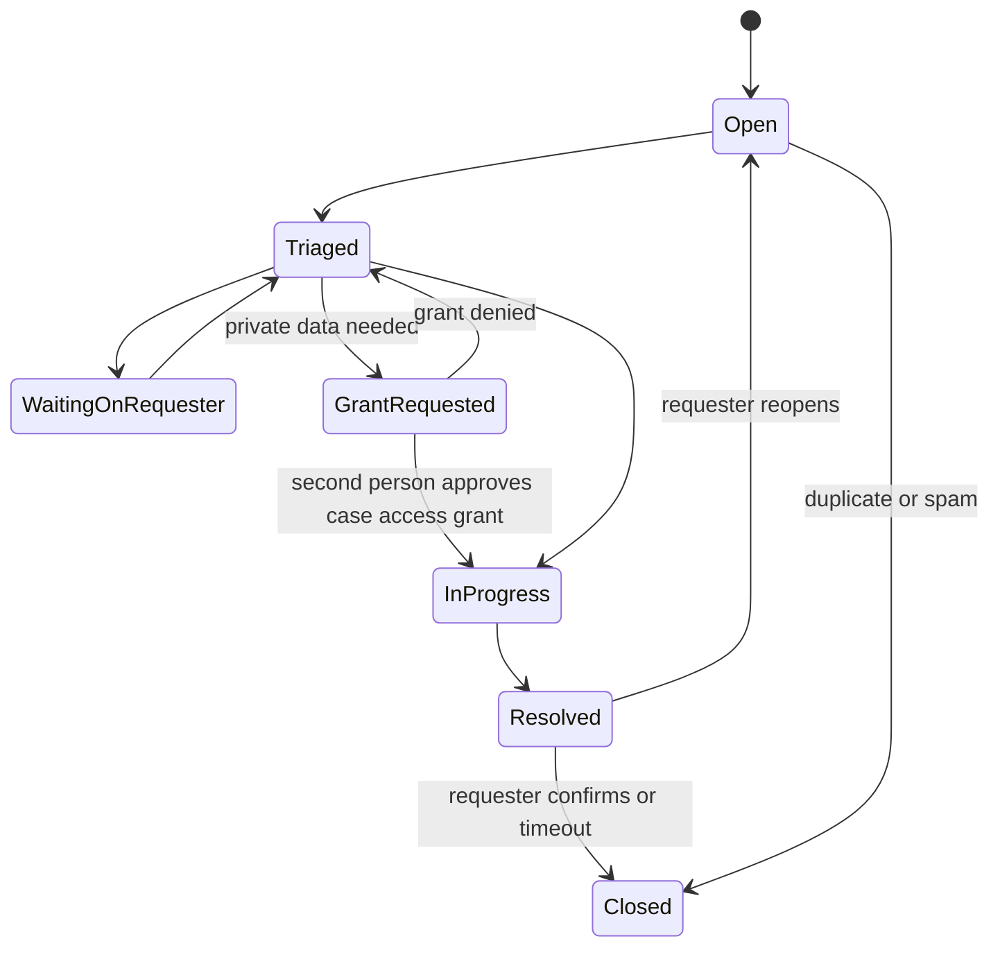

Case access grant: `requested → approved → expired | revoked`, or `requested → denied`; approval within the same case by a different person; expiry at most 72 hours after approval; closing the case revokes every active grant. Moderation case: `open → in_review → decided → appealed → appeal_decided → closed`, with `emergency_hold` possible while open. Privacy request: `received → identity_verified → in_progress → completed | denied | partially_completed`, extended deadlines recorded; erasure execution requires two people and writes the erasure ledger before completion.

### Hubs

`hub.status`: `draft → preparing → soft_launch → public → suspended ⇄ public`, `public | suspended → closing → closed`. `soft_launch → public` requires every launch gate `satisfied`; a gate that becomes `invalidated` after launch raises a compliance alert but does not take the hub offline automatically.
