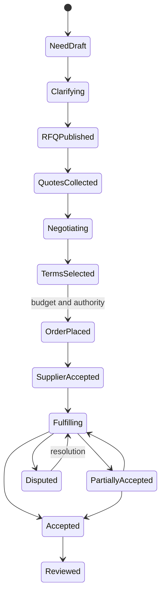
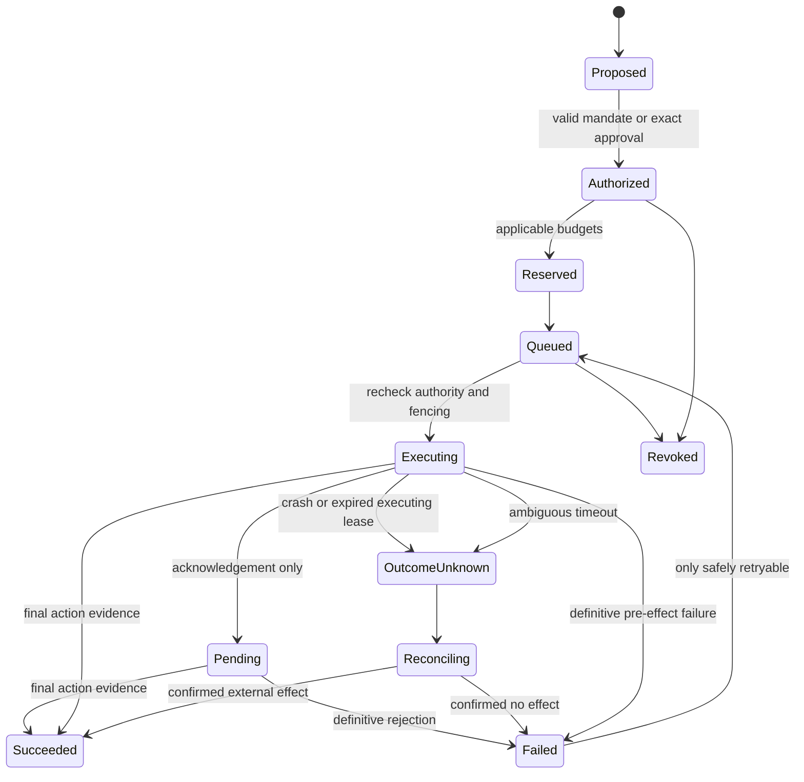

# Aggregate and evidence lifecycles

All transitions are commands with current authority, expected revision, idempotency and audit; arrows below omit error branches only for readability. They are domain plans, not implemented state machines.

RFQ may close/expire/cancel without an order (`rfq.status ∈ {draft, published, closed, cancelled, expired}`; `rfq_version.status ∈ {draft, published, superseded}`). Published requirement versions are immutable. Invitation and quote version reference exact RFQ version; an amendment sets `stale_reason = rfq_amended` on prior responses (a flag beside the unchanged status, never a `stale` status) and requires explicit supplier revalidation/new version (`revalidated_from`) before comparing as equivalent or accepting changed scope. Quote `draft -> sent -> superseded | withdrawn | expired | accepted`. Sent content is immutable in all terminal states. Buyer selection is not supplier acceptance (`agreement.status ∈ {proposed, accepted_by_buyer, accepted_by_both, declined, withdrawn, superseded}`). Agreement/order amendments append jointly accepted versions, never mutate history. Cancel/refund/compensation depends on actual external effects and obligations. Guards: `rfqVersionMutable`, `quoteVersionMutable`, `isQuoteStale`, `checkAcceptance`, `comparableQuoteVersions` in `packages/contracts`.

Persist operation/attempt identity before the external call. A crash after external commit but before result persistence requires a new worker to reconcile; local fencing cannot cancel the previous in-flight call. Provider key scope/retention and lookup guarantees must be documented, and replay is forbidden without valid provider deduplication guarantees or proof of no effect. An acknowledged operation remains pending until action-specific final success/failure evidence; test accepted-then-rejected as well as crash-after-effect-before-save.

`outcome_unknown` does not release money or trigger a duplicate order. Revocation blocks subsequent actions but cannot undo a provider's completed commitment. Approvals expire or invalidate on action digest change. Each attempt has a separate attempt ID but reuses stable effect correlation/idempotency key. Contract names: action states `proposed, authorized, reserved, queued, executing, pending, succeeded, failed, outcome_unknown, reconciling, revoked` (`actionTransitionAllowed`; `failed -> queued` only when explicitly safely retryable); external outcome kinds `unknown | acknowledged | final` (`outcomeTransitionAllowed`; `unknown -> final` only through a `Reconciliation` record); mandate states `draft, active, suspended, revoked, expired`; reservation states `reserved, settled, released, expired`.

Publication: draft -> in_review (if policy) -> scheduled/published -> corrected/retracted (`publicationTransitionAllowed`). Retraction keeps a permitted explanatory record; legal erasure may require further redaction. Issue draft -> curated -> review -> released -> corrected edition (`issueTransitionAllowed`; released items are frozen); archive preserves edition identity. Project planned -> active -> suspended/completed/cancelled; project publicity is independent. Ownership transfer `proposed -> accepted_by_recipient -> effective` or `rejected | expired | withdrawn` (`ownershipTransferTransitionAllowed`); leader reassignment independent. Membership `invited -> active -> ended` or `declined | expired | withdrawn`; one active employer per person (`canActivateMembership`). Index generation `building -> validated -> active -> draining -> retired`, plus `failed` and `tainted` (`generationTransitionAllowed`).

Assertion: claimed -> evidence_attached -> confirmed/disputed -> superseded/reversed. Confirmation is a recorded decision by an authorized actor with supporting evidence, not a source import. Reputation snapshots reference methodology and permitted facts; disputes may exclude/annotate observations until resolution. A corrected baseline must retain reason and responsibility so client changes are not counted as unexplained supplier delay.

Retrieval operations (private repository record, not exported) specifies outbox indexing, current-policy revocation, public-to-private taint, stale RFQ versions, erasure and restore replay. Saved multi-source answers require the intersection of current source permissions.
