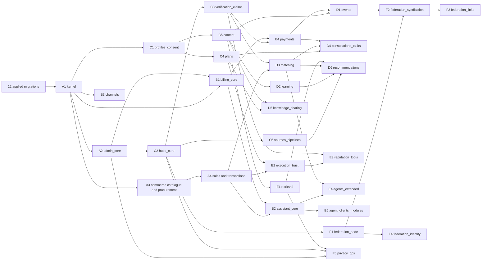

# Migration plan

**Status: Proposed (2026-10-31).** The ordered list of migration slices that implement the [data model](model.md) after the twelve applied migrations, mapped to work packages with dependencies. The data integrator owns `packages/data/migrations`, numbering and the lockfile; a work package proposes its slice and the integrator lands it ([model, section 29](model.md#29-implementation-and-migration-ownership)). Proposed packages (DATA-003, PPL-001, CLM-001, PRJ-001, CONS-001, KNOW-001, REP-001, REC-001, COMMS-001, HUB-004, AGT-002, BILL-002, PRV-001) are listed in [model, section 31](model.md#31-proposed-work-packages) and are not yet in `docs/engine/work-packages.json`.

## Rules for every slice

1. **Forward only.** Timestamp-prefixed, immutable once applied, recorded in `migration_ledger` with checksum. Never edit an applied file; fix forward.
2. **Small and working.** A slice lands with the use cases that need it, its invariants as constraints and triggers, FORCE row-level security with `maintenance_all` and runtime policies, column-level grants for `trustwork_app` (no DELETE, no TRUNCATE), `schema.ts` mirror and real-PostgreSQL tests under the runtime role (negative authorization and concurrency included).
3. **Expand → migrate → contract.** Changes to existing tables add new columns or tables first, backfill in a separate step, switch readers, and drop the old shape only in a later reviewed migration with backup and restore evidence (for example `company.legal_identifiers` → `company_identifier`, `person.prefers_*` → `person_preference`).
4. **Shared vocabularies grow per slice.** A slice that introduces a resource kind extends the `object_participation.resource_kind` CHECK (drop and re-add the constraint in the same transaction) and redefines `trustwork.owns_resource` / `participates_in_resource` with `CREATE OR REPLACE` for its kinds. The same applies to `mandate_context.context_kind`, `context_thread` context kinds and `audit_event.object_kind` documentation.
5. **Immutability by the shared trigger.** Every versioned record attaches `trustwork.reject_update_when_frozen(...)` with its frozen columns; append-only tables attach `trustwork.forbid_mutation()`.
6. **Hub scoping from the start.** Hub-scoped tables reference `hub(id)` from DATA-003 so no slice needs a later backfill of `hub_id`.
7. **No seeded fake data.** Migrations create structure and reference vocabularies only (units, jurisdictions loaded from packs by a maintenance command, not by SQL literals of real-world facts). Synthetic fixtures live in tests and are labelled.
8. **Numbering.** The integrator assigns timestamps at merge time in dependency order; the dates below are slots, not commitments. Slices whose packages run in parallel receive distinct timestamps in merge order.

## Applied (Live)

| # | File | Package | Contents |
|---|---|---|---|
| 1 | `20261027120000_core_functions.sql` | DATA-001 | Identity readers, `new_uuid`, `touch_row`, `forbid_mutation`, `reject_update_when_frozen` |
| 2 | `20261027120100_identity.sql` | DATA-001 | person, email_binding, credential, session, auth_token, login_failure, pre-identity allowlist |
| 3 | `20261027120200_company_access.sql` | DATA-001 | company, membership, permission_grant, object_participation, `set_principal` |
| 4 | `20261027120300_projects.sql` | DATA-001 | project, ownership_transfer, leadership_assignment |
| 5 | `20261027120400_reliability.sql` | DATA-001 | audit_event, outbox_event, job, idempotency_record, inbox_receipt |
| 6 | `20261027120500_access_hardening.sql` | DATA-001 | company_private split, RLS on company and project, self-escalation guards |
| 7 | `20261027120600_membership_hardening.sql` | DATA-001 | activation authority, transfer through definer, job state guard, `reconcile_job` |
| 8 | `20261027120700_principal_mac.sql` | BE-001 | principal_key, MAC-bound transaction identity |
| 9 | `20261027120800_admission.sql` | BE-001 | admission_scope, admission_lease, revocation_event |
| 10 | `20261027120900_identity_commands.sql` | BE-001 | `end_membership`, `finalize_ownership_transfer`, lockout, invitation tokens |
| 11 | `20261027121000_public_reads.sql` | BE-001 | participant project reads, anonymous public lookups |
| 12 | `20261027121100_sweeper_and_review_fixes.sql` | BE-001 | `sweep_expired`, login failure cap, non-disclosing admission denial |

## In review (Draft)

| File | Package | Contents | Note |
|---|---|---|---|
| `20261028010000_commerce_catalogue.sql` | COM-001 | offering, offering_version, bundle_component, offering_version_private | On branch `draft/com-001-commerce-migrations`, not merged |
| `20261028020000_commerce_procurement.sql` | COM-001 | need, need_line, rfq, rfq_version, rfq_private_constraint, rfq_invitation | Same branch |
| `20261028030000_*` (planned in the draft) | COM-001 | ownership helpers for commercial kinds | Referenced by the draft, not yet written |

## Planned slices

Phases group slices that can proceed in parallel once their dependencies are merged. "Needs" lists slices that must be applied first.

### Phase A: foundations

| Slice | Package | Tables | Needs | Key tests |
|---|---|---|---|---|
| A1 `kernel` | DATA-003 (proposed) | evidence_artifact, exchange_rate_snapshot, unit, unit_conversion_rule, jurisdiction, taxonomy_term, step_term_relation, taxonomy_release, hub (anchor), hub_territory (anchor) | Live | restricted jurisdiction rejected; attachment requires parent and classification; unit mismatch fails |
| A2 `admin_core` | DATA-002 | staff_role_definition_version, staff_role_assignment (with hub scope), staff_conflict_declaration, session_elevation, second_person_approval, case_access_grant, admin_audit_event, access_log_entry, support_case, support_case_note, moderation_report, moderation_case, sanction, appeal, feature_flag, maintenance_window, incident, kill_switch | A1 | runtime role cannot update or delete audit rows; requester ≠ approver; grant ≤ 72 h; gap-free sequence |
| A3 `commerce_catalogue_procurement` | COM-001 | the draft files above, rebased after A1 | A1 | frozen columns; invitations pin versions; buyer-private never joined |
| A4 `commerce_sales_transactions` | COM-001 | quote, quote_version, quote_line, quote_private_constraint, tax_determination, negotiation_round, amendment_request, agreement (+ `terms_kind` column defaulting to `rfq_quote`), agreement_buyer_private, agreement_seller_private, acceptance_event, order, order_change, obligation, rfq_clarification, supplier_candidate, evaluation | A3 | digest equality trigger; quote only against current RFQ version; acceptance recomputes digests |

### Phase B: money, agents and communication

| Slice | Package | Tables | Needs | Key tests |
|---|---|---|---|---|
| B1 `billing_core` | BILL-001 | billing_account, offer, subscription_plan_version, price_version, price_acceptance, subscription, entitlement, meter, usage_event, budget, reservation, ledger_entry, credit_grant | A1, A2 | concurrent reservations never exceed the limit; activator ≠ drafter; no overlapping active versions; balanced ledger |
| B2 `assistant_core` | AST-001 | mandate, mandate_context, mandate_revision, run, run_step, action_intent, action_attempt, action_outcome, approval, reconciliation, service_backlog_item, conversation_turn, assistant_note | B1, A4 | membership end revokes mandates in one transaction; outcome_unknown keeps reservation; unknown → final only via reconciliation |
| B3 `channels` | COMMS-001 (proposed) | context_thread, message, message_link, reply_token, channel_grant, send_receipt, notification, notification_preference, message_template, template_version, delivery, sender_identity, suppression_entry | A1 | duplicate inbound ignored; thread not found for non-participants; template activation blocked without all locales |
| B4 `payments` | BILL-002 (proposed) | invoice, invoice_line, payment, refund, payout_account, payout | B1, C3 | timeout never double-charges; every tax line names jurisdiction and rule |

### Phase C: people, companies, projects and content

| Slice | Package | Tables | Needs | Key tests |
|---|---|---|---|---|
| C1 `profiles_consent` | PPL-001 (proposed) | person_profile, person_preference (expand), consent_record, media_licence, portrait, experience_entry, follow, bookmark, reading_progress | A1 | withdrawal unpublishes; portrait needs consent and licence |
| C2 `hubs_core` | HUB-001 | hub (extend anchor), hub_territory (extend), hub_config_version, legal_document_version, counsel_approval, legal_acceptance, launch_gate, provider_credential_ref, model_route, provider_cost_budget, retention_policy | A1, A2 | hub cannot go public with an open gate; activation needs another person; restricted territory rejected |
| C3 `verification_claims` | HUB-003, CLM-001 (proposed) | verification_provider, verification_recipe_version, verification_check, screening_list, screening_list_version, screening_result, screening_review_case, company_profile, company_identifier (expand), company_registration, tax_registration, company_branch, company_claim, company_verification, authority_proof, ownership_declaration | C2 | identifier never upgrades a badge; potential match never auto-decides; baseline list cannot be disabled |
| C4 `plans` | PRJ-001 (proposed) | plan, plan_version, plan_item, plan_dependency, plan_item_state, plan_change, plan_share, permit_record, project_diary_entry, project_location, project_public_participant, project_template | A1, C1 | acyclic dependencies; invited view shows only shared items; budgets never in S |
| C5 `content` | CNT-001 | publication, publication_version, publication_authorship, correction, publication_topic, entity_link, edition_link, wall_reference, comment, issue, issue_revision, issue_item, render_artifact, magazine_digest | A1, C1 | published versions frozen; released issues frozen; correction is a new version |
| C6 `sources_pipelines` | HUB-004 (proposed) | source, crawl_policy, dataset, pipeline, pipeline_version, pipeline_schedule, pipeline_run, import_batch, source_item, sourced_record_field, record_link_proposal | C2 | runs never publish; display-only source never reaches a model or peer; robots change pauses pipeline |

### Phase D: gathering-point modules

| Slice | Package | Tables | Needs | Key tests |
|---|---|---|---|---|
| D1 `events` | EVT-001 | event, event_co_organizer, event_session, event_speaker, event_sponsor, ticket_type, ticket_price_version, registration_question, registration, ticket, check_in, waitlist_entry, meeting_profile, meeting_slot, meeting_request, event_material, event_feedback | C5, B1, B4, C1 | quota under concurrency; online link never public; sold ticket keeps price version |
| D2 `learning` | LRN-001 | course, course_version, course_lesson, assessment, course_price_version, enrollment, lesson_progress, assessment_attempt, certificate, accreditation | C5, C1, B1 | certificate never changes; no employer view; accreditation needs a source |
| D3 `matching` | MATCH-001 | capability_profile, open_need, need_interest, partner_post, match_method_version, match_run, match_candidate, introduction, outreach_quota, alert_subscription | A4, C3 | ranks identical with and without entitlements; contacts only after acceptance; quota serialized |
| D4 `consultations_tasks` | CONS-001 (proposed) | consultation_offer, consultation_price_version, availability_window, consultation_request, consultation_booking, consultation_session, consultation_deliverable, task_request, task_request_version, task_offer, task_offer_private, task_assignment, mentoring_relationship; agreement `terms_kind` values `task` and `consultation` enabled | C4, A4, B4, D3 | offers frozen and digest-bound; competing offerors isolated; address revealed only after booking |
| D5 `knowledge_sharing` | KNOW-001 (proposed) | knowledge_item, knowledge_consent, template_derivation; publication format values `diary`, `lesson`, `checklist`, `template` | C5, C4, C1 | no publication without owner consent; withdrawal unpublishes |
| D6 `recommendations` | REC-001 (proposed) | product_entry, learning_resource, recommendation_method_version, recommendation_set, recommendation, sponsored_placement | C6, C4, D2, D3, E1 | ranks identical with and without sponsored placements; every item explained |

### Phase E: retrieval, trust and agents

| Slice | Package | Tables | Needs | Key tests |
|---|---|---|---|---|
| E1 `retrieval` | RAG-201 | knowledge_source, knowledge_version, extraction_artifact, knowledge_projection, knowledge_chunk, citation_locator, embedding_config, index_generation, chunk_embedding, lexical_projection, knowledge_edge, index_job, retrieval_tombstone, retrieval_receipt, answer_dependency, saved_answer | Live (admission), C5 | no cross-audience chunk; tombstones replay after restore; pgvector introduced here with a written dependency reason |
| E2 `execution_trust` | EXE-001 | delivery_claim, work_record, acceptance_record, defect, remediation, source_record, assertion, confirmation, dispute_case, review, review_appeal, performance_observation, reputation_method_version, reputation_exclusion, reputation_snapshot | A4, C4 | claim ≠ confirmation; client-caused change excluded; no payment input |
| E3 `reputation_tools` | REP-001 (proposed) | professional_credential, portfolio_entry, confirmation_request, confirmation_response, contribution_record, timeliness_observation, reputation_passport, issued_credential, credential_status_list | E2, C3, C1 | passports identical with and without entitlements; revoked credential fails verification |
| E4 `agents_extended` | AGT-001 | goal, goal_progress, agent_envelope, negotiation_session, company_representative, representative_accountability, company_mandate | B2, D3 | one representative per company; envelope notes never change state; re-confirmation within 7 days |
| E5 `agent_clients_modules` | AGT-002 (proposed) | external_agent_client, agent_access_token, agent_module, agent_module_version, agent_module_enablement | B2, B1, C2 | token effects only under named mandates; module enablement never widens a mandate |

### Phase F: federation and privacy operations

| Slice | Package | Tables | Needs | Key tests |
|---|---|---|---|---|
| F1 `federation_node` | FED-001 | node, node_key, peer_node, peering_agreement | C2, FED-000 contracts | restricted jurisdiction refused at handshake; second approver for deal routing and identity |
| F2 `federation_syndication` | FED-002 | feed_cursor, replica, federation_inbox_item, federation_delivery, federation_tombstone, tombstone_application, takedown_notice | F1, C5, D1 | replicas never satisfy writes; tombstones applied within the agreement period |
| F3 `federation_links` | FED-003 | entity_link | F2, C3 | links, never merges |
| F4 `federation_identity` | FED-005 | federated_identity_link | F1, BE-002 | both sides confirm |
| F5 `privacy_ops` | PRV-001 (proposed) | privacy_request, privacy_preference, privacy_export, erasure_ledger (separate schema or store excluded from the restorable snapshot), legal_hold, data_broker_registration | A2, C2, E1 | restore drill serves nothing erased; export excludes counterparties' private fields; deadlines from packs |

Deals across nodes (FED-004) add no new tables beyond F2: cross-node RFQ invitations, quote versions, agreement events and agent envelopes reuse the commerce and agent tables with `home_node` provenance on replicas.

## Dependency graph

## Notes for the integrator

- DATA-002 names `packages/data/migrations/admin` as its path; the runner reads one flat directory today, so either the runner learns subdirectories (a reviewed change) or A2 lands as flat files. Decide before A2.
- DATA-002 mentions claim tables; this plan delivers claims in C3 because they need recipe versions from HUB-003. Moderation tables stay in A2 as DATA-002 says.
- `plan_baseline` and `project_milestone` from earlier designs are delivered as `plan_version` and `plan_item(kind = milestone)` in C4; `MilestoneSchema` stays the projection contract.
- The billing chapter's "plan version" is `subscription_plan_version` in B1 to avoid the project plan name.
- The agreement `terms_kind` extension needs a contract change (`transactions.ts`, digest input for task and consultation terms) reviewed through an ADR before D4.
- Hub console contracts (`packages/contracts/src/hub.ts`) and the agent catalogue are being designed in parallel; C2 and E5 align their column names with those contracts when they merge.
