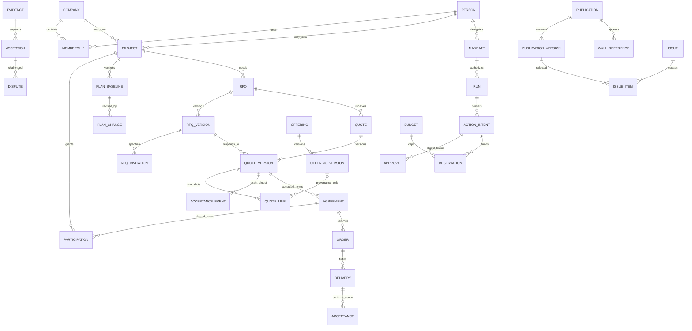

# Domain data dictionary and ER model

**Status 2026-10-27:** the identity/access slice (person, email binding, credential, session, auth token, company, company_private, membership, permission grant, object participation, project, ownership transfer, audit, outbox, job, idempotency, inbox) is implemented by DATA-001 as six reviewed migrations in `packages/data/migrations` with FORCE RLS and real-PostgreSQL tests; the remaining entities below are proposed logical entities to be delivered as small reviewed migrations with invariants and tests. Avoid a hundred empty tables ahead of working use cases.

## Fundamental types and ownership

Every mutable aggregate has opaque UUID ID, revision, created_at/updated_at (`timestamptz`), actor/provenance and lifecycle status. Historical records retain actor identity and context at the event time. Identifiers do not grant access. Ownership is exactly one person OR company, enforced by a sum type in contracts and a database XOR check over nullable FKs. Do not use unconstrained generic owner IDs where referential integrity is possible.

A human may have historical memberships but one active ordinary employer; enforce a partial unique membership index after clarifying invitation/pending states. No current-company filter alone can authorize shared transactions. `object_participation` joins a resource to a person/company party with capabilities, audience, validity, grantor and revision. Runtime object policy resolves current membership plus explicit grants, including personal owners. Private buyer/seller data uses separately authorized records/columns; a shared agreement projection has an explicit allowlist. Public projection is a third independent layer.

Money stores integer minor units (`bigint`/bounded numeric) plus ISO currency, scale/rounding policy where required. Serialize integer values as strings. Quantities and rates use exact decimals with units and precision, never floating-point accounting. Mixed-currency comparison requires an explicit exchange-rate snapshot/source/time; not an implicit sum. Business dates retain local date/timezone; chronological events use UTC and source timestamps separately.

## Logical dictionary

| Domain | Entities / key fields | Invariants and visibility |
|---|---|---|
| Identity | `person(id, display_name, profile_visibility)`, `credential(person_id, kind, provider_subject, password_hash)`, `email_binding(email_normalized, verified_at, is_primary)`, `session(token_hash, idle_expires_at, absolute_expires_at, authenticated_at, revoked_at)`, `auth_token(kind: verify/recovery, token_hash, expires_at, consumed_at)`, `login_failure`, `authz_epoch` columns on `person`/`company` (epoch-only updates do not bump `revision`) | Persistent human; `(credential.kind, provider_subject)` unique; one primary binding; no auto-link by unverified email; credentials and token hashes never public (`SessionView` strips `token_hash`) |
| Company | `company(id, sourced_status, claim_status, legal_identifiers)`, `membership(person_id, company_id, role, valid_from, ended_at)`, `company_claim(source, evidence, reviewer)` | Many people per company; one active employer per person; legal identifier is not verification |
| Access | `permission_grant(principal, action, scope, limits, expiry)`, `object_participation(resource, party, side, capabilities[], audience, valid_from, valid_until, granted_by, revoked_at, revision, case_ref)`, `publication_grant` | Grant intersection, deny default, revocable; `audience ∈ {shared_party, party_private, owner_private}`; capability vocabulary and projection layers (`public`, `shared_party`, `party_private`, `owner_private`, `staff_case`) frozen in `packages/contracts/src/access.ts`; admin role not universal access |
| Projects | `project(owner_person_id XOR owner_company_id, creator_id, leader_id, status, revision)`, `milestone(title,due,budget,shared)`, `ownership_transfer(from,to,consents,effective_at)`, `leadership_assignment` | Transfer != leadership; private default; preserved audit; participants see shared milestones without `budget` |
| Planning | `plan_baseline(project_id, version, approved_at)`, `plan_change(baseline, reason, accountable_party, agreement)`, `milestone(dates,budget)`, `dependency(predecessor, successor, type, lag)` | Acyclic dependencies; original/revised plan both retained; no retroactive blame rewrite |
| Catalogue | `offering(owner_company/person, kind, status)`, `offering_version(specs,options,price,availability,capacity,scope)`, `bundle_component(version,component,quantity)` | Goods/works/services and mixed bundles; immutable published version; selected public fields; private commercial knowledge separate |
| Intake | `need(project, source, missing_fields)`, `need_line(kind,quantity,unit,spec)`, `rfq(id,owner,status,current_version_id,revision,public_projection)`, `rfq_version(id,rfq_id,version,status,payload,digest,published_at,superseded_by,amendment_reason)`, `rfq_private_constraint(budget_ceiling,evaluation_weights,internal_notes,shortlist)`, `rfq_invitation(rfq_version_id,party,channel,stale_reason)` | Published RFQ versions immutable (`digest = trustwork-digest-1 over {payload}`); invitations pin exact `rfq_version_id`; amendment sets `stale_reason = rfq_amended` on pinned responses (flag, not status) pending explicit revalidation; buyer-private constraint is a separate record; no send from parsed text alone |
| Discovery | `supplier_candidate(source, observed_at, eligibility)`, `evaluation(criteria_version, evidence, score, uncertainty)` | External candidates not verified platform users; scoring explainable |
| Sales | `lead(context,contact,provenance)`, `quote(rfq,seller,buyer,status,stale_reason)`, `quote_version(id,quote_id,version,rfq_version_id,rfq_version_digest,status,payload,digest,sent_at,valid_until,stale_reason,revalidated_from)`, `quote_line(rfq_line_id,kind,spec_snapshot,quantity,unit_price,tax,tax_amount,line_total,offering_version_ref)`, `quote_private_constraint(floor_prices,margin_targets,cost_basis,negotiation_notes)` | Sent version immutable (`digest` over `{rfqVersion, payload}`); exact RFQ version pinned by id and verified by digest; catalogue provenance plus embedded snapshot; recipient-specific; seller-private constraint is a separate record; no negotiation floor exposure |
| Negotiation | `negotiation_round(context,proposal_version)`, `private_constraint(owner_party,encrypted_value)`, `accepted_terms(quote_version_ref,rfq_version_ref,digest)` | Private priorities separate from shared agreement; consent binds exact immutable version; `digest` over `{quoteVersion, rfqVersion}` computed once |
| Transaction | `agreement(parties,accepted_terms,status,superseded_by,obligations)`, `agreement_buyer_private(agreement_id,owner_party,transaction_budget_id,approval_refs,notes)`, `agreement_seller_private(agreement_id,owner_party,fulfilment_plan,notes)`, `acceptance_event(kind,quote_version_ref,rfq_version_ref,accepted_terms_digest,actor,authority,idempotency_key)`, `order(agreement,accepted_terms_digest,revision,external_reference,reservation_id)`, `order_change(previous,new_terms,consents)`, `obligation(party,kind,due,amount_or_scope)` | No order commit without authority/reservation; buyer placement and seller acceptance distinct; `acceptance_event.accepted_terms_digest = agreement.accepted_terms_digest` (trigger); party-private agreement records are never joined into the shared or the other side's view |
| Execution | `delivery(order,lines,quantity,evidence)`, `work_record(scope,period,claimant)`, `acceptance(subject,scope,accepted_quantity,actor)`, `defect`, `remediation` | Partial fulfillment/acceptance supported; claim != confirmation; contested quantities explicit |
| Evidence | `source_record(uri,source_time,observed_at,license)`, `evidence_artifact(hash,storage_key,classification)`, `assertion(subject,predicate,claimant,status)`, `confirmation(assertion,reviewer,evidence)`, `dispute`, `supersession` | Append historical corrections; permitted provenance; storage access checked separately |
| Reputation | `review(subject,author,transaction_ref,dimensions,text)`, `review_appeal`, `performance_observation(baseline,change,evidence,attribution)`, `reputation_snapshot(method_version,samples,dimension_scores,excluded_disputes)` | Subjective and evidence-based separate; missing != failed; no payment weight; explain method/samples |
| Content | `publication(format,status)`, `publication_version(body,source_refs,correction_of)`, `authorship(person/company/editorial,credit)`, `topic`, `entity_link`, `wall_reference` | One publication store; author vs editor right; source event date vs publish date; sanitization/licensing |
| Magazine | `issue(number,date,status)`, `issue_revision`, `issue_item(position,publication_version)`, `render_artifact(format,hash,source_revision)` | Curated immutable released edition; PDF separately laid out; correction trail and archive |
| Personal journal | `journal_brief(audience,topics,permitted_sources,cadence)`, `journal_edition` | Optional future product; billing/free policy unresolved; no employee surveillance |
| Assistant | `mandate(principal,actions,contexts,limits,conditions,valid_until,status,revision,revoked_at)`, `service_backlog`, `run`, `step`, `action_intent(action_digest,state,reservation_id,effect_correlation_key,outcome)`, `approval(action_digest,approver,expiry,revoked_at)`, `tool_attempt`, `external_outcome(kind: unknown/acknowledged/final)`, `reconciliation(attempt,operation,lookup_reference,outcome)` | Current principal rights cap mandate; chat not approval; revocation/revision checked before effect; unknown outcome preserved; `unknown -> final` only through a reconciliation record |
| Communication | `channel_grant(person/account,provider,scopes,revoked_at)`, `context_thread`, `message(direction,provider_id,source_time)`, `message_link`, `send_receipt`, `notification` | Existing email retained; explicit scope; unique provider delivery/event key; bell separate from correspondence |
| Billing | `billing_account(owner)`, `offer`, `plan_version`, `price_version(offer_id,version,currency,amount_minor,effective_from,effective_to,acceptance_text_version,status,drafted_by,activated_by,activated_at)`, `price_acceptance(price_version_id,acceptance_text_version,payer,accepted_by,amount)`, `subscription`, `entitlement`, `usage_event`, `credit_ledger`, `invoice_ref` | Price and acceptance versioned; `activated_by ≠ drafted_by`, `effective_from > activated_at`, no overlapping active versions; personal/company payer; economic rights distinct from roles |
| Budgets | `budget(kind:transaction/platform,owner,project/employee_scope,period,limit)`, `reservation(budget,action_intent,amount,state: reserved/settled/released/expired,settled_amount,effect_correlation_key)`, `ledger_entry` | Two budget types; atomic reserve/settle/release, no double allocation; ledger immutable with correcting entries |
| Reliability | `outbox_event(aggregate,revision,type,payload)`, `job(lease,fencing,attempt,next_at)`, `inbox_receipt(provider,event_id)`, `idempotency_record(scope,key,payload_hash,result)` | Atomic intent; duplicate delivery expected; unique keys; unknown effects reconciled |
| Governance | `audit_event(actor,principal,action,object,before/after_digest,reason)`, `admin_audit_event(sequence,actor_role,permission,second_approver,approval_digest,reason_code,outcome)`, `access_log(sequence,grant,kind,fields_hash)`, `staff_role_assignment`, `staff_role_definition_version(sod_mode)`, `case_access_grant(requested_by ≠ approved_by,projection_class,excluded_field_classes,expires_at ≤ approved_at + 72h)`, `second_person_approval(action,action_digest)`, `moderation_case`, `deletion_request`, `erasure_tombstone` | Least data; append-only audit with monotonic sequence and policy retention; `negotiation_private`, `credentials`, `payment_refs` always excluded from case grants; deletion replay after restore |

## Core relationships

The two ownership arrows mean XOR, not two simultaneous owners. Party participation and field policy qualify every relationship. ER notation is a conceptual map, not a complete SQL schema or authorization proof.

## Required database invariants

1. Unique active employer membership; XOR project owner FKs; historical membership cannot be overwritten to another person.
2. Published RFQ versions are immutable; each invitation and quote version references exact `rfq_version_id`. Amendment from quantity 10 in v1 to 100 in v2 sets `stale_reason` on v1 responses; compare/accept only against explicit matched scope or an explicitly revalidated new quote, never auto-upgrade. Unique `(rfq_id, version)` and `(quote_id, version)`; `reject_update_when_frozen` trigger on `payload`, `digest`, `rfq_version_id`, `rfq_version_digest`, `valid_until`, `sent_at`, `sent_by` (quote) and `payload`, `digest`, `published_at`, `published_by` (RFQ) when status is not `draft`; `quote_version.valid_until` equals `payload.validity.until`; a quote may be sent only against the published current RFQ version; acceptance references exact quote version/digest (`trustwork-digest-1`, ADR 003 amendment). Amendments append versions/events. A draft may be edited with revision check.
3. Atomic budget reserve under row lock or serializable transaction, with retry on serialization failure; all ledger changes balanced per currency and reservation kind. Concurrent valid requests cannot exceed remaining balance.
4. Unique idempotency `(principal,action,context,key)` with payload digest (`idempotency_record`); unique inbound `(provider,account,event_id)`; unique external-effect correlation. Never consider an unknown timeout a failed effect.
5. Public field allowlist; row security, if enabled, tested under runtime role distinct from schema owner/superuser/BYPASSRLS. Use FORCE RLS where appropriate, inspect security-definer functions and views. RLS does not solve field policy or consent.
6. Append-only evidence/confirmation/dispute/supersession chain with source and observation times. Retention/erasure design reconciles privacy and lawful evidence preservation; no claim that hashes anonymize personal data.
7. Attachment access through authorized parent and own classification; signed URL TTL bounded; move/copy preserves owner/classification and is audited.
8. All material approvals bind current scope and revision; revoke invalidates queued authority. Membership end updates authorization version and invalidates relevant caches/runs.

## Implementation and migration ownership

The data integrator exclusively owns `packages/data/migrations` and migration numbering/lockfile impact. Use timestamp-prefixed immutable SQL files with checksum ledger and one transaction per safe migration; use explicit nontransactional exceptions for operations such as concurrent indexes. Forward-only expand/migrate/contract with old/new app compatibility; destructive changes require separate reviewed migration and backup/restore evidence. Never edit an applied migration or use automatic ORM schema synchronization. Dry-run on disposable DB, test from empty and previous schema, test actual runtime role, record rollback/forward recovery. DATA-001 delivered the first six migrations (identity/access, hardening) with a checksum ledger; DATA-002 adds administration tables; COM-001 attaches `reject_update_when_frozen` to commercial versions.

[Knowledge schema](knowledge-model.md) defines source versions, audience-separated projections, chunks, generation-specific embeddings, source dependencies and tombstones. Canonical records remain authoritative; no retrieval migration has been applied.
