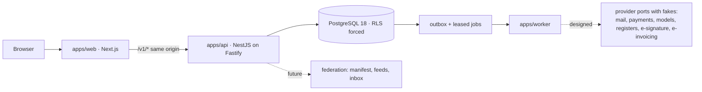

# Architecture for contributors

Normative requirements: [Security architecture](modules/security-architecture.md), [Operations](modules/operations.md), [API and MCP](modules/api-and-mcp.md). Participants: [who uses what](participants/README.md).

This chapter is the map you need before changing code. The accepted decisions behind it are the [ADRs](../adr/README.md); the detailed references are the [system architecture](../architecture/overview.md), [API conventions](../architecture/api.md), [data dictionary](../data/model.md), [lifecycles](../data/lifecycles.md) and [retrieval design](../architecture/retrieval.md).

## Shape

A TypeScript **modular monolith** with three processes and one PostgreSQL database per node:

Solid arrows exist today; dotted arrows are designed. The API writes outbox rows and the worker relays them (REL-001), but no domain handler is registered yet, so no provider effect leaves the request path: the only provider port in code (mail) is an in-memory fake still called directly from the request until MAIL-001 ([Data and reliability](#data-and-reliability)).

- **apps/web**: public site (server-rendered for discovery) and the workspace; country and language selection; the brand overlay.
- **apps/api**: domain modules with in-process authorization; today `identity` (accounts, sessions, providers, companies, memberships) and `projects`.
- **apps/worker**: outbox relay, durable jobs and scheduled maintenance on its own restricted database role (REL-001); provider calls arrive with the packages that own them (MAIL-001 first).
- Microservices, a message broker, an external vector database and an external policy service are deliberately **not** used until measured need (ADR 001, 004, 007).

## Repository layout

| Path | Contents |
|---|---|
| `apps/web` | Next.js App Router; `app/(public)`, `app/app` (workspace), `app/(auth)`, `app/onboarding`; `components/`; `app/_lib` (locale resolution, i18n, data adapters, demo personas); `fixtures/` (synthetic demo data and `fixtures/i18n/<locale>.json` overrides); `brand/` (deployment overlay) |
| `apps/api` | NestJS modules, guards (auth, CSRF), idempotency interceptor, error filter, OpenAPI generation |
| `apps/worker` | Outbox relay, job runner (leases, heartbeats, fencing, backoff, dead letters, reconciliation), scheduler, metrics |
| `packages/contracts` | Zod 4 schemas for every command, query and read model; digests; guards; error codes; projection serializers. Two entries: server (`@trustwork/contracts`) and browser-safe (`@trustwork/contracts/client`) |
| `packages/data` | Reviewed SQL migrations, migration runner with checksum ledger, Kysely repositories, admission control |
| `packages/ui` | Design system: tokens, React Aria components, brand mark and wordmarks, media registry, locale dictionaries, Storybook |
| `packages/i18n-runtime` | Request-scoped message store shared by server and client |
| `packages/country-packs` | Country packs, restricted places, ISO country dataset, formatting helpers |
| `packages/compliance` | Ownership declaration and sanctions screening adapter |
| `infra` | Local PostgreSQL compose file and the web Dockerfile |
| `scripts` | Test runner, smoke test, docs validator, country-pack validator, open-source export |
| `tests` | Contracts, data (real PostgreSQL), backend, compliance, country packs, retrieval fixtures, web (unit and Playwright) |
| `docs` | This handbook, ADRs, architecture, data, design system, quality, legal templates, country-pack guide |

## Module boundaries

Each module owns its tables and exposes use cases; others call those use cases, never write foreign tables. Planned modules: `identity`, `projects`, `catalogue`, `procurement`, `sales`, `transactions`, `execution`, `trust`, `content`, `events`, `learning`, `matching`, `assistant`, `channels`, `billing`, `hubs`, `verification`, `federation`, `platform-admin`, `retrieval`. A cross-module use case runs in one transaction and emits outbox events.

## Data and reliability

- Reviewed, forward-only SQL migrations; no ORM schema sync; never edit an applied migration.
- Money as integer minor units with ISO currency, serialized as strings; quantities as exact decimals with units; no floating point in accounting.
- **The rule:** aggregate change, audit event and outbox intent in one transaction; workers lease jobs with `FOR UPDATE SKIP LOCKED`, heartbeats and fencing tokens; provider effects are at-least-once attempts with stable idempotency keys; timeouts become `outcome_unknown` and go to reconciliation.
- **Where the code is today** (checked 2026-10-31):
  - Memberships, projects and participation grants write the aggregate, the audit event and the outbox row in one transaction. E-mail verification, recovery completion, step-up, password and e-mail changes, logout, session revocation and provider unlinking write the change and its audit event (and an outbox row where one is emitted) in one transaction.
  - Sign-up, login, failed-login and lockout bookkeeping, recovery requests and provider sign-in events write their audit event in a **separate** transaction after the change (`auth.service.ts`, `provider.service.ts`); no work package folds them in yet, so this is an open follow-up.
  - Mail (verification, recovery, invitations, security notices) is sent from the request handler after commit through the in-memory `FakeMailbox`, not through the outbox; MAIL-001 moves it to outbox and worker.
  - REL-001: `apps/worker` claims outbox rows with `FOR UPDATE SKIP LOCKED` and runs leased jobs with heartbeats, fencing tokens, backoff, dead letters and `outcome_unknown` parking, plus scheduled maintenance, under its own restricted role; the API role only appends audit and outbox rows. No domain handler is registered yet ([apps/worker](../../apps/worker/README.md)).

## Contracts first

Every API shape lives in `packages/contracts` as a Zod `strictObject`; JSON Schema and OpenAPI are generated from it. Errors use stable English codes (`auth.*`, `access.*`, `commercial.*`, `membership.*`, `validation.*`) mapped to localized messages in the web app. Identifiers are opaque. Time is RFC 3339 UTC; business dates carry their time zone.

## Front end conventions

- Every visible string comes from locale dictionaries (`apps/web/app/_lib/locales/<locale>.json`, `packages/ui/locales/<locale>.json`); English is the reference key set; tests fail on missing keys and on placeholder text.
- Dates, months, weekdays, time zones, numbers, money and file sizes come from `Intl` for the active locale.
- Demo content resolves per string: the locale's override, then English, then the base text; tests ensure no Russian reaches readers of other languages.
- Accessibility is tested with axe in Playwright; keyboard order, focus return and reduced motion are part of acceptance.
- The base path (`NEXT_PUBLIC_BASE_PATH`) is respected for links, assets, cookies and fetches.

## Quality gates

`npm run check` runs lint, strict type checking, unit and contract tests, design-system tests, documentation and link validation, all builds and a loopback smoke test. Browser tests: build the web app, then run Playwright (desktop, tablet and mobile projects). Security-critical flows need real negative authorization and concurrency tests, not only mocks.

## Technology

Node 24, npm 11, TypeScript 6 (strict), Next.js 16 with React 19, NestJS 12 on Fastify, PostgreSQL 18, Zod 4, Kysely with `pg`, React Aria Components, Playwright, axe-core, Storybook. Exact versions are pinned in the lockfile; upgrades are deliberate.
