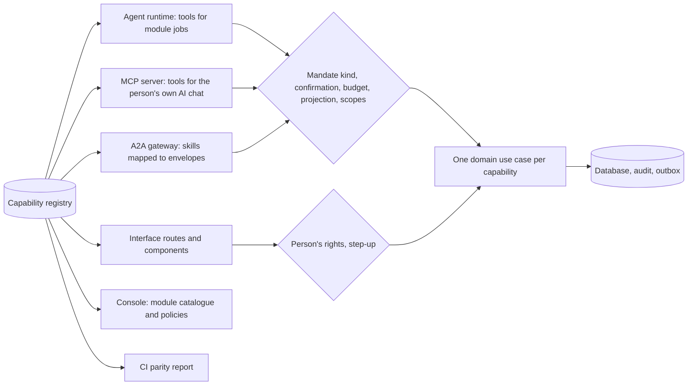

# The capability registry: one system for the agent and the interface

Requirement: [ADR 010 decision 23](../adr/010-gathering-point-hubs-agents-and-mesh.md) (owner, 2026-10-31). Status: the registry entry, the registry and the invariant and parity-gap functions are **Contract** (AGT-002, `packages/contracts/src/agent-catalog.ts`, with tests); the per-module entries, the generated CI parity report and the runtime that resolves every agent step through the registry are **Proposed**. The procurement and supply suite registers its operations through PRC-023, and the MCP server design projects registry entries as MCP tools. Module pages list their own entries under "Agent capabilities" ([module specifications](modules/README.md)).

## The decision in one paragraph

Everything in the product revolves around the person's own agent, their representative. Every participant-facing capability of the system is available **through that agent** and **directly in the interface**: full two-way parity. All modules register their operations in **one capability registry** (read, draft or commit; contract-derived inputs and outputs; data classes; mandate kind; confirmation policy; meter) that the agent runtime, the person's connected AI chat over MCP and the interface all use. A generated **parity report** in CI shows any capability missing from either side. Commitments still need a confirmed mandate, a budget where money is involved and the person's confirmation; chat text never authorizes.

## Why one registry

| Without a registry | With the registry |
|---|---|
| The interface and the agent call different code paths and drift apart | One use case per capability; the interface, the agent, MCP and A2A are four doors to the same room |
| Authorization rules are repeated per surface and one door is forgotten | Projection, mandate kind and confirmation are declared once and enforced for every door |
| Nobody can tell whether a feature works through the agent | The parity report lists every gap in CI |
| A hub cannot see what its agents can do | The console's module catalogue is generated from the registry |
| A hub extension adds an action that bypasses a rule | The same invariants validate built-in and extension entries |

## What a registry entry declares (contract)

| Field | Meaning |
|---|---|
| `id` | `<agent module or extension key>.<operation>`, stable across versions; prefixed with its module key (for example `project_planner.propose_version`, `quoting.send_quote`, `core.stop_all`) |
| `version` | Incremented when inputs, outputs or rules change |
| `source` | `module` (key and version) or `extension` (governed extension registry, AGT-023) |
| `kind` | `read`, `draft`, `commit` or `govern` (below) |
| `input`, `output` | References to exported Zod schemas in `packages/contracts/src/<contract>.ts`; JSON Schema for agents and MCP is generated from them |
| `mandateAction` | The mandate kind a commit needs; none for reads, drafts (except preparation verbs) and governance |
| `contextKinds` | Which contexts the capability acts on (project, RFQ, quote, agreement, order, introduction, open need, partner post, event, course, publication, profile, catalogue offering, opportunity, company, plan item, consultation, task request, goal) |
| `confirmation` | `none`, `mandate`, `person_each`, `person_each_step_up`, `first_party_form` or `first_party_step_up` |
| `budgetKind` | `transaction` or `platform` when the mandate verb spends money; none otherwise |
| `reads` | Projection layers it reads; `staff_case` is never reachable from a participant capability |
| `privateDataClasses` | Party-private classes it touches (`negotiation_constraints`, `budgets`, `private_projects`, `drafts`); external connections reach them only when the person opts in per class |
| `sideEffects` | `none`, `draft_state`, `state_change`, `outbound_message`, `publication`, `money_commitment`, `reputation_signal`, `external_call` |
| `acceptsUntrustedText` | Only reads and drafts may consume files, mail, web pages or other agents' notes |
| `meters` | Meters it consumes ([metering](agent-catalog.md#meters)) |
| `surfaces` | `ui`, `agent`, `mcp`, `a2a` |
| `status` | Live, Demo, Contract, Designed or Proposed, so that the agent never offers a capability that does not exist |
| `labelKey` | The locale key of its label in every engine language |

## The four kinds and their rules

| Kind | What it does | Rules enforced by the contract |
|---|---|---|
| `read` | Returns data | No mandate, no confirmation, no budget, no side effect |
| `draft` | Creates inert, owner-private drafts or proposals | No confirmation, no budget; only preparation verbs; only draft state (and external calls for extraction) |
| `commit` | Moves shared state | Names a mandate kind and a confirmation (`mandate`, `person_each`, `person_each_step_up`); human-only verbs (`confirm_execution`) and reputation signals are confirmed by a person each time; money actions name their budget kind; introductions are quota-bound, never bought; commits accept only structured first-party input |
| `govern` | Changes the person's own authority or account: confirm or revoke mandates, approve decisions, the stop control, consent to a connection, security, membership and role changes, accepting prices and terms | Never delegated to a mandate; confirmed on the first-party form (with step-up where required); never exposed to MCP or A2A; extensions cannot add governance |

## Parity: reach is equal, authority is not

Every participant capability carries both the `ui` and the `agent` surface. For `govern` capabilities the agent's surface is **preparation and handoff**: it explains, pre-fills and opens the exact first-party form; the person performs the step. A connection (MCP or A2A) can never perform governance and can never approve, confirm or widen a mandate, step up, change credentials, e-mail, membership or roles, accept prices, legal terms or a plan version, request a case grant, export in bulk, or press or release a kill switch (`CONNECTION_FORBIDDEN_OPERATIONS` in the contract). The stop control is always one click away on the first-party surface.

## The parity report

A generator reads the registry of the engine (and of each hub after its policy and extensions), the web route manifest, the agent tool list, the MCP catalogue and the locale files, and publishes a report with every pull request:

| Check | Fails when |
|---|---|
| Interface and agent surfaces | `parityGaps` finds a capability without `ui` or `agent` |
| Invariants | `capabilityViolations` reports any rule above |
| Contract references | An input or output reference does not resolve to an exported schema |
| MCP projection | A capability exposed to connections is missing from the MCP catalogue without a declared exclusion |
| Locale | A label, decision text or error text is missing in any engine language |
| Status honesty | An entry claims Live without a test exercising its use case, or the agent offers a Proposed capability as available |
| Tests | A `commit` capability has no negative authorization test |

## How the runtime uses the registry

1. A module job lists the capabilities it may use; the module manifest's allowlist is a subset of the registry.
2. The runtime resolves each step to a registry entry, evaluates the mandate (`evaluateMandateV2`), limits, budget kind and confirmation, and calls the same use case the interface calls.
3. Results come back in the projection layers the entry declares; text that originated with another party is marked untrusted for the model.
4. Every call writes the entry's audit event and, where metered, an idempotent usage record.

## Hubs, extensions and jurisdictions

- **Hub registry.** A hub's registry is the engine registry after the hub's agent policy and activated extensions (`hubId` set). Disabling an agent module removes its agent tools and leaves the interface paths in place; parity is engine-wide, and hubs enable modules, not doors.
- **Extensions** (AGT-023) add `read`, `draft` or `commit` entries with the same invariants, a safety suite and an adapter with a fake, activated by a second person; they can never add governance and must declare an interface surface too (a generated form is acceptable).
- **Jurisdiction settings and consumer mode** (HUB-005, AGT-008) may raise confirmations at run time, for example to `person_each` for consumer purchases; nothing lowers them.

## Status today

The identity, company and project operations of the live API are the only capabilities that execute end to end, and the interface does not call them yet (WEB-004); none is reachable by an agent until the runtime exists (AST-001). The parity report is therefore expected to show gaps; that is honest and intended.

## Open points

- Where the registry's generated report runs and who owns it (the MCP server design proposes it with its first package; see [conflicts to resolve](conflicts-to-resolve.md), C7).
- The procurement suite proposes three more mandate verbs (`approve`, `release_payment`, `maintain_records`) that the frozen v2 vocabulary does not contain ([conflicts to resolve](conflicts-to-resolve.md), C13).
- Per-object public assistants (ADR 012 decision 25) use the visitor's own agent and public `read` capabilities only.
