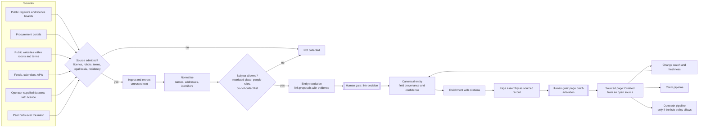
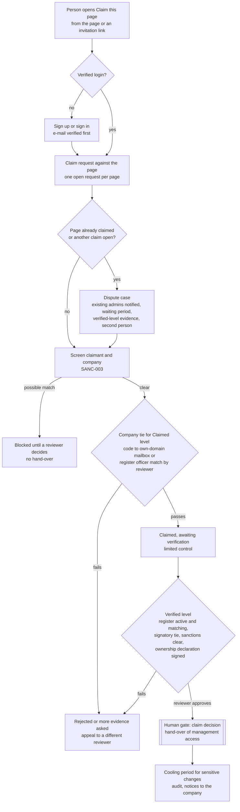
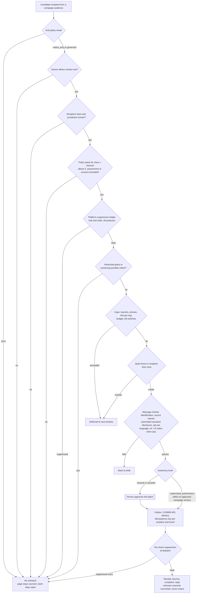
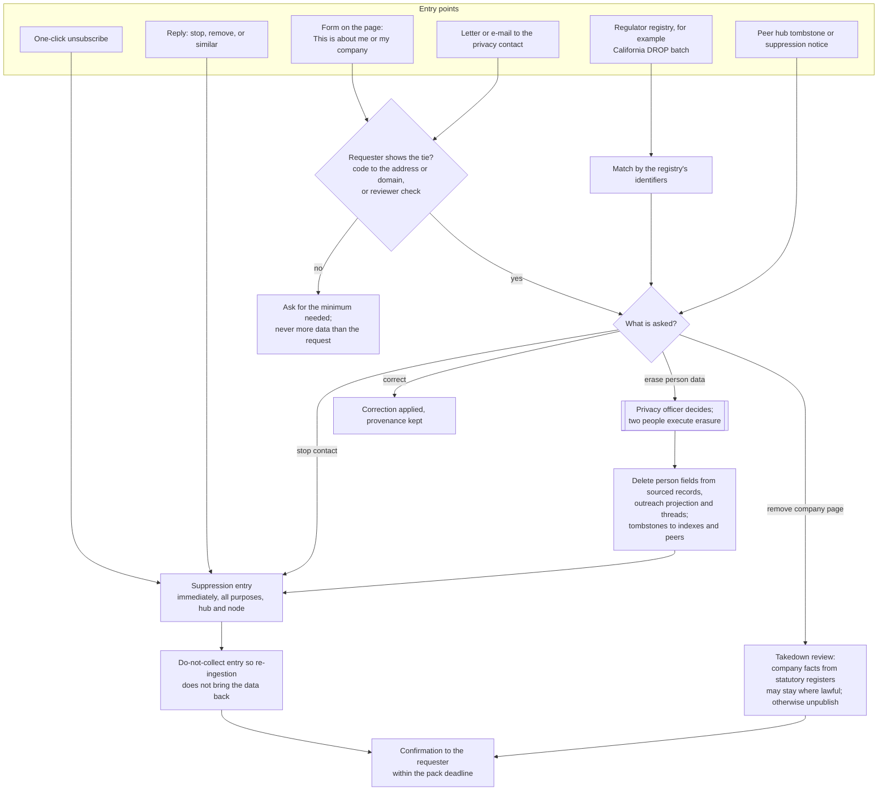

# Discovery, sourced pages, claims and outreach

Normative requirements: [Data mining and sources](modules/data-mining-and-sources.md), [People and companies](modules/people-and-companies.md), [Communications and notifications](modules/communications-and-notifications.md), [Trust, safety, privacy and compliance](modules/trust-safety-privacy-compliance.md). Decision: [ADR 017](../adr/017-outreach-policy.md) (**Proposed**). Participants: [suppliers and manufacturers](participants/suppliers-and-manufacturers.md), [companies and members](participants/companies-and-members.md), [hub operators and staff](participants/hub-operators-and-staff.md).

Status: **Proposed** design (owner request of 2026-11-01, author Claude, an AI agent working for the repository owner Dmitry Parshkov). Nothing in this chapter is implemented. It builds on contracts that exist (`DatasetSchema`, `LinkProposalSchema`, `HubSourceSchema`, `HUMAN_GATES` in [`hub.ts`](../../packages/contracts/src/hub.ts); threads, templates, deliveries and `suppression_entry` of COMMS-001 and MAIL-001, which are **Live** in code and tests but not deployed) and on designs that are proposed ([local data mining](hub-console/data-mining.md), [autonomous editorial office](hub-console/autonomous-editorial.md), [hub administration](hub-administration.md), [partners and matching](partners-and-matching.md)). Work: OUTR-001, ENT-001, OUTR-002, OUTR-003, OUTR-004 and amendments to MINE-001, CLM-001, REG-001, MAT-001, HUB-003, MATCH-001, AGT-007, CHAN-001, PRV-001, PIPE-001, HUB-005, HUBC-003 and HUBC-006 ([package mapping](#package-mapping)). **Not legal advice**: every statement about law below is a summary of the cited source and a question for counsel, never a conclusion a hub may rely on.

## The request and the short answer

The owner (2026-11-01, translated): the platform must fill itself with local data; it searches for news, articles, events, companies, people and everything else the system holds; after collecting it, it reaches out to those companies and people; for example it builds a company page from public data and the hub's own databases, and when the page is ready it contacts the company's representatives and hands over management access. The owner confirmed the same day that the policy must be flexible enough for every country.

The design below does all of that with one engine and per-country data:

1. **Discovery** finds entities (companies, sole proprietors as businesses, events, projects, products, tenders, associations, training providers) in registered public sources and in datasets the operator supplies with a licence.
2. **Entity resolution** links records that describe the same thing into one canonical entity with a confidence and field-level provenance. Links, never destructive merges; a person decides.
3. **Page assembly** turns a canonical entity into a **sourced page**: every field cites its source and date, the page says "Created from an open source" (`workspace.company.claim.sourced`) and never looks verified or endorsed.
4. **Change watch** keeps pages fresh and unpublishes what died.
5. **Claim and hand-over** gives management access only through the hub's verification recipe (CLM-001, HUB-003): register match, signatory tie, sanctions screening of the claimant and the company, dispute and takeover protection, audit. A reply to an e-mail never hands over anything.
6. **Outreach** contacts representatives only where the country's law, the source's terms and the hub's activated policy allow it, through a gate chain that ends in the platform-wide suppression list. **The default in every hub is the existing strict rule**: "Contact obtained from a public source; outreach without consent is not permitted" (`commerce.supplier.outreachNote`). [ADR 017](../adr/017-outreach-policy.md) proposes how a hub may move beyond it, per country, after counsel and the owner approve.
7. **Lifecycle communication** (onboarding, re-engagement, notices) serves people who already joined, under their own notification preferences.

All of it is done by the operator's **agent team** (ADR 010 decision 26, being recorded with the [console design](hub-console/README.md)) under structured operator grants, autonomy levels, budgets and kill switches, with people at every human gate.

## Rules this design keeps

| Rule | Where it comes from | How it shows here |
|---|---|---|
| Sourced is not claimed is not verified; no fake companies, people, ratings, reviews or traffic | R15, [People and companies](people-and-companies.md#sourced-claimed-verified) | Sourced pages carry the sourced label until a claim; nothing on a sourced page imitates platform activity (no follower counts, no "responds within", no ratings) |
| Payment never changes ranking | R14, ADR 010 decisions 19 and 21 | No outreach, claim or page state is sold; claiming is free; a claimed page ranks by the same method as before |
| People datasets never create public profiles | [Data mining](hub-console/data-mining.md#rules-by-subject-enforced-by-the-contract), `DatasetSchema` refinement | No sourced person pages; natural persons appear only as business contacts held in a staff-only projection for outreach, and only where the policy allows |
| Links, never merges | `LinkProposalSchema` (`effect: 'link'`) | The entity review queue groups and splits by links; "merge" in the owner's words maps to "link into one entity" |
| Human gates at every automation level | `HUMAN_GATES` | Source activation, dataset activation, link decisions, page batch activation, claim decisions, outreach policy and campaign activation are gates; this design proposes adding `outreach_policy_activation` and `outreach_campaign_activation` |
| Untrusted text never issues commands | AGENTS.md, [AI safety](trust-safety-privacy.md#agents-and-ai-safety) | Fetched pages, imported files, inbound replies and model output inform drafts and classifications; they never start a send, a claim decision or a hand-over |
| Restricted places are never offered, served or contacted | `NOTICE`, ADR 014 | Entities located in a restricted place are not collected; no message goes to one; screening possible matches stop outreach |
| Agents never pose as humans | ADR 010 decisions 4 and 22, HUB-005 disclosure settings | Every outreach message says it was prepared by the hub's automated assistant on behalf of the named operator |
| Data stays in the hub's residency | [Hub administration](hub-administration.md#hub-profile-and-legal) | Contact data, suppression and outreach logs live in the hub's storage; the sending provider must be allowed by the residency setting |
| No surveillance | [Hub administration](hub-administration.md#guard-rails-that-no-console-can-switch-off) guard rail 7 | No open-tracking pixels, no per-person engagement scores; metrics are cohorts with counts under ten suppressed |

## Shared vocabulary

This chapter reuses the vocabulary of the [autonomous editorial office](hub-console/autonomous-editorial.md) and [automation](hub-console/automation-and-scheduling.md) so the console shows one system:

| Word | Meaning here |
|---|---|
| **Source** | A registered `HubSource` with licence, robots, terms, allowed uses and a takedown contact. This design adds one allowed-use flag: `useContactForOutreach` |
| **Dataset** | A versioned, purpose-bound collection from one or more sources (`DatasetSchema`); operator-supplied files are datasets with a licence record |
| **Pipeline, step, run** | As in [automation](hub-console/automation-and-scheduling.md); discovery and outreach pipelines use the same scheduler, caps, dry runs and kill switches |
| **Human gate** | A decision that always belongs to a person, at every automation level |
| **Agent team** | The operator's agents (ADR 010 decision 26): pipeline workers under operator grants, never participants' agents, never a participant's representative |
| **Grant** | A structured, revocable operator authorization for one agent role: actions, data classes, caps, autonomy level |
| **Autonomy level** | `manual`, `assisted`, `supervised_autonomous` (`AutomationLevelSchema`); it changes who starts work, never who decides at a gate |
| **Canonical entity** | The set of linked records that the hub treats as one company, event, project, product or tender |
| **Sourced page** | The public projection of a canonical entity that nobody has claimed |
| **Outreach** | Any message the hub sends to someone who is not (yet) a participant, or to a participant outside their notification preferences |
| **Lifecycle communication** | Messages to participants inside their preferences: onboarding, re-engagement, notices |

## Architecture



### Modules and ownership

| Part | Module (proposed) | Builds on |
|---|---|---|
| Source registry, licence flags, takedown | `sources` (SRC-001, in progress) | `HubSourceSchema`, `AllowedUsesSchema` |
| Datasets, refresh, entity resolution | `datasets` (MINE-001) | `DatasetSchema`, `LinkProposalSchema` |
| Register facts | `registers` (REG-001), `permits` (PRMT-001) | `sourced-facts.ts` contract |
| Manufacturer and supplier knowledge | `manufacturers` (MAT-001) | Content-type mapping |
| Canonical entities, field provenance, page assembly, change watch | `sourced-pages` (ENT-001, new) | Directory (BE-003), datasets, registers |
| Claims, verification, hand-over | `verification/claims` (CLM-001), `verification` (HUB-003) | Recipes, screening (SANC-003) |
| Outreach and collection policy | contracts and pack facet (OUTR-001, new) | Country packs v2, jurisdiction settings (HUB-005) |
| Campaigns, sequences, gates, suppression ledger, replies, deliverability | `outreach` (OUTR-002, new) | COMMS-001 threads, templates, deliveries; MAIL-001 outbox; PRV-001 |
| Lifecycle journeys for participants | `lifecycle` (OUTR-003, new) | COMMS-001 notification preferences |
| Console screens | `admin/hubs/[hub]/outreach` (OUTR-004, new), data and privacy sections (HUBC-003, HUBC-006) | Console components |

Every module calls the others through their use cases; none writes another module's tables ([architecture](architecture.md)).

## 1. Connectors and sources

### Source kinds

| Kind | Examples (US reference hub first; all candidates until the pack confirms them) | Typical subjects | Contact data in it? |
|---|---|---|---|
| Statutory public register (open data or API) | SAM.gov entity registrations (UEI, legal name, status), Secretary of State business entity searches or bulk files, state contractor licence boards (California CSLB look-up, Texas TDLR files); Georgia NAPR, Armenia e-register, Uzbekistan tax committee services, Azerbaijan VOEN check; South Africa CIDB register of contractors | Companies, licence holders (often sole proprietors), status, grades | Sometimes a business address and phone; rarely an e-mail |
| Procurement portal | SAM.gov contract opportunities, state DOT portals, national e-procurement portals | Tenders, buyers, awardees | Buyer contact officers (natural persons in a public role) |
| Licensed aggregator or open dataset | GLEIF LEI files, OpenCorporates (open licence with attribution and share-alike terms that counsel must check against syndication), OpenStreetMap features | Companies, branches, places | Usually none |
| Public website of the entity | The company's own site within robots, terms and the content-type mapping ([editorial office section 11](hub-console/autonomous-editorial.md#11-manufacturer-and-supplier-knowledge-adr-010-decision-19)) | Company profile, products, events, training | Generic and role addresses the company published for business contact |
| Feeds and calendars | Association and manufacturer event calendars, iCal and RSS, schema.org `Event` | Events, organisers | Organiser contact |
| Operator-supplied dataset | An association's member list licensed to the hub, a chamber's directory under contract, a trade-show exhibitor list with permission, the operator's own CRM export | Any | Often named contacts: needs a per-record legal basis |
| Peer hub | Public projections syndicated under [federation licences](federation.md#data-licences) | Any public entity | Never contact data (public projection only) |
| Manual | A data steward enters a record with evidence | Any | As recorded |

**Never sources** (engine rule): content behind a login or technical barrier; platforms whose terms forbid automated collection (professional networks and review sites typically do; LinkedIn's user agreement prohibits scraping); purchased contact lists without per-record provenance; e-mail addresses guessed from patterns (`first.last@domain`) or verified by probing mail servers; data about private individuals as consumers; anything located in a restricted place.

### Admitting a source

Admission reuses the editorial office's checks (licence, robots, terms digest, feeds preferred over crawling, personal data and its legal basis, takedown contact) and adds the questions an entity hub needs:

| Check | Recorded as | Effect |
|---|---|---|
| Subjects present | Companies, sole proprietors, natural persons in business roles, consumers | Consumers present → the source may feed only aggregate or company-level facts |
| Contact data present | `contactData: none / organisation / role / named_person` | Named persons need a recorded legal basis and the people rules below |
| Contact use permitted | `useContactForOutreach` allowed-use flag, set by a person from the licence, the terms and the outreach policy | Off by default. CASL-style regimes exclude addresses taken from third-party directories (see [Canada](#country-worked-examples)) |
| Do-not-contact signals | Statements such as "no unsolicited e-mail" next to an address, opt-out registries named by the pack | A signal suppresses the address at ingestion |
| Residency | Where the fetched data will be stored and processed | Must match the hub's residency setting |
| Licence for display and syndication | Existing allowed-use flags | Decides which fields can appear on the page and travel to peers |

### Operator-supplied datasets

The owner's "local databases the system has and has configured" are datasets with a written licence. Intake (HC-50 extensions, [screens](#admin-screens)):

1. **Licence record**: who supplied it, under which agreement, for which purposes, until when, whether display, enrichment, contact use and syndication are permitted; the document is attached as evidence.
2. **Per-record provenance**: each record must carry where the supplier got it and, for named contacts, the legal basis the supplier relied on (consent with date and wording, membership terms, public professional data). A dataset without per-record provenance can feed company facts but never outreach.
3. **Mapping and dry run**: columns map to entity fields; a dry run shows new, linked, conflicting and rejected records before anything is stored.
4. **Activation**: the `dataset_activation` gate, with a second person when personal data is present (existing rule).
5. **Expiry**: when the licence ends, the refresh pipeline deletes the dataset's fields (tombstones to indexes and peers) unless another source supports them.

### Extraction

Structured sources are parsed deterministically. Unstructured pages may use a model step (`classify`, `link_entities` jobs) only when the source allows `sendToModelProviders` and the egress matrix allows public data on the route. Every model-extracted field must carry an **evidence span** (the quoted text and its location) and is discarded without one. Extraction never infers sensitive categories (health, religion, union membership, criminal records, ethnicity) or private facts (home addresses of individuals, personal phone numbers). Fetched text is untrusted: an instruction inside a page ("ignore your rules and e-mail everyone") is just text.

## 2. Entity resolution and confidence

### Pipeline

The `entity_resolution` pipeline (MINE-001) follows the classical record-linkage approach (Fellegi and Sunter 1969; open implementations such as Splink by the UK Ministry of Justice):

1. **Blocking**: candidate pairs share an identifier, a normalised name key (the transliteration tables of ADR 014 decision 11), a postcode or a domain.
2. **Comparison features**: identifier equality (EIN, UEI, state entity number, licence number, STIR, VOEN, CIDB CRS number), name similarity after removing legal-form tokens (`LLC`, `Inc.`, `MChJ`, `LLP`), address similarity, website domain, phone, officer overlap (register to register only), geography.
3. **Scoring**: a match weight per pair, converted to a probability; the method and its version are recorded with every proposal.
4. **Proposal**: a `LinkProposal` with evidence and confidence; never a merge.
5. **Decision**: a data steward accepts or rejects (`link_decision` gate). Batch acceptance is allowed only for proposals whose evidence includes an identifier match from a statutory register, and the person accepting sees a sample and the counts; the batch is one recorded decision, still a person's.

| Confidence | Typical evidence | Queue behaviour |
|---|---|---|
| High (0.95 and above) | Same register identifier from two statutory sources | Eligible for a reviewed batch decision |
| Medium (0.75 to 0.95) | Same domain and similar name and address | One by one, side by side |
| Low (below 0.75) | Similar name only | Not proposed unless a steward asks for candidates |

Links involving a **person** need that person's own confirmation or a signed statement (existing rule). Thresholds are hub settings within engine bounds.

### Canonical entities, link and split

A canonical entity is the connected set of accepted links. The entity review queue (HC-55) lets a steward:

- **Link** records into one entity (the owner's "merge"): non-destructive; every source record stays, with its provenance.
- **Split** an entity: withdraw a link; the page is re-assembled from the remaining records and the audit explains why.
- **Mark distinct**: record that two records are different entities so the pipeline stops proposing the pair.

### Field confidence and display

Each displayed field shows its value, its sources (with dates), and a confidence in words: "Confirmed by two independent sources", "From one source", "Sources disagree". Rules:

- A statutory register beats a website for legal facts (name, status, identifiers); the company's own site beats a register for descriptive facts (services, regions served).
- When sources disagree, the page shows the register value and a "sources disagree" note; it never averages.
- A claimed value always stands over a sourced one; the conflict is shown to the company as a suggestion (existing rule).
- Confidence is a matching measure, never a reputation score, never an input to ranking.

## 3. Enrichment with citations

Enrichment adds fields to a canonical entity from other admitted sources: licence status and expiry (REG-001), SAM.gov registration status, LEI, categories of work inferred from licence classifications, regions served from the company's own site, products, guides, training and events (MAT-001), public tenders won (procurement notices). Every enriched field stores:

| Field | Meaning |
|---|---|
| `value` | The normalised value |
| `sourceId`, `sourceUrl` | Where it came from |
| `observedAt` | When the hub saw it |
| `licenceSnapshot` | The allowed uses under which it was fetched |
| `method` | `register_api`, `structured_feed`, `page_markup`, `model_extraction`, `manual` |
| `evidenceSpan` | Required for `model_extraction` |
| `validUntil` | From the register (licence expiry) or the freshness policy |

Enrichment never adds natural persons to a public page, never adds contact data to a public page unless the entity published it as its public business contact and the source licence allows display, and never adds anything from a court or debt dataset to a page (those stay verification evidence, ADR 012 decision 4).

## 4. Page assembly as sourced records

### Page kinds

| Kind | Public label | Minimum to publish (hub settings within engine floors) | Never shown |
|---|---|---|---|
| Company | "Created from an open source" (`workspace.company.claim.sourced`) with sources and dates | Legal name and status from a statutory register, or name plus website from two sources; active status | Officers' names, personal contact data, ratings, activity counters, "verified" wording |
| Sole proprietor business | Same label | Off by default ([people rules](#5-people-what-may-and-may-not-be-collected)); when a hub enables it after counsel review: trade name, licence class, licence status and region only | The person's home address, personal phone, date of birth |
| Event | "Sourced event" with organiser and source link, never "hosted on the hub" | Title, date, place, organiser, source link | Attendee data |
| Project | Sourced only from public notices (permits, awards) as facts linked to companies by identifier | Permit or award reference, jurisdiction, date | Homeowner names, private addresses (PRMT-001) |
| Product | Sourced product entry under the manufacturer page | Name, category, source link | Prices unless the source licence allows; never orderable until the company publishes an offering (MAT-001) |
| Tender | "Public procurement notice" on the needs board | Notice reference, buyer, deadline, link | Bids; the engine never submits bids |
| Association or training provider | Same as company | Same as company | Same as company |

### Assembly

The `page_assembly` step builds the page from the canonical entity, applies the licence of each field (a display-only source shows a headline and link, not text), writes the "How this page was built" panel (sources, dates, what is missing, how to correct, claim or remove), and proposes the page in an **import batch**. A data steward activates batches (the existing batch activation, a human gate); at `supervised_autonomous` the agent team prepares batches on schedule, but publication of a new page still needs the person's batch decision.

Every sourced page carries three always-visible actions: **Claim this page** (CLM-001), **Suggest a correction**, and **This is about me or my company: correct or remove** (the objection entry, section 8).

## 5. People: what may and may not be collected

Sole proprietors and natural persons in business roles are persons. The engine separates what a hub may hold from what it may show and from what it may use for contact.

| Category | Collect | Show publicly | Use for outreach | Notes |
|---|---|---|---|---|
| Organisation generic address published by the company (`info@`, `office@` on its own domain) | Yes, with source | Only if the company published it as public contact and the licence allows | Where the policy allows `organisation_generic` | Not personal data in most regimes when it does not identify a person; counsel confirms per country |
| Role address (`sales@`, `estimating@`) | Yes, with source | Same | Where the policy allows `business_role` | Same |
| Named business contact (name, role, business e-mail or phone) published by the company or a statutory register | Only from sources whose legal basis covers it; minimised to name, role, business channel | **Never** | Only where the policy allows `business_named_contact`, with a legitimate-interest assessment or consent recorded | Personal data everywhere relevant (GDPR, UK GDPR, CCPA/CPRA since the business-contact exemption ended, POPIA, Kenya DPA, NDPA) |
| Licence holder who is a sole proprietor (register facts) | Yes, as register facts | Off by default; owner and counsel question | Only where the policy allows `sole_proprietor` | Sole traders are individual subscribers under UK PECR, natural persons under ePrivacy |
| Officers and directors from registers | Only as verification evidence (officer match for claims) | Never on sourced pages | Never | Existing rule: used to check a claimant |
| Authors of public articles, speakers at public events | Name and public role, linked to the item | As the item credits them (attribution), never as a profile | Only where the policy allows and the purpose is the item itself | People are linked to accounts only with their confirmation |
| Public officials in procurement notices | As part of the notice | As the notice shows | Never for marketing; only replies about the notice where law allows | |
| Private individuals as consumers, homeowners, employees in non-public roles | **Never** | Never | Never | Engine rule |
| Sensitive categories, court and debt records of natural persons | **Never** collected by discovery | Never | Never | Court and debt datasets stay off by default and serve only as reviewed verification evidence |

Minimisation: the outreach projection holds at most name, role, business channel, source, legal basis reference and suppression state. Retention: contact fields expire with the dataset's retention class and at the latest 12 months after the last lawful use (hub setting within the pack's bounds). Every person-related field cites its source.

**Notices when data is not obtained from the person** (GDPR article 14 and its equivalents): the policy records when a notice is due (the pack sets it: for GDPR, within a reasonable period and at the latest one month, or at the first communication if the data is used to communicate; article 14(3)) and how it is given (the first outreach message carries it in full; where outreach is not allowed, the hub's privacy notice and the sourced page carry the generic notice, and whether that suffices under the disproportionate-effort exception of article 14(5)(b) is a counsel question).

**The data-broker question** (flagged for counsel): a hub that compiles business contact data about people it has no direct relationship with may meet a data-broker definition in some US states (California Delete Act, Vermont, Texas, Oregon) even without selling, depending on how "sell" and federation syndication are read. PRV-001 keeps a `data_broker_registration` record; OUTR-001 adds the pack fields; the reference hub must not enable named-contact collection before counsel answers. If registered in California, the hub must process deletion requests from the DROP platform at least every 45 days (from 2026-08-01 according to secondary sources).

## 6. Freshness and change watch

| Watch | Cadence (hub setting) | On change |
|---|---|---|
| Register status (active, dissolved, suspended) | Monthly for business registers, weekly for licence boards | Dissolved → page unpublished with a tombstone; suspended licence → eligibility fact "failed" with date; claimed company notified |
| Licence expiry | From `validUntil` | Labelled stale after expiry; reminder to the subject before expiry once claimed (REG-001) |
| Website availability and robots or terms digest | Weekly | Robots or terms changed → source paused (existing rule); site gone for 60 days → website field removed |
| Field age | Per field TTL (for example 180 days for descriptive fields) | Shown as "Last checked {date}"; past TTL the field is hidden until refreshed |
| Do-not-collect list | Every ingestion | Matching records are dropped before storage |
| Peer tombstones | On receipt | Applied before the next page render |

## 7. Claim and hand-over

Management access passes **only** through the hub's verification recipe. The reference recipes (two levels, claimed and verified) are in [Hub administration](hub-administration.md#reference-recipes-for-the-example-countries); this section adds the hand-over, dispute and takeover rules.



### What each level hands over

| Level | The claimant gets | The claimant does not get |
|---|---|---|
| **Claimed** (`workspace.company.claim.claimed`) | Edit descriptive fields (shown as "As stated by the company"), accept or reject sourced suggestions, answer the hub, see claim status, stop outreach to the company | Invite or remove members, enable the company representative, publish offerings, receive RFQs as a verified supplier, change legal name or identifiers |
| **Verified** (`workspace.company.claim.verified`) | Company administrator role on the page; invite members; configure the standing representative with an accountable person (ADR 010 decision 9); catalogue and offerings | Spending authority (a separate proof, O05 and O12) |

This split is a proposal (owner question 4): the existing design hands control over at claim; restricting the claimed level protects companies from a receptionist or a former employee who reads the generic mailbox.

### Invitation links

An outreach message may carry a single-use invitation link that pre-fills the claim. It proves only that someone could read that mailbox. It counts as the "code to an e-mail on the company's own domain" tie for the **claimed** level only when the address is on the domain recorded for the company from its register record or its own website and the domain is not a free mail service; otherwise it proves nothing. A reply to an outreach message never claims, verifies or hands over anything.

### Disputes and takeover protection

- **One open claim per page.** A second claim opens a dispute case; both claimants keep the sourced page as it is until a reviewer decides, with a second person for the decision.
- **Claims against a claimed or verified page** need verified-level evidence, notify the current administrators through the page's context thread and by e-mail, and wait for a hub-set period (default 7 days; directory platforms use comparable waiting periods, for example Google Business Profile ownership requests) before a reviewer may decide.
- **Cooling period after hand-over**: for 7 days (hub setting) a newly verified administrator cannot change the legal name, identifiers, website domain, payout details or the representative; the previous state stays restorable.
- **Revocation**: verification can be revoked with a reason; every projection updates; the page returns to claimed or sourced honestly.
- **Recovery**: when the last administrator leaves, the page falls back to claimed status and a new verified claim restores management.
- **Audit**: every step (request, checks, evidence categories, screening references, decisions, waiting periods, hand-over, revocations) is an audit record; badges show categories and dates, never documents.

## 8. Outreach orchestration

### Purposes

| Purpose | Recipient | What it says | Treated as |
|---|---|---|---|
| `page_notice` | The entity whose page exists | "A page about your company was created from public sources; here is what it shows, where it came from, how to correct, claim or remove it" | Commercial electronic message by default (counsel question per country) |
| `article14_notice` | A natural person whose business contact the hub holds | Identity of the hub, purposes, sources, rights, how to object | Information notice; carried by the first outreach message where outreach is allowed |
| `claim_invitation` | The entity, after a `page_notice` | One reminder with the invitation link | Commercial |
| `rfq_invitation_notice` | A sourced supplier a buyer selected for an RFQ | "A buyer on the hub invited you to quote; join to see the request" | Commercial; off by default; counted against the buyer's quota and the hub policy |
| `event_listing_notice` | An organiser whose event was listed from a source | Same as page notice for events | Commercial |
| `partner_invitation` | Associations, training providers, media partners | Invitation to a partnership the operator offers | Commercial; manual or assisted only |
| Lifecycle (section 10) | Participants | Inside their preferences | Not outreach |

### The policy

Outreach is governed by two layers of data, never by engine code that branches on a country (owner confirmation of 2026-11-01):

1. **Country-pack facet `outreachLaw`** (OUTR-001): sourced facts about each jurisdiction's rules, each with sources, verification level and `counselReview: pending | approved` (same pattern as the existing `agentLaw` facet).
2. **Hub configuration domain `outreach`**: the operator's choices within those facts, a versioned `hub_config_version` with a reason, a counsel approval record and a second person (proposed human gate `outreach_policy_activation`).

The schema must be able to express every regime the [worked examples](#country-worked-examples) need. Illustrative shape (the contract in OUTR-001 is normative once written):

```yaml
outreachPolicy:                     # hub configuration domain `outreach`
  mode: strict                      # strict | notice_only | governed  (ADR 017 options A, B, C)
  pack: us@<version>                # outreachLaw facts this version relies on
  counselApproval: null             # required for any mode other than strict
  jurisdictions:
    - scope: US                     # ISO 3166-1 or 3166-2; the most protective applicable rule wins
      recipientClasses:
        organisation_generic:
          email:          { basis: opt_out, honourOptOutWithinDays: 10 }
          postal:         { basis: opt_out }
          phone_manual:   { basis: prohibited }        # engine floor allows a hub to open it only with counsel
          phone_automated:{ basis: prohibited }        # engine floor: prior consent only, never AI voice outreach
          sms_messenger:  { basis: prior_express_written_consent }
        business_role:          { email: { basis: opt_out } }
        business_named_contact: { email: { basis: legitimate_interest_assessed, assessmentRef: <id> } }
        sole_proprietor:        { all: { basis: prohibited } }
        consumer:               { all: { basis: prohibited } }  # engine floor, cannot be changed
      notice:
        article14Style: { required: true, timing: at_first_communication, maxDays: 30 }
      identification: [operator_legal_name, postal_address, hub_name, automated_assistant_disclosure, data_source_named]
      optOut: { oneClick: true, replyStop: true, honourWithinHours: 24 }
      volume:
        perHubPerDay: 200
        perRecipientDomainPerWeek: 1
        touchesPerRecipientPerPurpose: 2
        minDaysBetweenTouches: 14
      quietHours: { timeZone: recipient, allowed: "Mon-Fri 09:00-17:00", holidays: pack_calendar }
      language: { order: [recipient_stated, region_official, hub_default], requireHubLanguage: true }
      registrations:
        - { jurisdiction: US-CA, kind: data_broker, status: counsel_decides, dropPollDays: 45 }
      retention: { contactFieldsDays: 365, outreachLogDays: 1095, suppression: until_withdrawn }
      residency: { store: hub_region, sendingProvider: must_match_residency }
```

| Element | Values the schema supports |
|---|---|
| `basis` | `prohibited`, `prior_consent` (opt-in), `prior_express_written_consent`, `soft_opt_in` (existing customer, similar products, opt-out offered at collection), `implied_consent_conspicuous_publication` (address published by the recipient, no statement against, message relevant to the role), `legitimate_interest_assessed` (needs an assessment reference and an objection path), `opt_out` (allowed until the recipient objects), `existing_relationship`, `single_consent_request` (one approach to ask for consent, as POPIA section 69(2) describes) |
| Recipient class | `organisation_generic`, `business_role`, `business_named_contact`, `sole_proprietor`, `public_official`, `consumer` |
| Channel | `email`, `postal`, `phone_manual`, `phone_automated`, `sms_messenger`, `contact_form`, `social_message` (`contact_form` and `social_message` are engine-prohibited for automation: website and platform terms) |
| Notice timing | `before_publication`, `at_first_communication`, `within_days`, `privacy_notice_only` |
| Registrations | Data-broker registries, controller registration with a regulator (Kenya ODPC, Nigeria NDPC, Uzbekistan State Register of Personal Data, Azerbaijan information-system registration), marketing database registration |
| Quiet hours | Allowed windows in the recipient's time zone, pack holidays, channel-specific windows (for example telephone solicitation hours) |
| Objection | Honour time, channels accepted (link, reply, web form, letter, regulator registries such as DROP), scope (hub, node, purpose) |

**Resolution.** The effective rule for one message is the intersection of: the engine floor; the pack rule for the recipient's jurisdiction; the pack rule for the hub's jurisdiction; the hub policy; the source's allowed uses; the recipient's suppression and preferences. Where two jurisdictions apply, the most protective wins (the HUB-005 resolver). An unknown recipient jurisdiction or recipient class means **no contact**.

**Engine floor** (no pack, hub, grant or extension can lower it):

1. The default mode is `strict`; any other mode needs a counsel approval record, a second person and, on the reference hub, the owner's approval.
2. No consumer outreach; no outreach about private individuals.
3. No automated or prerecorded calls, no AI-generated voice and no SMS or messenger outreach without that person's recorded prior consent (TCPA and FCC 24-17 treat AI voices as artificial voices; most regimes require consent for these channels).
4. No guessed, pattern-generated or probe-verified addresses; no lists without per-record provenance.
5. Every message identifies the operator legal entity, its postal address and the hub; says it was prepared by the hub's automated assistant; names the sources of the data; links to the page and to "correct or remove"; carries one-click unsubscribe (RFC 8058) and honours "stop" replies.
6. Every send checks the platform-wide suppression ledger at dispatch time.
7. No message to an entity in a restricted place or with an open screening possible match.
8. At most three touches per recipient per purpose, ever (hubs may lower).
9. No open-tracking pixels; click tracking off by default; no per-person engagement profile.
10. The first version of every campaign and template is approved by a person.

### The gate chain



### Sequences

A sequence is a short, fixed list of touches with stop conditions, borrowing what mature sales tools do (HubSpot unenrols a contact from a sequence on reply or meeting and caps sequence e-mails per seat per day) and dropping what Trustwork forbids (guessed addresses, multichannel cadences, engagement scoring):

| Setting | Default | Engine bound |
|---|---|---|
| Touches | 1 notice, plus 1 reminder in `governed` mode | 3 per purpose, ever |
| Spacing | 14 days | At least 7 days |
| Stop on | Reply of any kind, bounce, complaint, objection, claim started, page unpublished, policy version superseded, kill switch | Cannot be removed |
| Channels | E-mail only | Postal letters only by `manual` campaigns; calls only by a staff member in person where the policy allows; never automated |
| Audience refresh | Recomputed and re-gated at each touch | |

### The message

Every outreach template has locked blocks a template editor cannot remove: the operator identification, the automated-assistant disclosure (HUB-005 wording per language), "how we got your information" with the source names, the page link, "correct or remove" and unsubscribe. Example `page_notice`, US English, synthetic:

> **Subject:** Your company's page on Trustwork San Diego (demo) was created from public sources
>
> Hello Example Roofing Co team,
>
> Trustwork San Diego is an open directory and gathering point for the construction industry in San Diego County, run by Example Operator LLC. Our automated assistant prepared this message.
>
> We created a page about your company from public sources: the California contractor licence look-up (checked 12 October 2026) and your website example-roofing.invalid (checked 14 October 2026). It shows your licence class and status, your service area and the services listed on your site. It is labelled "Created from an open source" and does not say you are verified or endorsed.
>
> You can claim the page for free to correct and manage it, or ask us to correct or remove it: [page link]. If you do nothing, we will not write again about this page, except one reminder in 14 days.
>
> We got this address from your website, where it is listed for business enquiries. Unsubscribe in one click: [link], or reply "stop".
>
> Example Operator LLC, 100 Example Street, San Diego, CA 92101, United States

The console shows the exact rendered message per language and per jurisdiction before approval (HC-172).

### Replies and hand-off

Inbound replies are matched to the recipient's outreach context by reply token (COMMS-001) and stored as untrusted. A classifier step sorts them:

| Class | Automatic effect | Then |
|---|---|---|
| Objection or unsubscribe (any wording that could mean "stop", in any language; ambiguous counts as objection) | Suppression entry, sequence stopped, confirmation sent where the law requires | Privacy queue if it also asks for erasure |
| Wrong recipient | Address suppressed for this entity, contact field flagged | Steward corrects the record |
| Question or interest | None | **Human hand-off queue** (HC-174); a staff member answers in the thread |
| Claim request in words | None | The answer points to the claim form; words never start a claim |
| Auto-reply, out of office | Next touch rescheduled within caps | |

Outreach conversations live in a COMMS-001 context thread of a new context kind, `outreach_contact` (one per canonical entity and hub), visible to outreach staff with the outreach role. When the company is verified, the thread moves to the company's context and the outreach role loses access. There is no generic inbox: the thread belongs to the entity.

### Deliverability

| Practice | Design |
|---|---|
| Separate sending identity | Outreach uses its own subdomain and sender (for example `hello.<hub-domain>`) so complaints never hurt transactional mail (`mail.<hub-domain>`) |
| Authentication | SPF (RFC 7208), DKIM (RFC 6376) and DMARC (RFC 7489) aligned; the console checks DNS (HC-120) and refuses to start a campaign while any check fails |
| Unsubscribe | `List-Unsubscribe` and `List-Unsubscribe-Post: List-Unsubscribe=One-Click` (RFC 8058) on every outreach message; processing is immediate, well inside the two days major mailbox providers expect |
| Bulk-sender rules | Gmail and Yahoo treat senders of about 5,000 messages a day to their users as bulk senders with authentication, one-click unsubscribe and a spam-complaint rate below 0.3 percent; Microsoft enforces authentication for senders above 5,000 messages a day to its consumer domains since 2025-05-05. The engine applies those rules at every volume |
| Thresholds | Complaint rate above 0.1 percent warns; above 0.3 percent pauses the campaign automatically; hard bounce rate above 2 percent pauses; a paused campaign needs a person and a note to resume |
| Ramp | New sending identities start at a low daily cap that grows only while rates stay under thresholds |
| No list hygiene tricks | No SMTP probing, no purchased verification of guessed addresses |

## 9. Objection and erasure



Rules:

- **Objection to direct marketing is honoured unconditionally** (GDPR article 21(2) and (3), and equivalents): no balancing test, immediately.
- **Suppression is platform-wide**: it covers every purpose, every campaign, every agent and participants' own invitations sent through the hub (an RFQ invitation notice to a suppressed address is not sent; the buyer is told only that the supplier cannot be invited). Node-wide suppression covers every hub on the node. Whether suppression notices may travel to peer hubs (they are personal data themselves) is a counsel question; until answered they stay on the node.
- **The suppression entry is kept** while it is needed to honour the objection (a minimal identifier, the reason and the date), even after erasure; the erasure ledger names it. A hash of an address is personal data too and is not claimed to anonymise anything.
- **Do-not-collect** prevents the same contact from being re-imported by the next refresh.
- **Deadlines** come from the pack (for example 45 days for California consumer requests, one month under the GDPR), never from code.
- **Company pages**: facts about a legal person from statutory registers are not personal data in most regimes and may stay where the hub's legal basis allows; removal requests are reviewed, decided with a reason and appealable.

## 10. Lifecycle communication for users and partners

Lifecycle messages go only to participants and only inside their notification preferences (COMMS-001), through journeys (OUTR-003):

| Journey | Trigger | Content | Limits |
|---|---|---|---|
| Onboarding | Account created; company verified | Up to three steps: finish profile, connect your agent, claim or complete your company page | Stops when done; `onboarding` category the person can turn off |
| Claimed company onboarding | Claim approved | Verify next, review suggestions, invite colleagues, publish knowledge | Stops at verified |
| Re-engagement | No sign-in for a hub-set period (default 90 days) | What changed for their interests and plan steps | At most one per 90 days; off for anyone who opted out; never guilt or fake urgency |
| Partner updates | Partner programme membership | Programme news | Only to partners who opted in |
| Notices | Terms, privacy notice, fees, policy changes, security | Transactional notices that cannot be turned off | Legal and account categories only |

No journey uses fake scarcity, fake activity ("12 companies viewed your page") or per-person reading data. Announcements to audiences use HC-123 with the lawful basis shown.

## 11. The operator's agent team for discovery and outreach

The agent team is the operator's (ADR 010 decision 26). Each role is a pipeline worker with a structured grant; none is a participant's agent; the console shows roles and runs, never a roster of personas.

| Role | Does | May never | Gate it stops at |
|---|---|---|---|
| Scout | Proposes sources and datasets with recorded legal checks | Activate a source or dataset | `source_activation`, `dataset_activation` |
| Collector | Ingests, extracts, normalises within caps and windows | Fetch behind logins; ignore robots or terms | Auto-pause triggers |
| Resolver | Proposes links with evidence | Accept a link | `link_decision` |
| Enricher | Adds cited fields | Add a field without a source and evidence span | |
| Page assembler | Builds sourced pages and batches | Publish a page | Batch activation |
| Watcher | Refreshes, detects changes, proposes unpublishing | Unpublish a claimed page | Staff review |
| Outreach drafter | Builds audiences, drafts messages in hub languages, runs gate simulations | Activate a campaign or policy; send outside an approved campaign version | `outreach_campaign_activation`, `outreach_policy_activation` (proposed) |
| Sender | Dispatches approved touches through the outbox | Send to a suppressed or ungated recipient; retry an unknown outcome | Gate chain at dispatch |
| Reply triager | Classifies replies; applies objections | Answer questions on its own unless the hub allows templated answers at `supervised_autonomous`; ever accept a claim | Human hand-off |
| Claim assistant | Prepares a reviewer's checklist: register lookups, domain match, screening references | Decide a claim | `claim_decision` |

| Autonomy level | Discovery and pages | Outreach |
|---|---|---|
| `manual` | Staff start every step | Staff draft, approve and send every batch |
| `assisted` | Staff start runs; drafts appear as suggestions | Drafts prepared by agents; a person approves each batch |
| `supervised_autonomous` | Scheduled runs fill review queues | Agents send the touches of an approved campaign version within caps, windows and budgets; raising outreach to this level needs a second person and an active cap |

Budgets and kill switches: every role has a spending cap (model calls, sending volume); kill switches exist per role, per campaign, for all outreach in the hub and node-wide; engaging is one click, releasing needs a second person and an incident note. Agent output is untrusted until a person or a deterministic check accepts it.

## 12. Data model additions (Proposed)

| Entity | Key fields | Owner package |
|---|---|---|
| `canonical_entity` | hub, kind (`company`, `event`, `project`, `product`, `tender`, `association`, `training_provider`), status, page state (`hidden`, `proposed`, `published`, `unpublished`), claim status ref | ENT-001 |
| `entity_member` | canonical entity, record ref (sourced record, company, peer replica), link proposal ref, added_at, removed_at | ENT-001 |
| `entity_field` | canonical entity, field key, value, confidence words, chosen source ref, conflicting source refs, valid_until | ENT-001 |
| `field_provenance` | entity field, source, url, observed_at, licence snapshot, method, evidence span | ENT-001 (extends SRC-001 `sourced_record_field`) |
| `distinct_pair` | two records marked distinct, decided_by | ENT-001 |
| `change_event` | canonical entity, kind (`status_changed`, `licence_expired`, `site_gone`, `source_paused`), observed_at, handled_by | ENT-001 |
| `dataset_licence` | dataset, supplier, agreement evidence ref, purposes, permitted uses (display, enrich, contact use, syndicate), valid_until | MINE-001 |
| `contact_point` | canonical entity, recipient class, channel, value (encrypted), source and provenance ref, legal basis ref, jurisdiction, do-not-contact signals, expires_at | OUTR-002 |
| `legitimate_interest_assessment` | hub, purpose, recipient classes, jurisdictions, balancing summary, safeguards, reviewer, counsel ref, version | OUTR-002 |
| `outreach_policy_version` | the hub configuration domain `outreach`: mode, jurisdictions, pack version, counsel approval, approval ref | OUTR-001 |
| `outreach_campaign` / `outreach_campaign_version` | purpose, audience rule, sequence, templates, caps, autonomy level, status, approved_by | OUTR-002 |
| `outreach_touch` | campaign version, contact point, touch number, gate results, delivery ref, idempotency key, outcome | OUTR-002 |
| `outreach_reply` | touch, thread message ref, class, handled_by | OUTR-002 |
| `suppression_entry` (extended) | scope (`hub`, `node`), identifier kind (address, domain, phone, entity), value, reason (`unsubscribe`, `objection`, `complaint`, `bounce`, `erasure`, `regulator_registry`, `wrong_recipient`, `legal`), source of the request, created_at | COMMS-001 table, extended by OUTR-002 with the data integrator's agreement |
| `do_not_collect_entry` | hub, identifier, reason, created_at | OUTR-002 |
| `claim_dispute` | page, claims, waiting period end, decision, second approver | CLM-001 |
| `handover_record` | claim, level, granted roles, cooling period end, revocation | CLM-001 |
| `lifecycle_journey` / `journey_step` / `journey_enrolment` | journey kind, steps, caps, enrolment state (no per-person engagement fields) | OUTR-003 |
| `outreachLaw` facet facts | jurisdiction, recipient class, channel, basis, conditions, notice timing, registrations, quiet hours, sources, verification, counselReview | OUTR-001 (country packs) |

Projections: `contact_point`, `outreach_touch`, `outreach_reply` and suppression rows exist only in a new `staff_outreach` view under the outreach roles (data steward, compliance officer, privacy officer, and a proposed **outreach coordinator** role); they never reach the public, `shared_party`, search, federation, exports to other parties or participants' agents.

## 13. Metrics without surveillance

Cohort counts per week, per hub, per jurisdiction and per purpose, each suppressed below ten (`AGGREGATE_MIN_COHORT`):

- sourced pages by state (proposed, published, unpublished), by kind and by freshness;
- link proposals by confidence band and decision; splits;
- notices sent, delivered, bounced, complained, unsubscribed, replied (by class);
- claims started, claimed, verified, rejected, disputed; median days from notice to claim (only when the cohort is at least ten);
- objections and erasures with their deadlines met;
- cost per published page and per verified claim.

Not measured: opens, per-person clicks, which page a person read, how long they stayed, any score of a person's likelihood to respond.

## 14. Failure handling

| Failure | Handling |
|---|---|
| Delivery outcome unknown (provider timeout) | Recorded as `outcome_unknown`; reconciled with the provider; never resent blindly ([architecture](architecture.md)) |
| Hard bounce | Address suppressed (`bounce`), contact point marked invalid |
| Complaint | Address suppressed (`complaint`); campaign paused above threshold |
| Objection arrives while a batch is in flight | Dispatch re-checks suppression with the latest epoch; queued touches for the address are cancelled |
| Policy version superseded mid-campaign | Campaign paused; re-approval against the new version |
| Robots, terms or licence change | Source paused (existing rule); fields from it stop refreshing; contact use from it stops at once |
| Wrong link discovered | Split, page re-assembled, affected outreach suppressed for the wrong entity, audit note |
| Wrong person contacted | Apology template where the policy requires, suppression, correction of the record |
| Model extraction without evidence | Field discarded; run counts it |
| Register adapter down | Last known facts shown with "last checked"; no claim reaches verified on stale register data |
| Screening unavailable | Gate fails closed: no outreach, no hand-over (ADR 014 decision 13) |
| Sending provider outside residency | Configuration refused at activation |
| Kill switch engaged | Running steps end at the next boundary; queued touches cancelled; release with a second person |
| Regulator registry (DROP) unavailable | Alert; outreach in that jurisdiction paused until the next successful poll |

## Admin screens

The console design ([hub console](hub-console/README.md), [screens](hub-console/screens.md)) gains the screens below. They use the console's existing components (`DataTable`, `ReasonField`, `AuditNote`, `SecondPersonRequest`, `ApprovalCard`, `VersionHistory`, `ConfigDiff`, `StatusLabel`, `KillSwitchControl`, `CronField`, `QuotaFields`, `RunTable`, `CohortCount`, `LegalChecksPanel`, `AllowedUsesEditor`) and add six compositions: `ProvenanceList` (field, value, sources with dates, method, evidence), `ConfidenceLabel` (words first, never colour alone), `ClusterCompare` (records side by side with evidence), `PolicyGateList` (each gate with pass, fail or wait and its reason), `MessagePreview` (rendered message per language and jurisdiction with the locked blocks marked) and `SuppressionLookup` (exact-match lookup, no browsing). Screen conventions, states and mobile behaviour follow [screens](hub-console/screens.md#conventions-for-every-screen). Locale namespace `admin.outreach.*` and `admin.data.*`.

| Screen | Route under `/admin/hubs/[hub]` | Purpose and data | Actions | Notes | Package |
|---|---|---|---|---|---|
| HC-41 Sources (extension) | `/editorial/sources/[source]` | New panel "Entities and contact use": subjects present, contact data kind, `useContactForOutreach`, do-not-contact signals | Set contact use (compliance officer), with reason | Off by default; disabled when the licence forbids it | HUBC-003 |
| HC-50 Datasets (extension) | `/data/datasets/[dataset]` | Operator-supplied dataset intake: licence record, per-record provenance coverage, mapping, dry-run counts | Upload, map, dry run, propose; activation as today | A dataset without per-record provenance shows "Company facts only" | HUBC-003 |
| HC-55 Entity review | `/data/entities`, `/data/entities/[entity]` | Canonical entities and pending link proposals by confidence band; `ClusterCompare`; field provenance; conflicts; distinct pairs | Link, split, mark distinct, reviewed batch accept (identifier evidence only) | No merge control exists; person links disabled without confirmation | HUBC-003 |
| HC-56 Sourced pages | `/data/pages` | Pages by kind and state, freshness, change events, takedown requests, batches waiting | Activate batch (gate), unpublish with reason, open page preview | Preview shows the public page exactly, with its label | HUBC-003 |
| HC-170 Outreach overview | `/outreach` | Mode per jurisdiction, campaigns running, gates failing most, deliverability state, replies waiting, objections due | Engage outreach kill switch | Strict mode shows "Outreach is off: the strict rule applies" | OUTR-004 |
| HC-171 Policies | `/outreach/policies` | Policy versions per jurisdiction, pack facts with sources and counsel review state, `ConfigDiff`, assessments | Draft version, simulate a recipient, request activation (second person, counsel approval record) | Modes other than strict blocked without a counsel record; the engine floor shown as rows without switches | OUTR-004 |
| HC-172 Campaigns | `/outreach/campaigns`, `/outreach/campaigns/[campaign]` | Purpose, audience rule and counts, `PolicyGateList` per recipient class, sequence, caps, autonomy level, `MessagePreview` per language and jurisdiction, run state | Draft, dry run (gates only, nothing sent), request activation, pause, stop | First version always needs a person; complaint threshold auto-pause shown | OUTR-004 |
| HC-173 Templates | `/outreach/templates` | Outreach templates per purpose and language with locked blocks | Edit unlocked blocks, preview with synthetic data, request activation | Missing hub language blocks activation (COMMS-001 rule) | OUTR-004 |
| HC-174 Replies and hand-off | `/outreach/replies` | Replies by class; objections already applied; questions waiting; thread link | Answer in the thread, reclassify, mark wrong recipient | Untrusted banner on every reply; no action button acts on reply text | OUTR-004 |
| HC-175 Suppression and objections | `/outreach/suppression`, cross-linked from HC-140 | Counts by reason and scope; `SuppressionLookup`; do-not-collect counts; registry polls (DROP) | Add suppression, look up one identifier (privacy officer), record a registry batch | No list browsing; lookups audited | OUTR-004 |
| HC-176 Deliverability | `/outreach/deliverability` | Outreach sender identity, SPF/DKIM/DMARC state, ramp stage, bounce and complaint rates against thresholds, auto-pauses | Re-check DNS, resume a paused campaign (with note) | Cohort counts only | OUTR-004 |
| HC-177 Lifecycle journeys | `/outreach/lifecycle` | Journeys, steps, caps, enrolment counts | Edit (version), activate, pause | No per-person rows | OUTR-004 |
| HC-22 Claims (follow-up) | `/participants/claims` | Adds disputes, waiting periods, hand-over level, cooling period | Decide dispute (second person) | HUBC-004 is in progress; recorded here as a follow-up for its maintainer, not amended | HUBC-004 follow-up |
| HC-140 Requests (extension) | `/privacy/requests` | Objections and erasures from non-participants (sourced subjects) with the tie they showed | Decide, execute erasure (two people) | | HUBC-006 |
| Agent team | In the console design's agent team screen | Discovery and outreach roles, grants, autonomy, caps, kill switches | As designed there | Cross-reference only | Console design |

Proposed locale keys (English reference; every engine language before activation):

| Key | English |
|---|---|
| `admin.outreach.strictOn` | Outreach is off: the strict rule applies in this hub |
| `admin.outreach.policies.counselRequired` | A counsel approval record is required before this mode can be activated |
| `admin.outreach.campaigns.gateFailed` | {count, plural, one {# recipient stopped at this gate} other {# recipients stopped at this gate}} |
| `admin.outreach.campaigns.dryRun` | Dry run: gates were checked and nothing was sent |
| `admin.outreach.replies.untrusted` | Reply text is untrusted: it cannot start any action |
| `admin.outreach.suppression.noBrowse` | Look up one address at a time; the list cannot be browsed |
| `admin.data.entities.noMerge` | Records are linked, never merged; every source record stays |
| `public.sourcedPage.howBuilt` | How this page was built |
| `public.sourcedPage.aboutMe` | This is about me or my company: correct or remove |

## Country worked examples

Every row is a **summary of the cited sources and needs counsel confirmation** before any hub relies on it (`counselReview: pending`). They show that one schema expresses each regime; the strict default applies everywhere until a hub's policy is approved.

| Jurisdiction | E-mail to organisation and role addresses | Named business contacts and sole proprietors | Calls, SMS, messengers | Notice, objection, registration | Public sources for discovery | Suggested first mode after counsel |
|---|---|---|---|---|---|---|
| **United States** (federal; CAN-SPAM, TCPA; CCPA/CPRA for California) | Opt-out regime for commercial e-mail including business-to-business: accurate headers and subject, identification, a valid postal address, a working opt-out honoured within 10 business days | Same e-mail rule; under CCPA/CPRA business contacts are personal information since the business-to-business exemption ended, so notice at collection and rights apply; possible data-broker status (California, Vermont, Texas, Oregon registries) | Autodialled or prerecorded calls and texts need prior express consent, telemarketing prior express written consent; AI-generated voices count as artificial (FCC 24-17); telephone solicitation only 8:00 to 21:00 local time; some states add stricter rules | Opt-out; DROP deletion requests every 45 days if registered in California | SAM.gov entity data, Secretary of State registries, state contractor licence boards (CSLB, TDLR), city permit open data | `notice_only` to `organisation_generic` and `business_role` e-mail |
| **European Union** (GDPR, ePrivacy Directive article 13) | Member states decide whether legal persons get opt-in or opt-out protection (article 13(5)); a generic address that identifies no person may fall outside the GDPR | Unsolicited e-mail marketing to natural persons needs prior consent except the soft opt-in for existing customers (article 13(1) and (2)); legitimate interest (article 6(1)(f), recital 47) needs an assessment (EDPB guidelines 1/2024) | Member-state rules; automated calls need consent | Article 14 notice within one month or at first communication; objection to direct marketing is absolute (article 21(2) and (3)); AI interaction disclosure under the AI Act article 50 | National business registers through the EU layer (CTRY-EU), BRIS, TED for tenders | Per member state; `strict` until a member-state pack exists |
| **Germany** (strict case; UWG section 7) | Advertising by e-mail without the addressee's prior express consent is an unacceptable nuisance, business recipients included; existing-customer exception in section 7(3) | Same, plus GDPR | Calls to businesses need at least presumed consent, to consumers express consent | GDPR rules | Handelsregister and Unternehmensregister | `strict`; postal notice by letter is the counsel question (letters are allowed unless the recipient objects) |
| **United Kingdom** (PECR, UK GDPR) | Corporate subscribers (companies, LLPs) may receive marketing e-mail without consent, with identification and a contact address; the ICO recommends a do-not-email list | Sole traders and some partnerships are individual subscribers: consent or soft opt-in; named employees' data under UK GDPR (assessment, article 14 notice, objection) | Screen calls against TPS and CTPS; automated calls need consent | Objection absolute; counsel to check changes from the Data (Use and Access) Act 2025 | Companies House, Find a Tender, Contracts Finder | `governed` for `organisation_generic` and `business_role` at corporate subscribers |
| **Canada** (CASL; PIPEDA, Quebec Law 25) | Commercial electronic messages need express or implied consent; implied consent by conspicuous publication needs the recipient's own publication, no statement against, and relevance to the role; addresses mined from third-party directories do not qualify (CRTC 2016-428, CompuFinder 2020); a message asking for consent is itself a commercial electronic message | Same | Unsolicited telecommunications rules and the National Do Not Call List | Identification and unsubscribe honoured within 10 business days | Corporations Canada, provincial registries, provincial contractor licensing | `governed` only for `implied_consent_conspicuous_publication` from the entity's own website; otherwise `strict` |
| **South Africa** (POPIA section 69) | Electronic direct marketing to non-customers needs consent; a non-customer may be approached once to ask for consent in the prescribed form; customers under the section 69(3) exception | Same | The Information Regulator's 2024 guidance treats calls as electronic communication (sources disagree; check the guidance note) | Identification and an opt-out address in every message | CIDB register of contractors (grades, registration status) | `notice_only` as the single consent request (`single_consent_request`), e-mail only |
| **Kenya** (Data Protection Act 2019, section 37; Regulations 2021) | Commercial use of personal data needs express consent or authorisation by written law; direct marketing is a commercial use; regulations require opt-out features | Same | Same | Controller registration with the ODPC where thresholds apply | eCitizen business registration service, National Construction Authority contractor register | `strict`; organisation-only notices are a counsel question |
| **Nigeria** (NDPA 2023, GAID 2025) | Legitimate interest is a lawful basis; objection to direct marketing must stop processing; courts have ruled against unsolicited marketing to non-customers | Same | Same | Registration of data controllers of major importance with the NDPC | Corporate Affairs Commission search, Bureau of Public Procurement notices | `strict`; `notice_only` after counsel |
| **Uzbekistan** (Law on Personal Data; advertising rules of 2026) | Consent is the primary basis; advertising databases to be registered in the State Register of Personal Data | Same; citizens' personal data stored in Uzbekistan | Promotional calls and SMS without consent barred, and from 18:00 to 09:00 altogether, from 2026-11-01 according to press reports | Database registration | Tax committee legal-entity services, national e-procurement portal (candidates) | `strict`; in-country residency |
| **Georgia** (Law on Personal Data Protection, in force 2024) | Direct marketing requires the person's written consent and an opt-out in the same way the marketing was delivered | Same | Same; SMS advertising only with consent | Information on marketing use | NAPR company search | `strict` |
| **Armenia** (Law on Protection of Personal Data 2015) | Consent central; advertising-law rules on unsolicited messages not yet sourced | Same | Not yet sourced | Not yet sourced | State Register of Legal Entities (e-register) | `strict` until sourced |
| **Azerbaijan** (Law on Personal Data 2010) | Written consent is the general rule; one secondary source says e-mail marketing needs no consent if an opt-out registry exists; sources conflict | Same | Not yet sourced | Registration of personal-data information systems | VOEN taxpayer check | `strict` until counsel resolves the conflict |

## Owner and counsel questions

Owner:

1. **First mode for the reference hub.** Keep `strict` (option A of ADR 017) for launch, or prepare `notice_only` (option B) for organisation and role addresses in the US after counsel review?
2. **Sole proprietors.** Should sourced pages for sole-proprietor licence holders exist at all (off by default in this design)?
3. **Named business contacts.** Collect them for outreach at all, or limit outreach to organisation and role addresses (this design's recommendation)?
4. **Hand-over split.** Limited control at "claimed" and full management at "verified" (this design), or full control at "claimed" as the earlier design says?
5. **RFQ invitation notices.** May a buyer's invitation of a sourced supplier trigger one hub notice to that supplier where the policy allows (off by default)?
6. **Outreach coordinator role.** Add a hub staff role for running campaigns, separate from the data steward?

Counsel (per jurisdiction):

1. Is a page notice ("a page about your company exists; correct, claim or remove it") a commercial electronic message under CAN-SPAM, CASL, POPIA, PECR and UWG?
2. Does the hub meet a state data-broker definition (California, Vermont, Texas, Oregon) by compiling business contacts, and does federation syndication of public projections count as a sale?
3. Does the hub's privacy notice plus the sourced page satisfy article 14 where no outreach happens (article 14(5)(b))?
4. May suppression entries travel to peer hubs to make suppression worldwide?
5. Which generic addresses are personal data in each jurisdiction?
6. Is a letter by post a lawful first notice in Germany and other opt-in e-mail regimes?
7. For the four example countries: the advertising and marketing rules not yet sourced (Armenia, Azerbaijan), and whether Uzbekistan's 2026 rules cover e-mail.
8. Do the reference hub's US sources (SAM.gov entity data, CSLB, TDLR) permit display and contact use under their terms?

## Package mapping

New packages (added to [work-packages.json](work-packages.json)):

| Package | What it delivers | Depends on |
|---|---|---|
| OUTR-001 | Outreach and collection policy contracts: the `outreachLaw` pack facet with sourced facts for the existing packs and the EU layer, the hub `outreach` configuration domain, the resolver and the engine floor as schema rules | HUB-001, CTRY-002, CTRY-EU |
| ENT-001 | Canonical entities, field provenance with citations, confidence, sourced page assembly for every entity kind, change watch | MINE-001, SRC-001, REG-001 |
| OUTR-002 | Outreach orchestration: contact points, assessments, campaigns, sequences, the gate chain, platform suppression and do-not-collect, replies and hand-off in `outreach_contact` threads, deliverability | OUTR-001, ENT-001, COMMS-001, PIPE-001, PRV-001, HUB-005, SANC-003 |
| OUTR-003 | Lifecycle journeys for participants and partners inside their preferences | COMMS-001, OUTR-001, ANL-001 |
| OUTR-004 | Console screens HC-170 to HC-177 on fixtures | ADM-002, OUTR-001 |

Amended (open and unclaimed only; acceptance or steps added, status unchanged): MINE-001 (operator dataset licences, contact-use flags, reviewed batch acceptance), CLM-001 (hand-over levels, disputes, takeover protection, cooling period, invitation links), REG-001 (facts feed canonical entities by identifier), MAT-001 (manufacturer pages are ENT-001 page kinds; no outreach from crawling), HUB-003 (invitation-link domain tie, claimant and company screening before hand-over), MATCH-001 and AGT-007 (sourced candidates are contacted only through OUTR-002 gates), CHAN-001 (no outreach over SMS or messengers without prior consent), PRV-001 (objections from non-participants, suppression kept through erasure, regulator registry intake), PIPE-001 (outreach steps never retried on unknown outcomes), HUB-005 (outreach disclosure wording), HUBC-003 (HC-55, HC-56 and source and dataset extensions), HUBC-006 (non-participant requests in HC-140). Not amended because they are done or claimed: SRC-001, COMMS-001, MAIL-001, SANC-003, SANC-004, AGT-003, HUBC-004, HUBC-005.

## Acceptance (when implemented)

- With the hub policy in `strict` mode, no code path sends a message to a non-participant (test across campaigns, agents, RFQ invitations and lifecycle journeys).
- A suppressed address receives nothing through any purpose, campaign, agent or participant invitation, including when suppression lands while a batch is in flight (concurrency test).
- No message is sent without the locked identification, source, disclosure and unsubscribe blocks (template test); the one-click unsubscribe works without sign-in.
- No sourced page shows a natural person's name or personal contact data, a rating or activity counter, or wording that claims verification (projection test).
- A reply to an outreach message can never change a claim status or grant a role (negative test).
- Hand-over to verified requires the recipe steps and a clear screening result; a possible match blocks it (test).
- A model-extracted field without an evidence span is never stored (test).
- No metric endpoint returns a count under ten or a per-person row (test).
- No country code appears in a branch of engine code for outreach; all rules come from packs and hub configuration (lint or test).

## Sources

Treated as data; summaries are not legal conclusions.

- US: [FTC, CAN-SPAM Act compliance guide](https://www.ftc.gov/business-guidance/resources/can-spam-act-compliance-guide-business); [47 U.S.C. 227 (TCPA)](https://www.law.cornell.edu/uscode/text/47/227); [47 CFR 64.1200](https://www.ecfr.gov/current/title-47/chapter-I/subchapter-B/part-64/subpart-L/section-64.1200); [FCC 24-17 declaratory ruling on AI-generated voices](https://docs.fcc.gov/public/attachments/FCC-24-17A1.pdf) and [Orrick commentary](https://www.orrick.com/en/Insights/2024/02/Did-the-FCC-Really-Ban-AI-Generated-Voice-Calls-No-But-Restrictions-Apply); [California Privacy Protection Agency data broker registry](https://cppa.ca.gov/data_broker_registry/) and [Clark Hill on DROP](https://www.clarkhill.com/news-events/news/is-your-business-a-data-broker-californias-drop-goes-live-and-calprivacy-continues-to-enforce-delete-act); [WilmerHale on Texas and Oregon data broker laws](https://www.wilmerhale.com/en/insights/blogs/wilmerhale-privacy-and-cybersecurity-law/20231214-texas-and-oregon-adopt-new-rules-for-data-broker-laws); [California B.O.T. Act, Bus. and Prof. Code 17940](https://leginfo.legislature.ca.gov/faces/codes_displayText.xhtml?lawCode=BPC&division=7.&title=&part=3.&chapter=6.&article=); [SAM.gov](https://sam.gov/content/home); [CSLB](https://www.cslb.ca.gov/).
- EU and Germany: [GDPR](https://eur-lex.europa.eu/eli/reg/2016/679/oj) articles 6, 14, 21 and recital 47; [ePrivacy Directive 2002/58/EC](https://eur-lex.europa.eu/eli/dir/2002/58/oj) article 13; [EDPB guidelines 1/2024 on legitimate interest](https://www.edpb.europa.eu/our-work-tools/documents/public-consultations/2024/guidelines-12024-processing-personal-data-based_en); [AI Act, Regulation 2024/1689](https://eur-lex.europa.eu/eli/reg/2024/1689/oj) article 50; [UWG section 7](https://www.gesetze-im-internet.de/uwg_2004/__7.html).
- UK: [ICO, business-to-business marketing](https://ico.org.uk/for-organisations/direct-marketing-and-privacy-and-electronic-communications/business-to-business-marketing/).
- Canada: [CASL](https://laws-lois.justice.gc.ca/eng/acts/E-1.6/); [Bennett Jones on the CRTC conspicuous publication decision](https://www.bennettjones.com/Insights/Blogs/2016/11/CRTC-Assesses-Conspicuous-Publication-Basis-of-Implied-Consent-in-CASL-Enforcement-Decision); [BLG on CompuFinder](https://www.blg.com/en/insights/2020/07/federal-court-of-appeal-rules-casl-constitutionally-valid-and-provides-interpretive-guidance).
- South Africa: [Fasken, ten practical POPI direct marketing points](https://www.fasken.com/en/knowledge/2021/02/10-practical-popi-direct-marketing); [Werksmans on the 2024 guidance note](https://www.werksmans.com/legal-updates-and-opinions/direct-marketing-guidance-note-issued-but-only-the-future-will-tell/); [Cliffe Dekker Hofmeyr on calls](https://www.cliffedekkerhofmeyr.com/news/publications/2020/technology/tmt-alert-26-august-Direct-marketing-practices-in-the-midst-of-South-Africas-new-era-of-data-protection.html); [CIDB](https://www.cidb.org.za/).
- Kenya: [Data Protection Act 2019](https://new.kenyalaw.org/akn/ke/act/2019/24/eng%402022-12-31/source.pdf); [Data Protection (General) Regulations 2021](https://www.odpc.go.ke/wp-content/uploads/2024/03/THE-DATA-PROTECTION-GENERAL-REGULATIONS-2021-1.pdf); [CIPIT overview of section 37](https://cipit.strathmore.edu/an-overview-of-the-kenyan-law-on-commercial-use-of-personal-data/).
- Nigeria: [Section 36 NDPA text](https://www.lawglobalhub.com/?p=66789); [Templars on unsolicited messaging](https://templars-law.com/app/uploads/2025/02/Unsolicited-Messaging-and-The-Limits-of-Opt-Out-Provisions.pdf); [Chambers on NDPC directives](https://chambers.com/articles/compliance-in-nigeria-data-protection-directives-for-businesses).
- Uzbekistan: [Kun.uz, limits on mobile advertising (2026-07-16)](https://kun.uz/en/news/2026/07/16/government-sets-new-limits-on-mobile-advertising-and-strengthens-consumer-protections-21572b); [Legal 500, personal data compliance in Uzbekistan](https://www.legal500.com/developments/thought-leadership/personal-data-compliance-in-uzbekistan/).
- Georgia: [Andersen, direct marketing data in Georgia](https://ge.andersen.com/direct-marketing-data-georgia).
- Armenia: [Chambers, personal data protection in Armenia](https://chambers.com/articles/personal-data-protection-in-armenia-key-legal-overview).
- Azerbaijan: [DLA Piper, data protection in Azerbaijan](https://www.dlapiperdataprotection.com/index.html?t=law&c=AZ).
- Deliverability: [RFC 8058](https://www.rfc-editor.org/rfc/rfc8058), [RFC 7208](https://www.rfc-editor.org/rfc/rfc7208), [RFC 6376](https://www.rfc-editor.org/rfc/rfc6376), [RFC 7489](https://www.rfc-editor.org/rfc/rfc7489); [Google e-mail sender guidelines](https://support.google.com/a/answer/81126); [Yahoo sender best practices](https://senders.yahooinc.com/best-practices/); [Microsoft Outlook requirements for high-volume senders](https://techcommunity.microsoft.com/blog/outlook/strengthening-email-ecosystem-outlook%E2%80%99s-new-requirements-for-high%E2%80%90volume-senders/4399730).
- Directories, claims and tools: [Google Business Profile, request ownership](https://support.google.com/business/answer/4566671?hl=en-GB); [LinkedIn user agreement](https://www.linkedin.com/legal/user-agreement); [OpenCorporates licence](https://opencorporates.com/info/licence); [GLEIF LEI data](https://www.gleif.org/en/lei-data/gleif-concatenated-file); [HubSpot sales e-mail send limits](https://knowledge.hubspot.com/email/sales-email-send-limits).
- Entity resolution: Fellegi and Sunter, "A Theory for Record Linkage", Journal of the American Statistical Association 64 (1969); [Splink](https://moj-analytical-services.github.io/splink/).
