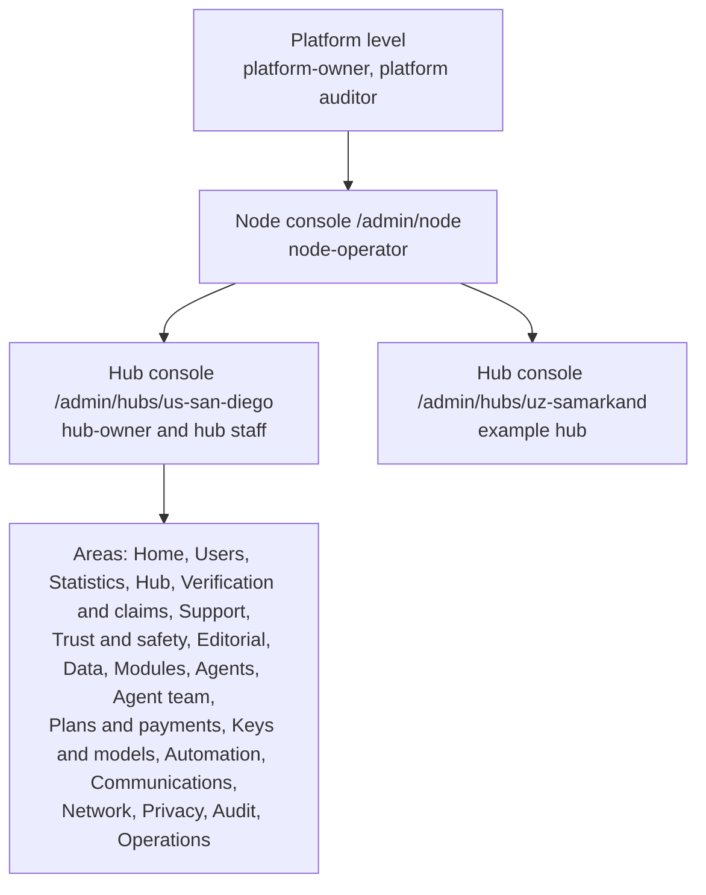
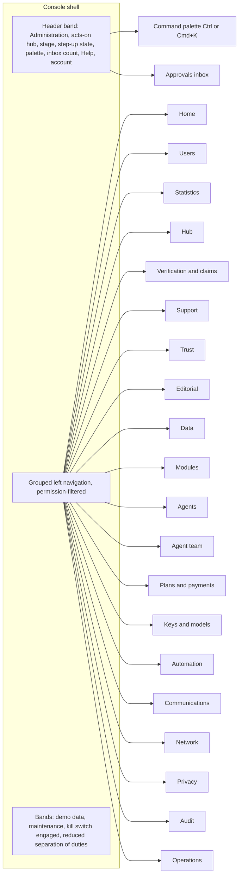
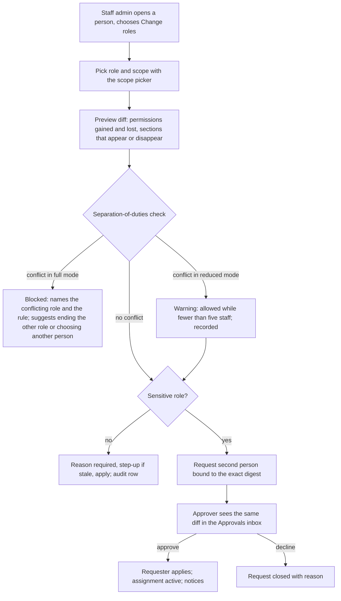
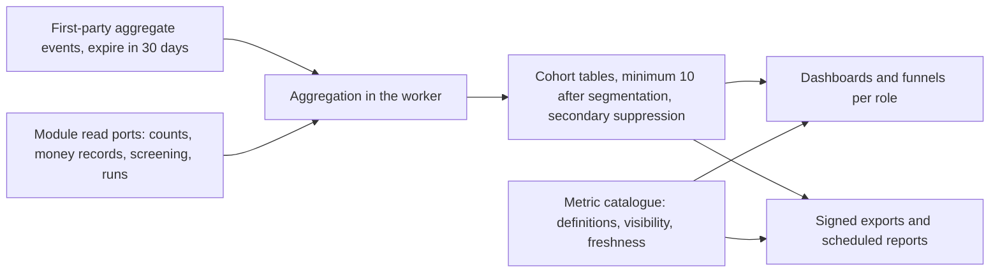
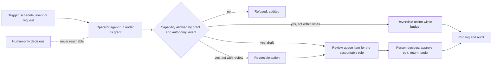

# Console design: one understandable console for users, permissions and the platform

Status: **Proposed** design (owner request of 2026-11-01, recorded below; ADR 010 decisions 20 to 26). Nothing in this chapter is implemented beyond what [the hub console](README.md) already labels **Live** (the ADM-001 and HUB-001 APIs) or **Demo** (the ADM-002 shell and milestone M1 on fixtures). Prototype: a clickable single-file prototype on synthetic data was made for the owner's review outside the repository; it is illustration, not a reference screenshot.

**Owner request (2026-11-01, translated):** "The admin console must be thought through completely and in detail. Make the whole interface understandable for users, following the best standards and modern approaches. There must be a system for managing users, permissions and the platform as a whole. Study which components, functions and so on it should have." The same day the owner added ADR 010 decision 26 (an internal team of operator agents) and asked for a complete editorial office, designed in its own chapter ([The editorial office](../editorial-office.md), with [Autonomous editorial office](autonomous-editorial.md) for the earlier pipeline design).

**Owner requirement (2026-11-01, translated):** the console must have mandatory, detailed sections for **statistics management** and **users management**, and an area for **communication and connections between hubs**. Statistics and users are designed in depth here ([section 7](#7-statistics-management) and [section 4](#4-users-management)); the hub network (world map and directory of hubs, peering settings, operator-to-operator channel, network statistics) is designed in its own chapter (`docs/engine/hub-network.md`, being written in parallel) and appears here as the **Network** area with a shared map component.

**How this chapter relates to the others.** The [README](README.md) keeps the section map, the permission table and the milestones; [screens](screens.md) keeps the per-screen contract (HC-xx, NC-xx, SW-x); [hub administration](../hub-administration.md) keeps the guard rails and the staff roles. This chapter is the **cross-cutting design** those documents did not yet have: the information architecture across platform, node and hub; the interaction model (navigation, search, command palette, approvals inbox, states, phone, dark mode, keyboard); user, staff and permission management end to end; the platform management areas including the new **Agent team**; the component inventory for `packages/ui`; the console's writing rules; and the mapping of every screen and component to work packages, with amended acceptance criteria and the few new packages that close real gaps. Where this chapter and an accepted decision differ, the decision wins and the difference is listed under [Escalations](#escalations-and-inconsistencies-found).

## Contents

1. [Research: what modern consoles and standards teach](#1-research-what-modern-consoles-and-standards-teach)
2. [Binding constraints](#2-binding-constraints)
3. [Information architecture](#3-information-architecture)
4. [Users management](#4-users-management)
5. [Permissions in the interface](#5-permissions-in-the-interface)
6. [Platform management](#6-platform-management)
7. [Statistics management](#7-statistics-management)
8. [The Agent team (ADR 010 decision 26)](#8-the-agent-team-adr-010-decision-26)
9. [Component inventory for packages/ui](#9-component-inventory-for-packagesui)
10. [Writing rules for the console](#10-writing-rules-for-the-console)
11. [Mapping to work packages](#11-mapping-to-work-packages)
11. [Escalations and inconsistencies found](#escalations-and-inconsistencies-found)
12. [Open questions for the owner](#open-questions-for-the-owner)

## 1. Research: what modern consoles and standards teach

Sources were read on 2026-10-31 and treated as data. We extract patterns, never branding, and we record where we deliberately depart from common practice.

### 1.1 Admin consoles studied

| Product | Pattern observed | What Trustwork takes | What Trustwork refuses |
|---|---|---|---|
| Microsoft Entra Privileged Identity Management | Roles are *eligible* rather than standing; a person activates a role for a limited time with justification, a second factor and optionally an approver; access reviews remove stale eligibility because activation alone never does ([deployment plan](https://learn.microsoft.com/en-us/entra/id-governance/privileged-identity-management/pim-deployment-plan), [configure PIM](https://learn.microsoft.com/en-us/training/modules/manage-authorization-microsoft-entra-id/15-configure-privileged-identity-management)) | Just-in-time elevation for sensitive roles, maximum activation length per role, justification, approval and recurring access reviews | Nothing |
| Okta admin role governance | Admin roles bundled with resource sets; requests go through approval sequences and are granted for a limited time; certification campaigns retain or revoke access and produce reports ([govern admin roles](https://help.okta.com/oie/en-us/Content/Topics/security/governance-admin-roles/govern-admin-roles.htm)) | Role plus scope as one requestable bundle; campaign-style access reviews with a retained or revoked outcome per assignment | Nothing |
| Google Workspace Admin console | Custom admin roles built from privileges; sensitive investigation and content privileges are separate and off by default; guidance to limit who can read audit logs and reports ([audit and investigation privileges](https://knowledge.workspace.google.com/admin/reports/admin-privileges-for-the-audit-and-investigation-tool), [admin privileges to protect user privacy](https://knowledge.workspace.google.com/admin/users/set-admin-privileges-to-protect-user-privacy)) | Separate permissions for reading audit and for reading content; content only under a case grant | Admins reading user content by privilege alone |
| GitHub sudo mode and enterprise audit | Sensitive actions require recent re-authentication for a window of a few hours; the audit log can be streamed to external storage ([sudo mode](https://docs.github.com/en/enterprise-server@3.17/authentication/keeping-your-account-and-data-secure/sudo-mode), [audit streaming](https://docs.github.com/en/enterprise-cloud@latest/admin/monitoring-activity-in-your-enterprise/reviewing-audit-logs-for-your-enterprise/streaming-the-audit-log-for-your-enterprise)) | A step-up prompt for high-risk actions, shorter than GitHub's window (ten minutes, as already designed); signed audit export | Nothing |
| Stripe Dashboard | Built-in roles, custom roles derived from a base role that can only remove permissions, and a security history of team activity that is filterable and exportable ([user roles](https://docs.stripe.com/get-started/account/teams/roles), [custom roles](https://docs.stripe.com/get-started/account/teams/custom-roles)) | If custom roles are ever allowed, they may only **narrow** a released role (subtractive custom roles); filterable, exportable audit | Custom roles that add permissions without review |
| Shopify admin | Staff permissions per area; collaborator access is requested by the outside party and granted by the owner or a person holding the "manage collaborator requests" permission ([collaborator permissions](https://help.shopify.com/manual/your-account/staff-accounts/collaborator-accounts)) | Access requested by the person who needs it, decided by someone else | Collaborators with broad standing access |
| Atlassian Administration | An overview showing user access requests and account security; a filterable, API-readable organization audit log ([navigate Atlassian Administration](https://support.atlassian.com/organization-administration/docs/explore-an-atlassian-organization/), [audit log activities](https://support.atlassian.com/security-and-access-policies/docs/accessing-audit-log-activities/)) | An overview that leads with requests waiting for a decision | Monthly-active-user style analytics about individuals |
| Linear | A command menu on Ctrl or Cmd+K that runs any action or opens any page by name, and a separate search for records ([navigating Linear](https://linear.app/enablement/guide/navigating-linear)) | A command palette for navigation and commands; record search kept distinct where privacy needs a case | Free-text search over participants' data from the palette |
| Vercel and Supabase | Team and project scoped roles; audit logs exportable (Vercel) or drained to external storage ([Vercel audit log](https://vercel.com/docs/audit-log), [Supabase platform audit logs](https://supabase.com/docs/guides/security/platform-audit-logs)) | Scope chosen at assignment time (our platform, node or hub) | Audit visible only to owners: Trustwork also gives a read-only auditor role |
| Discourse moderation | One consolidated review queue for flags, queued posts and users; resolutions that combine a decision and a penalty; recorded reasons ([moderation guide part 3](https://meta.discourse.org/t/discourse-moderation-guide-part-3-managing-content/406266), [part 2](https://meta.discourse.org/t/discourse-moderation-guide-part-2-managing-users/406265)) | One queue per decision type with a decision and its consequence in one step, reason required | Reputation-weighted automatic hiding that silences people before a person decides |

Common practice we **refuse everywhere**: "log in as user" or impersonation (offered by several support consoles), admins editing a customer's own settings, per-employee activity analytics, and silent standing super-administrators.

### 1.2 Standards and guidance

| Source | Requirement or advice | How the console applies it |
|---|---|---|
| WCAG 2.2 AA ([W3C](https://www.w3.org/TR/WCAG22/), [Deque summary](https://dequeuniversity.com/resources/wcag-2.2)) | New criteria: focus not obscured (2.4.11), dragging movements (2.5.7), target size minimum 24 by 24 CSS px (2.5.8), consistent help (3.2.6), redundant entry (3.3.7), accessible authentication (3.3.8) | Sticky bars never cover the focused row; reordering by buttons; 24 px minimum targets (44 px on phones by our own rule); Help in one place on every page; forms keep values already entered; step-up accepts passkeys, password managers and paste |
| WAI-ARIA Authoring Practices: grid ([APG grid](https://www.w3.org/WAI/ARIA/apg/patterns/grid/)), dialog, tabs and combobox patterns | A grid is one tab stop with arrow, Home, End, Page and Ctrl+Home navigation; use a grid when cells are interactive, a plain table otherwise | Read-only lists render as tables; only the permission matrix, the egress matrix and editable grids are ARIA grids; dialogs trap focus and return it; the command palette is a combobox with a listbox |
| Nielsen Norman Group: data tables ([four major user tasks](https://www.nngroup.com/articles/data-tables/)) | Users find records, compare, view or edit one row, and act on records; use a human-readable first column, visible active filters, a non-modal side panel for row detail, batch actions with select all | Data grid with a filter bar that shows active filters as removable chips, a detail drawer, and a bulk-action bar |
| Nielsen Norman Group: confirmation dialogs ([confirmation dialog](https://www.nngroup.com/articles/confirmation-dialog/)) | Confirm only serious, irreversible actions; specific wording; typed confirmation for the highest stakes; a different person for the most dangerous | Three tiers: undoable actions get no dialog, consequential ones a specific dialog, irreversible broad ones typed confirmation; second-person approval for the actions the contract lists |
| Nielsen Norman Group: dashboards ([preattentive dashboards](https://www.nngroup.com/articles/dashboards-preattentive/)) | Operational dashboards support time-sensitive action; analytical ones support later study; use position and length for quantity | Overview is operational (what needs a person now, each tile links to the fix); Statistics is analytical (cohort trends); bars for quantity, never colour alone |
| Carbon Design System data table ([usage](https://carbondesignsystem.com/components/data-table/usage/)) | A batch action bar replaces the toolbar when rows are selected; its height matches the row density | Bulk-action bar replaces the filter bar while rows are selected and announces the count |
| GOV.UK Design System ([error message](https://design-system.service.gov.uk/components/error-message)) | Say what went wrong and how to fix it; avoid "invalid"; use an error summary | The console error formula and an error summary at the top of forms |
| OWASP ASVS 5.0 chapter V8 ([authorization](https://raw.githubusercontent.com/OWASP/ASVS/v5.0.0/5.0/en/0x17-V8-Authorization.md)) | Document function, data and field level rules (8.1.1 to 8.1.4); enforce at a trusted layer (8.3.1); apply authorization changes immediately (8.3.2); decide on the originating consumer, not an intermediary (8.3.3); protect administrative interfaces with layered controls, not network location (8.4.2) | Permission table and field visibility matrix in this chapter; the database is the authority (ADM-001); revocation ends sessions, elevations and grants at once; operator agents act under their own grants with an accountable person, never as a staff member; elevated sessions with step-up |
| NIST SP 800-207 zero trust ([CSRC](https://csrc.nist.gov/pubs/sp/800/207/final)) | Per-session, least-privilege access decided for each request by a policy decision point | Elevation is per session and expires; case grants are per object and purpose; every request is checked again |
| GDPR Articles 5 and 25 ([Article 25 text](https://www.legislation.gov.uk/eur/2016/679/article/25), [EDPB guidelines 4/2019](https://gdpr-text.com/en/guidelines/pbd/)) | Data protection by design and by default: only data necessary for each purpose, limited in amount, extent, retention and accessibility | Allowlist projections; masked fields; purpose and expiry on every grant; cohort-only statistics; staff see the minimum their role needs |

Secondary summaries were used only to locate primary pages; claims above cite the primary page.

## 2. Binding constraints

These come from accepted decisions and are not relaxed anywhere in this design:

- **No impersonation, ever.** No route, control, API or agent acts as a participant ([support](support.md#why-there-is-no-impersonation-and-what-replaces-it)).
- **Policy, never a person's own agent.** Staff and operator agents never read or change a participant's agent, mandates, settings, goals, job subscriptions or conversations (ADR 010 decision 25).
- **No multi-company or workspace switching for participants**, and no hub switcher in the console header ([README](README.md#who-uses-it)).
- **Private data only under a case grant**: named objects, purpose, at most 72 hours, approved by a different person, every read logged.
- **No ranking controls**: nothing sets a score, rank, position, badge, weight or boost (`FORBIDDEN_CONTROL_WORDS`).
- **Second person** for every action in `CONSOLE_SECOND_PERSON_ACTIONS`; no self-approval; no self-granted role.
- **Human gates** (`HUMAN_GATES`) stay human at every automation level, including for operator agents.
- **Restricted places are never offered, hosted, served or federated**; the list is read-only.
- **Statistics are cohorts**: counts under ten are suppressed (`AGGREGATE_MIN_COHORT`); no per-person behaviour analytics, including about staff.
- **Languages**: seven engine languages (en, ru, uz-Latn, ka, hy, az-Latn, es); English is the reference; Russian is one interface language only; every string is a locale key.
- **No fake data**: fixtures are synthetic and labelled; the console never claims that a provider, register, backup or agent works before a test or drill proved it.

## 3. Information architecture

### 3.1 Three levels: platform, node, hub

The console uses the contract's three staff scopes (`StaffScopeSchema`): **platform** (every node of this installation; held by `platform-owner` and platform-scoped auditors), **node** (one installation: hubs on it, engine updates, backups, node keys; held by `node-operator`), and **hub** (one country or city hub: everything else). A person sees a level only if they hold a role at it.



Rules:

- **No level switcher in the header.** The node console lists its hubs; a hub console is reached from that list or a bookmark; a single-hub node opens straight into the hub. The header always names the one hub (or node) the page acts on ("This page acts on", `admin.hubBand.actsOn`).
- **Breadcrumbs carry the level**: `Node › Trustwork United States (demo) › Users › Roles and permissions › Support lead`. On phones the breadcrumb collapses to a back link naming the parent.
- **Platform-scoped people** use the node console of each node; a platform overview is not needed while an installation has one node (the common case) and is listed as a later option in [open questions](#open-questions-for-the-owner).

### 3.2 Navigation model

The left navigation is grouped by the job a person comes to do. Routes are those of the [section map](README.md#hub-console-section-map); the grouping changes in three places (**Users**, **Statistics** and **Network** become first-class areas) and new sections are marked **new**. Moving a section between groups never changes its route.

| Group | Sections | Notes |
|---|---|---|
| Home | Overview, **Approvals inbox** (new route `/inbox`; the existing Approvals screen becomes its "Waiting for me" tab), Help | Overview is operational |
| **Users** (new first-class area) | People, Companies (from Participants), Staff, **Roles and permissions** (new), **Invitations** (new), **Access reviews** (new), **Service accounts and AI clients** (new), Conflicts (from "Staff and audit") | Every kind of user in one place ([section 4](#4-users-management)); participant servicing still happens in Support, inside a case |
| **Statistics** (new first-class area) | **Dashboards**, **Metric catalogue**, **Segments and funnels**, **Reports and exports**, **Access and retention** (all new, `/statistics/...`) | Analytical cohorts only ([section 7](#7-statistics-management)) |
| Hub | Identity and territory, System modes, Modules, Legal and operator, Residency, Country base, Taxonomy, Launch checklist | Unchanged |
| Verification and claims (the rest of Participants) | Claims, Verification, Credentials, Consents | Decisions with evidence |
| Support | Lookup, Account card, Company card, Cases, Recovery, Access explainer | Case-first; every lookup logged |
| Trust and safety | Moderation, Disputes, Reputation methods, Appeals, Screening, Confirmations | One queue per decision type |
| Editorial | Desk, Sources, Discovery, Pipelines, Review, Calendar, Publications, Magazine, Translations, Policy | First-class area; designed in depth in [The editorial office](../editorial-office.md) (screens HC-170 … HC-191) and [Autonomous editorial office](autonomous-editorial.md); this chapter only defines the shared components it uses |
| Data | Datasets, Import batches, Links, Knowledge, Recommendations | Unchanged |
| Modules | Projects, Planner, Marketplace, Shared knowledge, Events, Learning, Matching, Commerce, Procurement | Unchanged |
| Agents | Agent modules, Agent policy, Extensions, External agents, Usage, Abuse | The participants' agent **product** (policy for everyone) |
| **Agent team** (new) | Roster, Roles, Grants, Runs, Review queue, Budgets, Evaluations | The hub operator's own internal agents ([section 8](#8-the-agent-team-adr-010-decision-26)); the editorial agents appear here and in Editorial |
| Plans and payments | Offers and plans, Prices, Invoices, Payouts, Credits and refunds, Tax | Fees and commissions are price versions |
| Keys and models | Providers, Model catalogue, Routing, Egress, Spending caps, Usage and costs, Kill switches | ADR 010 decision 25 |
| Automation | Schedules, Runs, Alerts | Shared run history pattern |
| Communications | Senders, Templates, Deliverability, Announcements | Unchanged |
| **Network** (new first-class area, replaces Federation) | **Hub map and directory**, Peers and peering, **Operator channel**, Licences, Tombstones, Incoming links, **Network statistics** | Designed in `docs/engine/hub-network.md` (in progress) and [Federation](../federation.md); this chapter defines only the shared map component ([section 9](#9-component-inventory-for-packagesui)) |
| Privacy | Requests, Retention and holds, Settings, Breaches | Unchanged |
| Audit (split from "Staff and audit") | Audit explorer, Access log, Chain verification, Exports | Auditors land here directly; read-only except export and verify |
| Operations | Health, Jobs, Flags, Maintenance, Incidents, Locales, Accessibility | Unchanged |



Behaviour (extends [navigation behaviour](README.md#navigation-behaviour)):

- Groups and sections without a read permission are absent; a direct address renders the denied state with the role that grants it; a private object without a grant is **not found**.
- Attention counts on navigation items count only work the viewer may act on, as text ("Claims, 4 waiting") inside the link's accessible name; the visual badge is decorative (`Badge` is `aria-hidden`).
- The current section is `aria-current="page"`; groups are disclosure buttons that remember their state per person (a personal preference, not shared).
- The navigation can be collapsed to icons on desktop; icons always have visible labels on hover and focus and accessible names.

### 3.3 Page anatomy

Every page has the same five parts, top to bottom: **acts-on line** (hub or node name and stage), **title row** (`h1`, status label Live / Demo / Contract / Designed / Proposed, primary action at most one, a "More" menu for secondary actions), **lede** (one sentence saying what the page is for), **filter bar or tabs**, **content**. Object pages (a staff member, a role, a case, a configuration version, an incident, an agent) add tabs: **Overview**, **Activity** (the object's audit trail), **Related**. Rule for drawers versus pages: a row's detail opens in a non-modal **detail drawer** when the person is working through a list (queues, triage, review); it opens as a **page** when the object has its own lifecycle or will be linked to (cases, incidents, roles, versions). The drawer has an "Open as page" link and its own address so it can be shared with a colleague who has access.

### 3.4 Command palette and global search

Opened by Ctrl+K or Cmd+K, or the search field in the band. It is a combobox with a grouped listbox (APG combobox pattern):

| Input | Results | Privacy rule |
|---|---|---|
| Plain words | Sections ("Kill switches"), commands ("Engage a kill switch", "Invite a staff member"), help articles | Only sections and commands the viewer holds; nothing about participants |
| `#` and an id or request id | The object with that id: approval, configuration version, incident, case, run, audit event, flag, staff member | Object shown only if the viewer may read it; otherwise "Nothing found" (identical wording either way) |
| `@` and a name | Staff members of this hub | Staff directory visibility rules (`admin.staff.read`) |
| `>` and a command | Commands only | Commands that need a reason or a second person open their form; nothing runs from the palette directly |

**Participants are never searched from the palette.** Typing an e-mail or a person's name offers one result, "Look up a participant in Support", which opens [Lookup](screens.md#hc-30-lookup--support) where the person must name or create the case the lookup serves and the lookup is written to the access log. This keeps the palette fast and free of personal data, and keeps every participant lookup purposeful and logged. Recent palette entries are stored per staff member on their own device only and never include participant data.

### 3.5 Approvals inbox

The approvals inbox (`/inbox`) is the staff member's list of **decisions and work assigned to them**. It is a typed work list, not a message inbox: every row is a structured object with a state and a link, there are no free-form messages, and nothing in it is a participant's correspondence. It replaces the separate places a staff member would otherwise have to check.

| Tab | Rows | Actions |
|---|---|---|
| Waiting for me | Second-person approvals I may decide; case-grant requests I may approve; recovery escalations I may approve; access-review items assigned to me; Agent team review items for my roles | Open, approve, decline with reason, ask a question in the request thread |
| My requests | Approvals, grants and elevation requests I made, with state and expiry | Withdraw; execute an approved action (only the requester executes, `approvalBindsAction`) |
| Assigned to me | Support cases, moderation cases, appeals, incidents I am on, alerts I own | Open |
| Done | My decisions of the last 90 days | Open |

Each row shows: what (action name in plain words), scope (hub), who asked and why, the exact change (a short diff summary; the full diff on open), expiry as relative and absolute time, and the reason the row is mine ("You hold Commercial admin at this hub"). The inbox count in the band counts "Waiting for me" only.

**Notifications.** In-console counts always; e-mail opt-in per category; a future push channel for phones (incidents and approvals only). Notifications carry identifiers and the action name, never private values or participant data (matching the ADM-001 outbox intents). A staff member can set quiet hours; incident pages for an on-call rota are an operations integration, not a console feature.

### 3.6 States

The [default states](screens.md#conventions-for-every-screen) apply everywhere (loading, empty, error, denied, offline, stale, demo). This design adds:

| State | Pattern |
|---|---|
| Not found (private object without a grant) | Same page and wording as a missing object: "We could not find this. It may not exist, or you may need a case access grant." The second clause appears only on routes where grants exist |
| Step-up required | Inline `StepUpPrompt` above the action, not a full-page interruption; the form keeps its input |
| Pending second person | The object shows a "Waiting for a second person" banner with the request, its expiry and who may approve (roles, not names, when the viewer cannot read the staff directory) |
| Kill switch engaged | A band under the header on every page, naming the switch, who engaged it and when, linking to the incident |
| Reduced separation of duties | A permanent note on Overview and Staff: "Fewer than five staff: only 'actor is not approver' is enforced. Add staff to enable full separation of duties." |
| Partial failure | The page renders what loaded; failed panels show their own error with the request id and Retry |
| Long operation | Progress with what is happening, what the person can do meanwhile, and that it continues if they leave |

Empty states teach: what fills the screen, why it is empty, and the one link that starts it.

### 3.7 Phone and tablet

Breakpoints follow the design system: phone below 768 px, tablet 768 to 1279 px, desktop from 1280 px. At 375 px the console is fully usable for: the approvals inbox (approve and decline with a diff shown as a list of changed fields), incidents, engaging a kill switch, requesting a kill-switch release, step-up, support cases, queue triage and run history. Rules: the navigation becomes a full-height sheet; tables become cards showing the human-readable identifier and two key fields with "Details"; primary actions sit in a bottom action bar that never covers the focused element (WCAG 2.4.11); drawers become full-screen sheets; targets are at least 44 by 44 px on phones; complex editors (egress matrix, permission matrix, step lists, template trees, calendar grid) say "More comfortable on a wide screen" (`admin.common.wideScreenNote`) and remain operable as lists.

### 3.8 Dark mode

The design system is light-only today ([tokens](../../design/system/tokens.md)). The console offers **system**, **light** and **dark**, defaulting to system (`prefers-color-scheme`), stored as a personal preference. Dark mode is a second token set with the same custom-property names under `[data-theme="dark"]`, delivered by the new package DS-004. Requirements: every text and status token keeps at least 4.5:1 (3:1 for large text and control boundaries) in both themes, verified by the existing token contrast unit test extended to the dark set; status is never colour alone (text and icon always present); focus ring at least 3:1 on every dark surface; the header band stays distinct from page content in both themes so staff always know they are in the console; screenshots and charts are checked in both themes.

### 3.9 Keyboard

- **Order**: skip link, band, navigation, page heading, filters, content; after navigation focus moves to the page `h1`; after a mutation focus goes to the toast and then back to the changed row.
- **Shortcuts** (listed on the Help page and in the palette next to each command): Ctrl or Cmd+K palette; `/` focus the current page's filter; `?` keyboard help; `g` then `o` Overview, `g` then `i` inbox, `g` then `a` Audit; in lists `j` and `k` move between rows, `x` selects a row, Enter opens the drawer, Escape closes it. Single-character shortcuts can be switched off or remapped per person (WCAG 2.1.4) and never fire inside text fields.
- **No drag-only interaction**: ordering uses move up and move down buttons with live announcements (WCAG 2.5.7).
- **Grids**: only interactive matrices are ARIA grids; everything else is a table with normal tab order.

## 4. Users management

**Users** is a mandatory first-class area. It covers every kind of user the hub has, each with the controls that fit it:

| Kind | Section | What staff can do | What staff can never do |
|---|---|---|---|
| Participants: people | Users → People (public projection, account states, verification and consent problems as counts); servicing through Support | Find, see public data, open the account card inside a case, apply servicing actions, open data rights requests, decide claims, moderation and appeals in their own sections | Sign in as the person, read private objects without a case grant, manage the person's agent, mandates or settings |
| Participants: companies | Users → Companies | Claim and verification state, representative state and accountable person, register re-checks | Act for the company, see its private projects, RFQs, quotes or budgets without a case grant |
| Staff | Users → Staff, Roles and permissions, Invitations, Access reviews, Conflicts | Invite, assign and revoke roles at a scope, time-boxed and just-in-time roles, second-person approvals, offboarding, recertification | Grant themselves a role, approve their own request, see staff activity or productivity analytics |
| Service accounts and AI clients | Users → Service accounts and AI clients | See system principals, staff members' admin MCP clients, operator agents (with links to Agent team), counts of participants' connected AI clients | Create a free-standing credential with staff authority, list participants' connected clients outside a case grant |

The Users area home shows four tabs with counts (People, Companies, Staff, Clients), a filter bar and saved views; every row opens the right place for that kind of user (the account card through a case for participants, the staff page for staff, the client page for clients). People and Companies rows show the public projection only.

### 4.1 Participants: people and companies

Participants are people and companies. Staff reach them in two ways, deliberately separate:

1. **Directories** (Participants → People, Companies): the **public projection** only, plus counts by state, claim and verification queues. No private field appears; nothing here needs a case.
2. **Support** (Lookup → Account card or Company card): an **allowlist projection** for servicing, opened only inside a support case; each lookup and each card view is an access-log entry naming the case.

#### The participant card

The account card ([HC-31](screens.md#hc-31-account-card--supportaccountsperson)) is the participant's single page for staff. It is a set of panels, each shown only to the roles that need it. A panel the viewer may not see is **absent**, not greyed, so its existence is not disclosed.

| Panel | Contents | Support agent | Support lead | Trust reviewer | Moderator | Compliance officer | Privacy officer | Auditor |
|---|---|---|---|---|---|---|---|---|
| Identity and state | Display name, masked e-mail and verified flag, account state, second-factor enrolment (count only), session count, recovery state | Yes | Yes | Yes | Yes | Yes | Yes | Logged views only |
| Employment | Employer and role as public membership data | Yes | Yes | Yes | Yes | Yes | Yes | No |
| Verification and claims | Claim and verification state with evidence categories, never documents | Summary | Summary | Full under the claim review grant | No | Summary | No | No |
| Compliance | Screening status, list matches, jurisdiction holds | Only "Restricted: contact the compliance officer" when an active hold blocks servicing, and only where the hub's legal settings allow saying so | Same as support agent | No | No | Full | No | No |
| Support cases | Cases with state, assignee, grants and their access log | Own and team cases | All | No | No | No | Linked to requests | Counts |
| Moderation history | Reports about the person's content, decisions, sanctions on the ladder with level and end date | Counts | Summary | No | Full | No | No | No |
| Appeals | Appeals filed by the person and their outcomes | Counts | Summary | Own area | Own area | Own area | No | No |
| Data rights requests | Access, export, correction, deletion, opt-out and objection requests with deadlines | Open a request | Open a request | No | No | No | Full | No |
| Consents | Kind, version, given or withdrawn, date | Yes | Yes | No | No | No | Yes | No |
| Who viewed this record | Access-log entries for this person: role, case, purpose, time | No | No | No | No | No | Yes | Yes |

"Own area" means the appeals against decisions of that role's domain. The compliance rule follows ADR 014: the subject and other staff learn only what the law allows; the matched list entry and the names compared are visible only to the compliance role under the review case (SANC-006).

**Every view is logged.** Opening a card, expanding a panel that reads beyond the allowlist, and every read under a grant write an access-log entry (`AccessLogEntrySchema`) with the case. Where the hub's policy says so, the person sees in their own privacy page that support viewed their record, when and why.

#### Account recovery without impersonation

Recovery changes how someone signs in, so it takes evidence, a second person and time for the real owner to object ([support](support.md#servicing-actions)). The console shows the 72-hour cooling-off as a timeline with each notification sent and a prominent "Cancel" for any objection; an objection from the account owner cancels automatically. Other servicing actions (resend verification, unlock, revoke sessions, require password reset, guided task) are single-person actions with a reason. The replacements for impersonation (public projection preview, access explainer, diagnostic snapshot, guided task, case grant, demo reproduction, the person's own agent) appear as buttons on the card so support never looks for a "log in as" that does not exist.

#### Case access grant

```mermaid
sequenceDiagram
  autonumber
  actor A as Support agent
  participant C as Console
  participant API as Platform admin API
  actor L as Support lead
  participant P as Participant
  A->>C: Open case, choose "Request access to named objects"
  C->>A: Form: objects (up to 100 ids of one type), projection class, purpose, expiry up to 72 h, reason
  A->>API: Request case grant (idempotency key, digest of the request)
  API-->>L: Approvals inbox item: objects, purpose, expiry, requester
  L->>C: Open item, review digest, step-up if older than 10 min
  L->>API: Approve restating the digest (different person; conflicts checked)
  API-->>A: Grant active until expiry
  A->>API: Read objects through the staff_case projection
  API->>API: Write one access-log entry per read
  API-->>P: Where policy says so, "Support viewed your RFQ for case 123"
  Note over API: Expiry or revocation: objects are not found again
```

Approval of one's own request is impossible ("You cannot approve your own request", `admin.approvals.ownRequest`); excluded field classes (`negotiation_private`, `credentials`, `payment_refs`) never appear even under a grant.

#### Sanctions, appeals and other decisions about participants

Moderation sanctions use the ladder of ADM-001 (levels 1 and 2 by moderators within bounded durations, level 3 by other roles, level 4 only with a second person); screening holds and matches follow ADR 014 (a possible match never auto-blocks or auto-clears; "not the same person" needs a second person); appeals are decided by someone other than the original decider. The card shows each decision as a timeline entry with clause, decider role, reason category and appeal state; the person's own view (`/v1/moderation/me`) never shows staff identities.

### 4.2 Staff

#### Staff directory

Columns: name, roles with scope (chips "Support lead · hub"), second factor (enrolled or missing, text), elevation (active until, or none), break-glass (active, with incident), declared conflicts (count), last role change. There is **no** activity, productivity or "last seen" analytics column (no surveillance of employees). Filters: role, scope, state (active, invited, suspended, offboarding), second factor missing. Bulk actions: none that change roles in bulk; "Start access review for selected" is the only bulk action, because role changes are individual decisions.

#### Invitation with approval

```mermaid
sequenceDiagram
  autonumber
  actor S as Staff admin
  participant C as Console
  participant API as Platform admin API
  actor O as Hub owner (second person)
  actor I as Invitee
  S->>C: Invite: e-mail, role, scope (hub), optional end date, reason
  C->>C: Preview: permissions granted, second-person need, SoD conflicts with the invitee's other roles
  S->>API: Create invitation (expires in 7 days)
  alt Sensitive role (hub-owner, staff-admin, commercial-admin, privacy-officer, compliance-officer, node-operator, platform-owner)
    API-->>O: Approvals inbox: staff.assign_sensitive_role with the exact digest
    O->>API: Approve (different from grantor and invitee)
  end
  API-->>I: Invitation e-mail (identifiers only)
  I->>C: Sign in, verify e-mail, enrol second factor, accept staff terms, declare employer and conflicts
  C->>API: Accept invitation
  API->>API: Assignment created; audit row; notices
  API-->>S: Inbox: "Invitation accepted"
```

Nobody invites or assigns themselves; an invitation for a sensitive role cannot be accepted before the approval exists; an invitation expires unused after seven days (proposal) and can be revoked.

#### Time-boxed roles and just-in-time elevation

Two different mechanisms, both visible on the staff page:

- **Elevated session** (already designed): the console itself opens only after step-up; it expires after inactivity (30 minutes proposed) and on closing the browser.
- **Just-in-time role**: a sensitive role may be held as **eligible** rather than active. The person activates it for a bounded time (default 4 hours, maximum per role, at most 12 hours like break-glass) with a reason; activation needs a second person for sensitive roles, a fresh second factor always. Break-glass is the incident-only variant with an incident reference.

```mermaid
sequenceDiagram
  autonumber
  actor E as Eligible staff member
  participant C as Console
  participant API as Platform admin API
  actor A as Approver
  E->>C: "Activate Commercial admin" (eligible role)
  C->>E: Duration (up to the role maximum), reason, step-up
  E->>API: Request activation (digest of role, scope, window)
  API-->>A: Approvals inbox item
  A->>API: Approve (different person, holds an executing permission)
  API->>API: Assignment active from now until the window ends
  API-->>E: Toast and band: "Commercial admin active until 15:40"
  Note over API: At the end of the window the role stops; open forms that need it refuse with "Your Commercial admin role has ended"
```

Assignments with an end date (`validUntil`) are the simplest form: contractors and temporary cover get roles that end by themselves.

#### Separation of duties, conflicts and offboarding

- **Separation of duties** is shown on every role and assignment: conflicting roles (`sodConflicts`), the hub's mode (reduced below five staff, full from five) and, in full mode, the rule that an approver acts through a role the requester does not hold for that action.
- **Conflicts of interest**: staff declare employer and other interests at acceptance and any time later; the console routes claims, disputes, moderation, support cases and appeals about their own company or close relations to someone else and shows the reason "Routed to another reviewer because of a declared conflict" without naming the conflict to others.
- **Offboarding** is one guided flow: revoke every role (ends elevations, eligible roles and pending approvals at once, as ADM-001 already enforces), revoke the person's admin clients, reassign their open cases, review items and incidents (the flow lists each with a suggested assignee chosen by role, never automatically by workload), and record the reason. Past actions stay attributed.

#### Access reviews

Recurring reviews keep standing access small. Default cadence (proposal): sensitive roles every 90 days, other roles every 180 days, break-glass and just-in-time activations after each use. Each campaign lists assignments; a reviewer who is not the holder marks each **keep** or **remove** with a reason; unanswered items at the deadline are escalated to the hub owner, never removed silently (removal is a decision). The campaign report shows counts kept and removed and is exported to the audit. A role's last use date is shown in the review only as an access-hygiene fact (whether any permission of that role was used in the period), never as a measure of a person's work; whether even this is acceptable is an [open question](#open-questions-for-the-owner).

### 4.3 Service accounts, API and MCP clients

Trustwork has no free-standing "service account" with staff authority. Every non-human actor is one of four kinds, each shown in Users → Service accounts and AI clients:

| Kind | What it is | Accountable human | Where managed |
|---|---|---|---|
| System principals | The worker, scheduler and outbox relay defined in code with fixed duties | The node operator | Read-only list with their duties; no console can widen them |
| Admin MCP clients | A staff member's AI chat connected to `/mcp/admin` (off by default, MCP-060), drafts and summaries only, every decision in the console | The staff member who connected it | Each staff member sees and revokes their own; a staff admin sees counts per person and revokes all of an offboarded person's clients |
| Operator agents | The hub's internal agent team ([section 8](#8-the-agent-team-adr-010-decision-26)) acting under operator grants | The role owner named on each agent role | Agent team area |
| Participants' external agents | MCP and A2A clients that participants connect to their own accounts | The participant | Never listed individually to staff; counts and policy only (HC-82); a list only under a case grant |

Outbound credentials (models, payments, e-mail, registers) are **provider connections**, not accounts, and live in Keys and models with write-only secrets. Configuration as code (for operators who keep hub settings in a repository) is designed as export and import of **drafts**: an import creates draft configuration versions that a person activates, so no token can activate anything by itself.

## 5. Permissions in the interface

### 5.1 Role catalogue

Users → Roles and permissions lists every released role definition (`ScopedStaffRoleDefinitionSchema`) with: plain-language summary ("Decides support cases and approves case access grants"), scopes where it can be held, sensitive or not, conflicting roles, caps (credit cap, maximum grant hours), number of holders at this scope, definition version and release date. Two roles the editorial office needs are not yet in the contract: the editorial chapter proposes `translator-reviewer` (scoped per language) and `legal-reviewer` through TRN-001 ([editorial roles](../editorial-office.md)); until that contract change lands, the **legal reviewer** duty is held by `compliance-officer` and the **translator / reviewer** duty by `editor` with translation review (see [escalations](#escalations-and-inconsistencies-found)).

### 5.2 Permission matrix

The role page shows a **permission matrix**: rows are permission domains (`admin.<domain>`) expanded to their actions, columns are the role and, optionally, up to three roles for comparison. Each cell says in text "Allowed", "Not allowed", "Allowed, second person needed" or "Node only" and has an explanation on focus. It is an ARIA grid (one tab stop, arrow keys) because cells open explanations; on phones it becomes a list per domain. Permissions are written in plain words with the code beneath ("Approve case access grants", `admin.support.grant.approve`).

Role definitions are released versions. Editing a hub's role definition (where the hub is allowed to) creates a new version with a diff and needs a second person; a hub can only **narrow** an engine role (subtractive), never add a permission the engine definition lacks, and node-only permissions are never offered at hub scope.

### 5.3 Scope picker

Choosing where a role applies is a three-step choice that mirrors `StaffScopeSchema`: Platform, a node, or a hub (with the hubs the assigning person may act on). Scopes a role cannot be held at (`ROLE_SCOPES`) are not offered, with the reason shown ("Hub owner is held at one hub").

### 5.4 "What can this person do"

Every staff page has an **effective access** view: for a chosen scope, the permissions the person holds now, grouped by section, each with the role that grants it, permissions held only through break-glass or a just-in-time activation marked with their end time, eligible roles not active, and second-person actions they could request or approve. A second view answers the reverse question for a section: "Who can approve price activations at this hub?" (roles, and names only for viewers allowed to read the staff directory).

### 5.5 Role change with diff, separation-of-duties check and approval



The diff is authoritative: the API recomputes it and refuses if the person's roles changed since the preview ("The roles changed since you opened this; review the new difference").

### 5.6 Guard rails shown as locked

Each area that is adjacent to a non-switchable rule shows it as a **locked row**: a lock icon with the text "Locked by the engine" (the same wording as the editorial office, `admin.editorial.locked`; never colour or icon alone), a one-sentence explanation, and a link to the decision. There is no control, not even a disabled one, so nobody wonders whether it can be unlocked with more privilege.

| Locked rule | Shown in | Explanation text (English reference) | Source |
|---|---|---|---|
| No impersonation | Support, Users | "Staff never sign in as a participant. Use the access explainer, a diagnostic snapshot, a guided task or a case grant." | [support](support.md#why-there-is-no-impersonation-and-what-replaces-it) |
| Private data only under a case grant | Support, Audit | "Private data is visible only for named objects, for a stated purpose, for up to 72 hours, after a second person approves." | [hub administration](../hub-administration.md#guard-rails-that-no-console-can-switch-off) |
| No ranking controls | Participants, Trust, Agents, Plans and payments | "No setting changes a score, a position or a badge. Reputation changes only through evidence decisions and method releases." | same |
| Payment neutrality | Plans and payments, Agents, Keys and models | "No price, plan, credit or commission changes ranking, matching, recommendations or reputation." | ADR 010 decisions 21 and 25 |
| Mandates and the person's confirmation | Agents, Agent team | "Agents commit only under a confirmed mandate, within a budget, with the person's confirmation." | ADR 010 decisions 23 and 25 |
| Sanctions gates and baseline lists | Trust and safety, Plans and payments | "Baseline screening cannot be switched off; money and commitments wait while a match is open." | ADR 010 decision 24, [ADR 014](../../adr/014-sanctions-compliance-engine.md) |
| Restricted places | Hub identity, Keys and models, Network, node console | "These places are never offered, hosted, served or federated. The list is part of the engine." | ADR 014 decision 2 |
| No per-person agent management by staff | Agents, Support | "Administrators set policy for everyone and never read or change one participant's agent, mandates, settings or connections." | ADR 010 decision 25 |
| Human gates | Editorial, Data, Trust, Plans and payments, Agent team | "Publishing, activating sources and datasets, claim and link decisions, sanctions and price activation are decided by people." | `HUMAN_GATES` |
| Cohort statistics | Statistics, Usage, Agent team | "Counts under ten are shown as fewer than 10, and no screen shows one person's behaviour." | `AGGREGATE_MIN_COHORT` |
| Trustwork never holds money | Plans and payments | "Charges, credits, refunds and payouts go only through the hub's licensed payment provider." | ADR 010 decision 20 |

## 6. Platform management

Each area below names its screens (existing ids from [screens](screens.md)), what this design adds, and the owning packages (section 11 lists them all).

| Area | Screens | What this design adds |
|---|---|---|
| Hubs and territories | NC-01, NC-02, HC-10 | Hub list as a data grid with stage, languages, staff count; creating a hub reuses the wizard steps; closing a hub is typed confirmation plus a second person |
| Configuration versions | Every settings screen; `VersionHistory`, `ConfigDiff` | One versioning pattern for all 25 domains; diff, approval and rollback as below |
| Launch gates | HC-17 | Gates as a checklist with evidence, owner role and invalidation reason; no waiver control exists |
| Legal documents | HC-13 | Per language completeness; counsel approval record before activation; the legal reviewer is the compliance officer |
| Modules and capabilities | HC-12, HC-80 | Dependencies shown as plain sentences ("Expert marketplace needs Project planner and Billing") |
| Agent product | HC-80 to HC-85 | Effect preview before activation (cohort-suppressed counts); capability switches per participant type and plan |
| Models and prices (ADR 010 decision 25) | HC-100 to HC-106, HC-91 | One "Models and prices" overview joining catalogue, routes, cost beside sale price, margin, evaluation state and kill switches, with the locked guard-rails panel |
| Billing and commissions | HC-90 to HC-95, HC-62 | Fee versions with effective date and public disclosure; activation by a second person |
| Feature flags with staged rollout | HC-162 | Stages and expiry, below |
| Integrations and keys | HC-100, HC-120 | Write-only secrets; connection tests; non-fake enabling needs a second person |
| Content and editorial | HC-40 to HC-49 | Shared components only here; the area is designed in [The editorial office](../editorial-office.md) |
| Trust and safety queues | HC-22, HC-70 to HC-75 | One queue pattern: drawer, decision with consequence, reason, appeal routing |
| Sanctions and compliance | HC-74, participant compliance panel | Role-restricted visibility (section 4.1) |
| Privacy operations | HC-140 to HC-143 | Deadlines as text and relative time; erasure is typed confirmation plus a second person |
| Network (communication and connections between hubs) | HC-130 to HC-133 and the hub network screens | World map and directory of hubs, peering settings, the operator-to-operator channel and network statistics, designed in `docs/engine/hub-network.md`; raising a peering level shows exactly what new data classes would flow; restricted places never appear on the map or in the directory |
| Operations | HC-160 to HC-166, NC-05 to NC-08 | Incident flow with kill switch and step-up, below |
| Audit log explorer | HC-153 | Saved views, request-id search, denied attempts, chain verification, signed export |
| Statistics management | **HC-210 to HC-215** (new) | [Section 7](#7-statistics-management) |
| Agent team | **HC-200 to HC-206** (new) | [Section 8](#8-the-agent-team-adr-010-decision-26) |

### 6.1 Configuration change with diff, second person and rollback

```mermaid
sequenceDiagram
  autonumber
  actor D as Drafter (for example Compliance officer)
  participant C as Console
  participant API as Hubs API
  actor A as Second person
  D->>C: Edit settings of a domain (for example egress)
  C->>API: Save draft version N+1 with reason
  C->>D: Diff against active version N: field, old value, new value, plain-language effect
  D->>API: Request activation with effective date (never back-dated)
  alt Sensitive domain (legal, residency, providers, egress, federation, agents, agent_extensions, jurisdiction, payments, privacy)
    API-->>A: Approvals inbox: digest of version N+1
    A->>C: Review the same diff; step-up if stale
    A->>API: Approve (activator is not the drafter)
  end
  API->>API: Version N+1 active, N superseded; audit row with both digests
  Note over D,API: Rollback = draft N+2 with the payload of N, then the same activation path. No version is edited in place.
  Note over API: If anyone changes the draft after approval, the digest differs and the approval is void
```

The diff viewer shows changed fields only by default with "Show unchanged"; values that are references (secrets, documents) show their fingerprint or version, never content; lists show added and removed items; every change has a plain-language line generated from the domain's labels ("Private project data may now be sent to Example Models Inc. in the United States").

### 6.2 Feature flags with staged rollout

Flags (ADM-001: owner, scope, expiry up to 400 days; never access, never ranking) gain **rollout stages**: Off → Staff only → A share of sessions (deterministic buckets of 1, 5, 25 or 50 percent, chosen per hub; no targeting by person attributes beyond hub, language and participant type) → On. Turning a flag off is immediate and single-person; widening a stage needs a reason; every flag shows its expiry and its declared scope, and the registry refuses flags whose scope touches authorization, projections, egress or ranking. Expired flags are listed for removal from code.

### 6.3 Incident, kill switch and step-up

```mermaid
sequenceDiagram
  autonumber
  actor O as Ops engineer (on a phone)
  participant C as Console
  participant API as API
  actor H as Hub owner
  O->>C: Health tile red: "Agent dispatch errors above threshold"
  O->>C: Open incident from the tile (title, severity, what is known)
  O->>C: Engage kill switch "Agent dispatch, this hub"
  C->>O: Step-up prompt (second factor within 10 minutes)
  O->>API: Engage with reason (one person, immediate)
  API-->>C: Band on every page: "Agent dispatch stopped by Ops engineer at 14:02"
  O->>C: Link switch, holds and break-glass (if any) to the incident; timeline entries
  O->>API: When fixed: request release with incident note
  API-->>H: Approvals inbox: kill_switch.release
  H->>API: Approve (different person)
  API->>API: Switch released; queued work resumes; post-incident review becomes required
```

Engaging is fast on purpose (one tap plus reason and a fresh factor); releasing is slow on purpose (a second person and an incident note). Node-wide switches follow the same flow in the node console.

### 6.4 Audit log explorer

A data grid over the mutation audit and the access log with: filters by actor, role, permission, action, object, scope, outcome (applied, denied, failed), time; full-text search on request id and object id; saved views ("Denied attempts this week", "Second-person actions", "Break-glass actions"); a detail drawer showing actor, role, permission, elevation, case, approver and approval digest, before and after digests (never payloads), reason; chain verification with a clear result ("No gaps in 18,422 events" or "Sequence gap after event 18,401"); signed export through the allowlist, itself audited. Auditors and the hub owner see everything at their scope; other staff see their own actions.

### 6.5 Statistics

Analytics without surveillance is now a first-class area: see [section 7](#7-statistics-management).

## 7. Statistics management

**Statistics** is a mandatory area of the hub console (owner requirement of 2026-11-01). It answers "is the hub working, for whom, and at what cost" with cohort aggregates, and nothing in it describes a person. The backend is ANL-001 ([Analytics module](../modules/analytics.md)); agent product usage comes from AGT-004, agent team runs from AGT-030, money records from BILL-002 and BILL-003, screening counts from the SANC packages, and every module contributes aggregates through its own read port. The Overview stays operational (what needs a person now); Statistics is analytical (trends and comparisons).

### 7.1 Principles

1. **Cohorts only.** Every count about participants is at least ten (`AGGREGATE_MIN_COHORT`) **after** segmentation; smaller cells show "fewer than 10". **Secondary suppression** hides another cell whenever a total, a difference between periods or a sibling segment would reveal a suppressed value.
2. **No person, no staff member.** No statistic, filter, export or drill-down leads to one participant or one staff member; there is no per-staff productivity view, even aggregated per staff member.
3. **Every number has a definition.** Each metric comes from the metric catalogue with its formula, source, method, freshness and owner; charts link to the definition.
4. **Honest numbers.** Demo hubs show synthetic numbers labelled as such; no estimated or invented readership or traffic is ever shown; a metric whose source is not live shows its status label (Live, Demo, Proposed) instead of a number.
5. **First-party only.** Product events are first-party and aggregate, with no third-party trackers, advertising identifiers or cross-site cookies; raw events expire quickly ([ANL-F05](../modules/analytics.md#functional-requirements)).
6. **Statistics never steer.** No statistic feeds ranking, matching, recommendations or reputation (ANL-F10); payment never buys a different statistic.
7. **Purpose-bound access.** Each dashboard and metric names the roles that may see it, and exports carry the same suppression and definitions.

### 7.2 Screens

| Id | Screen and route | Contents | Actions |
|---|---|---|---|
| HC-210 | Dashboards `/statistics` | A hub overview dashboard and one dashboard per domain (below), each a set of tiles and tables over catalogue metrics, with period, comparison period and segment controls | Change period, compare, segment, open a metric, save a view, export |
| HC-211 | Metric catalogue `/statistics/metrics` | Every metric with its definition and status | Read; propose a new hub metric (data steward), activate it (second person when it adds a segment by territory below region level) |
| HC-212 | Segments and funnels `/statistics/funnels` | Predefined funnels and segment comparisons | Choose funnel, entry cohort period and segments |
| HC-213 | Reports and exports `/statistics/reports` | Exports and scheduled reports with recipients, cadence and last run | Export now, schedule, pause, cancel |
| HC-214 | Access and retention `/statistics/settings` | Which roles see which dashboards; retention of raw events, aggregates and exports; minimum cohort (never below ten); whether aggregate readership counts are public | Edit as a configuration version |
| HC-215 | Metric detail `/statistics/metrics/[metric]` | Definition, method, the chart with its data table, segment breakdown, change log of the definition | Export this metric |

Every chart has an equivalent data table (the design system has no chart library by decision): bars for quantity, text values beside them, never colour alone; dark mode uses the same tokens.

### 7.3 Metric catalogue

Each metric is a versioned definition:

| Field | Meaning |
|---|---|
| Key and name | Stable key (`participants.verified_companies`) and a name in every hub language |
| Definition and formula | Plain-language definition and the exact formula over aggregates |
| Unit and grain | Count, share, median duration, money; day, week or month in the hub's time zone |
| Source | Owning module and projection (public, operational counts, money records); never a private projection |
| Freshness | How often it is computed and when it last was; stale values say so |
| Segments allowed | The segment dimensions this metric may be split by |
| Suppression | Minimum cohort (at least ten) and whether secondary suppression applies |
| Visibility | Roles that may see it |
| Owner | The role that maintains the definition |
| Status | Live, Demo, Contract, Designed or Proposed |

Starting catalogue (examples; the full list is ANL-001's):

| Domain | Metrics | Visible to |
|---|---|---|
| Participants and growth | New accounts per week, verified e-mails, people with a public profile, companies sourced, claimed and verified, active participants per month (cohort) | Hub owner, staff admin, trust reviewer, auditor |
| Plan to people | Plans started, plan items turned into requests, consultations booked, tasks engaged, completed projects shared as knowledge | Hub owner, commercial admin, editor-in-chief |
| Content and editorial performance | Items published, corrected and retracted; median time from draft to publication; share of AI-assisted items; translation completion per language; aggregate readership per rubric, format and language with the method stated; magazine issues released | Hub owner, editor-in-chief, editor |
| Support and trust | Cases opened and resolved, median time to first response and to resolution, case grants requested, approved, declined and expired, data rights requests by kind and deadline compliance | Hub owner, support lead, privacy officer (requests), auditor |
| Compliance and trust | Screening runs, possible matches opened and closed, median time to review, active holds, list freshness; moderation reports, decisions, sanctions by ladder level, appeal rate and reversal rate; claims decided, verification re-checks due | Hub owner, compliance officer (screening), trust reviewer, moderator (moderation), auditor |
| Agent product | Active principals per module (cohort), runs, actions succeeded, escalated to people, outcomes unknown, cost and revenue per module | Hub owner, commercial admin, ops engineer |
| Agent team | Runs per role, outcomes, review approve and return rates, items undone, cost against budget, cost per model version | Hub owner, accountable role owners, ops engineer |
| Money flows | Charges, credit purchases, refunds, payouts and commissions **as recorded instructions** by state (instructed, confirmed by the provider, failed, unknown and in reconciliation), totals per price version and provider reference; a fixed note: "Trustwork never holds funds; these are records of instructions to the licensed payment provider" | Hub owner, commercial admin, auditor |
| Operations | Queue ages, unknown outcomes, incidents and time to resolve, time with a kill switch engaged, provider spend against caps, backup age | Hub owner, ops engineer, node operator |

### 7.4 Segments

Allowed dimensions: **module**; **territory** (country, region, place, as configured for the hub; a place whose cells are small is rolled up to its region automatically); **language** (interface language of the session or of the content); **time** (day, week, month, quarter in the hub's time zone); **participant type** (person, company, and the participant kinds of the catalogue); **verification state**; **plan** (as a cohort, never to rank). Rules: segments are computed on the server from aggregates; suppression applies to every cell of every combination; there is no free-form query builder over raw events; no segment uses sensitive personal characteristics (the engine does not collect them); a combination that would leave most cells suppressed explains why ("Too few participants for this combination; try a wider territory or a longer period").

### 7.5 Funnels

Predefined funnels, each counted by **entry cohort** (week or month of the first step):

| Funnel | Steps |
|---|---|
| Joining | Account created → e-mail verified → profile public → first plan or first request |
| Plan to people | Plan started → first item turned into a request → first consultation or task engaged → completed |
| Company trust | Sourced → claimed → verified → re-checked on time |
| Editorial | Source item ingested → drafted → reviewed → published (with returned and rejected counts) |
| Support | Case opened → first response → resolved (with reopened counts) |

A conversion rate appears only when both steps have at least ten in the cohort; there are no individual paths, no session replay and no "users who dropped here" lists.

### 7.6 Exports and scheduled reports

- **Exports** contain aggregates only, with the suppression already applied, the metric definitions, the period, the segments and the method; formats CSV and PDF; every export is signed, audited and expires from the download area after seven days (proposal).
- **Scheduled reports** (weekly or monthly) go to staff who hold the dashboard's permission at the moment of sending (rechecked each time); the e-mail carries a link and identifiers, never figures about participants. The Analytics reporter agent may add a labelled narrative summary ([section 8](#8-the-agent-team-adr-010-decision-26)).
- **Public statistics**: a hub may publish aggregate readership counts with their method (HC-214 switch, off by default); nothing else is public.

### 7.7 Retention

Raw first-party events: short (default 30 days, a hub setting within country-pack bounds); aggregates: default 24 months, a hub setting; exports: seven days; definitions and their change log: kept. Erasure removes a person's raw events; aggregates hold no person and are not recomputed. Statistics settings are a configuration version like any other.

### 7.8 What does not exist

"Who viewed this profile", per-person activity timelines, per-staff productivity or activity, session replay, per-person heat maps, third-party analytics or advertising tags, purchased data, invented or estimated numbers, and any statistic that feeds ranking.



## 8. The Agent team (ADR 010 decision 26)

**Owner decision (2026-11-01, translated):** "The admin must have an internal team of agents that work in the system and automate it: in the editorial office as writers, layout designers, designers, photographers and illustrators, and so on, so that their work and the work of the editorial office and the platform as a whole can be fully automated." Recorded as [ADR 010 decision 26](../../adr/010-gathering-point-hubs-agents-and-mesh.md#owner-decision-of-2026-11-01-the-operators-agent-team), which also clarifies that the "no multi-agent management UI" rule protects participants (each has exactly one assistant, their representative) and does not forbid the hub operator's internal team.

### 8.1 What it is and is not

- An **operator agent** is a principal owned by the hub, not by a person. It works only under **operator grants**: structured, scoped, revocable permissions over capabilities of the one capability registry (ADR 010 decision 23), at most what its role definition allows. It is **never** given a participant's mandate and never acts as a participant or as a staff member.
- Every operator agent role names an **accountable person**: a staff member holding the role that owns the work (for example the support lead for support triage). If no accountable person remains, the role's agents suspend automatically (the same pattern as the company representative, ADR 010 decision 9).
- The administrator sets an **autonomy level** per role, using the same scale as the [editorial agent team](../editorial-office.md#82-autonomy-levels) so the console has one vocabulary: *Off*; *Draft only* (runs when a person starts it; output is a suggestion); *Auto with review* (runs on schedule or events within caps; output, or a reversible action, lands in the review queue); and, for platform roles only, *Act within limits* (reversible operational actions within grants and budgets without per-item review). The editorial scale's *Auto-publish allowed* applies only to eligible editorial content classes under a standing publication policy, which the editorial chapter proposes and which needs ADR 015 and contract 1.1.0 before any code relies on it. Decisions reserved for humans are never available at any level; raising a role's autonomy needs a second person.
- Operator agents label every output as agent work, never pose as human staff, and every action is audited with the agent, its role, its grant and the accountable person.

### 8.2 Roles

Platform-wide operator roles proposed for the first release (the editorial roles, such as writer, layout designer, designer, photographer and illustrator agents, are designed in [the editorial agent team](../editorial-office.md#8-the-editorial-agent-team) and configured under Editorial → Team (HC-184 … HC-189); the Agent team roster lists them read-only beside the platform roles, with links, so the administrator sees every operator agent and every kill switch in one place):

| Role | Prepares or does | Highest autonomy offered | Always human |
|---|---|---|---|
| Support triage | Categorises new cases, drafts first replies and guided tasks, suggests the access explainer result | Auto with review (replies sent after a person's review) | Case grants, servicing actions that change sign-in, closing a case with a complaint |
| Moderation triage | Groups reports, drafts case summaries with the matching clauses | Draft only | Every moderation decision and sanction |
| Trust and safety assistant | Evidence checklists for claims and disputes against the recipe | Draft only | Claim, dispute and exclusion decisions, appeals |
| Sanctions review assistant | Prepares the comparison of a possible match (names, dates, list entry) for the compliance officer | Draft only | Confirming a match, "not the same person", clearing a hold, any suspension |
| Data steward assistant | Import batch triage, licence and robots flags, link proposals with evidence | Draft only | Source and dataset activation, link decisions |
| Operations monitor | Watches health, queues and provider states; opens draft incidents; suggests kill switches | Auto with review (may open an incident and page the on-call person; may never engage or release a kill switch) | Engaging and releasing kill switches, restores, migrations |
| Billing reconciliation | Matches provider reports to invoices and payouts; flags unknown outcomes | Draft only | Payout release, refunds, credits, price activation |
| Analytics reporter | Weekly cohort reports from Statistics | Act within limits (reports only, cohort-suppressed) | Nothing beyond reports |
| Setup assistant | Walks a new operator through the wizard and launch gates, drafts evidence packs | Draft only | Every activation and lifecycle transition |

### 8.3 Screens (HC-200 to HC-206)

| Id | Screen | Contents and actions |
|---|---|---|
| HC-200 | Roster `/agent-team` | Every operator agent with role, autonomy level, state (enabled, paused, suspended, kill switch engaged), accountable person, model route, budget used this month, last run, evaluation state; enable (only after a passing evaluation), pause, engage kill switch |
| HC-201 | Roles `/agent-team/roles` | Role definitions: capabilities from the registry with read, draft or commit kind, data classes, autonomy levels allowed, human-only decisions listed as locked rows, schedules and triggers |
| HC-202 | Grants `/agent-team/grants` | Operator grants per role: capabilities, scope, data classes, limits, expiry; changing a grant is a configuration version (sensitive when it adds a data class or a commit capability: second person) |
| HC-203 | Runs `/agent-team/runs` | Run history with trigger, steps, capabilities called, outcome (including unknown outcomes for reconciliation), cost, model version; dry runs labelled "Dry run: nothing was saved" |
| HC-204 | Review queue `/agent-team/review` | Items the agents prepared or performed with review: approve, edit then approve, return with a note, undo where the action is reversible; feeds the approvals inbox |
| HC-205 | Budgets `/agent-team/budgets` | Cost caps per agent, role and month with hard stop; cost beside value delivered as counts |
| HC-206 | Evaluations `/agent-team/evaluations` | The EVAL-001 safety suite and role-specific checks on synthetic samples; required to pass before enabling and after any model or grant change |

Kill switches exist per agent and per role (a contract addition, see AGT-030) next to the existing hub-wide agent dispatch switch; engaging is one person, releasing needs a second person and an incident note, as for every kill switch.



## 9. Component inventory for packages/ui

Existing components are documented in [components](../../design/system/components.md). "New" components are added by DS-003 unless noted; "extend" means a change to an existing component in a backward-compatible way.

| Component | Status | Purpose | Accessibility notes |
|---|---|---|---|
| `DataTable` (data grid mode) | Extend | Server-side sorting, filtering and pagination (controlled), row selection with "select all on this page" and "select all N matching", column visibility and order, density, sticky first column and header, saved views slot | Table semantics by default; ARIA grid only with interactive cells; `aria-sort`; selection announced ("3 of 120 selected"); pagination as a `nav` with labelled buttons; cards below 768 px keep every column label |
| `FilterBar` | New | Search field, filter menus, active filters as removable chips, "Clear all", result count | Active filters listed in text; each chip a button "Remove filter: State is open"; result count in a polite live region |
| `FacetPanel` | New | Faceted search for large lists (counts per value, cohort-suppressed where counts are about people) | Checkbox groups with legends; counts in the accessible name |
| `SavedViews` | New | Name, save, share with the team, set as default; views store filters, columns and sort only | Menu pattern; current view in the page title for screen readers |
| `BulkActionBar` | New | Replaces the filter bar while rows are selected; count, actions, cancel; consequential actions go through `ConfirmDialog` | Focus moves to the bar on first selection; count announced; Escape clears selection |
| `DetailDrawer` | New | Non-modal side panel for a row's detail with its own address and "Open as page" | Non-modal: focus moves in on open and returns on close, the list stays operable; full-screen sheet on phones |
| `AuditTrail` | Extend `Timeline` | Object activity: actor role, action, reason, approval, digest links | Ordered list; times as `time` elements with absolute values on focus |
| `DiffViewer` | New | Field-level diff of configuration versions, role changes and price versions; changed-only by default; plain-language effect lines | Each change is a row with "Before" and "After" headers; added and removed marked in text, not only colour |
| `ApprovalCard` | New (promotes `SecondPersonRequest`, `ApprovalCard` from the console list) | Action, scope, requester, reason, diff summary, digest, expiry, approve and decline | Approve disabled with the reason for own requests; expiry as text; decline needs a reason field |
| `PermissionMatrix` | New | Roles × permissions with explanations; comparison of up to four roles | ARIA grid with row and column headers; one tab stop; list layout on phones |
| `ScopePicker` | New | Platform, node or hub, filtered by `ROLE_SCOPES` and the assigner's own scopes | Radio group then a combobox for the node or hub |
| `EffectiveAccess` | New | "What can this person do" grouped by section with the granting role and end times | Description lists; break-glass and just-in-time entries marked in text |
| `StatusLabel` | Exists in the console; promote | Live, Demo, Contract, Designed, Proposed; provider modes; run states | Text always; icon optional; never colour alone |
| `LockedRule` | New | A guard rail shown as locked with explanation and source link | No control element; "Locked by the engine" text; the explanation is real text, not a tooltip |
| `ConfirmDialog` with typed confirmation | Extend | Three tiers: none, specific confirmation, typed confirmation of the object's name for irreversible broad actions | Cancel first with focus; the typed field accepts paste (WCAG 3.3.8); error says what to type |
| `StepUpPrompt` | New | Inline re-authentication with passkey, security key, authenticator code or password manager | Never blocks paste; announces success; keeps the form's input |
| `ReasonField`, `AuditNote` | Promote from the console | Required reason with optional reason code; "This action is recorded in the audit log" | Label and description linked; character counter polite |
| `CommandPalette` | New | Ctrl or Cmd+K combobox with grouped results and shortcuts beside items | APG combobox with listbox; results count announced; Escape closes and returns focus |
| `InboxList` | New | Typed work items with state, expiry and reason the item is mine | List of articles with headings; actions as buttons with full names ("Approve price version 4") |
| `KillSwitchControl` | Promote | Engage with reason (one person), request release (second person and incident note) | Two distinct buttons; state as text in the band |
| `BudgetMeter`, `CostCell`, `MarginCell`, `CohortCount` | Promote | Money and cohort numbers formatted with `Intl`; suppressed counts as "fewer than 10" | Text first, bar second |
| `EmptyState` | Exists | Teaching empty states; denied tone | Never reveals existence of private objects |
| `Toast` | Exists | Results of actions; errors persist | Errors use `role="alert"` and never auto-dismiss |
| `InlineHelp` | New | "Explain this" disclosure next to complex controls with the rule it enforces | Disclosure button with `aria-expanded`; content is real text |
| `KeyboardShortcuts` | New | Help dialog listing shortcuts and the switch to turn single-key shortcuts off | Table of keys; preference respected app-wide |
| `RunHistory` | Promote (`RunTable`, `RunLog`) | Shared by Automation, Editorial and Agent team: runs, steps, dry-run banner, unknown outcomes | Step log as an ordered list; dry run stated in text |
| `CalendarAgenda` | Promote | List-first calendar with month grid on desktop (Editorial, Automation) | Agenda list is the accessible primary view |
| `MetricChart` | New | Bar or line chart of one catalogue metric, always with its data table, the definition link, the period and suppressed cells as "fewer than 10" | The data table is the primary accessible view; values as text beside bars; no colour-only series; works in both themes |
| `NetworkMap` | New (component level only; the Network area is designed in `docs/engine/hub-network.md`) | World map and directory of hubs with their territories, peering level and status | Always paired with a list of the same hubs, which is the primary accessible view; keyboard: one tab stop, arrow keys move between hub markers in reading order, Enter opens the hub; markers carry text labels; zoom by buttons, not only pinch or wheel; reduced motion respected; no third-party tile or map service (a bundled or self-hosted vector outline, so no request leaves the node); restricted places are never drawn as selectable and never listed; dark-mode tokens |
| Dark theme tokens | New (DS-004) | `[data-theme="dark"]` token set | Contrast unit tests over both themes |

**Shared by the editorial office.** The editorial area uses `DataTable` in grid mode, `FilterBar`, `SavedViews`, `BulkActionBar`, `DetailDrawer`, `DiffViewer` (draft against source and edition against edition), `ApprovalCard`, `CalendarAgenda`, `RunHistory` with dry-run preview, `StatusLabel`, `ReasonField` and `InlineHelp`; its own workbench components (review workbench, similarity meter, step list editor) stay in its chapter.

## 10. Writing rules for the console

The console speaks to busy, careful people. Rules (English reference; every language follows the same intent, adapted by its locale owner):

1. **Plain words first, codes second.** "Approve case access grants" with `admin.support.grant.approve` beneath, never the code alone.
2. **Say what the page or control is for** in one sentence (the lede); name things the same way everywhere (the term list below).
3. **Consistent verbs**, one meaning each:

   | Verb | Meaning | Never use for |
   |---|---|---|
   | Save draft | Store a version that is not active | Activating |
   | Request activation | Ask for a second person or activate when no second person is needed | Saving |
   | Activate | Make a version take effect from its effective date | Publishing content |
   | Approve / Decline | Decide someone else's request | Own requests |
   | Engage / Release | Kill switches and holds | Flags |
   | Turn on / Turn off | Flags, modules, capabilities | Kill switches |
   | Revoke | End a role, grant, client or secret | Pausing |
   | Pause / Resume | Temporary stop of schedules, sources, agents | Ending |
   | Remove | Take an item out of a list without deleting its history | Erasure |
   | Erase | Privacy erasure, irreversible | Anything else |

4. **Errors say what happened and what to do**, in that order, without blame and without "invalid": "This version cannot be activated yet: counsel approval is missing for Spanish. Record the approval, then request activation again." Long forms start with an error summary linking to each field.
5. **Refusals by policy name the rule** and, where useful, who can help: "You cannot approve your own request. Ask another staff member with Commercial admin."
6. **Numbers, dates and money** always through `Intl`, with relative time plus absolute time on focus ("in 3 hours, 14:00 PDT").
7. **Confirmation dialogs** state the object and the consequence in the title ("Erase this account's personal data?"), the body says what cannot be undone, the confirm button repeats the verb ("Erase"), Cancel comes first.
8. **No hype and no blame**; no exclamation marks; no jargon such as "tenant", "RBAC" or "PIM" in visible text.
9. **Agents are named as agents** ("Support triage agent drafted this reply"); AI assistance and AI images are labelled as already designed.

### Term list and locale keys

New top-level keys live in new namespace files (`apps/web/locales/<tag>/console-navigation.json` with the top-level key `consoleNav`, `apps/web/locales/<tag>/console-statistics.json` with `consoleStats`, and `apps/web/locales/<tag>/agent-team.json` with `agentTeam`), following the one-namespace-per-feature rule ([localization](../localization.md#namespaces)); shared console words already in `admin.json` stay there.

| Key | English reference |
|---|---|
| `consoleNav.palette.placeholder` | Search sections and commands, or type # and an id |
| `consoleNav.palette.participantLookup` | Look up a participant in Support |
| `consoleNav.palette.nothingFound` | Nothing found |
| `consoleNav.inbox.title` | Approvals inbox |
| `consoleNav.inbox.waitingForMe` | Waiting for me |
| `consoleNav.inbox.myRequests` | My requests |
| `consoleNav.inbox.assignedToMe` | Assigned to me |
| `consoleNav.inbox.whyMine` | You hold {role} at this hub |
| `consoleNav.stepUp.title` | Confirm it is you |
| `consoleNav.stepUp.body` | This action needs a fresh confirmation. Use your passkey, security key or authenticator code. |
| `consoleNav.locked.label` | Locked by the engine |
| `consoleNav.errors.changedSincePreview` | The roles changed since you opened this; review the new difference |
| `consoleNav.errors.digestChanged` | The action changed after approval; a new request is required |
| `consoleNav.access.effective` | What this person can do |
| `consoleNav.access.whoCan` | Who can do this |
| `consoleNav.review.keep` | Keep |
| `consoleNav.review.remove` | Remove |
| `consoleStats.title` | Statistics |
| `consoleStats.suppressed` | fewer than 10 |
| `consoleStats.suppressedWhy` | Groups smaller than 10 are hidden so no one can be singled out. |
| `consoleStats.tooNarrow` | Too few participants for this combination; try a wider territory or a longer period |
| `consoleStats.moneyNote` | Trustwork never holds funds; these are records of instructions to the licensed payment provider |
| `consoleStats.definition` | Definition |
| `consoleStats.freshness` | Updated {time} |
| `agentTeam.title` | Agent team |
| `agentTeam.accountable` | Accountable person: {name} |
| `agentTeam.autonomy.off` | Off |
| `agentTeam.autonomy.draftOnly` | Draft only |
| `agentTeam.autonomy.autoWithReview` | Auto with review |
| `agentTeam.autonomy.actWithinLimits` | Act within limits |
| `agentTeam.humanOnly` | A person decides this. Agents can prepare it, never decide it. |
| `agentTeam.label` | Prepared by the {role} agent |

The Russian interface translates these keys in `apps/web/locales/ru/*.json`; this chapter quotes only the English reference.

## 11. Mapping to work packages

Issue numbers are those of the repository's work-package issues. Packages marked **in progress** were claimed when this design was written; their scope is not rewritten, and the follow-ups below are for their builders and reviewers.

### 11.1 Screens and areas

| Area or screen | Fixtures (UI) | Live wiring | Backend |
|---|---|---|---|
| Shell, Overview, Help, hub settings (HC-01 to HC-17) | ADM-002 (done) | HUBC-007 (#114) | HUB-001, ADM-001 (done), HUB-005 (#88) |
| Approvals inbox, command palette, saved views, shortcuts, Users area home | **HUBC-020** (new) | **HUBC-020** with **ADM-005** | **ADM-005** (new) |
| Statistics (HC-210 to HC-215) | **HUBC-022** (new) | **HUBC-022** with ANL-001 | ANL-001 (#274, amended), AGT-004, AGT-030, BILL-002, BILL-003, SANC-003, SANC-005 |
| Network (hub map and directory, peering, operator channel, network statistics) | Hub network packages of `docs/engine/hub-network.md` (parallel design); HUBC-006 for the existing federation screens | HUBC-010 | FED-001 and the hub network packages; map component DS-003 |
| Setup wizard | ADM-002 (done) | HUBC-007 | HUB-004 (#89, in progress) |
| Participants, Support, Trust (HC-20 to HC-35, HC-70 to HC-75) | HUBC-004 (#111, in progress) | HUBC-009 (#116) | SUP-001 (#92, in progress), ADM-001, CLM-001 |
| Compliance panel and Screening (HC-74) | SANC-006 (#326) | SANC-006 | SANC-003, SANC-005 (done), SANC-004 |
| Editorial and Data (HC-40 to HC-54) | HUBC-003 (#110) and the editorial office packages | HUBC-008 (#115) | EDIT-001, PIPE-001, MINE-001 |
| Modules, Agents, Plans and payments (HC-60 to HC-95) | HUBC-005 (#112, in progress), HUBC-011 (#230) | HUBC-009 | AGT-003 (#119, in progress), AGT-004 (#120), AGT-023, BILL-003 (#82) |
| Keys and models, Automation (HC-100 to HC-112) | HUBC-002 (#109) | HUBC-008 | KEYS-001 (#90, in progress), MODEL-001 (#352), PIPE-001 |
| External agents (HC-82) | MCP-071 (#256) | MCP-071 | MCP-002 (done) |
| Federation, Privacy, Users (staff side), Audit, Operations, node console | HUBC-006 (#113) | HUBC-010 (#117) | PRV-001 (#93), OPS-004 (#107), FED-001, ADM-001 |
| Invitations, just-in-time roles, access reviews, offboarding, effective access, role diff | HUBC-006 (#113, amended) | HUBC-010 | **ADM-004** (new) |
| Clients (admin MCP clients) | HUBC-006 | HUBC-010 | MCP-060 (#254, amended) |
| Agent team (HC-200 to HC-206) | **HUBC-021** (new) | HUBC-009 (amended) | **AGT-030** (new), AGT-015 (#133, amended), AGT-003, AGT-004, KEYS-001, MODEL-001, EVAL-001 (done) |
| Editorial agent roles | Editorial office packages (parallel design) | same | AGT-030 roster, AGT-014 for participant-side content modules |
| End-to-end acceptance | HUB-002 (#22, amended) | | |

### 11.2 Components

| Component group | Package |
|---|---|
| Data grid mode, filter bar, facets, saved views, metric chart, network map, bulk-action bar, detail drawer, audit trail, diff viewer, approval card, permission matrix, scope picker, effective access, locked rule, typed confirmation, step-up prompt, reason field, command palette, inbox list, inline help, keyboard shortcuts, run history, calendar agenda, status label and money cells | **DS-003** (new) |
| Dark theme tokens | **DS-004** (new) |
| Console-only compositions not reused elsewhere | The section package that needs them |

### 11.3 Amended acceptance (packages not yet claimed)

Recorded in [work-packages.json](../work-packages.json) in the same pull request:

| Package | Added acceptance |
|---|---|
| HUBC-002 (#109) | The models and prices overview shows the locked guard-rails panel with explanations and no control for them; shared list, diff and approval patterns come from `packages/ui` (DS-003) once merged, without console-local copies |
| HUBC-003 (#110) | Editorial lists, drawers, diffs, approvals, calendar and run history use the shared components of this chapter once merged |
| HUBC-006 (#113) | The staff side of Users shows the role catalogue, the permission matrix, effective access, the role-change diff with the separation-of-duties check, invitations, just-in-time roles, access reviews, offboarding and clients on fixtures; the audit explorer has saved views, request-id search and denied attempts; flags show rollout stage and expiry |
| HUBC-009 (#116) | The Agent team area is wired against AGT-030 (new dependencies HUBC-021 and AGT-030) |
| HUBC-010 (#117) | Staff lifecycle screens are wired against ADM-004 (new dependency) |
| SANC-006 (#326) | Screening status and holds on the participant card are visible only to roles holding the screening permission; other staff see neither the status nor its absence, except the restricted-servicing notice the hub's legal settings allow |
| MCP-060 (#254) | A staff member sees and revokes their own admin clients; revoking a staff member's last role revokes their admin clients in the same transaction |
| AGT-015 (#133) | The hub operations assistant's jobs run as operator agent roles of the agent team (new dependency AGT-030) under operator grants with an accountable person |
| ANL-001 (#274) | A metric catalogue with versioned definitions, visibility roles, freshness and allowed segments; suppression applied after segmentation with secondary suppression; predefined funnels by entry cohort; signed exports and scheduled reports rechecking recipients' permissions; retention settings for raw events, aggregates and exports (console design, section 7) |
| HUB-002 (#22) | The six flows of this chapter pass end to end on the API, including phone journeys for the approvals inbox, an incident with a kill switch and step-up (new dependencies HUBC-020, HUBC-021, HUBC-022) |

### 11.4 Follow-ups for packages in progress (scope unchanged)

| Package | Follow-up for its builder or reviewer |
|---|---|
| HUBC-004 (#111) | Build the participant card panels so a panel the viewer may not see is absent, not disabled (section 4.1); keep list, drawer and confirmation compositions small so they can be swapped for DS-003 components later; show the impersonation replacements as buttons on the card |
| HUBC-005 (#112) | Show cost beside sale price and margin on the models and prices views; render the guard rails as locked rows (section 5.6); keep the Agents group about the participants' agent product and leave the operator team to the new Agent team area |
| SUP-001 (#92) | Return the access-log entry id with each lookup and card view so the console can show "Logged for case 123"; expose the panel allowlist per role so the console can omit panels instead of hiding them client-side |
| HUB-004 (#89) | Record the first administrator's eligible and active roles so just-in-time roles (ADM-004) can start from a clean state; nothing else changes |
| KEYS-001 (#90) | Return route, cost and egress data in a shape the models and prices overview can join without extra calls |
| AGT-003 (#119) | Keep kill-switch scopes extensible so AGT-030 can add per-agent and per-role switches through an additive contract change |

### 11.5 New packages

Added to [work-packages.json](../work-packages.json), each with dependencies and owned paths that do not overlap with claimable packages:

| Package | Title | Depends on | Why it is a gap |
|---|---|---|---|
| DS-003 | Console component kit in packages/ui | DS-001, ADM-002 | No shared data grid mode, filter bar, drawer, diff, approval, permission matrix, scope picker, step-up or palette exists; four console packages would otherwise build copies |
| DS-004 | Dark theme tokens | DS-003, INTL-006 | The design system is light-only; the owner asked for dark mode |
| ADM-004 | Staff lifecycle and access governance backend | ADM-001, HUB-001 | ADM-001 assigns and revokes roles but has no invitations, eligible or just-in-time roles, access reviews, offboarding flow, effective-access query or role-change preview |
| ADM-005 | Console search, saved views, approvals inbox and flag rollout backend | ADM-001, HUB-001 | No permission-aware console search, saved views store, unified work list read model or flag rollout stages exist |
| HUBC-020 | Console navigation layer on fixtures: command palette, approvals inbox, saved views, shortcuts and the Users area home | ADM-002, DS-003 | Cross-cutting navigation is owned by no section package |
| HUBC-022 | Console Statistics area on fixtures | ADM-002, DS-003 | No screen package owns dashboards, the metric catalogue, funnels, scheduled reports or statistics access; ANL-001 is backend only |
| HUBC-021 | Console Agent team area on fixtures | ADM-002, DS-003 | ADR 010 decision 26 has no screens |
| AGT-030 | Operator agent team: roles, operator grants, autonomy levels, budgets, evaluation gate and kill switches | AGT-003, AGT-004, KEYS-001 | AGT-015 drafts for staff but there is no hub-owned agent principal, operator grant, autonomy level or per-agent kill switch |

## Escalations and inconsistencies found

1. **Automatic publication versus human gates.** ADR 010 decision 26 aims at fully automating the editorial office; the frozen console contract makes `publication` a human gate at every automation level (`HUMAN_GATES`), and the console principle "no pipeline publishes" is accepted. [The editorial office](../editorial-office.md) proposes standing publication policies (a person's prior, signed, second-person, time-limited decision for narrow content classes) and says this needs ADR 015 and contract 1.1.0. This design keeps publication human for every platform role and shows the editorial proposal as pending; the decision belongs to the owner.
2. **Roles named in the editorial office.** `translator-reviewer` and `legal-reviewer` are proposed by the editorial chapter (TRN-001) and are not yet in `HUB_STAFF_ROLES`; until the additive contract change lands this design maps the duties to `editor` and `compliance-officer`.
3. **Two expiry rules that look alike.** [Operations](operations.md#approvals) says pending requests expire after seven days (proposal); the contract says an approval, once given, must be executed within 72 hours (`SECOND_PERSON_APPROVAL_MAX_HOURS`). Both hold; the inbox shows both ("Request expires in 6 days"; "Approved: execute within 72 hours").
4. **Approvals route.** The existing `/approvals` route (owned by HUBC-007) and the new `/inbox` route should not coexist as two places; HUBC-007 can make `/approvals` an alias of the inbox's "Waiting for me" tab when HUBC-020 lands.
5. **Custom roles.** Hubs can only narrow released role definitions in this design; whether operators may compose new roles is open.
6. **No statistics permissions yet.** The frozen vocabulary has `admin.usage.read`, `admin.commerce.usage.read` and `admin.observability.read` but nothing for the Statistics area as a whole. ANL-001 should request additive permissions (`admin.statistics.read`, `admin.statistics.export`, `admin.statistics.reports.schedule`, `admin.statistics.catalogue.edit`) in the same integrator-reviewed minor version of `hub.ts` (1.1.0) that the editorial office proposes for its permissions; until then each dashboard is gated by the existing permission of its domain.

## Open questions for the owner

1. **Automatic publication.** Accept the editorial office's standing publication policies (ADR 015, contract 1.1.0), or keep every publication an individual human decision (see escalation 1)?
2. **Roles for the editorial office.** Should `translator-reviewer` and `legal-reviewer` become roles of their own (as the editorial chapter proposes), or stay duties of `editor` and `compliance-officer`?
3. **Last-use date in access reviews.** Showing whether a role's permissions were used in the review period is standard access hygiene; is it acceptable under the rule against surveillance of employees, or should reviews rely only on the holder's and reviewer's judgement?
4. **Custom roles.** Keep only engine roles (narrowable per hub), or allow operators to compose roles from permissions under review?
5. **Platform overview.** Is a platform-level page across several nodes needed now, or only when an installation runs more than one node?
6. **Compliance notice to support.** May support staff see that an account is restricted for compliance reasons (without details), or must they see only a generic "contact the compliance officer"? This may differ per jurisdiction.
7. **Default access-review cadence.** Ninety days for sensitive roles and 180 for others, or different?
8. **Statistics retention and publicity.** Raw events 30 days, aggregates 24 months and exports 7 days as defaults; and may a hub publish aggregate readership counts (off by default)?
9. **Operator agent autonomy ceiling.** Is "Act within limits" acceptable for any role other than the analytics reporter in the first release?
