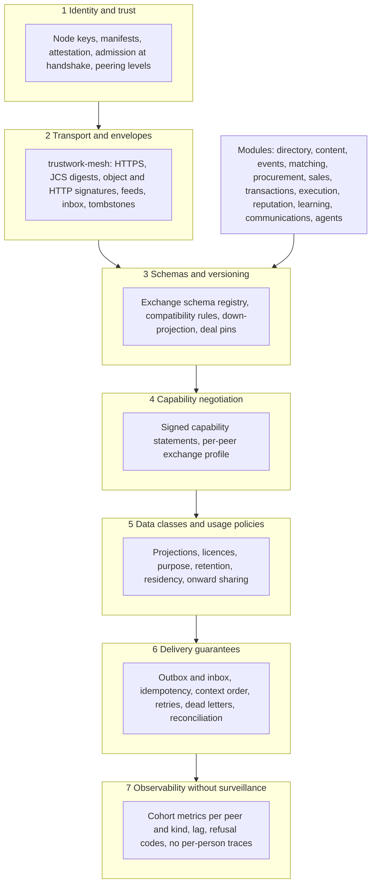
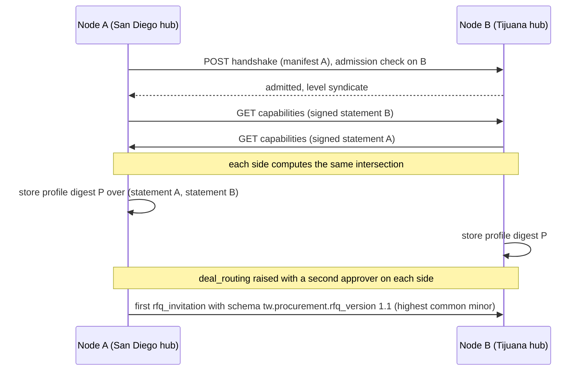
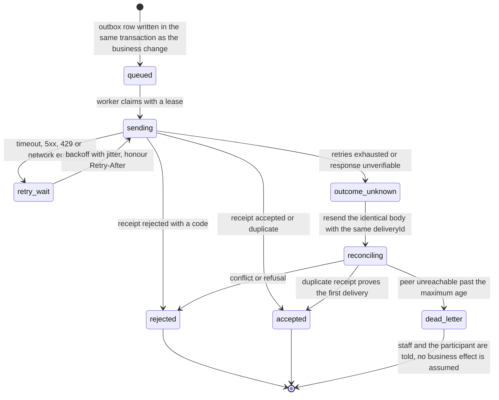
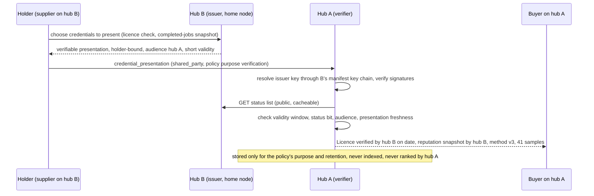
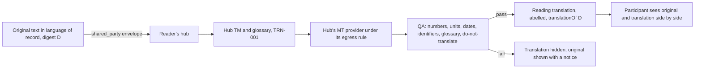
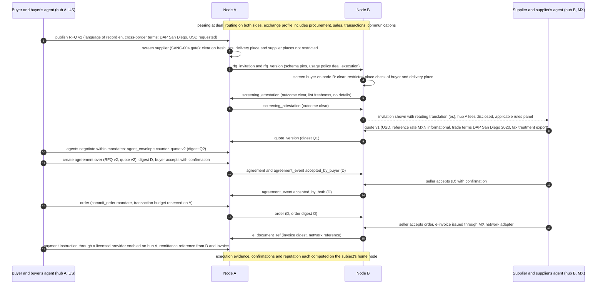
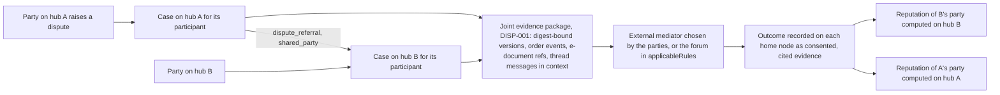
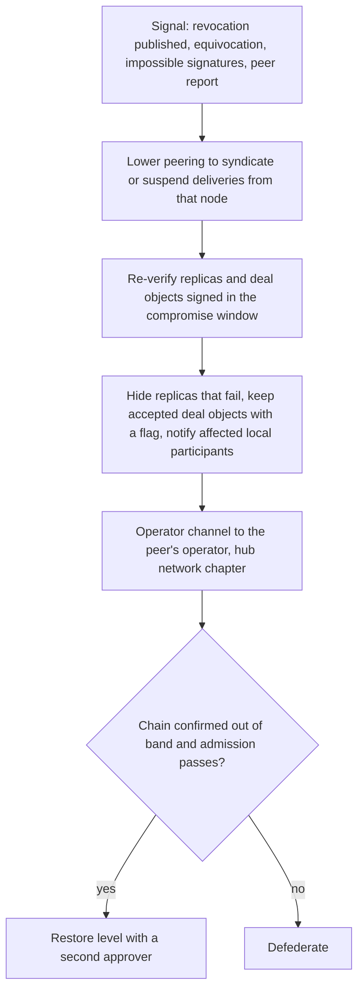

# Hub exchange architecture: data, modules, content, translation and cross-border commerce

Status: **Proposed** (owner request of 2026-11-01, design of 2026-11-01). Nothing in this chapter is implemented. It builds on what is already a **Contract**: the mesh protocol [`trustwork-mesh/1`](federation-protocol.md) (FED-000, `packages/contracts/src/federation.ts`, conformance vectors), the admission check at handshake (SANC-008, `packages/compliance/src/admission`), deployment attestation (SANC-009), screening (SANC-003), agent envelopes and negotiation sessions (AGT-001), RFQs, quotes, agreements and orders (COM-001, COM-002), content with licences (CNT-001) and context threads (COMMS-001). Architecture decisions it relies on: [ADR 011](../adr/011-federation-mesh.md) (the mesh), [ADR 014](../adr/014-sanctions-compliance-engine.md) (sanctions), [ADR 010](../adr/010-gathering-point-hubs-agents-and-mesh.md) decisions 18, 20 and 21 (passport, no held funds, disclosed fees). The changes it needs to the wire protocol are proposed in [ADR 016](../adr/016-hub-exchange-layer.md) (status **Proposed**, escalated to the owner and the integrator). Work packages: XCH-001 to XCH-016 and amendments listed in [section 9](#9-work-packages).

Narrative of the mesh: [Federation: one worldwide mesh](federation.md). Requirements: [Federation mesh](modules/federation-mesh.md) (MSH-F21 to MSH-F32 added by this design). The operator-facing side of the network (world map and directory, peering settings, operator channel, network statistics) is designed separately in the hub network chapter (in flight in its own pull request); this chapter designs no screens for operators and uses the same words: *node*, *hub*, *peer*, *peering level*, *defederation*.

## Contents

1. [The owner request and what this design adds](#1-the-owner-request-and-what-this-design-adds)
2. [Research and what we take from it](#2-research-and-what-we-take-from-it)
3. [Layered architecture](#3-layered-architecture)
4. [Data and module exchange](#4-data-and-module-exchange)
5. [Automatic translation across hubs](#5-automatic-translation-across-hubs)
6. [Cross-hub and cross-border commerce](#6-cross-hub-and-cross-border-commerce)
7. [Security and abuse](#7-security-and-abuse)
8. [Contracts this design asks for](#8-contracts-this-design-asks-for)
9. [Work packages](#9-work-packages)
10. [Questions for the owner and for counsel](#10-questions-for-the-owner-and-for-counsel)
11. [Sources](#11-sources)

## 1. The owner request and what this design adds

The owner's request of 2026-11-01, translated from Russian: "Overall we need to develop a high-quality architecture, models and protocols of communication between all hubs: data exchange, modules, content, with automatic translation, and even with the possibility of creating commercial offers and communications between countries and hubs."

`trustwork-mesh/1` already answers *how two nodes talk safely*: identity, signatures, envelopes, feeds, an idempotent inbox, tombstones and a merge rule. It deliberately does not yet answer *what the modules say to each other over time*: how an exchange schema evolves without breaking a peer, how two hubs learn which modules and versions the other speaks, what a receiving hub may do with data it was given, how a message is translated and labelled, and how a commercial offer crosses a border with two sets of rules, two sanctions screens, two currencies and two tax systems. This design fills those gaps.

| Layer | Already a Contract or Live | Gap this design closes | Packages |
|---|---|---|---|
| Identity and trust | Manifest, key chain, rotation, revocation, admission at handshake, attestation summary | Capability statement signed by the node; key compromise response across the mesh | XCH-003, XCH-014, FED-001 (amended) |
| Transport and envelopes | Envelopes, object and HTTP signatures, feeds, inbox, receipts, tombstones, `trustwork-merge-1` | Outbox, retries, ordering per context, reconciliation of unknown outcomes; new envelope members (schema, language, usage policy, context sequence) | XCH-004, XCH-002 |
| Schemas and versioning | Strict Zod contracts per module; protocol versioning by name | A registry of exchange schemas per module with compatibility rules and down-projection | XCH-001 |
| Capability negotiation | `protocol` list and `peeringPolicy` in the manifest | Modules, schema versions, languages, translation offers and commerce features each hub supports; a per-peer exchange profile | XCH-003 |
| Data classes and usage policies | Projections, data classes, syndication terms, licence conditions | Purpose binding, retention, residency and onward-sharing rules for shared and consented data | XCH-005 |
| Delivery guarantees | Idempotent inbox keyed by `(senderNode, deliveryId)` | At-least-once delivery with effectively-once effects, causal order for negotiations and threads, dead letters, reconciliation | XCH-004 |
| Observability | Metrics named per module | Cohort metrics per peer and kind, no per-person traces across nodes | XCH-004, XCH-014 |
| Translation | Linked editions and machine-translation labels (CNT-001, PROV-001); the editorial office's translation memory design (TRN-001, in flight) | Language negotiation between hubs, translation records that travel, reading translations of shared messages, the original as the authority | XCH-006, XCH-010 |
| Commerce across hubs | Cross-node RFQ, quote and agreement envelopes (FED-004, designed) | Trade terms, currency reference rates, tax treatment, applicable rules, dual screening, e-documents, e-signatures, payments, disputes and fees across hubs | XCH-007, XCH-008, XCH-009, XCH-016, FED-004 (amended) |
| Reputation across hubs | Passport credentials as a public kind (FED-000), issuance designed (REP-002) | Presentation and verification by a peer, without importing raw reviews | XCH-011 |
| Search across hubs | Replicas indexed locally (FED-002, RAG-201) | Opt-in public query protocol with permission intersection | XCH-012 |
| Interop and skew | Conformance vectors for the wire | Module interop contracts and a version-skew suite | XCH-013 |

## 2. Research and what we take from it

Research date 2026-11-01. Fetched documents were treated as data. Versions are those published at that date; implementers pin and re-check them.

| Source | What it is | What we take | What we leave |
|---|---|---|---|
| ActivityPub (W3C Recommendation, 2018) and Activity Streams 2.0 vocabulary | Actor inboxes and outboxes, activities (`Create`, `Update`, `Delete`, `Offer`, `Accept`, `Reject`) | The inbox/outbox shape (already in ADR 011), `Delete` as tombstone, `contentMap` for language-tagged text, the outbound bridge (FED-006). Fediverse Enhancement Proposals show how extensions are negotiated by convention rather than central approval | Its open-world JSON-LD extensibility: our objects are strict so a private field cannot slip in; its activities do not bind commercial digests |
| Matrix (current specification) | Rooms replicated across homeservers as an event graph; state resolution; server-signed events; room versions | Per-context ordering by referencing previous events (we use a context sequence plus previous digest), **room versions as a precedent** for pinning a protocol variant to one conversation for its whole life (we pin the exchange schema version to one deal), server signatures over every event | Full replication of every room to every participant's server and history visibility rules: deal data goes only to the parties' home nodes |
| AT Protocol (Lexicon, repositories) | Schemas named by reverse-DNS identifiers (NSIDs) with evolution rules; signed data repositories per account | **Lexicon's evolution rule**: a schema may only gain optional fields; anything else is a new name. Our exchange schema registry follows it (`tw.<module>.<object>` with major versions as new identifiers). Signed repositories confirm our "home node is the only writer" | Global relays and firehoses; account portability between providers (identity stays on the home node, linked by FED-005) |
| Open Contracting Data Standard (OCDS 1.1.5; 1.2 in development) | Public procurement disclosure: planning, tender, award, contract, implementation, linked by an `ocid` | Mapping for public procurement notices imported by PROC-002; the stage model as a reference when a public opportunity becomes an RFQ; the `ocid` kept as an external identifier | Using OCDS for private B2B deals: it is a disclosure standard, our private deals are not public |
| Peppol (BIS Billing 3.0 on EN 16931 with UBL; eDelivery four-corner model) | Cross-border e-invoicing and e-ordering network with access points and participant identifiers | E-invoices and e-orders for cross-hub deals travel over Peppol through each party's access point adapter where both parties' packs list it (PRC-012); the mesh carries only a reference and a digest | Running an access point inside the engine (it is an adapter with a fake) |
| UBL 2.x (OASIS, ISO/IEC 19845 for 2.1) | XML documents for Quotation, RequestForQuotation, Order, DespatchAdvice, ReceiptAdvice, Invoice | Field names for the trade-terms and document blocks of the cross-border terms contract; export of agreements and orders to UBL for the parties' own systems (PRC-012, PRC-013) | UBL as the mesh wire format: the mesh stays JSON with JCS digests |
| ISO 20022 | Financial messaging; remittance information and structured creditor references (RF references, ISO 11649) | Payment instructions created through a licensed provider carry an end-to-end reference built from the agreement and invoice identifiers, never private data | Anything that would make Trustwork a payment service |
| W3C Verifiable Credentials Data Model 2.0 and Bitstring Status List 1.0 (both W3C Recommendations, 15 May 2025); DIDs 1.0; Open Badges 3.0 | Issuer-signed claims, holder presentations, revocation by status list | The passport (ADR 012 decision 5) and how a peer verifies it: signature against the issuing node's key chain, status list check, validity window. Issuer identifiers resolve through the node manifest (the `did:web` pattern is a candidate, REP-002 pins it) | Ledger-based DID methods; a verifier that stores presentations longer than the purpose needs |
| schema.org | Shared vocabulary for organizations, people, events, offers and demands | JSON-LD on public pages (`Organization`, `Person`, `Event`, `Offer`, `Demand`, `Product`, `Article`) as a projection of the same public fields; never a second source of truth | Using schema.org types inside the mesh payloads |
| OpenAPI 3.1, AsyncAPI 3, CloudEvents 1.0 | API description, event-driven API description, event envelope attributes | The mesh endpoints are described in OpenAPI (DOC-002); module exchange schemas are published as JSON Schema generated from Zod; delivery metadata names follow CloudEvents (`id`, `source`, `type`, `time`, `datacontenttype`) where a hub bridges events to its own systems (INTEG-001) | A CloudEvents envelope on the wire: the signed mesh envelope already carries these facts |
| Data spaces: IDSA and the Eclipse Dataspace Protocol (1.0, 2025), Gaia-X, W3C ODRL 2.2 | Catalogues, contract negotiation and usage control expressed as ODRL policies | **Usage policies attached to data** (purpose, retention, onward sharing, place of processing) and the idea that a receiver accepts a policy before it may use data; the negotiation is replaced by our capability profile plus per-delivery policy references | A full ODRL engine and connector stack; dynamic contract negotiation for public data |
| XLIFF 2.2 (OASIS Committee Specification, March 2025), TMX 1.4b, TBX (ISO 30042), ITS 2.0 | Translation exchange, translation memory exchange, termbase exchange, translation metadata (provenance, MT confidence) | Hubs exchange glossaries as TBX and translation memories as TMX; translation records keep ITS-style provenance (who or what translated, reviewed by whom) | Running a translation management system inside the mesh |
| Incoterms 2020 (ICC) | Eleven trade-term rules allocating delivery, risk and costs | A trade-terms field holding the rule code, the version and the named place; the engine never reproduces the ICC text (counsel question on naming) | Deciding the rule for the parties |
| CISG (UN Convention on Contracts for the International Sale of Goods, 1980) | Uniform sale law that applies to B2B sales of goods between parties in contracting states unless excluded | A visible applicable-law statement on cross-border agreements; the engine never decides whether the CISG applies (counsel question) | Any default exclusion or inclusion without counsel |
| Sanctions and export controls (OFAC lists, EU dual-use Regulation 2021/821, US Export Administration Regulations) | Who may not be dealt with; which goods need licences | Both hubs screen both parties; export-control status is a party declaration with "unknown" escalated to a person; restricted places refused on both sides and for the delivery place | Classifying goods automatically |
| GDPR Chapter V (Articles 44 to 50), the EU–US Data Privacy Framework, residency laws in the example packs | Rules for transfers of personal data to third countries | A transfer basis recorded per peering for personal data classes; residency in usage policies; a node never relays a foreign authority's request to peers | Assuming any transfer basis by default |
| RFC 9421, RFC 9530, RFC 8785 | HTTP signatures, content digests, canonical JSON | Already in `trustwork-mesh/1`; unchanged | — |

Conclusion: no existing standard covers digest-bound commercial objects moving between independently governed nodes with projection levels, so the mesh stays our own protocol (as ADR 011 decided) and borrows from each standard what fits. Where a domain standard exists for a payload (e-invoices, procurement notices, credentials, translation exchange), we map to it at the edges instead of inventing a parallel format.

## 3. Layered architecture

Each layer can refuse what the layer below delivered; no layer can widen what a lower layer refused. A refusal at any layer is a machine code from the protocol's error table (extended in [section 8](#8-contracts-this-design-asks-for)), never an echo of private data.

### 3.1 Identity and trust (layer 1)

Unchanged from `trustwork-mesh/1` sections 4 to 8: a node is a DNS name with an Ed25519 key chain in a signed manifest; the responder runs the SANC-008 admission check on declared, attested and observed places before any peering; peering levels `syndicate`, `trust_verifications`, `deal_routing` and `identity`, the last two with a second approver. Two additions:

- **Capability statement.** A second signed document, next to the manifest, says what the node's hubs can exchange ([3.4](#34-capability-negotiation-layer-4)). It is separate so the manifest stays small and stable, and so modules can be switched on and off without re-signing the identity document.
- **Admission is continuous.** The responder re-runs admission whenever the manifest, the attestation or the capability statement changes and before the first commercial delivery of every new deal (FED-001 amended). A node whose admission lapses drops to "no deliveries accepted" until it passes again; nothing already accepted is rewritten.

### 3.2 Transport and envelopes (layer 2)

The wire stays `trustwork-mesh/1` for every kind it already defines. [ADR 016](../adr/016-hub-exchange-layer.md) proposes `trustwork-mesh/2`, a strict superset that keeps every byte rule (JCS, `trustwork-digest-1`, the object signing input, RFC 9421 coverage, `trustwork-merge-1`) and adds:

| Addition | Where | Why |
|---|---|---|
| `schema: { id, version }` | Every envelope | Names the registered exchange schema and minor version of the payload (layer 3) |
| `language: { tag, role, translationOf, method, review }` | Envelopes whose payload carries human text | Language of the text and whether it is an original or a translation ([5.4](#54-labelling-and-machine-readable-provenance)) |
| `policy: { id, digest }` | `shared_party` envelopes and consented items | The usage policy the receiver must honour (layer 5) |
| `context: { id, seq, previous }` | Envelopes that belong to a negotiation or a thread | Causal order inside one context (layer 6) |
| New shared kinds `thread_message`, `order`, `order_event`, `e_document_ref`, `screening_attestation`, `credential_presentation`, `dispute_referral`, `confirmation_request`, `usage_policy` | Inbox only | Federated threads, orders, documents, dual screening, passport presentations, disputes and counterparty confirmations ([sections 4](#4-data-and-module-exchange) and [6](#6-cross-hub-and-cross-border-commerce)) |
| New public kinds `procurement_notice`, `glossary`, `edition` | Feeds | Imported public notices (OCDS mapping), published hub glossaries, linked translations with their own licence |
| Capability statement (signature purpose `capabilities`) at `GET /federation/v2/capabilities` | New endpoint | Layer 4 |
| Optional `POST /federation/v2/search` | New endpoint, only when both profiles enable `search.public` | Federated public search ([4.5](#45-search-across-hubs-with-permission-intersection)) |

During a compatibility period both versions are offered in `protocol`; objects signed under `trustwork-mesh/1` keep verifying forever. A peer that only speaks version 1 simply never receives the new kinds; the sending hub shows its participant an honest "this hub cannot receive messages of this kind yet" instead of degrading silently.

### 3.3 Schemas and versioning (layer 3)

Every object that crosses a node boundary has a registered **exchange schema**. The registry (XCH-001) lives in the repository next to the contracts, is generated from the same Zod schemas and is published with each engine release.

| Element | Rule |
|---|---|
| Identifier | `tw.<module>.<object>` (for example `tw.sales.quote_version`, `tw.communications.thread_message`, `tw.directory.company_profile`), plus a **major** number in the identifier when the meaning changes (`tw.sales.quote_version.v2`) |
| Minor version | `<major>.<minor>`; a minor version may only add **optional** members or widen an enum the receiver can ignore by explicit rule; it may never remove, rename, retype or tighten |
| Major version | A new identifier; old and new coexist during the compatibility period; the registry records the conversion rule if one exists, or "none" |
| Owner | One module per schema; only that module's package may publish a new version (paths in `work-packages.json`) |
| Projection | Each schema version names its projection (`public` or `shared_party`), data class and mesh kind; a schema can never carry a projection the kind does not allow |
| Digest input | The payload exactly as sent, in the version sent. A digest never covers a member the receiver cannot validate |
| Description | JSON Schema generated from Zod for external implementers; OpenAPI for the endpoints (DOC-002) |

**Down-projection, not tolerance.** Mesh objects are strict: a receiver refuses unknown members so a private field cannot slip in. Therefore a sender never sends a newer minor version than the peer declared. Each schema version ships a pure **down-projection** to every earlier minor of the same major (dropping only the optional members added later). The sender serializes at the highest minor in the exchange profile ([3.4](#34-capability-negotiation-layer-4)), computes the digest over exactly those bytes and signs. If a member that matters for the meaning would be dropped (the registry marks such members `essential`), the sender refuses to send and tells its participant why.

**Deal pins.** A commercial context (RFQ, its quotes, the agreement, its orders and events) **pins** the schema versions in force when the first cross-hub version was sent, the way a Matrix room pins its room version. Every later object in that context uses the pinned versions, so both nodes recompute identical digests until the deal ends, whatever upgrades happen in between. A pin can be raised only by a new RFQ version that both nodes can read.

### 3.4 Capability negotiation (layer 4)

Each node publishes a **capability statement**, signed with the node key (purpose `capabilities`):

| Section | Content |
|---|---|
| `hubs[].modules` | For each hub: module, the exchange schemas it **produces** and **consumes**, with the minor versions supported (`tw.sales.quote_version: produces 1.0-1.2, consumes 1.0-1.3`) |
| `hubs[].languages` | Languages the hub serves, the review status per locale (INTL-007), and whether it accepts content in other languages |
| `hubs[].translation` | Whether reading translations are offered to its participants, for which data classes, and the label policy (never the provider name or model, which are hub configuration) |
| `hubs[].commerce` | Currencies accepted for quotes, e-invoicing networks (pack codes such as `peppol`, `cfdi`), e-signature schemes recognized (pack codes), payment provider kinds enabled (`card`, `ach`, `sepa_credit`, `spei`; never provider credentials), whether cross-border consumer deals are allowed, trade-term support |
| `hubs[].policies` | Usage policy templates it can honour (retention bounds, residency, onward sharing) and its transfer bases for personal data classes ([7.6](#76-privacy-transfers-and-residency)) |
| `limits` | Rates per kind per peer, maximum attachment size by reference, search enabled or not |
| `issuedAt`, `signature` | As for the manifest |

**The exchange profile.** When peering reaches `syndicate` (and again whenever either statement changes), each side computes the **intersection** of the two statements: for every schema the highest minor both support in the right direction, the languages both serve, the commerce features both enable, the stricter policy bounds. The profile is stored on both sides with its digest and the two statement digests (XCH-003). Rules:

- Nothing is sent outside the profile. A schema missing from the profile means the feature is unavailable with that peer, and the interface says so.
- The profile is computed, never edited by staff; staff change their own statement (through the hub console, designed in the hub network chapter) and the profile follows.
- A profile change never affects a pinned deal ([3.3](#33-schemas-and-versioning-layer-3)). If a peer withdraws a schema a pinned deal needs, the deal finishes on what was already accepted and new deliveries in that context are refused with `federation.capability_withdrawn`; both participants are told.

### 3.5 Data classes and usage policies (layer 5)

Projections stay as `trustwork-mesh/1` fixes them: only `public` and `shared_party` cross; `party_private`, `owner_private` and `staff_case` never do. Licences per data class stay as the integrator decided. This design adds **usage policies** for everything that is not plain public syndication.

| Data class | Projection | What decides what the receiver may do |
|---|---|---|
| Public classes (directory facts, profiles, publications, events, open needs, reputation snapshots, certificates, images) | public | The syndication term and licence conditions (unchanged) |
| `deal_data` (RFQ invitations and versions, quotes, agreements, orders, agent envelopes, thread messages, e-document references, screening attestations) | shared_party | A usage policy, referenced by every envelope |
| `consented_items` (new): items a person shares with one counterparty, such as a passport presentation or a prequalification pack | shared_party | A usage policy recorded with the person's consent |
| `editions` (new): linked translations of public content | public | The edition's own licence, never looser than its original's |

A **usage policy** is a small signed document (kind `usage_policy`, inspired by ODRL and data-space usage control, with our own closed vocabulary):

| Member | Values | Default for deal data |
|---|---|---|
| `purpose` | `deal_execution`, `verification`, `dispute_resolution`, `display_to_parties`, `search_index_public` | `deal_execution` |
| `audience` | The parties of the context, by global identifier | The context's parties |
| `retention` | A bound from the stricter of the two packs (for example accounting retention for agreements and invoices) and an event that starts it | Pack record-keeping period from agreement end |
| `onwardSharing` | `none`, `parties_staff_with_case_grant`, `named_processors` | `parties_staff_with_case_grant` |
| `modelUse` | `none`, `governed_retrieval_for_parties`, `reading_translation` | `governed_retrieval_for_parties` and `reading_translation` |
| `residency` | `any_admitted_node`, or a list of countries where the receiver may store it | From the sender's pack and hub decision |
| `exportAllowed` | Whether a party may export it in a dispute package or to their own systems | `true` for the parties |

Rules: the receiver evaluates the policy before storing; if it cannot honour it (for example residency excludes its own country), it refuses the delivery with `federation.policy_unacceptable` and stores nothing. Purpose binding is enforced at read time by the same projection serializers that guard local data (R28), so a thread message received for `deal_execution` never enters a public search index, a recommendation or an analytics row. Retention is enforced by the receiver's retention jobs (PRV-001 bounds) and recorded in the erasure ledger. Onward sharing beyond the policy is impossible by construction: replicas of `shared_party` data are never re-served by feeds, never relayed (no transit) and never exported except as the policy allows.

### 3.6 Delivery guarantees (layer 6)

| Guarantee | How |
|---|---|
| No lost deliveries | **Transactional outbox** (ADR 004): the business change and its `federation_delivery` row commit together; the worker sends later |
| Effectively once | At-least-once sending plus the receiver's unique `(senderNode, deliveryId)` constraint (protocol section 13). A repeat with the same body returns the stored receipt and has no second effect |
| Reconciliation of unknown outcomes | Never "retry with a new identifier". Resending the **identical body** under the same `deliveryId` is safe and is the reconciliation: a `duplicate` receipt proves acceptance, `accepted` means the first attempt never arrived, a conflict is a bug flagged to staff. This is the mesh form of the engine's rule "unknown outcomes are reconciled, never retried blindly" (BE-005, PAY-001) |
| Order inside a context | Negotiations, threads and order events carry `context: { id, seq, previous }`. The receiver applies them in `seq` order, holds a gap for a bounded time and asks nothing of the sender (the sender's outbox retries); a `previous` digest mismatch is refused with `federation.context_out_of_order` and flagged |
| Order of revisions | Public objects keep `trustwork-merge-1`: revision numbers and tombstones converge in any order |
| Backpressure | `429` with `Retry-After` per peer and per kind; limits from the exchange profile; agent envelopes stay under the peering's hourly rate |
| Maximum age | A delivery older than its kind's maximum age (for example a quote past its validity) is dead-lettered, never delivered late as if fresh |
| Atomic effects at the receiver | Receiving, validating, authorizing and applying one delivery is one database transaction; the receipt is written in it |

### 3.7 Observability without surveillance (layer 7)

- **What is measured**: per peer and per kind, cohorts only: deliveries queued, accepted, duplicate, rejected by code, dead-lettered; feed lag; tombstone application time; profile changes; admission refusals by place category. These feed the network statistics in the hub network chapter.
- **What is never measured**: who talked to whom across nodes, per-person delivery logs visible to staff without a case grant, message content in logs, cross-node correlation identifiers that outlive the delivery. Trace identifiers are local to one node; the only identifier shared across nodes is the `deliveryId`, which carries no person.
- **Audit**: both sides keep an append-only audit of peering, profile and policy changes and of staff actions on replicas (hide, report forward). Participants see their own deals' delivery states in the deal context ("delivered to the supplier's hub", "waiting for the supplier's hub", "could not be delivered").

## 4. Data and module exchange

### 4.1 Directory entities

| Entity | Mesh kind and schema | Who may see it on the peer | Consent and limits | External vocabulary |
|---|---|---|---|---|
| Company | `company_profile`, `tw.directory.company_profile` | Anyone the peer serves | Public directory facts only; badges with the granting hub | schema.org `Organization` on public pages |
| Person | `person_profile`, `tw.directory.person_profile` | Anyone the peer serves | Only `profileVisibility: public`; redisplay inside the mesh only; no bulk export, no model training outside governed retrieval | schema.org `Person` (public fields only) |
| Project | `project`, `tw.projects.public_project` | Anyone | Published by its owner; never budgets, addresses or private plan items | — |
| Open need | `open_need`, `tw.matching.open_need` | Anyone; responses only through deal routing | Published by its owner | schema.org `Demand` |
| Product and catalogue item | `catalogue_item`, `tw.catalogue.offering_public` | Anyone | Public offering fields only, never private price knowledge | schema.org `Product` and `Offer` |
| Event | `event`, `tw.events.public_event` | Anyone; registration on the home hub (or with federated sign-in, FED-005) | Public card | schema.org `Event` |
| Public tender (sourced) | `procurement_notice` (mesh/2), `tw.opportunities.procurement_notice` | Anyone, per the source licence (default `link_only`) | Always labelled "public procurement notice from <source>", never as a member's need | OCDS release fields and `ocid` (PROC-002) |

Entities are **linked, never merged** (FED-003). A company present on two hubs in different countries keeps each country's identifiers separately; identifiers from two different packs never create a link by themselves.

### 4.2 Content syndication with licences and attribution

Unchanged rules from the federation chapter, plus:

- A **linked edition** (translation) travels as its own public object (`edition`, mesh/2) pointing to the original by global identifier and digest. Its licence is never looser than the original's and its label travels with it ([5.4](#54-labelling-and-machine-readable-provenance)).
- A receiving hub never re-syndicates a replica (protocol section 12) and never re-labels it as its own; the home hub and author stay visible on every card.
- Corrections propagate as new revisions; editions of a corrected original become `stale` on every hub that holds them (the editorial office's stale state, TRN-001).

### 4.3 Knowledge and recommendations

- Knowledge items (guides, lessons, checklists, answers) are publications and federate under their licence.
- **Recommendations never federate as rankings.** A hub may use public replicas from peers as candidates for its own plan-step recommendations (REC-001), labelled with their home hub; ranking happens only on the participant's hub, under its published ranking statement, payment-blind. No peer can push a "recommended" flag.
- Sponsored content never federates as editorial; if a hub allows sponsored items they are not syndicated at all.

### 4.4 The reputation passport across hubs

Authority stays home: a hub **verifies** another hub's credentials, it never imports raw reviews, never recomputes and never re-issues.

Rules (XCH-011, REP-002 amended):

- The verifier checks issuer signature against the issuing node's key chain at the credential's issuance time (key selection rules of protocol section 5), the Bitstring Status List entry, the validity window and the presentation's audience and freshness.
- A verified credential is shown as "verified by hub X", with the evidence categories and dates, exactly as the issuer stated them. A peer at `trust_verifications` level may also show public passport credentials pulled from feeds; any hub can verify a presentation a holder gives it, regardless of peering level, because verification needs only the public key chain and the status list.
- What never crosses: individual reviews, review text, observations, counterparties' identities, documents, scores recomputed elsewhere.
- Reputation snapshot credentials carry a short validity; a stale snapshot is shown as "snapshot of <date>", never as current.
- A hub may require a presented credential for an RFQ eligibility rule; the rule is evaluated locally and explained, and "unknown" stays unknown.

### 4.5 Search across hubs with permission intersection

Phase 1 (FED-002, RAG-201): each hub indexes the public replicas it received as a separate source class with licence flags. Phase 2 (XCH-012, opt-in for both hubs):

- `POST /federation/v2/search` accepts a **public** query (text, filters by kind, territory, category, language) from a peer with `search.public` in both profiles. The query is not tied to a person, not logged with any requester identity, and the receiving node returns only global identifiers, kinds, home hubs and public snippets it already serves in feeds.
- Private queries are never forwarded. A participant's private context (budgets, private projects, deal data) never becomes part of a federated query.
- The asking hub hydrates results from its replicas or by signed lookup, applies the licence of each item, and ranks locally under its own ranking statement. Any answer composed from several sources inherits the **intersection** of their audiences (R31, `intersectReplicaAudiences`): public results never widen a shared one, and rights are rechecked at delivery.
- Rate limits per peer; a peer that scrapes through search is lowered to `syndicate` or defederated.

### 4.6 Module interop contracts

Each module that exchanges data declares an **interop contract** in the registry: what it produces and consumes, which state transitions cross the boundary, which node is authoritative, and how conflicts resolve. Today's modules:

| Module | Crosses as | Authoritative node | State that crosses | Never crosses |
|---|---|---|---|---|
| Directory and companies | `company_profile`, `person_profile`, links | Subject's home | Public fields, claim status, badges with granting hub | Documents, private contacts, staff notes |
| Content and magazine | `publication`, `magazine_issue`, `edition` | Author's home | Published versions, corrections, tombstones | Drafts, editorial notes, sources under `syndication: none` |
| Events | `event` | Organizer's home | Public card, cancellations | Attendee lists, payments |
| Matching | `open_need`, `introduction` | Need owner's home; introduction on the requester's home | Introduction request and decision (double opt-in) | Matching scores, private constraints |
| Procurement | `rfq_invitation`, `rfq_version` | Buyer's home | Published versions, amendments, stale flags | Budget ceilings, evaluation weights, shortlists, levelling sheets |
| Sales | `quote_version` | Seller's home | Sent versions, withdrawals | Floors, margins, cost basis |
| Transactions | `agreement`, `agreement_event`, `order`, `order_event` | Agreement and order on the buyer's home; seller acceptance on the seller's home | Digests, acceptances, order changes | Budget reservations, approval routes |
| Execution | `order_event` with evidence references | Author of the evidence | Milestone acceptance, delivery confirmation | Site addresses, crew data |
| Reputation | `confirmation_request`, `review_submission`, `passport_credential`, `credential_presentation` | Subject's home | Confirmation answers tied to the deal; presentations | Scores recomputed elsewhere, review text of other deals |
| Learning | `certificate` | Issuer's home | Verification record | Learner progress |
| Communications | `thread_message` | Context's home | Messages of parties in the context | Notifications, channel grants, external addresses |
| Agents | `agent_envelope` | Sender's home | Structured intents, refs, mandate digest, untrusted note | Mandate contents, budgets, private priorities |
| Consultations and tasks | `agreement` with `terms_kind` `consultation` or `task` | Client's home | As transactions | As transactions |

### 4.7 Version skew

| Situation | Behaviour |
|---|---|
| Peer supports an older minor of a schema | Sender down-projects to that minor; if an `essential` member would be lost, the feature is unavailable with that peer and both participants are told before they start |
| Peer supports only an older major | Feature unavailable unless the registry has a conversion rule; never a lossy guess |
| Peer upgrades during a deal | The deal stays on its pinned versions ([3.3](#33-schemas-and-versioning-layer-3)) |
| Peer downgrades and withdraws a schema a deal needs | New deliveries in that context refused with `federation.capability_withdrawn`; the deal finishes under accepted terms; parties told |
| Receiver gets a version above its profile | Refused with `federation.schema_unsupported`; the sender's profile is stale and is recomputed |

The skew suite (XCH-013) runs two simulated nodes at engine versions N and N-1 through every interop contract and fails the build when a release would break an older supported peer.

## 5. Automatic translation across hubs

### 5.1 Language negotiation

- Each hub declares its languages in the manifest (already) and, in its capability statement, the review status per locale and whether it offers reading translations.
- Each participant has preferred languages on their own hub. Inside a deal context, a party's preferred languages are shared with the counterparty's node as part of the deal (`deal_participation`), so the other side can choose a language for replies and documents. Outside a deal, a person's language preference never leaves their hub.
- An RFQ, a quote and an agreement each declare a **language of record**: the language of the original text that binds. The parties may agree on a language of record different from either hub's default (for example English between a San Diego buyer and a Tijuana supplier, with Spanish reading translations).

### 5.2 Where translation happens

| What | Who translates | Why there |
|---|---|---|
| Public content (publications, guides, events) | The **home hub's editorial office** produces reviewed linked editions (TRN-001 workflow); editions federate under their own licence | Quality, accountability and the reviewer's name stay with the author's hub |
| Public content read on another hub, no edition available | The **reader's hub** may show a reading translation on request, labelled, not stored as an edition and never re-syndicated | The reader's hub applies its own provider, egress and label rules |
| Deal content (RFQ text, quote notes, thread messages, agent envelope notes) | The **reader's hub** produces a reading translation for its own participant, if the usage policy allows `reading_translation` and the reader's hub has an egress rule permitting `deal_data` to its translation provider | Private text goes only to a provider the reader's hub governs, under its own egress policy (LLM-001, KEYS-001); the sender's hub never sends its participants' text to the other side's provider |
| Structured values (amounts, currencies, quantities, units, dates, identifiers, trade-term codes, line references) | **Nobody**: they are never translated; each hub renders them from structured data with `Intl` and its locale files | Numbers cannot drift in translation |
| Legal texts (hub terms, agreement clauses, consumer information, notices) | Human translators with counsel review on the hub that publishes them; machine translation only as a labelled reading aid | A machine translation is never binding ([5.6](#56-legal-texts)) |
| A shared mesh translation service | **Not proposed.** A hub may contract any provider itself; a common service would centralize private text and contradict independent operators | Owner question 7 |

### 5.3 Translation memory and glossaries per hub

- Each hub keeps its own translation memory and termbases (TRN-001, designed in the editorial office chapter, in flight). Only reviewed segments enter TM; machine output never does unreviewed.
- **Deal text never enters a translation memory**: it is `deal_data`, its usage policy does not allow it, and TM is a hub-wide asset.
- Hubs may **publish** a glossary as a public object (`glossary`, mesh/2) and exchange it as TBX; a peer may import it read-only as a termbase with attribution. This is how construction terms ("vapor retarder" and "retardador de vapor") converge across a region without a central authority.
- TMX exchange between hubs is allowed only for segments whose source licence permits it, and only by an explicit operator action (the hub network chapter's operator channel), never automatically.

### 5.4 Labelling and machine-readable provenance

Every translated text carries a label in the interface and a provenance record on the wire. Interface labels reuse the editorial office's keys: "Translated by {translator}, reviewed by {reviewer}" (`content.label.translatedReviewed`), "Machine-assisted translation, reviewed by {reviewer}" (`content.label.machineTranslationReviewed`), "Machine translation, not reviewed" (`content.label.machineTranslationUnreviewed`), and for deal content a new reading label "Machine translation for reading; the original in {language} is binding" (proposed key `exchange.label.readingTranslation`, to be added in every engine language by XCH-016).

On the wire (mesh/2 `language` member, XCH-006):

| Member | Meaning |
|---|---|
| `tag` | BCP 47 language tag of the payload's human text |
| `role` | `original` or `translation` |
| `translationOf` | Global identifier and digest of the original (translations only) |
| `method` | `human`, `machine_assisted`, `machine` |
| `review` | `reviewed` with the reviewer's role (never a private person's details unless the edition is public and credits them), or `unreviewed` |
| `binding` | Always `false` for translations; the schema refuses `true` |

These map to ITS 2.0 provenance and MT confidence when a hub exports to XLIFF for external translators.

### 5.5 The original is the authority

- Acceptance of an agreement binds the agreement digest, which covers the payloads **in their language of record**. A translation has its own digest and is never part of the agreement digest.
- When a person accepts while a reading translation was displayed, the acceptance record also stores the digest of the translation that was shown (evidence of what the person saw), with the label. It changes nothing about what was agreed.
- A quote note or message that exists only as a translation never moves state; only structured fields do (AGT-001 rule).
- Disputes cite originals; dispute packages (DISP-001) include translations only as labelled exhibits.

### 5.6 Legal texts

- Hub legal documents, agreement clause templates and consumer information are translated by people and reviewed by counsel for each language the hub serves; a missing language blocks activation (the template rule of COMMS-001).
- A machine translation of a legal text may be shown only as a labelled reading aid next to the binding version, never in place of it.
- Some jurisdictions require consumer contracts or information in a specific language (for example Spanish for consumer information in Mexico, French in Quebec). Whether a cross-border deal may proceed when the binding language differs is a counsel question ([section 10](#10-questions-for-the-owner-and-for-counsel), C12); until answered, cross-border consumer deals are off by default.

### 5.7 Quality flags

- Automatic checks before any translation is shown: numbers, currency codes, units, dates, identifiers, URLs and placeholders identical to the original; glossary and do-not-translate entries respected; no untranslated segments; script check. A failure **hides** the translation and shows the original with "A translation could not be checked; showing the original".
- A quality-estimation score routes public editions to full post-editing (TRN-001); for reading translations of deal text it only adds a "low confidence" flag, never an approval.
- Participants can report a bad translation; the report goes to the reader's hub (which produced it), never to the counterparty.

## 6. Cross-hub and cross-border commerce

### 6.1 Principles

1. **Each object is written on its author's home node** and replicated to the other party's home node as `shared_party` (ADR 011 decision 9). Both nodes verify every digest; acceptance binds the same agreement digest on both sides.
2. **Authority stays with each party's own hub.** Mandates, budgets, approvals and private constraints never leave it; nothing on node B can authorize anything on node A.
3. **Both hubs' rules apply cumulatively where they protect someone**, and the stricter wins (screening, restricted places, consumer protection, privacy). Where rules allocate (governing law, taxes), the allocation is stated explicitly in the agreement, never assumed by the engine.
4. **Trustwork is not a money service.** No conversion, no held funds, no pooled balances; quotes carry their currency and optional informational reference rates; payments go only through licensed providers.
5. **Nothing is hidden.** Each hub's fees, the applicable rules, the language of record and the labels are shown to both parties before acceptance.

### 6.2 The flow: an RFQ from a San Diego buyer to a supplier on a Mexico hub

Every step from 3 onwards is refused if either hub's screening outcome is not `clear` on fresh lists, if any party, the delivery place or a declared origin is a restricted place, or if the exchange profile lacks a schema the step needs.

### 6.3 Which hub's rules apply

| Domain | Whose rules | How the engine records it |
|---|---|---|
| Restricted places | Engine-wide, on both sides; no setting can relax them | Refusal before any message; places of both parties and the delivery place checked |
| Sanctions screening | **Both** hubs screen **both** parties (each against its own baseline plus pack lists) | `screening_attestation` exchanged (outcome class and list freshness only, never matches or details); a non-clear outcome on either side stops the deal |
| Export controls | The parties (seller primarily); both packs' facts shown | Party declaration per line (`controlled`, `not_controlled`, `unknown`); `unknown` escalates to a person; never an automatic clearance |
| Participant protection, agent disclosure, record-keeping, per-action limits | Each participant's **own** hub (HUB-005 jurisdiction settings) | Each node applies its settings to its own participant and their agent |
| Consumer protection | The consumer's hub and country law, which the parties cannot waive (counsel question C2) | Cross-border consumer deals off by default; when enabled by **both** hubs, consumer mode applies (AGT-008) |
| Contract law and forum | Chosen by the parties in the agreement from counsel-reviewed clause templates; never defaulted silently | `applicableRules` block: governing law, dispute resolution (court, arbitration, mediation), CISG statement as reviewed by counsel (C1) |
| Taxes | Each party's tax rules under their packs, as determined by the seller (or its tax provider) and shown to the buyer | `taxTreatment` per line with rule source (for example export zero rating, reverse charge) and the parties' tax registrations shown by consent |
| E-invoicing | Seller's country mandate for issuing; buyer's country for receiving where it mandates | E-document over a network both packs list; the mesh carries `e_document_ref` with digest |
| E-signatures | Each party signs under a scheme valid in its jurisdiction | Signature level per party from its pack; recognition of the other party's level shown as a pack fact or "unknown" (ESIG-001) |
| Personal data | Each node for the data it holds; transfer rules of the sending node | Usage policy and transfer basis recorded per peering ([7.6](#76-privacy-transfers-and-residency)) |
| Fees | Each hub for its own participant only | Both hubs' fee versions shown and recorded at acceptance ([6.11](#611-commissions-and-fees-across-hubs)) |

### 6.4 Sanctions and restricted places on both sides

- **Before the first commercial message** of a context, each node runs its SANC-004 gate on the counterparty (screening from the public directory facts and the names in the deal) and on its own participant. Only `clear` (or a decided `not_same_person`) against fresh list versions lets a commercial message leave or be accepted.
- The two nodes exchange **screening attestations**: kind `screening_attestation`, signed by the node, saying only "subject X screened `clear` on <date> against list versions current within <freshness>". Never the lists, never a possible match, never the reason for a refusal. A refusal is communicated as a generic "this deal cannot proceed" with the hub's contact, as ADR 014 decision 15 requires.
- Re-screening on list updates (ADR 014 decision 12) can stop an ongoing deal: new deliveries are refused on that node; accepted terms stay recorded; money and commitment gates fail closed.
- **Restricted places**: refused for the participants' places, the delivery place, any declared place of origin of goods and any hub or node. The mesh never transits; a delivery is never routed through a third node.
- A peer is never trusted to have screened on our behalf: its attestation is required in addition to our own check, never instead of it.

### 6.5 Currency and exchange rates

- A quote is in **one currency** chosen by the seller (or requested in the RFQ). Totals are recomputed exactly in that currency (`verifyQuoteTotals`).
- A quote or comparison may carry **reference rates**: `{ from, to, rate (decimal string), source (named publisher), observedAt, purpose: "informational" }`. They help a buyer compare; they are never used to settle and never bind. The buyer's hub can add its own snapshot for comparison, labelled with source and time (as the commerce chapter already requires for mixed currencies).
- **Trustwork never converts money.** If payer and payee currencies differ, conversion is done by the licensed payment provider or the parties' banks, under their terms, outside the engine.
- Payment references follow ISO 20022 practice: the payment instruction created through the provider carries an end-to-end reference derived from the agreement and invoice identifiers (a structured creditor reference where the provider supports RF references), never private data.

### 6.6 Taxes, VAT and e-invoicing

- The tax rule for each line comes from the packs and the parties' registrations (country specifics: tax and invoicing), never from a hard-coded rate. For cross-border lines the seller records the treatment with its rule source (for example "export of goods, zero rated, source: pack fact `MX-VAT-EXPORT`" or "reverse charge, source: EU layer fact"). The buyer's hub shows it and may show the buyer's own pack facts next to it ("import duties and import VAT may apply; not calculated by the platform").
- **E-invoicing**: the seller's node issues the e-invoice through the network adapter its pack requires (CFDI through an authorized provider in Mexico, Peppol BIS Billing 3.0 in Peppol countries, none mandatory in the US). Where both parties have Peppol participant identifiers, Peppol is preferred end to end. The buyer's node receives either through its own network adapter or as an `e_document_ref` with the document digest and a fetch-on-demand reference to the seller's node, under the deal's usage policy.
- Marketplace-facilitator and deemed-supplier rules may make a hub responsible for collecting tax on some sales (counsel question C10). Until answered, hub fees on cross-hub transactions are invoiced only to the hub's own participant (BILL-002), and the platform never collects tax on the parties' trade.

### 6.7 Incoterms and delivery terms

- Cross-border goods lines may carry **trade terms**: `{ rule, version, namedPlace }` where `rule` is one of the eleven Incoterms 2020 codes (EXW, FCA, CPT, CIP, DAP, DPU, DDP, FAS, FOB, CFR, CIF) and `version` is `2020`. The engine stores codes and a link to the ICC page; it never reproduces the rules' text. Whether and how the trademarked name may be displayed is counsel question C4.
- The four sea and inland waterway rules (FAS, FOB, CFR, CIF) are offered only when the RFQ states a port; the engine validates the shape, never the commercial suitability.
- Domestic deals keep the existing `deliveryTerms` (milestones and location). Trade terms never replace the delivery window and milestones.

### 6.8 Documents and certificates

- An RFQ may state **document requirements** from the buyer's pack (for example conformity marking, product test reports, certificates of origin, environmental product declarations, insurance certificates); a quote attaches them by reference with digest.
- Recognition of a foreign document is the **buyer's decision**, helped by pack facts ("CE marking under Regulation (EU) 2024/3110", "NOM certification in Mexico", "listing by a nationally recognized testing laboratory in the US"); the engine shows "provided by the supplier" versus "checked by hub X on date" and never claims equivalence.
- Documents travel only to the parties' nodes, under the deal's usage policy, and are fetched on demand from the author's node (no bulk copy).

### 6.9 E-signature recognition

- Each party signs the agreement or act under a scheme its pack lists as valid (ESIGN and UETA in the US; advanced or qualified electronic signatures under eIDAS in the EU; national schemes elsewhere). The signed document's hash binds to the agreement digest (ESIG-001).
- Cross-border recognition is a **pack fact or "unknown"**: for example a qualified electronic signature is recognized across EU member states; recognition of a foreign scheme in the other party's country is shown only when a pack fact states it. "Unknown" is shown as unknown, and the parties decide (counsel question C3).

### 6.10 Payments

- Only licensed payment providers configured per hub, never held funds (ADR 010 decision 20).
- The candidate set for a cross-hub agreement is the providers enabled on the **payee's** hub (or the payer's hub when it collects for its own participant's purchase) that support the payer's country and currency, after both screening gates are clear and no restricted payout country is involved (PAY-001). If none exists, the agreement records that payment happens outside the platform as the parties agreed, and the engine records evidence and reconciliation only.
- Escrow, retainage and milestone payouts exist only where the chosen provider offers them in both countries.
- Payment outcomes that are unknown go to reconciliation (PAY-001); a cross-hub `order_event` "paid" is a statement of evidence (provider reference and status), never a balance.

### 6.11 Commissions and fees across hubs

- Each hub charges **only its own participant**, under its own published fee version (BILL-003). A hub never adds a fee to the other hub's participant.
- Before acceptance both parties see both hubs' applicable fee versions ("Hub A charges the buyer 0 percent for this category; hub B charges the supplier 1 percent, published fee version 7"). The acceptance on each node records the fee version shown to its participant and the other hub's disclosed version as displayed.
- **No hidden or double fees.** If operators agree on revenue sharing between hubs, it is outside the protocol, it never changes ranking, matching or delivery, and it must be disclosed on both hubs' price pages (owner question 2).

### 6.12 Disputes and appeals across hubs

- Each hub handles the case and the appeal of **its own participant** under its own policy; a hub never decides about the other hub's participant.
- The evidence package contains only records both parties may see and verifies against the digests on both nodes.
- Outcomes enter reputation only as consented, cited evidence on each subject's home node; staff on either hub cannot set a score.
- Moderation reports about a replica are forwarded to the home node (protocol section 14); moderation stays local.

### 6.13 Consumer-protection limits

- Cross-border deals where either party is a consumer are **off by default** on every hub and can be enabled only when **both** hubs enable them (HUB-005 jurisdiction setting, second-person activation).
- When enabled: consumer mode applies (no agent pre-authorization of consumer commitments, AGT-008), mandatory information and cooling-off from the consumer's pack, the consumer's language rules (C12), trader traceability for EU hubs (DSA-001), and the consumer's hub's complaint path.
- A business party may never present itself as a consumer to avoid a rule, nor a consumer be classified as a business to remove protection; classification is by the party's declared role and evidence (company membership), shown to both sides.

### 6.14 Cross-hub communication threads

- A thread belongs to its context (COMMS-001); the context's home node holds the thread. A party on the other node writes on its own node; the message is delivered as `thread_message` (mesh/2) with `context: { id, seq, previous }` and the deal's usage policy.
- Messages are authored by a person or by an agent on behalf of a person; agent messages are labelled and their text is untrusted for the receiver (AGT-001).
- Reading translations are produced on the reader's node ([5.2](#52-where-translation-happens)); the original is always one click away.
- Attachments travel by reference with digest and are fetched on demand under the audience check.
- Notifications are created by each node for its own participant from what it received; a notification never carries a value its recipient may not read.
- External channels (e-mail, messengers) remain each node's own channel grants; a node never sends to the other node's participant's external address.

## 7. Security and abuse

### 7.1 Replay protection

Already in the protocol: RFC 9421 signatures with a 300-second window, `(keyid, nonce)` remembered until expiry, idempotent `(senderNode, deliveryId)`, per-object revisions and `trustwork-merge-1`. Added: context sequences reject replayed or reordered negotiation and thread messages ([3.6](#36-delivery-guarantees-layer-6)); maximum age per kind refuses stale deliveries.

### 7.2 Key rotation and revocation

Rotation is signed by the previous key; revocation publishes `compromisedSince`. Added (FED-001 amended, XCH-014): peers re-fetch manifests at least daily and immediately after any `federation.key_unknown`; a revocation triggers re-verification of every replica and every accepted deal object signed at or after `compromisedSince`.

### 7.3 Compromised hub response

- Two successors signed by the same previous key (equivocation) stop acceptance of the node's new signatures at once (protocol section 5).
- Accepted agreements are never silently voided: both parties keep their digest-identical copies; a flag explains what happened and the dispute path is open.

### 7.4 Spam and abuse across hubs

- Rate limits per peer, per kind and per principal; agent envelopes under the peering's hourly rate; introductions under the sender's introduction quota (shared by person and agent).
- Unsolicited commercial messages are impossible by construction: deal kinds require an introduction, an invitation or an existing context; there is no open "send to anyone" kind.
- Abuse reports go to the home node as forwarded moderation reports. Repeated abuse from a node lowers its level or defederates it; there is no public score of nodes (decisions are local, recorded in each hub's audit).
- Competition rule across hubs: a hub never relays one seller's quote, price or participation to another seller, and agents of competing sellers exchange no pricing through the mesh (AGT-001 rule, AGT-008 test).

### 7.5 Defederation effects

| Data | After defederation |
|---|---|
| Public replicas | Kept with attribution until their licence or a tombstone says otherwise; no new pulls; the hub may hide them |
| Pending deliveries | Dead-lettered with a notice to the participant |
| Deals not yet accepted | Stopped; parties told; nothing accepted |
| Accepted agreements and orders | Finish under accepted terms; both nodes keep their copies; new order changes impossible across the boundary, so the parties continue outside the platform with their records |
| Passport presentations already verified | Kept only for their purpose and retention; new verifications still possible because verification needs only public keys and status lists (unless the issuer node is itself restricted) |
| Tombstones received earlier | Still applied |

### 7.6 Privacy: transfers and residency

- **A peering that carries personal data is a transfer** from the sending node's operator to the receiving node's operator in many jurisdictions (for example GDPR Chapter V when the sender is in the EU and the receiver outside it). Each peering records, per personal data class, the **transfer basis** the sending operator relies on (adequacy, standard contractual clauses, a derogation, or "not applicable") and its evidence reference. Without a recorded basis, that class does not flow to that peer (XCH-005, XCH-015).
- Public person profiles flow only with `profileVisibility: public` and only inside the mesh; deal data only between the parties' nodes; erasure propagates as tombstones within the agreed hours.
- **Residency**: a hub whose pack requires local storage of certain personal data (for example the Uzbekistan pack's localization note) sets usage-policy residency for those classes; peers outside the allowed countries receive links instead of copies, or nothing.

### 7.7 Audit

Both sides audit peering changes, profile and policy changes, admission outcomes, refusals by code, replica hides, report forwards and staff access to shared deal data (case grants only). Audit rows contain identifiers and codes, never payloads.

### 7.8 Legal holds and law-enforcement requests across borders

- A node answers only for **data it holds**, under the law of its jurisdiction, through its own legal process (PRV-001 legal holds). It never relays a foreign authority's request to peers and never asks a peer to disclose on its behalf.
- A legal hold on a node suspends deletion locally; it never blocks a peer's tombstone duties for the peer's own data, and it never causes the node to keep re-serving data it has tombstoned publicly.
- Whether and how a node tells a peer or the affected participant about a request is decided by its counsel (C7); the default design is a per-hub transparency report with counts.

## 8. Contracts this design asks for

| Contract | File (proposed) | Package | Notes |
|---|---|---|---|
| Exchange schema descriptor, registry and compatibility checker | `packages/contracts/src/exchange-registry.ts`, `packages/contracts/src/exchange-schemas/` | XCH-001 | No wire change; usable with mesh/1 |
| `trustwork-mesh/2` envelope members, new kinds, capability statement, search request and response, new error codes, conformance vectors | `packages/contracts/src/federation-v2.ts`, `tests/federation/protocol-v2` | XCH-002 | Blocked until ADR 016 is accepted |
| Usage policy | `packages/contracts/src/exchange-policy.ts` | XCH-005 | Closed vocabulary from [3.5](#35-data-classes-and-usage-policies-layer-5) |
| Language block and translation record | `packages/contracts/src/exchange-language.ts` | XCH-006 | Aligns with TRN-001's `translation.ts` once merged |
| Cross-border terms (trade terms, reference rates, tax treatment, applicable rules, consumer status, document requirements, export-control declarations) | `packages/contracts/src/cross-border.ts` | XCH-007 | Embedding in RFQ and quote payloads is a contract change to COM-001 and COM-002 schemas: a new optional block in a new payload minor version, reviewed by the integrator |

Proposed error codes for `trustwork-mesh/2`:

| Code | HTTP | Meaning |
|---|---|---|
| `federation.schema_unsupported` | 422 | The schema or version is outside the exchange profile |
| `federation.capability_withdrawn` | 409 | A pinned context needs a schema the peer withdrew |
| `federation.policy_unacceptable` | 422 | The receiver cannot honour the usage policy |
| `federation.context_out_of_order` | 409 | Context sequence or previous digest mismatch |
| `federation.screening_required` | 403 | No clear screening attestation for this context on the receiving side |
| `federation.expired` | 410 | Delivery older than its kind's maximum age |

## 9. Work packages

### 9.1 New packages

| ID | Title | Depends on | Status |
|---|---|---|---|
| XCH-001 | Exchange schema registry and compatibility checker | FED-000 | open |
| XCH-002 | Protocol `trustwork-mesh/2`: contracts and conformance vectors | XCH-001 | blocked (ADR 016) |
| XCH-003 | Capability statements and per-peer exchange profiles | XCH-002, FED-001 | open |
| XCH-004 | Federation delivery engine: outbox, inbox processing, ordering, retries and reconciliation | FED-001 | open |
| XCH-005 | Usage policies: purpose, retention, residency, onward sharing and transfer bases | XCH-003, PRV-001 | open |
| XCH-006 | Cross-hub language negotiation and translation records | XCH-002, PROV-001 | open |
| XCH-007 | Cross-border commercial terms contract | COM-002, CTRY-002 | open |
| XCH-008 | Cross-hub agreements, orders, documents, signatures and payments | FED-004, XCH-007, XCH-005, ESIG-001, PAY-001, PRC-012, BILL-003 | open |
| XCH-009 | Cross-hub disputes, appeals and moderation referrals | XCH-008, DISP-001 | open |
| XCH-010 | Federated context threads with reading translations | FED-004, XCH-004, XCH-006 | open |
| XCH-011 | Passport presentation and verification across hubs | REP-002, XCH-003 | open |
| XCH-012 | Federated public search with permission intersection | FED-002, RAG-301, XCH-003 | open |
| XCH-013 | Module interop and version-skew conformance suite | XCH-003, FED-004 | open |
| XCH-014 | Compromised hub response, abuse controls and defederation effects | FED-001, XCH-004 | open |
| XCH-015 | Cross-border transfer, residency and lawful-request policy for federation (counsel research) | none | open |
| XCH-016 | Cross-hub deal screens: home-hub labels, both hubs' fees, applicable rules, original and reading translation | XCH-008, XCH-010, WEB-004 | open |

Package text (goal, steps, acceptance, paths) is in [`work-packages.json`](work-packages.json).

### 9.2 Amended open packages (acceptance added, status unchanged)

| Package | Amendment |
|---|---|
| FED-001 | Continuous admission (manifest, attestation and capability changes; before each new deal); daily manifest refresh; re-verification after revocation |
| FED-002 | Editions keep their own licence and label; replicas never re-syndicated; editions of a corrected original marked stale |
| FED-003 | Identifiers from different packs never link by themselves; cross-country links keep each country's identifiers |
| FED-004 | Depends on XCH-004 and SANC-004; dual screening before the first commercial message; restricted-place checks of parties and delivery place; deal schema pins; private fields absent from every envelope (forbidden-field test including cross-border terms); no relay of one seller's data to another |
| FED-005 | A remote identity never accepts agreements or orders for a local company; consumer or business role carried and shown |
| FED-006 | Outgoing objects carry language tags and machine-translation labels; editions never presented as originals |
| REP-002 | Holder-bound presentations with audience and short validity; status lists reachable by any verifier; no review text in any credential |
| PAY-001 | Cross-hub provider selection rule; no currency conversion by the engine |
| BILL-002 | Cross-border tax treatment names the jurisdictions and rule sources; hub fees invoiced only to the hub's own participant |
| BILL-003 | On cross-hub transactions each hub charges only its own participant; both fee versions disclosed and recorded |
| ESIG-001 | Cross-jurisdiction recognition shown only from pack facts, otherwise "unknown" |
| DISP-001 | Cross-hub packages from records both parties see on both nodes; each hub handles its own participant's case |
| PRC-012 | Cross-hub e-documents over a network both packs list, Peppol preferred where both parties have participant identifiers; `e_document_ref` with digest otherwise |
| PROC-002 | Imported notices federate only as `link_only` unless the source licence allows redisplay; `ocid` kept |
| RAG-301 | Federated replicas indexed only under their source class and licence; no private query forwarded to peers |
| AGT-008 | Consumer mode applies when either hub classifies a party as a consumer; cross-hub envelopes pass the same mandate checks |
| AGT-017 | A2A messages to participants on other nodes travel only as mesh agent envelopes through the participant's home node |
| DSA-001 | Consumer-facing offers from another hub into an EU hub carry trader traceability from the home node |
| INTL-007 | Locale review status available in a machine-readable form for capability statements |

### 9.3 Amendments requested from packages edited by pull requests in flight

To avoid conflicting edits, these are requested here for the integrator to apply after the other pull requests merge: **HUB-005** (cross-border consumer deals off by default, enabled only when both hubs enable them; jurisdiction limits for foreign counterparties), **PRV-001** (erasure tombstones to every peer that received the subject's data; transfer basis per peering in the privacy record), **MATCH-001** (remote candidates matched only on public replicas, labelled with their home hub), **PROV-001** (provenance record covers reading translations of deal text), **TRN-001** (proposed by the editorial office design: deal text never enters TM; published glossaries exportable as TBX; XCH-006 depends on it once it exists), **HUBC-006 and HUBC-010** (console screens for capability statements, profiles and usage policy templates, designed in the hub network chapter).

## 10. Questions for the owner and for counsel

### Owner

| # | Question | Proposed default |
|---|---|---|
| 1 | Accept [ADR 016](../adr/016-hub-exchange-layer.md): a `trustwork-mesh/2` superset with a schema registry, capability statements and usage policies, rather than freezing the mesh at version 1 | Accept |
| 2 | May hubs share revenue on cross-hub transactions? | Allowed only by operators' written agreement, disclosed on both price pages, never affecting ranking or delivery |
| 3 | Cross-border consumer deals | Off by default; on only when both hubs enable them after counsel review |
| 4 | Federated public search | Opt-in per hub, off by default |
| 5 | Length of the compatibility period for a new protocol or schema major version | At least 12 months and two engine minor releases |
| 6 | Does the US reference hub enable `deal_routing` with other hubs while it is demo-only? | No; demo peering with a synthetic second node only |
| 7 | A shared mesh translation service | No; each hub uses its own providers |
| 8 | Reading translations of deal messages on by default where the hub has an approved provider and egress rule | On by default, labelled, with a per-person switch |

### Counsel

| # | Question | Where it matters |
|---|---|---|
| C1 | Governing law and CISG: how agreements between parties in contracting states (for example the US and Mexico) should present the applicable law, and whether templates should offer an explicit CISG inclusion or exclusion clause | XCH-007, XCH-008 |
| C2 | Cross-border consumer contracts: which mandatory protections follow the consumer (for example Rome I Article 6 in the EU, US state law, Mexico's consumer law), and whether a hub may offer such deals at all | HUB-005, XCH-008 |
| C3 | Recognition of electronic signatures across jurisdictions (US ESIGN and UETA, eIDAS, Mexico's advanced electronic signature) for agreements and acceptance acts | ESIG-001 |
| C4 | Use of the Incoterms name and rule codes in the interface | XCH-007 |
| C5 | Whether a peering that carries public person profiles or deal data is a transfer requiring a GDPR Chapter V basis, which contractual form fits (for example controller-to-controller clauses), and whether the reference operator should self-certify under the EU–US Data Privacy Framework | XCH-005, XCH-015 |
| C6 | Data residency laws in the example packs (for example Uzbekistan's localization requirement) and which classes may federate | XCH-005 |
| C7 | Handling of foreign law-enforcement and court requests (for example the US CLOUD Act and GDPR Article 48), notice to peers and participants, transparency reports | XCH-015, PRV-001 |
| C8 | Export controls: responsibilities of the platform versus the parties under the EAR and Regulation (EU) 2021/821; whether catalogue categories need control flags | XCH-007 |
| C9 | Sanctions: whether screening the counterparty from public directory facts plus deal names is sufficient for a US-person operator facilitating a cross-border deal, and whether a peer's attestation may be relied on at all (the design never relies on it alone) | FED-004, SANC-004 |
| C10 | Marketplace-facilitator and deemed-supplier tax rules for hubs that charge commissions on cross-hub sales | BILL-002, BILL-003 |
| C11 | Competition law limits on information exchanged between hubs and agents across borders | AGT-008, XCH-012 |
| C12 | Language requirements for consumer contracts and information (for example Spanish in Mexico, French in Quebec) when the language of record differs | XCH-006, XCH-016 |

## 11. Sources

Standards and specifications (read 2026-11-01):

- [ActivityPub, W3C Recommendation](https://www.w3.org/TR/activitypub/) and [Activity Vocabulary](https://www.w3.org/TR/activitystreams-vocabulary/); [Fediverse Enhancement Proposals](https://codeberg.org/fediverse/fep)
- [Matrix specification](https://spec.matrix.org/latest/) (rooms, room versions, server-server API)
- [AT Protocol: Lexicon](https://atproto.com/specs/lexicon) and [repositories](https://atproto.com/specs/repository)
- [Open Contracting Data Standard](https://standard.open-contracting.org/latest/en/) and [how OCDS works](https://standard.open-contracting.org/latest/en/primer/how/)
- [Peppol BIS Billing 3.0](https://docs.peppol.eu/poacc/billing/3.0/); [OpenPeppol](https://peppol.org/)
- [OASIS Universal Business Language](https://docs.oasis-open.org/ubl/)
- [ISO 20022](https://www.iso20022.org/)
- [Verifiable Credentials Data Model 2.0](https://www.w3.org/TR/vc-data-model-2.0/) and [Bitstring Status List 1.0](https://www.w3.org/TR/vc-bitstring-status-list/) (W3C Recommendations, 15 May 2025); [Decentralized Identifiers 1.0](https://www.w3.org/TR/did-core/); [Open Badges 3.0](https://www.imsglobal.org/spec/ob/v3p0/)
- [schema.org Organization](https://schema.org/Organization), [Offer](https://schema.org/Offer), [Demand](https://schema.org/Demand)
- [OpenAPI 3.1](https://spec.openapis.org/oas/v3.1.0), [AsyncAPI 3.0](https://www.asyncapi.com/docs/reference/specification/v3.0.0), [CloudEvents](https://github.com/cloudevents/spec) (CNCF graduated, [announcement](https://cloudevents.io/blog/2024-01-25/))
- [Dataspace Protocol (IDSA, Eclipse)](https://docs.internationaldataspaces.org/dataspace-protocol), [ODRL Information Model 2.2](https://www.w3.org/TR/odrl-model/), [Gaia-X](https://gaia-x.eu/)
- [XLIFF 2.2 Core](https://docs.oasis-open.org/xliff/xliff-core/v2.2/xliff-core-v2.2-part1.html) (OASIS Committee Specification, 13 March 2025), [TMX 1.4b](https://www.gala-global.org/tmx-14b), [TBX, ISO 30042](https://www.iso.org/standard/62510.html), [ITS 2.0](https://www.w3.org/TR/its20/)
- [RFC 9421 HTTP Message Signatures](https://www.rfc-editor.org/rfc/rfc9421), [RFC 9530 Digest Fields](https://www.rfc-editor.org/rfc/rfc9530), [RFC 8785 JCS](https://www.rfc-editor.org/rfc/rfc8785)

Law and trade terms (counsel questions, not legal advice):

- [Incoterms rules, ICC](https://iccwbo.org/business-solutions/incoterms-rules/)
- [CISG, UNCITRAL](https://uncitral.un.org/en/texts/salegoods/conventions/sale_of_goods/cisg)
- [GDPR, Regulation (EU) 2016/679](https://eur-lex.europa.eu/eli/reg/2016/679/oj) (Chapter V, Articles 44 to 50; Article 48); [EU–US Data Privacy Framework](https://www.dataprivacyframework.gov/)
- [Rome I, Regulation (EC) 593/2008](https://eur-lex.europa.eu/eli/reg/2008/593/oj)
- [eIDAS, Regulation (EU) 910/2014](https://eur-lex.europa.eu/eli/reg/2014/910/oj)
- [Dual-use Regulation (EU) 2021/821](https://eur-lex.europa.eu/eli/reg/2021/821/oj); [US Export Administration Regulations, 15 CFR 730-774](https://www.ecfr.gov/current/title-15/subtitle-B/chapter-VII/subchapter-C)
- [OFAC](https://ofac.treasury.gov/)

Repository sources: [ADR 011](../adr/011-federation-mesh.md), [`trustwork-mesh/1`](federation-protocol.md), [ADR 014](../adr/014-sanctions-compliance-engine.md), [Buying and selling](commerce.md), [Communications](communications.md), [Billing](billing.md), [Country specifics](country-specifics.md), [Execution and reputation](execution-and-reputation.md), [Your agent](agents.md#agents-talking-to-agents), [Data model section 26](../data/model.md#26-federation).
