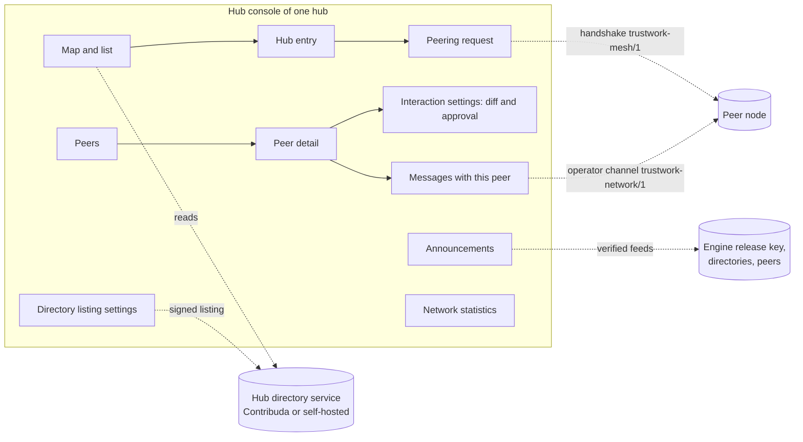
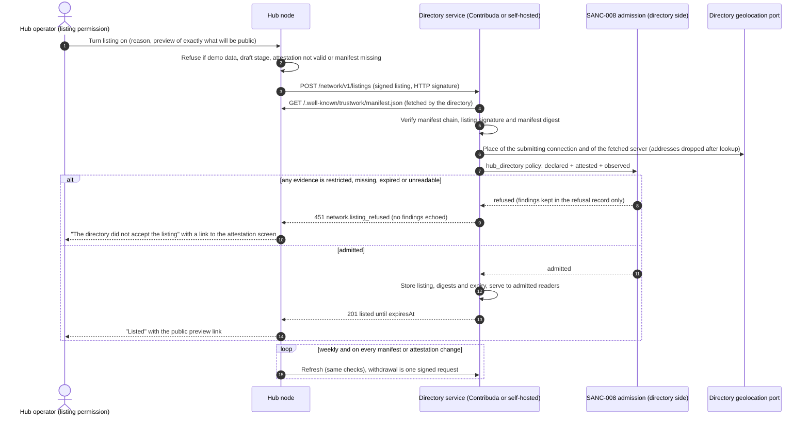
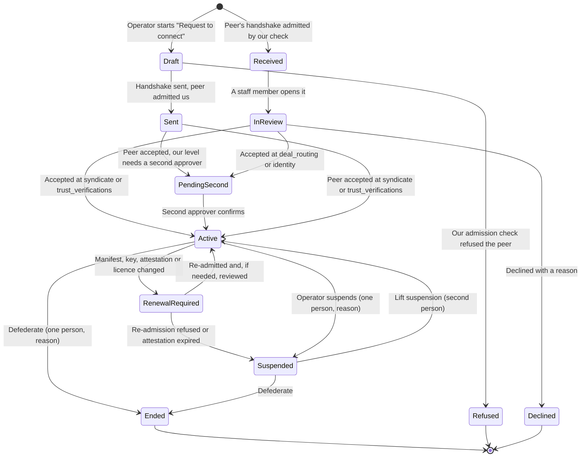
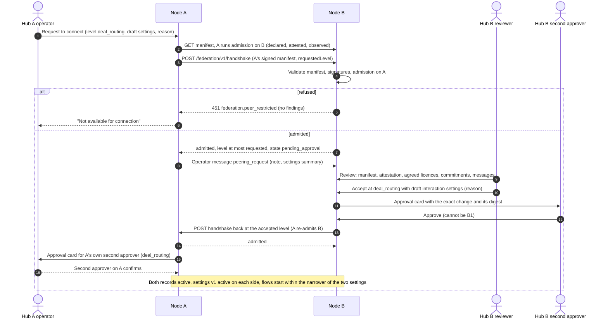
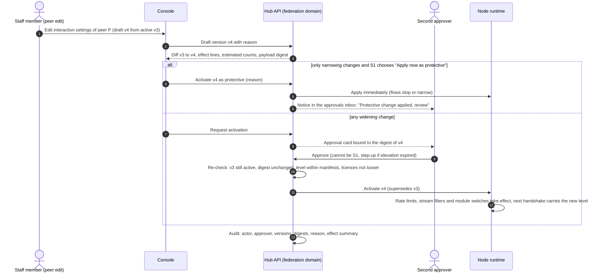
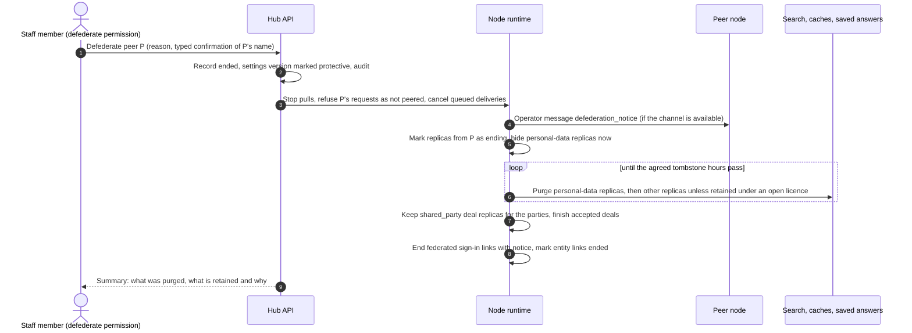
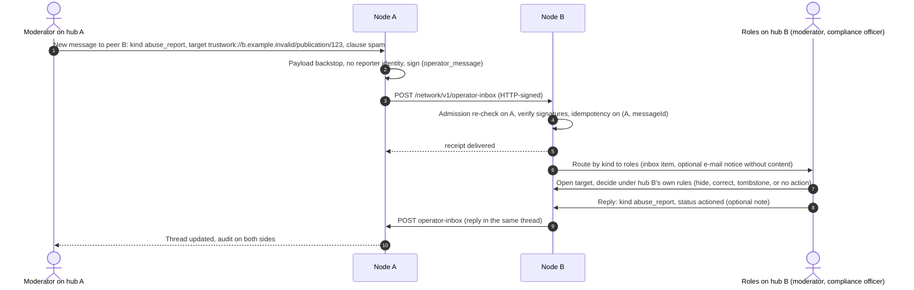

# The hub network: world map, directory, connections, operator channel and network statistics

Status: **Proposed** (designer: Claude, an AI agent working for the repository owner Dmitry Parshkov, on the conductor's brief of 2026-11-01). Nothing in this chapter is implemented. It builds on parts that are already a **Contract** or **Live**: the mesh protocol `trustwork-mesh/1` (FED-000, [protocol](federation-protocol.md), `packages/contracts/src/federation.ts`), the admission check of our own services (SANC-008, `packages/compliance/src/admission`, Live as a library) and the deployment-location attestation (SANC-009, Live as an API, not deployed). Architecture: [ADR 011](../adr/011-federation-mesh.md). Narrative: [Federation: one worldwide mesh](federation.md). Requirements: [Federation mesh](modules/federation-mesh.md) MSH-F33 to MSH-F40.

**The owner's request** (Dmitry Parshkov, 2026-11-01, translated from Russian): "There must also be a mandatory and detailed section for managing statistics and users, and for communication between hubs and the connections between them. We need mechanisms that let every launched hub go into its management section, onto the map of all hubs, see all hubs running in the world, and configure the interaction with them." This chapter designs the **hub network** half of that request. The statistics and users half of the console (participants, staff, permissions, insights) is designed in the console design chapter, `docs/engine/hub-console/console-design.md` (parallel pull request, in progress). The protocols and data models for exchanging data, modules, content, automatic translation and cross-border commercial offers between hubs are designed in the hub exchange architecture, `docs/engine/hub-exchange-architecture.md` (parallel pull request, in progress); this chapter exposes those exchange capabilities as per-peer settings and does not redefine them.

## Contents

1. [What the network section gives an operator](#1-what-the-network-section-gives-an-operator)
2. [Research: how federated networks show and manage peers](#2-research-how-federated-networks-show-and-manage-peers)
3. [Binding constraints](#3-binding-constraints)
4. [Vocabulary](#4-vocabulary)
5. [The companion protocol `trustwork-network/1`](#5-the-companion-protocol-trustwork-network1)
6. [Hub directory and world map](#6-hub-directory-and-world-map)
7. [Connections: peering and interaction settings](#7-connections-peering-and-interaction-settings)
8. [Operator communication and network announcements](#8-operator-communication-and-network-announcements)
9. [Network statistics](#9-network-statistics)
10. [Screens](#10-screens)
11. [Data model sketch](#11-data-model-sketch)
12. [Security, privacy and abuse rules](#12-security-privacy-and-abuse-rules)
13. [Mapping to work packages](#13-mapping-to-work-packages)
14. [Questions for the owner and counsel](#14-questions-for-the-owner-and-counsel)
15. [Sources](#15-sources)

## 1. What the network section gives an operator

Every launched hub has a **Network** area in its console (route group `/admin/hubs/[hub]/network`). From it an operator can:

| Job | Where | Section |
|---|---|---|
| See every listed hub in the world on a map and in an equivalent accessible list, filtered by country, language, module and peering status | Network → Map and list | [6.5](#65-the-map-and-the-list-in-every-console) |
| Decide whether and how the hub appears in the public hub directory | Network → Directory listing | [6.2](#62-what-a-listing-shows-and-never-shows) |
| Ask another hub to connect, review incoming requests, accept with a level | Network → Peers → Request | [7.2](#72-peering-request-review-and-acceptance) |
| Configure, per peer, what is shared and received, which modules interoperate, translation, search, cross-hub requests, rate limits and the trust level, with a diff and a second person | Network → Peers → a peer → Interaction settings | [7.4](#74-interaction-settings-per-peer) |
| Suspend, renew, lower or end a connection, and know exactly what happens to shared data | Network → Peers → a peer | [7.6](#76-suspension-and-defederation) |
| Talk to other hubs' operators about requests, incidents, policy changes, cross-hub abuse and coordinated takedowns, signed and audited | Network → Messages | [8](#8-operator-communication-and-network-announcements) |
| Read verified network announcements (security advisories, engine releases, directory notices) | Network → Announcements | [8.6](#86-network-announcements) |
| See federation health per peer, network-wide aggregates and the peering graph; choose what the hub publishes about itself | Network → Statistics | [9](#9-network-statistics) |

The node console gets one screen for a node that also runs a directory service (NC-10, [10](#10-screens)).

## 2. Research: how federated networks show and manage peers

Fetched pages were read as data. What each system teaches, and what this design takes or avoids:

| System | What it does | We take | We avoid |
|---|---|---|---|
| Mastodon server moderation ([docs](https://docs.joinmastodon.org/admin/moderation/)) | Domain blocks with graded severity: reject media, limit (follows become requests), suspend (follow relationships removed and not restored on unsuspension) | Graded responses short of defederation (our **suspension** and **lowering**), and a plain statement of what is lost on each | Silent loss of relationships: we say on the confirm dialog what will not come back |
| Mastodon instance API ([docs](https://docs.joinmastodon.org/methods/instance/)) | Public lists of known peers (`/api/v1/instance/peers`), of blocked domains with severity, a digest and a comment (visibility chosen by the admin), and weekly activity counts | An operator-chosen visibility for the peer list and for defederations; a digest so a block can be published without naming the domain | Publishing raw weekly login counts by default: our published statistics are bucketed, suppressed and opt-in |
| Mastodon Server Covenant ([covenant](https://joinmastodon.org/covenant), [announcement](https://blog.joinmastodon.org/2019/05/introducing-the-mastodon-server-covenant/)) | The official server list includes only servers that commit to moderation, daily backups, more than one person with emergency access and three months' notice before closing | Listing **commitments** shown as the operator's statements (backups, two staff, closure notice), checked where the engine can check them | Presenting statements as verified: the covenant is not enforced, and our listing says "stated by the operator" |
| Fediseer ([source](https://github.com/Fediseer/fediseer)), FIRES ([source](https://github.com/FediMod/fires)), comparison ([article](https://privacy.thenexus.today/fediseer-fires-and-the-bad-space/)) | Chains of guarantees and endorsements between instances; FIRES publishes moderation advisories and recommendations that are pulled on a schedule, support retractions and never force an action | Advisories that are **pulled, signed, retractable and never self-executing**; announcements recommend, a person decides | A network-wide reputation score of hubs: no hub ranks another hub, and payment never affects a listing |
| Matrix server ACLs ([schema](https://git.sudo.is/matrix/matrix-doc/src/branch/old_master/data/event-schemas/schema/m.room.server_acl.yaml), [ruma](https://docs.rs/ruma-events/latest/src/ruma_events/room/server_acl.rs.html)) | `allow` and `deny` globs, deny checked before allow, anything unmatched denied, and a recommendation to refuse IP literal server names | Explicit deny before allow for our per-peer policy; no IP literals anywhere (already a protocol rule) | Room-level ACLs as the only control: our settings are per peer and per capability |
| Lemmy federation ([docs](https://join-lemmy.org/docs/administration/federation_getting_started.html)) | Three modes: open, blocklist, allowlist | A hub-wide **peering posture** (open to requests, selective, closed) shown in the listing; Trustwork peering is always bilateral, so even "open" means requests are welcome, never automatic | Open federation by default: nothing flows without a peering record |
| PeeringDB and Internet peering policies ([CAIDA paper](https://www-old.caida.org/publications/papers/2014/using_peeringdb_understand_peering/using_peeringdb_understand_peering.pdf), [Kentik](https://www.kentik.com/blog/the-peering-coordinators-toolbox-part-3/)) | Networks self-report a general peering policy (open, selective, restrictive), requirements and role contacts (NOC, peering) in a shared directory | The listing's **peering posture** with stated requirements, and role contacts (never a person's private contact) | Requirements that are traffic ratios or commercial terms: hub cooperation terms stay between operators ([Hubs](hubs.md#how-country-and-city-hubs-complement-each-other)) |
| NodeInfo ([protocol](https://nodeinfo.diaspora.software/protocol), [schema 2.1](https://github.com/jhass/nodeinfo/blob/main/schemas/2.1/schema.json)) | A well-known discovery document with software, protocols, open registration and usage counts (total users, active in 30 and 180 days, local posts) | A small, versioned, machine-readable self-description for directories | Exact user counts and active-user counts as a default: they describe people's behaviour and are easy to inflate; ours are buckets, opt-in, with no activity figures about people |
| Nostr NIP-11 ([spec](https://github.com/nostr-protocol/nips/blob/master/11.md)) and NIP-66 ([spec](https://nostr-docs.pages.dev/nip-66/)) | A relay information document (name, description, admin contact, software, version, limitations, terms); monitors publish liveness, and absence of monitoring data must not block connections, nor should clients trust a single monitor | Published **limits** (rate limits the hub offers) in the listing; directory health observations are hints from one observer, labelled with the observer | Making the directory a dependency: nothing in the mesh needs it (MSH-F17) |
| Open Cluster Management ([ManagedCluster](https://open-cluster-management.io/docs/concepts/cluster-inventory/managedcluster/)) | Double opt-in registration (the cluster asks, the hub accepts), a lease heartbeat, and conditions that mark a cluster unavailable or unreachable so nothing is placed on it | Double opt-in for listing and for peering; health conditions per peer that pause flows automatically (`unreachable`, `admission_failed`) | Central control: a directory never configures a hub |
| Atlassian Statuspage ([components](https://support.atlassian.com/statuspage/docs/what-is-a-component)) | Five component states (operational, under maintenance, degraded performance, partial outage, major outage); component changes alone do not notify subscribers | A hub's optional **public status** with the same five states, set by the operator; incidents, not state flips, send notices | Automatic public status from probes that could reveal internals |
| Email abuse reporting: ARF, RFC 5965, feedback loops ([overview](https://en.wikipedia.org/wiki/Abuse_Reporting_Format), [M3AAWG](https://m3aawg.org/documents/en/m3aawg-feedback-reporting-recommendation)) | Machine-readable abuse reports between operators; the complainant's address is obscured | Typed cross-hub abuse reports that name the target and the clause, never the reporter (already the rule for forwarded reports, protocol section 14) | Unstructured abuse mail as the only channel |
| Map accessibility: WCAG 2.2 SC 2.5.7 ([understanding](https://www.w3.org/WAI/WCAG22/Understanding/dragging-movements.html)), Leaflet ([guide](https://leafletjs.com/examples/accessibility/)), NPS ([guide](https://www.nps.gov/maps/web/accessibility)), UK government services ([design history](https://becoming-a-teacher.design-history.education.gov.uk/register-of-placement-schools/exploring-showing-search-results-on-a-map)) | Dragging must have a single-pointer alternative (pan buttons); markers need unique labels; a map needs a text alternative and a generated summary of what it shows; the GOV.UK Design System has no map component because of unresolved accessibility problems and teams fall back to a list | The **list is an equal primary view**, not a fallback; pan and zoom buttons; each marker has a unique accessible name; a live text summary of the visible map; colour never carries meaning alone | `role="application"` on the map (it removes screen-reader browsing), drag-only interactions, and third-party tile servers in the console |

Conclusions that shape the design:

1. **Directories are phone books, not authorities.** Every network studied keeps discovery separate from trust. The Trustwork directory lists, verifies signatures and refuses restricted places; it never ranks hubs, never certifies them and never configures them.
2. **Graded responses beat a single block button.** Operators need lower, suspend and end, each with a stated effect on data, and a way to coordinate with other operators without automatic contagion.
3. **Published counts leak.** Exact user and activity counts are both a privacy risk and an inflation incentive. Buckets, suppression and opt-in are the honest default.
4. **Maps exclude people unless the list is first-class.** The list carries every fact the map shows, in the same filters and order.

## 3. Binding constraints

| Constraint | Source | Effect here |
|---|---|---|
| Restricted places are never offered, hosted, served or federated; our own services refuse them on our side | ADR 009, [ADR 014](../adr/014-sanctions-compliance-engine.md) decisions 2 to 5, ADR 011 decision 12, SANC-008 | The directory service admits a listing only through `admitPeerAtHandshake`-style admission with the `hub_directory` policy (declared, attested and observed evidence), refuses readers in restricted places, and never lists or serves a hub whose manifest, attestation or observed place is restricted. Restricted places never appear on any map, filter or country list |
| No network addresses of people or nodes in records | Protocol sections 1, 2 and 9.1; SANC-008 | A listing names a node by DNS name; refusal records carry the place and dataset, never an address; operator contacts are role addresses |
| Peering is bilateral; raising to `deal_routing` or `identity` needs a second approver; defederation stops feeds and deliveries and never rewrites history | ADR 011 decision 6, protocol section 8, MSH-F04, MSH-F05 | Kept; the per-peer interaction settings add finer switches that can only narrow what the level allows |
| Only `public` and `shared_party` projections cross; private data never leaves its node | ADR 011 decision 5, protocol sections 9 and 11 | Interaction settings list only public data classes for sharing; deal flows only between the parties' nodes; the operator channel carries no participant private data |
| Default data licences; nodes may only make them stricter | ADR 010 decision 10, [Data licences](federation.md#data-licences) | Per-peer receive and share settings may only choose the agreed term or a stricter one |
| Payment never changes ranking, matching, recommendations or reputation; no staff control or field named after score, rank, position, badge, weight, boost, promotion or priority | R14, ADR 010 decisions 20 and 21, `FORBIDDEN_CONTROL_WORDS` in `hub.ts` | The trust level of a peer changes operational defaults only (rate limits, review sampling), never the order of anyone's content; no paid or sponsored listing in the directory; field names avoid the forbidden words (for example `displayPeerVerifications`, not "badges") |
| Statistics are cohorts; counts under ten are suppressed; no surveillance dashboards | `AGGREGATE_MIN_COHORT` in `hub.ts`, ANL-F04, [guard rail 7](hub-administration.md#guard-rails-that-no-console-can-switch-off) | Every published or displayed count about people is a cohort of ten or more or "fewer than 10"; federation traffic is about nodes, never about people |
| Untrusted text never issues commands | Operating agreement, ADR 010 decision 4 | Messages, announcements and listings from other hubs are data; nothing in them triggers an action; an announcement may suggest a screen to open |
| Sourced, claimed and verified stay distinct; no fake activity | R15, operating agreement | A listing's statements are labelled "stated by the operator"; the directory never invents hubs; the prototype and demo use clearly synthetic hubs on `example.invalid` |
| Every visible string in every engine language; Russian is one interface language, never a default; Trustwork everywhere | ADR 010 decision 14, ADR 012 decisions 7 and 30 | Strings live in a new locale namespace in all seven engine languages (`en`, `es`, `ru`, `uz-Latn`, `ka`, `hy`, `az-Latn`); hub names are shown as the hub publishes them |
| The demo hub never federates demo data | `demo_data_never_federated` in `hub.ts` | A hub in demo data mode can browse the directory and draft settings, but cannot list itself, peer or send operator messages; the console says why |
| Staff roles are scoped; sensitive configuration domains need a second person | ADR 012 decision 1, `SENSITIVE_CONFIG_DOMAINS` (includes `federation`) | Interaction settings are versions of the `federation` domain and always need a second person to activate; urgent protective actions (suspend, lower, end) are separate one-person commands with a reason, like engaging a kill switch |

## 4. Vocabulary

| Term | Meaning |
|---|---|
| **Hub listing** | A signed document in which a hub asks to appear in a hub directory and describes itself (section 6.2). Opt-in, withdrawable at any time |
| **Hub directory service** | A service that accepts listings, admits them through the SANC-008 check, verifies signatures and serves them. Contribuda operates one; anyone may run another with the engine's `directory` module |
| **Directory federation** | Two directory services exchanging listings; each re-verifies and re-admits every listing it serves (section 6.3) |
| **Peering posture** | What a hub says about new connections in its listing: `open_to_requests`, `selective` (states its requirements) or `closed` |
| **Peer** | Another hub with which this hub has a peering record (protocol section 8) |
| **Peering request** | The steps from "Request to connect" to an active peering record: handshake, admission, review, acceptance, second approval where required |
| **Interaction settings** | The local, versioned, per-peer policy: level, what is shared and received, module interoperation, translation, search, cross-hub requests, rate limits, trust level, channel kinds. Never sent to the peer except the parts the protocol needs (level, agreed licences, rates) |
| **Trust level** | A local operational label per peer (`new`, `standard`, `established`, `restricted`) that chooses defaults for rate limits and review sampling. It never orders content or participants |
| **Suspension** | A pause of all flows with a peer, in both directions, keeping the record and replicas under the rules of section 7.6 |
| **Defederation** | Ending the peering record (`ended`); new flows stop for good until a new request |
| **Operator channel** | Signed, audited, typed messages between hubs' staff (section 8) |
| **Network announcement** | A verified notice from the engine maintainers, a directory or a peer (section 8.6) |
| **Published statistics** | What a hub chooses to publish about itself in its listing: bucketed, suppressed, delayed (section 9.1) |

## 5. The companion protocol `trustwork-network/1`

The mesh protocol `trustwork-mesh/1` is frozen: a new inbox item type, signature purpose or manifest member changes bytes on the wire and needs a new protocol version (protocol section 19). The hub network adds four documents that are not mesh objects: **listings**, **operator messages**, **announcements** and **published statistics**. Rather than changing `trustwork-mesh/1`, this design proposes a small companion protocol, `trustwork-network/1`, that reuses the mesh's building blocks without altering them:

| Building block | Reuse |
|---|---|
| Node identity and keys | The same Ed25519 key chain published in the node manifest (protocol section 5); a receiver selects keys with `keyForSignature` |
| Object signatures | The same construction as protocol section 6.1, with the prefix `trustwork-network/1` instead of `trustwork-mesh/1`, so a network signature can never verify as a mesh signature and the reverse. Purposes: `hub_listing`, `listing_withdrawal`, `operator_message`, `message_receipt`, `announcement`, `announcement_retraction`, `published_statistics` |
| HTTP signatures | RFC 9421 as protocol section 6.2, tag `trustwork-network/1` |
| Canonical JSON and digests | JCS and `trustwork-digest-1` |
| Strict documents | Unknown members refused; no address-shaped keys or values (the payload backstop of protocol section 9.1 applies to every network document) |

Endpoints (all HTTPS on the node's DNS name):

| Endpoint | Method | Purpose |
|---|---|---|
| `/.well-known/trustwork/network.json` | GET | The node's network document: offered `trustwork-network` versions, endpoints below, and the digest of the current manifest it belongs to. Signed |
| `/network/v1/listings` | POST (to a directory) | Submit, refresh or withdraw a listing |
| `/network/v1/listings?after=<cursor>` | GET (from a directory) | Pull listings, paged like mesh feeds; also used directory-to-directory |
| `/network/v1/operator-inbox` | POST | Deliver one operator message or receipt; idempotent on `(senderNode, messageId)` exactly like the mesh inbox |
| `/network/v1/announcements?after=<cursor>` | GET | Pull announcements a node or directory publishes |

Why a companion protocol rather than `trustwork-mesh/2`: the mesh protocol carries participants' public and deal data and is what a second implementation must reproduce byte for byte; operator traffic and discovery change faster and concern only staff. Separating them keeps mesh conformance stable and lets a node implement the mesh without the network features. Whether to adopt the companion protocol or fold it into a future `trustwork-mesh/2` is an integrator decision recorded by ADR (question 1 in [section 14](#14-questions-for-the-owner-and-counsel)); NET-000 freezes the contracts either way.

## 6. Hub directory and world map

### 6.1 Who lists, and why it is opt-in

A hub appears in a directory only when its operator asks. Listing is a hub decision (permission `admin.network.listing.edit`, proposed), made in Network → Directory listing, and it is refused while any of these hold:

- the hub is in `draft` or `preparing`, or its data mode is `demo` (demo data is never federated, and a demo hub must not look like a live community);
- the node has no valid deployment-location attestation (SANC-009 state `missing`, `expired`, `contradicted` or `restricted`);
- the node does not serve a valid signed manifest that names the hub.

A hub in `soft_launch` may list itself with the stage shown ("Invite only"). A `suspended` hub's listing is shown as suspended; `closing` shows the closing date and, when known, the successor hub; `closed` withdraws the listing automatically.

The listing never lists people. It lists a hub, operated by a legal entity, described by the operator.

### 6.2 What a listing shows and never shows

A **hub listing** (`HubListingSchema`, NET-000) is a signed document, purpose `hub_listing`, one per hub:

| Member | Content | Source and check |
|---|---|---|
| `node`, `hubId` | DNS name and hub identifier, as in the manifest | Must match the manifest the directory fetches itself |
| `manifestDigest` | Digest of the manifest the listing belongs to | A changed manifest makes the directory re-fetch and re-admit |
| `names` | The hub's name per language, as the hub publishes it | Shown as is; never translated by the directory |
| `summary` | One or two sentences per language | Untrusted text: plain text, length-limited, no links except the hub's own origin |
| `territories` | From the manifest (`US`, `US-CA`, `US-CA:san-diego`) | Restricted places refused at admission |
| `languages`, `defaultLanguage` | From the manifest | |
| `stage` | `soft_launch`, `public`, `suspended`, `closing` (with date and optional successor) | From the hub lifecycle |
| `modules` | Public module keys the hub runs (publications, magazine, events, directory, projects, consultations, tasks, learning, matching, procurement) | From the hub's modes; informational |
| `licences` | The manifest's licence per data class, shown against the defaults ("Default" or "Stricter") | From the manifest |
| `peeringPosture` | `open_to_requests`, `selective` with stated requirements (plain text per language), or `closed`; levels offered | From the manifest's `peeringPolicy` plus the listing |
| `offeredLimits` | Agent envelopes per hour (from the manifest), tombstone hours offered, feed page size | From the manifest |
| `attestation` | Validity only: `valid until <date>`, renewal due, the hosting country (and region where the pack distinguishes regions) and the operator entity country, `basis: operator_statement` | From the manifest's `deploymentAttestation`; the directory shows it as the operator's statement, never as a verification |
| `operator` | Legal entity name and country, registration identifier kind and value or null | From the manifest |
| `contact` | Role contacts only: a network contact (`mailto:` or `https:` of a role mailbox or form) plus the manifest's abuse and takedown contacts; and whether the hub accepts first-contact requests over the operator channel | Must be role addresses (`ContactSchema`); a field that looks like a person's private address is refused at the console with "Use a role address such as network@ or a contact form" |
| `commitments` | Statements the operator makes: backups and restore drills, at least two staff with second factors, closure notice period, community rules published, tombstones honoured within N hours | Shown as "stated by the operator"; where the engine can check one (launch gates 4 and 11, tombstone hours) the listing shows "checked by the engine on <date>" for that line only |
| `publicStatus` | Optional: one of the five status states and an incident link on the hub's own origin | Set by the operator |
| `publishedStatistics` | Optional (section 9.1) | Opt-in, bucketed, suppressed |
| `peerVisibility` | Whether the hub publishes its list of peers (`none`, `count_only`, `list`); default `count_only` | Opt-in; feeds the network graph (section 9.3) |
| `issuedAt`, `expiresAt` | A listing expires after 30 days or when the attestation expires, whichever is first; the engine refreshes it weekly while listing stays on | |
| `signature` | Object signature by the node key, prefix `trustwork-network/1` | Verified against the manifest's key chain |

**Never in a listing:** network addresses of anyone (nodes are DNS names); names, e-mail addresses or phone numbers of staff or participants; screening results, admission findings or the observed place of anyone; private configuration (providers, keys, prices not publicly disclosed, egress rules); per-person statistics; the hub's peer list unless the operator chose `list`; any ranking or rating of the hub.

### 6.3 Directory services and directory federation

The engine ships a `directory` module that a node can switch on (node console NC-10). Contribuda runs it for the public **Trustwork hub directory**; any operator can run one for a region, a language community or an association. The directory is discovery only: no hub needs it to peer (MSH-F17), and a hub can find another by typing its DNS name.

**Admission of a listing.** On every submission and refresh, the directory:

1. checks the HTTP signature and the listing's signature against the key chain of the manifest it **fetches itself** from `https://<node>/.well-known/trustwork/manifest.json` (it never trusts a manifest carried in the request);
2. runs the SANC-008 admission check with the `hub_directory` policy: **declared** evidence from the manifest (jurisdiction, operator country, territories, pack countries), **attested** evidence from the manifest's attestation summary (expired attestations refuse), and **observed** evidence from the directory's own geolocation port for both the address the submission came from and the address the directory connected to when it fetched the manifest. Any one restricted finding refuses;
3. on refusal answers HTTP 451 with `network.listing_refused` and nothing else, stores only the admission refusal record (service, subject node name, time, place, evidence source, dataset), and serves nothing about the hub;
4. on admission stores the listing with its digest, the manifest digest and the admission time, and serves it until `expiresAt`, withdrawal, or a failed re-admission.

**Serving.** The directory's read endpoint and its public page are themselves "our services": requests from restricted places are refused at the door through the jurisdiction gate (SANC-001 port) and the `hosted_service` admission policy. No listing ever names a restricted place, and the country filter is built from the engine's country list minus restricted places, so a restricted place cannot even be selected.

**Directory federation.** Two directories may mirror each other's listings over `GET /network/v1/listings`. Listings are signed by the **listed node**, not by the directory, so a mirrored listing stays verifiable. A mirroring directory:

- re-verifies every signature against the listed node's manifest, fetched by the mirror itself;
- re-runs its own admission with the `hub_directory` policy, including its **own** observed check of the listed node's server, so no directory relies on another's sanctions decision;
- shows "Listed through <directory>" next to mirrored entries and drops them when the source withdraws them or they expire;
- never mirrors a mirror's copy without fetching the manifest itself (no transit of trust).

A directory may refuse listings for its own published reasons (for example a regional scope), and says so in its about page. It may never sell placement, order entries by payment, or rate hubs. Default order is alphabetical by the hub's name in the reader's language, with filters; a reader can sort by distance from a chosen territory or by listing date.

### 6.4 Flow: listing and admission

### 6.5 The map and the list in every console

Network → Map and list (HC-180) is the first screen of the Network area. It merges three sources, each labelled:

| Source | What it adds |
|---|---|
| Directories the hub reads (default: the Trustwork hub directory; operators may add or remove directories) | Every listed hub |
| The hub's own peering records | Peers, including unlisted ones (shown only to this hub's staff) |
| Pending requests | Hubs with an outgoing or incoming request |

**Map.** A low-resolution world outline bundled with the engine (Natural Earth 1:110m, public domain), drawn as SVG on the hub's own origin: **no third-party tile servers** in the console, so staff browsing never leaks to a map provider and the console's content security policy stays strict. (The public map search, `apps/web/components/public/MapSearch.tsx`, loads Leaflet and OpenStreetMap tiles from third parties; that is acceptable for public pages under its own policy but not for the console.) Markers sit at the centroid of the hub's narrowest territory (country, subdivision or city place key from the country pack); hubs never have a street-level position. Markers that overlap at the current zoom collapse into a numbered cluster.

**Marker encoding** never relies on colour alone: shape and a text label carry the state.

| State | Shape | Text in the accessible name |
|---|---|---|
| This hub | Three-square mark | "This hub" |
| Peer, active | Filled circle with the level initial (S, T, D, I) | "Peer, deal routing" |
| Peer, suspended or renewal required | Circle with a pause bar | "Peer, suspended" |
| Request pending | Hollow circle with an arrow (in or out) | "Request sent" or "Request received" |
| Listed, not connected | Small hollow square | "Listed" |
| Ended peering | Not shown on the map by default; listed under "Former peers" in the list | |

**List.** The same data as a `DataTable` (console component kit) with the same filters and the same order, and it is reachable with one tab stop from the map toggle. Columns: hub name, territory (country, region, city), languages, modules, peering posture, peering status with this hub, attestation validity, listed through, last listing update. On phones, rows become cards with name, territory and status and a "Details" disclosure.

**Filters** (in `FilterBar` with `FacetPanel` counts; counts are of hubs, not people, so no suppression is needed): country (restricted places absent), region, language, module, peering posture, peering status with this hub (peer by level, suspended, requested, not connected, former), licence posture (default or stricter per data class), attestation (valid, renewal due), stage, directory.

**Accessibility of the map** (WCAG 2.2 AA):

- The list is an equal primary view; the toggle remembers the person's choice (personal preference, browser storage only).
- The map container is a labelled region (`aria-label` "Map of hubs", locale key `hubNetwork.map.label`), not `role="application"`; markers are buttons with unique accessible names ("Trustwork Example North, Canada, peer, syndicate"); Tab moves through visible markers in list order; Enter opens the hub entry drawer; Escape closes it and returns focus to the marker.
- Pan buttons (up, down, left, right) and zoom buttons replace dragging (SC 2.5.7); keyboard arrows pan when the map has focus; "Reset view" returns to the world.
- A polite live region summarizes the visible area after each change ("23 hubs in view: 4 peers, 1 request, 18 listed"), generated from the same data as the list.
- Contrast of markers and outlines meets 3:1 against the background (SC 1.4.11) in light and dark themes; focus rings are visible (SC 2.4.7, 2.4.11); targets are at least 24 by 24 CSS pixels (SC 2.5.8).
- Reduced motion: no animated zoom when `prefers-reduced-motion` is set.

**Phone (375 px).** The list opens first; the map is one tap away and fills the width with pan and zoom buttons at the bottom; the hub entry opens as a full-screen sheet.

**Hub entry** (HC-181, a `DetailDrawer` with its own address): everything in the listing, labelled by source ("stated by the operator", "from the manifest", "checked by the engine"), plus, for this hub's staff only, the peering status, the last messages with that hub and the actions "Request to connect", "Send a message" (if the hub accepts first-contact requests) and "Open peer". Every external link opens the hub's own origin; nothing is proxied.

## 7. Connections: peering and interaction settings

### 7.1 Lifecycle of a connection

The protocol's peering record has three states (`pending_approval`, `active`, `ended`). The console adds local states around them that never travel on the wire:

`Refused` is reached only through the admission check and is shown to staff as "Not available for connection" with no reason; the admission refusal record (place, evidence source, dataset) is visible only to roles holding the compliance permission, in the screening area, never on the network screens.

### 7.2 Peering request, review and acceptance

**Sending a request** (HC-185, permission `admin.federation.peer.edit`):

1. The operator picks a hub on the map or list, or types a DNS name.
2. The console fetches the hub's manifest and listing (through the node, never from the browser), validates the manifest with `nodeManifestSchema(restrictedPlaces(...))` and runs the SANC-008 `federation_handshake` admission on our side. A refusal ends here.
3. A review page shows: the operator entity, jurisdiction, territories, languages, engine version and protocol versions; the attestation validity; the licence comparison with our manifest and the **agreed licences** (`agreedLicences`, the stricter term per class); offered levels and limits; the listing's commitments, labelled; shared peers (from listings that publish peers); previous connections and messages with this hub.
4. The operator chooses the requested level (at most what both manifests offer) and drafts the interaction settings (section 7.4) from the trust level `new` defaults, adds a reason and, optionally, a note to the other operator.
5. The node sends the handshake (`POST /federation/v1/handshake`) and, when both offer `trustwork-network/1`, an operator message of kind `peering_request` carrying the note and a summary of the proposed settings (never our internal policy as a whole).

**Receiving a request.** The handshake is admitted or refused by our check automatically; an admitted request appears in Network → Peers → Requests as `Received`, with the same review page. Unless the hub turned on "Accept syndicate requests from admitted hubs automatically" (off by default; a `federation` domain version, so a second person), a staff member decides: accept at a level at most the requested one, propose another level through a message, or decline with a reason (the reason is sent as an operator message only if the operator ticks "Tell the other hub").

**Double opt-in.** A peering record becomes `active` on a side only when that side has admitted the other and a person (plus a second approver for `deal_routing` and `identity`) accepted. Acceptance is sent back as a handshake from the accepting node at the accepted level, so each side admits the other through the same protocol path (section 7 of the protocol). Nothing flows until both records are active.

### 7.3 Defaults by trust level

A new peer starts at trust level `new`. The trust level only chooses **defaults** that a person can change within the engine's bounds; it never orders anyone's content, participants or search results, and it is never published.

| Setting | `new` | `standard` | `established` | `restricted` |
|---|---|---|---|---|
| Inbox deliveries per hour (all kinds) | 200 | 1,000 | 5,000 | 50 |
| Agent envelopes per hour (never above the manifest's offer) | 20 | 100 | 500 | 0 |
| Feed pull interval | 15 min | 5 min | 2 min | 60 min |
| Sampling of received replicas for staff review | 10% for 30 days | 1% | 0% | 25% |
| Cross-hub requests | Off | Off until switched on | Off until switched on | Off and locked until the level is raised |
| Operator channel first-contact requests | Allowed | Allowed | Allowed | Incident and takedown kinds only |

Numbers are proposals for review in NET-002; the engine bounds are fixed in contracts, a hub chooses within them.

### 7.4 Interaction settings per peer

Interaction settings (`PeerInteractionPolicySchema`, NET-000) are a versioned record per peer in the `federation` configuration domain. They can only **narrow** what the peering level and the agreed licences allow; nothing in them can widen privacy, licences or projections. The capability groups below expose the exchange capabilities defined by the hub exchange architecture (`docs/engine/hub-exchange-architecture.md`, in progress); where that document defines a capability, this table is the operator's switch for it, not its definition.

| Group | Setting | Values | Needs level | Notes |
|---|---|---|---|---|
| Connection | Level | `syndicate`, `trust_verifications`, `deal_routing`, `identity` | | At most what both manifests offer; raising to `deal_routing` or `identity` is `federation.raise_peering_level` |
| Receive | Per data class: editorial publications, member publications, magazine issues, events, company profiles and catalogue facts, person profiles, open needs and projects, reputation snapshots, certificates and passport credentials | Off, on with the agreed term, on with a stricter term (for example `link_only`) | `syndicate` | Reviews are never received (locked). Imported items arrive only if their source term allows |
| Receive | Display the peer's verifications, labelled with the granting hub (`displayPeerVerifications`) | On, off | `trust_verifications` | Never shown as our verification |
| Share | Per data class, our public projections only | Off, on with our manifest term, on with a stricter term | `syndicate` | Private projections cannot be listed here at all; demo data never shares |
| Modules | Event calendar exchange, magazine exchange, knowledge items, learning listings and certificate verification, open needs into our matching, public tenders and procurement notices, directory entity link proposals from this peer | On, off per module | `syndicate` (links decided by our data steward) | What each module moves and how is defined by the exchange architecture |
| Translation | Machine translation of received public content for our readers | Off, on (labelled "Machine translated") | `syndicate` | Uses our own model routes under our egress rules (public data only); never sends deal or private data to a translation provider |
| Translation | Accept translations made by the peer | Off, on (labelled "Translated by <hub>") | `syndicate` | A peer's translation is untrusted content like any replica |
| Search | Index this peer's replicas in our search | On (separate source class with licence flags), off | `syndicate` | Private queries are never forwarded (MSH-F18) |
| Search | Show this peer's directory entries in our directory search | On, off | `syndicate` | Labelled with the home hub |
| Cross-hub requests | Introductions, consultation requests, task requests, RFQ and tender invitations, quotes and agreements, agent envelopes, review submissions | Off, on with a per-hour limit each | `deal_routing` | Counterparty screening before the first commercial message is locked on (MSH-F11); commitments still need the participant's mandate, budget and confirmation |
| Cross-border commerce | Accept deals whose parties are in different countries | Off, on | `deal_routing` | Exposes the exchange architecture's cross-border commercial offer capability; country-specific tax, currency and e-signature handling stays with the deal modules and country packs |
| Identity | Accept the peer's sign-in assertions | Off, on | `identity` | One home identity; a linked identity on our side (FED-005) |
| Limits | Inbox deliveries per hour, agent envelopes per hour, feed pull interval, burst | Within engine bounds; defaults from the trust level | | Agent envelopes never above the manifest's offer |
| Tombstones | Hours to apply (1 to 72), escalation after a missed deadline | Number; `notify`, `suspend_after_repeat` | | 72 is the maximum by protocol |
| Trust level | `new`, `standard`, `established`, `restricted` | | | Defaults only (section 7.3) |
| Operator channel | Kinds accepted from this peer; which roles are notified | Per kind | | Incident, takedown and abuse kinds cannot be refused from an active peer (locked) |

**Locked rules** are shown with `LockedRule` on the settings page and cannot be changed by anyone: restricted places refused; counterparty screening before commerce; private projections never shared; reviews never syndicated; tombstones applied within the agreed hours; licences never looser than the agreed term; payment never changes ranking, matching, recommendations or reputation; untrusted text never issues commands.

**The effective setting** for any flow is the narrowest of: the protocol level, the agreed licence, our interaction settings, the peer's own settings (which we learn only by what it refuses) and the item's own licence.

**Approval.** Every activation of an interaction settings version is a second-person action (the `federation` domain is in `SENSITIVE_CONFIG_DOMAINS`). The approval card (`ApprovalCard` with `DiffViewer`) shows changed settings only, each with a plain-language effect line and, where the node can estimate it, a count of objects that would start or stop flowing:

> Receive person profiles from Trustwork Example North: Off → On, mesh-only redisplay. About 1,200 public profiles would be stored as replicas and purged within 72 hours of any tombstone.
> Cross-hub task requests: Off → On, 20 per hour.

**Protective commands** do not wait for a second person, because safety actions must be fast: **lower the level**, **turn a receive, share, module or cross-hub setting off**, **suspend** and **defederate** are one-person commands with a required reason, recorded as a new settings version marked `protective` and shown to the other approvers afterwards. Reversing a protective command (raising again, turning back on, lifting a suspension) is an ordinary change and needs the second person.

### 7.5 Renewal when a peer changes

The node watches every peer's manifest (on each signed request and at least daily) and its attestation summary. Each trigger re-runs the SANC-008 admission automatically:

| Trigger | Automatic effect | What staff see |
|---|---|---|
| Manifest digest changed (territories, operator, packs, licences, policy) | Re-admit. Licences stricter → apply the stricter term at once. Licences looser → keep the agreed term; never loosen automatically | `Renewal required` with the manifest diff; accept the new agreed licences or keep ours |
| Key rotated (valid chain) | Continue; record the new key label | Activity entry |
| Two different successors signed by one key (equivocation) | Suspend; stop accepting the node's new signatures (protocol section 5) | Incident prompt; confirm the chain out of band through the operator channel or another channel |
| Key revoked | Refuse signatures after `compromisedSince`; re-verify replicas signed after that time and quarantine failures | Incident prompt |
| Attestation renewal due (30 days before expiry) | None | Warning on the peer and in the overview |
| Attestation expired, or re-admission refused | **Suspend** all flows in both directions | "Suspended: the connection no longer passes the admission check", no findings |
| Peer's hub stage becomes `suspended` or `closing` | Keep flows; stop new cross-hub requests to that hub | Notice with the successor hub if named |
| Peer lowers or ends peering | Mirror locally | Activity entry and operator message if sent |
| Engine major version or new protocol version offered | None | Prompt to review compatibility |
| Tombstone deadline missed | Notify; after repeated misses, suspend if the setting says so; a peer that does not honour tombstones is defederated (ADR 011 decision 11) | Tombstone compliance on the peer detail and on HC-132 |

### 7.6 Suspension and defederation

**Suspension** pauses every flow with the peer in both directions: we stop pulling, refuse its pulls and inbox deliveries (answered as not peered), and send nothing new. Deals already accepted continue between the parties' nodes only for the steps their accepted terms require, exactly as after defederation. Lifting a suspension re-runs admission, then pulls the peer's `tombstones` stream from the last cursor before any other stream.

**Defederation** ends the peering record (`ended`) on our side; the other side mirrors it when it learns. It never rewrites history and is final: a new connection needs a new request.

What happens to data received from or sent to the peer:

| Data | On suspension | On defederation |
|---|---|---|
| Public replicas of person profiles, reputation snapshots and passport credentials (personal data) | Hidden from display and search immediately; purged if the suspension lasts longer than the agreed tombstone hours, because tombstones can no longer reach us | Purged from replicas, search indexes, caches and saved answers within the agreed tombstone hours |
| Other public replicas (publications, issues, events, company profiles, open needs, certificates) | Stay, labelled "Updates from this hub are paused" | Purged within the agreed tombstone hours by default. A hub may keep open-data directory facts and CC BY 4.0 editorial publications, labelled "No longer updated by its home hub", if it chose `retain_open_licensed` before defederating (a `federation` domain setting, second person) |
| `shared_party` deal replicas | Kept for the parties | Kept for the parties under the hub's retention rules; accepted deals finish under their accepted terms (digest-bound) |
| Entity links to records on the peer | Suspended (not shown) | Marked `ended`; link history kept; never merged |
| Our replicas held by the peer | We cannot force deletion; our tombstones already sent remain binding under the licence conditions; we send a takedown notice for personal data if the peer stops honouring tombstones | Same; the licence conditions survive the end of peering |
| Federated sign-in links | Paused | Ended; people keep their home identity; the linked identity is closed with notice to the person |
| Operator channel | Incident, takedown and abuse kinds stay open | Stay open for 90 days for incident, takedown and abuse kinds, then close; the thread history is kept under audit retention |
| Rate counters, traffic aggregates | Kept | Kept as node-level aggregates; never about people |

### 7.7 Audit

Every step is a console audit event (`ConsoleAuditEventSchema`): listing on, refresh, withdrawal and refusal by a directory; request sent, received, accepted, declined; admission outcome (outcome only; findings stay in the refusal record); settings drafted, approved, activated, protective; suspension and lift; defederation and the purge summary; renewal triggers and their outcomes; operator messages sent and received (metadata and digest, not participant data); announcements acknowledged. Audit events carry digests and reasons, never payloads.

## 8. Operator communication and network announcements

### 8.1 What the operator channel is for

Operators of different hubs need to talk: to agree a connection, warn each other of an incident, announce a policy or licence change, report abuse that crosses hubs and coordinate a takedown. E-mail works but is unsigned, unstructured and outside the audit. The operator channel is a typed, signed, audited message thread between two hubs' staff, carried by `trustwork-network/1` (`POST /network/v1/operator-inbox`).

| Who can write | To whom |
|---|---|
| Staff with `admin.network.messages.send` (proposed) on an active or suspended peer | That peer's hub |
| The same staff, to a listed hub that accepts first-contact requests | That hub, limited to kinds `introduction` and `peering_request`, three new threads per day per hub |
| Anyone, for incidents and takedowns, through the abuse and takedown contacts in the manifest | Unchanged: these remain e-mail or forms; the channel adds a signed path between peers, it does not replace legal contacts |

Messages are received by the hub's staff with `admin.network.messages.read` (proposed) and routed to roles by kind (for example `abuse_report` to moderators and the compliance officer, `security_incident` to ops engineers and the hub owner). There are no personal inboxes for operator messages: a thread belongs to the hub and is visible to the roles that may read it. Operator agents of the hub's agent team may draft messages and summarize threads for staff; sending, accepting peering, coordinating a takedown and defederating stay human acts.

### 8.2 Message kinds

Each message (`OperatorMessageSchema`, NET-000) has a kind, structured fields per kind, an optional plain-text body (untrusted, length-limited, no markup, links only to the sender's own origin or to public global identifiers), a thread identifier, the sending hub, the receiving hub, `sentAt`, an `urgency` (`routine`, `soon`, `urgent`) and a signature.

| Kind | Structured fields | Notes |
|---|---|---|
| `introduction` | Purpose (cooperation, editorial exchange, events, verification, other) | First contact |
| `peering_request` | Requested level, proposed settings summary (classes, modules, requests), cooperation note | Accompanies the handshake |
| `peering_response` | Accepted level or counter-proposal, reason | |
| `policy_change` | Area (licences, community rules, peering policy, retention, verification recipes), effective date, public link | Sent to all peers by default when the manifest's licences or policy change |
| `incident_notice` | Category (availability, security, data integrity, key compromise, legal order), start, status, expected impact on federation, public status link | A key compromise notice is also a reason for peers to re-verify the chain |
| `abuse_report` | Target global identifier(s) of public objects or a node-level behaviour (spam deliveries, rate abuse, tombstones ignored), clause code, evidence references to public objects | Never names the reporter; like a forwarded moderation report (protocol section 14); the receiving hub decides under its own rules |
| `takedown_coordination` | Reference to a signed takedown notice or tombstone (protocol section 14), reason category, deadline, status per hub | Coordinates people; the binding instruments remain tombstones and takedown notices |
| `licence_change` | Data class, old term, new term, effective date | Stricter terms take effect for replicas at once |
| `defederation_notice` | Effective time, reason category (optional), data handling summary | |
| `case_reference` | Case grant reference (section 8.3) | Off by default; only after counsel review |
| `receipt` | `delivered`, `read by role`, `actioned`, with time | Automatic for delivery; "read" and "actioned" are explicit staff acts, never read tracking of a person |

### 8.3 Privacy: no participant private data

The channel never carries participants' private data: no budgets, negotiations, private projects, contact details, screening results, staff case data, credentials or addresses. The payload backstop (`FORBIDDEN_PAYLOAD_KEYS`, address-literal refusal) applies to every message; the console warns before sending when the body looks like it contains an e-mail address or a phone number and asks the sender to refer to the public object instead.

Some cases lawfully need a specific datum to cross (for example a court order naming an account, or a participant who asked both hubs to resolve a dispute). The design allows it only through a **case grant** on the sending hub that names the receiving hub, the legal basis, the participant's consent record where consent is the basis, the data classes, the purpose and an expiry; the message then carries only the grant reference (`case_reference`), and the datum travels as a separate signed attachment stored on the receiving side in a staff case under the `staff_case` projection, visible only to roles with a case grant there. This kind is **off in every hub** until counsel has reviewed it for the hub's jurisdiction (question 4 in [section 14](#14-questions-for-the-owner-and-counsel)).

### 8.4 Signing, delivery and audit

- Every message is signed with the node key (object signature, purpose `operator_message`) and every exchange is RFC 9421-signed; the receiver verifies both against the sender's manifest chain.
- Delivery is idempotent on `(senderNode, messageId)` with the mesh inbox's rules (same body: duplicate; different body: rejected).
- Only peers and listed hubs that accept first contact can deliver; the receiver re-runs admission on the sender like any federation request.
- Threads, messages, receipts and the sender's staff role (not the person's name, unless the sender chose to sign with their name) are kept under the hub's audit retention.
- A received message never triggers an action; buttons next to a message ("Open the takedown notice", "Open peer settings") are links that a person may follow.

### 8.5 Flow: an operator message

### 8.6 Network announcements

Announcements come from three kinds of publisher, each verified differently and shown with its verification state:

| Publisher | Examples | Verification | Display |
|---|---|---|---|
| **Engine maintainers** (the Trustwork project) | Security advisories, new engine versions, protocol deprecations | Signed with the project's announcement key, whose public part is committed in the repository and published with releases; the console verifies against the key in the running engine's source. Pulled from the official release channel, which refuses restricted places (SANC-008 `release_channel`) | "From the Trustwork project, signature verified"; security advisories link to Operations → Updates (OPS-004) and state the affected versions and whether this node runs one |
| **Directory operators** | Directory policy changes, maintenance | Signed by the directory node's key (its manifest chain) | "From the directory <name>" |
| **Peers** | A peer's policy change to all its peers, a planned migration | Signed by the peer node | "From <hub>" |

Rules: announcements are pulled, never pushed into a hub by a third party; they can be retracted (`announcement_retraction`, signed by the same key) and a retracted announcement is shown struck through with the retraction note; an announcement never executes, installs or changes anything; staff acknowledge security advisories (who acknowledged, when) so the overview can show "1 advisory not acknowledged"; an unverifiable announcement is not shown, and the failure is logged.

## 9. Network statistics

### 9.1 What a hub publishes about itself (opt-in)

A hub may add **published statistics** to its listing (`PublishedHubStatisticsSchema`, NET-000). Every figure is opt-in per line, computed by the hub's analytics (ANL-001), published weekly with a seven-day delay, and coarse:

| Figure | Form | Why this form |
|---|---|---|
| Registered participants | Bucket: `fewer than 10`, `10-99`, `100-999`, `1,000-9,999`, `10,000+` | Exact counts invite inflation and say little; buckets are honest and safe |
| Verified companies | Same buckets | |
| Public publications in the last 90 days | Same buckets | Content counts, not people |
| Public events in the next 90 days | Same buckets | |
| Open needs published in the last 90 days | Same buckets | |
| Languages with complete interface and legal texts | List | From the locale completeness screen (HC-165) |
| Modules running | List | |
| Peers | Count, or the list if `peerVisibility` is `list` | |
| Federation service level | Median tombstone application time over 30 days, in hours | Shows whether the hub honours the network's rules |

Never published: active-user counts of any period, sign-in counts, per-person or per-company figures, revenue or prices beyond what the hub already discloses publicly, traffic by country, anything below a cohort of ten (rendered "fewer than 10", which is also the lowest bucket).

### 9.2 Federation health per peer (local, staff only)

Computed by the node from its own federation logs as node-level aggregates; they are about nodes, never about people:

| Measure | Detail |
|---|---|
| Reachability | Last successful pull and handshake; condition `reachable`, `degraded` (errors above threshold), `unreachable` (no success within three pull intervals) |
| Feed lag | Per stream: time between the peer's `generatedAt` and our successful storage; replicas held per data class |
| Inbox traffic | Deliveries sent and received per day by item kind; outcomes `accepted`, `duplicate`, `rejected` by error code (`federation.signature_invalid`, `federation.rate_limited` and others of protocol section 17) |
| Signature and key events | Verification failures, key rotations, revocations, equivocation flags |
| Rate limiting | Deliveries refused for rate, both directions |
| Tombstones | Ours: sent, acknowledged by the peer's later behaviour; theirs: received, applied, median and worst application time against the agreed hours |
| Cross-hub requests | Counts per kind per day, refused by our settings, refused by theirs |
| Operator channel | Open threads by kind, median first response time |

Peer detail shows these as small charts with a table alternative; Operations → Health (HC-160) shows a federation tile ("2 peers degraded, 1 unreachable") that links here.

### 9.3 Network-wide view

From the directories the hub reads, the console aggregates: listed hubs by country, region, language and module; engine and protocol versions in use; peering postures; attestation renewals due across listed hubs (count only); and the **peering graph** of hubs that publish their peer lists. Counts here are of hubs. The graph is drawn as a node-link diagram with this hub at the centre and is always accompanied by an adjacency table ("Hub, peers listed, shared peers with us"), keyboard-navigable, with the same filters as the map.

### 9.4 What is never collected

No tracking of which staff member of another hub read what; no read receipts of people; no participant counts below ten; no traffic by individual participant across hubs; no cross-hub analytics of participants (a participant on a peer hub is visible to us only through public replicas and deals they take part in); no hub "score". Network statistics are never used to order hubs in a directory.

## 10. Screens

Screen ids continue the hub console sequence; the console design chapter uses HC-170 to HC-176. Route prefix `/admin/hubs/[hub]`; locale namespace `hubNetwork` in `apps/web/locales/<locale>/hubNetwork.json` for every engine language (English reference; machine drafts labelled until reviewed, ADR 012 decision 30). Components come from the console component kit proposed in the console design chapter (`DataTable` grid mode, `FilterBar`, `FacetPanel`, `DetailDrawer`, `DiffViewer`, `ApprovalCard`, `AuditTrail`, `StatusLabel`, `LockedRule`, `ReasonField`, `ConfirmDialog` with typed confirmation, `CohortCount`, `InboxList`, `InlineHelp`) plus the new `WorldMap` (MAP-001). Default states (loading, empty, error, denied, offline, stale, demo) follow [screens](hub-console/screens.md#conventions-for-every-screen).

| Id | Screen and route | Purpose and data | Actions | Specific states | Mobile |
|---|---|---|---|---|---|
| HC-180 | Map and list `/network` | Every listed hub, peers and requests (section 6.5); summary line; directory sources | Toggle map and list; filter; open hub entry; manage directories read | No directory reachable → peers only, with "Directory unavailable" | List first; map one tap away |
| HC-181 | Hub entry `/network/hubs/[node]/[hub]` (drawer) | Listing with labelled sources; for staff: peering status, last messages | Request to connect; send message; open peer | Hub withdrawn or expired → "No longer listed" with last known data date | Full-screen sheet |
| HC-182 | Directory listing `/network/listing` | Current listing preview exactly as the public will see it; directories submitted to and their state (listed, refused, expired); published statistics choices; peer visibility; commitments; public status | Turn listing on or off; edit summary and contacts; choose statistics; submit to another directory; set public status | Demo data or attestation not valid → listing disabled with the reason and a link; refused → "The directory did not accept the listing" | One column; preview collapsible |
| HC-183 | Peers `/network/peers` (supersedes HC-130) | Peers with level, state, trust level, reachability, tombstone compliance, last change; tabs Active, Requests (received, sent), Suspended, Former | Open peer; accept or decline request; request to connect | | Cards with name, level, state |
| HC-184 | Peer detail `/network/peers/[peer]` | Tabs: Overview (manifest summary, attestation validity, agreed licences, conditions), Interaction settings (current version, locked rules), Traffic (section 9.2), Messages (threads with this peer), Activity (`AuditTrail`) | Edit settings; protective commands (lower, turn off, suspend, defederate); lift suspension; renew | Renewal required band with the manifest diff; suspended band with reason category | Tabs become a select; charts become tables |
| HC-185 | Request to connect `/network/peers/new` | Stepper: choose hub → review (section 7.2) → level and settings → note and reason → send; for received requests, the same review with accept or decline | Send; accept at level; counter-propose; decline | Admission refusal → "Not available for connection"; peer offers no common protocol → explained | One step per screen |
| HC-186 | Settings change `/network/peers/[peer]/settings/[version]` | `DiffViewer` of the draft against the active version with effect lines and estimated counts; locked rules; approval state | Request activation; apply now as protective (narrowing only); approve or decline (second person, in the approvals inbox) | Action changed since request → new request needed; own request → cannot approve | Diff rows stack Before then After |
| HC-187 | Messages `/network/messages` and `/network/messages/[thread]` | Threads by kind, peer, urgency and state; message with structured fields first, body second, signature state | New message (kind form); reply; mark actioned; open linked object | Unverifiable message → not shown, logged; channel unavailable (peer offers no `trustwork-network/1`) → role contacts shown | `InboxList`; composer full screen |
| HC-188 | Announcements `/network/announcements` | Announcements by publisher with verification state; affected versions; acknowledgements | Acknowledge advisory; open the linked screen; hide a peer's announcements | Retracted → struck through with note | List |
| HC-189 | Network statistics `/network/statistics` | Tabs: This hub (published statistics preview, federation service level), Peers (health per peer), Network (aggregates of listed hubs), Graph (peering graph with adjacency table) | Change period; export aggregates (CSV of node-level data only) | Small cohorts rendered "fewer than 10" | Charts become tables; graph replaced by the table |
| NC-10 | Directory service `/admin/node/directory` (node console, nodes running the directory module) | Listings received, admitted, refused (place and dataset only, no address), expired, withdrawn; mirrored directories and their state; directory announcements | Switch the module on or off (second person); add or remove a mirror directory; publish a directory announcement | Geolocation port unconfigured → module cannot accept listings (`geolocation_unconfigured`) | Read-only comfortable |

**Navigation.** The console's Federation group becomes **Network** (`admin.nav.federation` relabelled "Network"; locale key `hubNetwork.nav.title`): Map and list, Peers, Messages, Announcements, Statistics, Directory listing, and the existing Licences (HC-131), Tombstones (HC-132) and Incoming links (HC-133). The overview shows a network tile: requests waiting, peers needing renewal, unacknowledged advisories, urgent messages.

**Permissions** (additive contract change to `HUB_CONSOLE_PERMISSIONS`, requested through NET-000 with the integrator's agreement): `admin.network.listing.edit`, `admin.network.messages.read`, `admin.network.messages.send`, `admin.network.statistics.publish`, `admin.node.directory.operate` (node only). Existing `admin.federation.read`, `admin.federation.peer.edit` and `admin.federation.defederate` keep their meaning. Default holders: hub owner and compliance officer for peering and listing; moderators, compliance officer, ops engineers and the hub owner read messages of their kinds; auditors read everything read-only.

**Second-person actions** (additive): `federation.raise_peering_level` (exists) covers raising; new `federation.activate_interaction_settings` (any widening settings version), `federation.lift_suspension`, `federation.enable_auto_accept`, `network.enable_case_reference` and `directory.enable_module`.

**Languages.** Every string, including marker names, summaries, effect lines and message kind labels, is a locale key in all seven engine languages. Hub names and summaries are shown as the publishing hub wrote them, with a "Translate" action that uses the hub's own model route only when translation of public data is allowed. Russian is one interface language like the others (in the Russian interface the product name follows the brand overlay); no screen defaults to it.

## 11. Data model sketch

Proposed tables, each in its package's migration directory (ADR 012 decision 15); none holds a network address, and none holds participant private data.

| Table | Package | Key columns |
|---|---|---|
| `hub_listing` | NET-001 | hub, directory node, listing digest, manifest digest, state (`listed`, `refused`, `expired`, `withdrawn`), submitted at, expires at |
| `directory_entry` | NET-001 (directory module) | listed node and hub, listing document, digests, admitted at, source (`direct` or mirrored directory node), expires at |
| `directory_mirror` | NET-001 | mirrored directory node, cursor, state, last pull |
| `directory_admission_refusal` | NET-001 | stores the SANC-008 refusal record (service `hub_directory`, subject node name, time, findings with place, source and dataset) |
| `peering_request` | NET-002 | direction, peer node and hub, requested level, local state (section 7.1), reviewer, decision, reason |
| `peer_interaction_policy_version` | NET-002 | peering record, version, payload (settings), payload digest, status, protective flag, drafted by, activated by, approval id |
| `peer_condition` | NET-002 | peering record, condition (`renewal_required`, `suspended`, `unreachable`, `admission_failed`), since, cause category |
| `operator_thread`, `operator_message` | NET-003 | thread kind, peer, urgency, state; message id, sender node, kind, structured fields, body, digest, signature state, received at |
| `operator_message_receipt` | NET-003 | message, receipt kind, staff role, time |
| `network_announcement` | NET-003 | publisher kind and node, announcement id, verification state, retracted at, acknowledgements (role, staff id, time) |
| `peer_traffic_daily` | NET-004 | peering record, day, stream or item kind, outcome, error code, count, lag percentiles |
| `published_hub_statistics` | NET-004 | hub, week, figures (buckets), published at |

## 12. Security, privacy and abuse rules

1. **Restricted places at every door**: directory submissions, directory reads, mirroring, handshakes, operator messages and announcement pulls all pass SANC-008 admission or the jurisdiction gate on the receiving side. No setting, allowlist or staff role can admit a restricted place.
2. **No addresses**: nodes are DNS names; IP literals are refused in every document; observed places are looked up and dropped.
3. **Everything received is untrusted**: listings, messages, announcements and summaries are rendered as text, never as markup; links open only the sender's own origin or public global identifiers; nothing triggers an action.
4. **Signatures twice**: object signatures for re-verification later, HTTP signatures for each exchange; the companion protocol's prefix keeps network and mesh signatures apart.
5. **Narrow by default**: a new peer receives and shares public data only, at `syndicate`, with cross-hub requests, identity and case references off.
6. **Two people to widen, one to protect**: widening any setting needs a second person bound to the digest of the exact change; narrowing, suspension and defederation are immediate with a reason and reviewed afterwards.
7. **Licences only get stricter**: per-peer settings cannot loosen the agreed term; a peer's looser manifest never loosens anything automatically.
8. **Personal data first out**: on suspension or defederation, personal-data replicas are hidden at once and purged within the agreed tombstone hours.
9. **Cohorts only**: every number about people is ten or more or "fewer than 10"; published figures are buckets with a delay.
10. **No ranking of hubs**: directories order alphabetically or by distance or date; trust levels and statistics never order content, participants or hubs; nothing is paid.
11. **Abuse of the channel**: first-contact threads are limited per day; a hub can mute a non-peer; repeated unsolicited messages from a node can be refused for 30 days by one staff member with a reason.
12. **Demo stays local**: a hub in demo data mode cannot list, peer or send operator messages.

## 13. Mapping to work packages

Issue numbers are those of the repository's work-package issues. Only open packages without an active claim are amended; no status changes. Recorded in [work-packages.json](work-packages.json) in the same pull request.

### 13.1 New packages

| Package | Title | Depends on | Why it is a gap |
|---|---|---|---|
| NET-000 | Hub network contracts: listings, interaction settings, operator messages, announcements and published statistics (`trustwork-network/1`) | FED-000, HUBC-000, SANC-008, SANC-009 | No contract exists for listings, per-peer settings, operator messages, announcements or published statistics, and the frozen mesh protocol has no place for them |
| NET-001 | Hub directory service and listings | NET-000, FED-001 | SANC-008 names the hub directory as one of our services, but nothing accepts, admits, mirrors or serves listings |
| NET-002 | Peering requests, per-peer interaction settings, renewal, suspension and defederation handling | NET-000, FED-002 | FED-001 records levels only; nothing holds per-peer settings, the review workflow, renewal triggers, suspension or the defederation data plan |
| NET-003 | Operator channel and verified network announcements | NET-000, FED-001 | Operators can only use e-mail today; no signed, typed, audited channel or verified announcements exist |
| NET-004 | Network statistics: federation health, published hub statistics and the peering graph | NET-001, NET-002, ANL-001 | No per-peer federation health, no published self-statistics and no network aggregates exist |
| MAP-001 | Accessible world map component with an equal list view | DS-001 | The public map loads third-party tiles and is not a reusable component; the console needs an offline, accessible world map |
| HUBC-023 | Console network area on fixtures: map and list, hub entry, listing, peers, request flow, settings with diff and approval, messages, announcements, statistics | ADM-002, MAP-001 | No section package owns the network screens |
| HUBC-024 | Console network area live wiring | HUBC-023, HUBC-007, NET-001, NET-002, NET-003, NET-004 | Wiring for the new backends |

### 13.2 Amended acceptance (open, unclaimed packages)

| Package | Change |
|---|---|
| FED-001 (#26) | Added acceptance: acceptance of a request is a handshake from the accepting node and a record becomes active on a side only after admission and a person's acceptance (double opt-in), with a second approver for `deal_routing` and `identity` (tested); a changed peer manifest or attestation re-runs admission and an expired attestation or refused re-admission suspends all flows (tested); peering and refusal records hold no address (tested) |
| FED-002 (#27) | Added acceptance: feeds and pulls consult a per-peer stream policy port (default: everything the level and agreed licences allow) so NET-002 narrows them without changing syndication code; a purge-by-peer operation removes a peer's replicas from replicas, indexes, caches and saved answers, personal-data classes first (tested) |
| FED-003 (#28) | Added acceptance: links to records on a suspended peer are hidden, and on defederation are marked ended and kept as history, never merged (tested) |
| FED-004 (#29) | New dependency NET-002. Added acceptance: cross-hub request kinds and cross-border deals are refused when the per-peer settings turn them off or exceed their per-hour limits (tested) |
| FED-005 (#30) | Added acceptance: sign-in assertions are accepted only while the per-peer policy port allows identity for that peer (tested) |
| HUBC-006 (#113) | Added acceptance: HC-130 Peers moves to the Network area (HC-183, HUBC-023) and the Federation section keeps Licences, Tombstones and Incoming links under the Network navigation group; NC-10 Directory service is built on fixtures in the node console |
| HUBC-010 (#117) | New dependency NET-001. Added acceptance: NC-10 is wired to the directory module and refusal rows show the place and dataset, never an address (tested) |
| OPS-004 (#107) | Added acceptance: health aggregates include a federation tile (peers reachable, degraded, unreachable; tombstone deadlines missed) as node-level counts, and security advisories link to the update screen with the affected-version check |
| HUB-002 (#22) | New dependency HUBC-024. Added acceptance: the network flows pass end to end on the API (listing, request and acceptance with a second approver, settings change with approval, suspension and defederation with the purge summary, an operator message thread, an advisory acknowledgement), including phone journeys |

Requirement trace: R39 gains NET-000 … NET-004, MAP-001, HUBC-023 and HUBC-024 ([traceability](../product/traceability.json)); new functional requirements MSH-F33 to MSH-F40 are in [Federation mesh](modules/federation-mesh.md).

### 13.3 Escalations and inconsistencies found

1. **Mesh directory wording.** MSH-F17 speaks of a community-run mesh directory; the brief asks for a directory Contribuda operates plus self-hosted directories. Both are compatible: the engine's `directory` module lets anyone run one, Contribuda runs the public one, and nothing in the mesh depends on any of them.
2. **Second person for protective changes.** `SENSITIVE_CONFIG_DOMAINS` makes every `federation` version need a second person. Protective (narrowing) versions applied by one person need an explicit, additive exemption in the console contract (a `protective` flag that only narrowing diffs may carry), requested through NET-000 with the integrator.
3. **Suspension on the wire.** The protocol has no suspended state; a suspended peer is answered with `federation.not_peered`. A dedicated code would be clearer but changes `trustwork-mesh/1` and needs an ADR; not proposed now.
4. **Screen contracts.** HC-180 to HC-189 and NC-10 live in this chapter until the console design pull request (which also edits [screens](hub-console/screens.md)) lands; the integrator then moves the rows into the screens contract and marks HC-130 superseded by HC-183.
5. **Third-party tiles on public pages.** The public map search loads Leaflet and OpenStreetMap tiles from third parties. Not changed here; flagged for the owners of the public pages.
6. **Owner decision record.** The owner's request of 2026-11-01 is quoted at the top of this chapter; recording it as an ADR 010 decision is left to the integrator, together with the console design's statistics and users half.

## 14. Questions for the owner and counsel

| # | Question | For | Blocks |
|---|---|---|---|
| 1 | Adopt the companion protocol `trustwork-network/1`, or fold listings, operator messages and announcements into a future `trustwork-mesh/2`? | Owner and integrator (ADR) | NET-000 |
| 2 | Confirm that Contribuda operates the public Trustwork hub directory, under which terms of service and legal entity (public references use contribuddha.com until the move completes), and who answers listing disputes | Owner, counsel | Running the public directory |
| 3 | Should a refused listing or connection receive any reason category, or nothing (current design)? Telling a party why sanctions screening refused it can raise tipping-off and evasion concerns | Counsel | NET-001, FED-001 messages |
| 4 | May operator messages ever carry a participant's private datum under a case grant (`case_reference`), and under which legal bases per jurisdiction (cross-border transfer rules such as GDPR chapter V, US state privacy laws)? Off everywhere until answered | Counsel per jurisdiction | `network.enable_case_reference` |
| 5 | Published statistics as buckets with a seven-day delay, or may a hub publish exact counts of public content (never of people)? | Owner | NET-004 |
| 6 | Default visibility of a hub's peer list: `count_only` (proposed), `none` or `list`? | Owner | NET-001, NET-004 |
| 7 | After defederation, purge everything (proposed default) or keep open-licensed replicas labelled as no longer updated? | Owner | FED-002, NET-002 |
| 8 | Custody of the project's announcement signing key: who holds it, two-person signing, rotation and publication in the repository | Owner | NET-003 |
| 9 | Should operator messages be signed with the staff member's role only (proposed) or may a sender add their name? | Owner, counsel (staff privacy) | NET-003 |
| 10 | Confirm that protective commands (lower, turn off, suspend, defederate) take effect with one person and a reason | Owner and integrator | NET-002, contract exemption |
| 11 | Should the setup wizard suggest listing in the public directory after launch (always opt-in), and should new hubs read the Trustwork directory by default? | Owner | HUB-004 follow-up, HUBC-023 |
| 12 | The proposed defaults for trust levels and rate limits (section 7.3) | Owner, after NET-002 measurements | NET-002 |

## 15. Sources

Fetched 2026-10-31 and 2026-11-01; content was read as data.

- Mastodon documentation: [Moderation actions](https://docs.joinmastodon.org/admin/moderation/), [instance methods](https://docs.joinmastodon.org/methods/instance/); [Mastodon Server Covenant](https://joinmastodon.org/covenant) and [its announcement](https://blog.joinmastodon.org/2019/05/introducing-the-mastodon-server-covenant/)
- [Fediseer](https://github.com/Fediseer/fediseer); [FIRES](https://github.com/FediMod/fires); [Fediseer, FIRES and The Bad Space compared](https://privacy.thenexus.today/fediseer-fires-and-the-bad-space/)
- Matrix `m.room.server_acl`: [event schema](https://git.sudo.is/matrix/matrix-doc/src/branch/old_master/data/event-schemas/schema/m.room.server_acl.yaml), [ruma implementation notes](https://docs.rs/ruma-events/latest/src/ruma_events/room/server_acl.rs.html)
- [Lemmy: federation getting started](https://join-lemmy.org/docs/administration/federation_getting_started.html)
- PeeringDB and peering policies: [CAIDA, using PeeringDB to understand peering](https://www-old.caida.org/publications/papers/2014/using_peeringdb_understand_peering/using_peeringdb_understand_peering.pdf), [Kentik, the peering coordinator's toolbox](https://www.kentik.com/blog/the-peering-coordinators-toolbox-part-3/)
- [NodeInfo protocol](https://nodeinfo.diaspora.software/protocol) and [schema 2.1](https://github.com/jhass/nodeinfo/blob/main/schemas/2.1/schema.json)
- Nostr [NIP-11](https://github.com/nostr-protocol/nips/blob/master/11.md) and [NIP-66](https://nostr-docs.pages.dev/nip-66/)
- [Open Cluster Management: ManagedCluster](https://open-cluster-management.io/docs/concepts/cluster-inventory/managedcluster/)
- [Atlassian Statuspage: components](https://support.atlassian.com/statuspage/docs/what-is-a-component)
- [Abuse Reporting Format](https://en.wikipedia.org/wiki/Abuse_Reporting_Format); [M3AAWG feedback reporting recommendation](https://m3aawg.org/documents/en/m3aawg-feedback-reporting-recommendation)
- [WCAG 2.2: Understanding SC 2.5.7 Dragging Movements](https://www.w3.org/WAI/WCAG22/Understanding/dragging-movements.html); [Leaflet accessibility guide](https://leafletjs.com/examples/accessibility/); [US National Park Service map accessibility](https://www.nps.gov/maps/web/accessibility); [Department for Education design history: search results on a map](https://becoming-a-teacher.design-history.education.gov.uk/register-of-placement-schools/exploring-showing-search-results-on-a-map)
- Repository: [ADR 010](../adr/010-gathering-point-hubs-agents-and-mesh.md) decisions 10, 16, 24 and 25; [ADR 011](../adr/011-federation-mesh.md); [ADR 012](../adr/012-integrator-decisions-2026-10-31.md); [ADR 014](../adr/014-sanctions-compliance-engine.md); [mesh protocol](federation-protocol.md); [hub administration](hub-administration.md); [hub console](hub-console/README.md) and [screens](hub-console/screens.md); [hubs](hubs.md)
