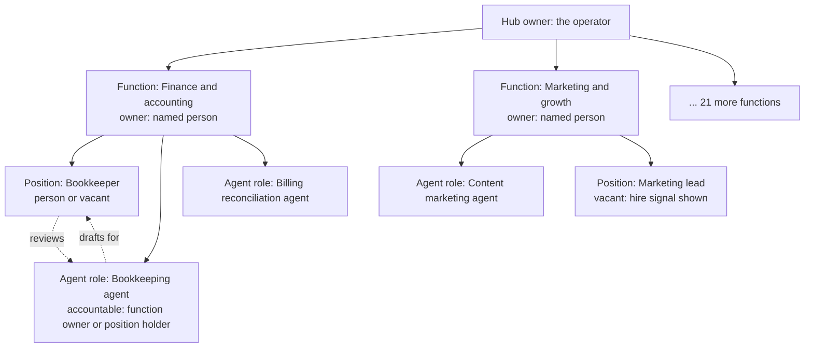
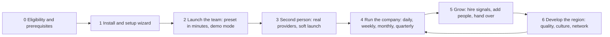

# The hub operating company: one person launches a whole team of agents and grows it with people

Status: **Proposed** design (owner request of 2026-11-01, recorded below; decision proposed in [ADR 018](../adr/018-hub-operating-company.md)). Nothing in this chapter is implemented. It builds on [ADR 010](../adr/010-gathering-point-hubs-agents-and-mesh.md) decisions 20 to 26, on the [console design](hub-console/console-design.md) (the Users area, the Agent team area of decision 26, the role catalogue and the component kit), on the [setup wizard](hub-console/setup-wizard.md), [hubs](hubs.md), [hub administration](hub-administration.md), [billing](billing.md) and [support](hub-console/support.md), and on the merged but still proposed [editorial office](editorial-office.md), [discovery and outreach](discovery-and-outreach.md) (ADR 017), [hub network](hub-network.md) and [hub exchange](hub-exchange-architecture.md) (ADR 016) designs. The launch playbooks (`docs/launch/`) are being written in parallel; [section 6.4](#64-how-presets-plug-into-the-launch-playbooks) defines how they connect. Author: Claude, an AI agent working for the repository owner Dmitry Parshkov. **Not legal, tax or employment advice**: every statement about law is a summary of a cited source and a question for the operator's counsel.

**Owner request (2026-11-01, translated):** "The administrator's agents are not only for the editorial office but also for outreach, marketing, project management, commerce, accounting and so on. Think about what else is needed: the whole team needed for this business to work fully, anywhere in the world. A person becomes a hub: launches the whole company, configures everything, adds living people to the team as it grows, and develops the platform, the quality of work, the culture and so on in their region."

**The short answer.** A hub is a small company. This chapter designs that company as **23 functions**. Each function has a purpose, a set of **agent roles** (operator agents of decision 26, working under operator grants over capabilities of the one registry), a set of matching **human positions**, the decisions that always stay with people, measures that never watch individuals, its screens, and the growth signals that say when to hire a person. A new operator chooses a **team preset** and gets every function staffed by agents in minutes, at the safe starting autonomy, with themselves as the **accountable person for every function**. As the hub grows they invite people into positions and **hand over** agent roles through a shadowing and review flow, so that every function has a named accountable human at every moment and responsibility never falls between a person and an agent.

## Contents

1. [What already exists and what this chapter adds](#1-what-already-exists-and-what-this-chapter-adds)
2. [Research: how such businesses are run and staffed](#2-research-how-such-businesses-are-run-and-staffed)
3. [The model: functions, positions, agent roles, accountability](#3-the-model-functions-positions-agent-roles-accountability)
4. [The hub operator journey](#4-the-hub-operator-journey)
5. [The operating team, function by function](#5-the-operating-team-function-by-function)
6. [Presets per hub size and region](#6-presets-per-hub-size-and-region)
7. [Guard rails no setting can switch off](#7-guard-rails-no-setting-can-switch-off)
8. [Screens](#8-screens)
9. [Contracts and data (proposed)](#9-contracts-and-data-proposed)
10. [Mapping to work packages](#10-mapping-to-work-packages)
11. [Escalations and inconsistencies found](#11-escalations-and-inconsistencies-found)
12. [Questions for the owner](#12-questions-for-the-owner)
13. [Questions for counsel](#13-questions-for-counsel)
14. [Acceptance (when implemented)](#14-acceptance-when-implemented)
15. [Sources](#15-sources)

## 1. What already exists and what this chapter adds

| Existing design | What it keeps owning | What this chapter adds |
|---|---|---|
| ADR 010 decision 26; [console design section 8](hub-console/console-design.md#8-the-agent-team-adr-010-decision-26) | Operator agents, operator grants, autonomy per role, accountable person per role, evaluation gate, kill switches, the Agent team area (HC-170 to HC-176) and nine platform-wide roles | The **function** as the organising unit above roles; agent roles for every business function beyond the nine; human positions per function; the accountable human per function; hand-over between agents and people; presets |
| [Console design section 4](hub-console/console-design.md#4-users-management) and ADM-004 | Staff invitations, roles, just-in-time elevation, separation of duties, access reviews, offboarding | Inviting a person **into a function position**; offboarding that reassigns function accountability before it completes; people operations around the access lifecycle |
| Editorial office (`docs/engine/editorial-office.md`, #367) | The 19 editorial agent roles, autonomy per content class, standing publication policies, the editor-in-chief | The editorial function's place in the company, its hire signals and its link to marketing, community and quality |
| [Discovery and outreach](discovery-and-outreach.md) (ADR 017, Proposed) | The outreach engine, its ten roles, the strict default (option A), the gate chain | The outreach and partnerships function and the partner desk; nothing in this chapter loosens the strict default |
| [Setup wizard](hub-console/setup-wizard.md), [hubs](hubs.md#launch-checklist) | The first run, the launch checklist and its gates | The journey before and after the wizard: eligibility, prerequisites, "launch your team", running cadence, growth |
| [Billing](billing.md), BILL-001 to BILL-004 | Prices, fees, invoices, payouts through licensed providers | The operator's **own books**: bookkeeping, revenue records, tax preparation packs, budgets and model cost caps, all through providers and the accountant the operator chooses |
| [Agent catalogue section 15](agent-catalog.md#15-hub-operator-staff) | Each staff member's own single agent inside the console (`hub_ops`) | The distinction between a staff member's own assistant and the hub's operator agents; both stay |

**What does not change.** Participants still have exactly one agent each and never manage several; a company still has at most one standing representative (decision 9). Operator agents act under operator grants, never under a participant's mandate, never as a participant and never as a staff member. Decisions the law or our decisions reserve for people stay with people. Payment never changes ranking, matching, recommendations or reputation. Trustwork never holds participants' money.

## 2. Research: how such businesses are run and staffed

The original author recorded source access on 2026-10-31 and 2026-11-01; the conductor integration did not refresh these sources or verify a deployment. Sources were treated as data; most are secondary (law-firm notes, company help pages, practitioner summaries) and are marked so in [section 15](#15-sources). We take patterns, never branding.

| Finding | Source (section 15) | What it changes in the design |
|---|---|---|
| City launches of large two-sided marketplaces used a tiny founding team per city: a general manager acting as the local chief executive, an operations manager for the supply side and a marketing manager for the demand side and grassroots work, with a travelling "launcher" who hired the local team and left once it could run alone | S1, S2 (secondary accounts) | The **founding pair** preset mirrors this: the operator as general manager, a second person for operations and trust, agents for marketing, editorial and the back office. The setup assistant plays the launcher's role: it hands over and steps back |
| Single-city, single-vertical focus is the usual right path for service marketplaces; the main risk is a customer who comes once, gets no response and never returns | S3 | Presets start one territory; the community and support functions measure first-response cohorts, not vanity sign-ups |
| Local volunteer community leaders run clubs and meetups with a company contact, small event funding, rules forbidding them to present themselves as employees or give legal advice, and a channel back to the company | S4 | The **champions and local chapters** programme in the community function: volunteers with written rules, never staff, never paid ranking, a human community lead as their contact |
| Community work should be tied to explicit business outcomes (support, product feedback, acquisition and advocacy, engagement, success) rather than activity counts | S5 | Community KPIs are outcome cohorts (questions answered by peers, retention of activated members), never per-member scores |
| Small associations are usually volunteer-run, move to an executive director or an association management company as they grow, and contract chapter management out | S6 | The **association-run** preset: a volunteer board, a small staff or management company, committees as human review panels, agents doing the routine work of the secretariat |
| Trade association certification and standards programmes are generally lawful but become risky when they exclude firms without justification or touch prices | S7 | The quality and standards function never ranks firms commercially, documents criteria, keeps recognition evidence-based and open to all, and routes programme design to counsel |
| A franchisor that grants a franchise must furnish a disclosure document before sale (US Franchise Rule); some states have their own laws with different definitions | S8 | The **regional operator** preset (a master operator with city sub-hubs) carries a counsel gate: if a master operator charges sub-operators fees for a business system and brand, franchise law may apply. The engine itself is free software and Contribuda sells no franchise |
| Workflows (predefined paths) are more predictable than open-ended agents; start with the simplest pattern and add autonomy only where it pays; use checkpoints and stopping conditions | S9 | Agent roles are mostly workflows with draft outputs; autonomy starts at Draft; every role has stopping conditions (caps, kill switches) and a review queue |
| Excessive agency (too many tools, permissions or autonomy) is a top risk for applications built on language models | S10 | Grants are per role and per function, the least capability set, read and draft by default; commit capabilities do not exist for operator agents except reversible operational actions |
| Accountability for AI systems needs documented roles and lines of responsibility for human-AI configurations and oversight | S11 | One accountable human per function and per agent role, at all times; the org chart shows the line |
| EU deployers must disclose AI-generated text published to inform the public on matters of public interest, unless it underwent human review and someone holds editorial responsibility; providers must make AI interaction recognisable | S12 | Every agent output is labelled; agents never pose as people in any channel; this is an engine floor in every region, not only the EU |
| The US Endorsement Guides (revised 2023) require disclosure of material connections; the 2024 consumer reviews rule bans fake and incentivised-without-disclosure reviews and fake indicators of influence | S13 | Referral programmes disclose the incentive; nothing in marketing creates reviews, testimonials or follower counts; sponsored items are labelled |
| EU platform operators report seller data annually (DAC7); US payment settlement entities issue information returns for marketplace payments | S14 | Finance prepares reporting **data readiness** packs from provider records; filing stays with the operator's accountant; thresholds are country-pack facts checked by counsel |
| New York requires written notice to new employees of electronic monitoring; the EU allows member states to set specific rules for employee data, and the platform work directive (transposition by 2 December 2026) adds human review of consequential automated decisions about platform workers | S15, S16 | People operations never monitors staff; no agent evaluates, ranks or decides about a person who works for the hub; consequential decisions about people are human-only everywhere |
| Worker classification differs sharply: California's ABC test presumes employment, the US federal test looks at control, other countries have their own tests; employer-of-record arrangements are a common route for hiring abroad | S17 | Hiring a person is always a counsel question per country; the engine records positions and access, never a classification conclusion; presets suggest when to ask |

**What the research rejects.** Growth automation that scrapes and cold-messages people (rejected by ADR 017 option D), engagement scoring of members, productivity monitoring of staff, automated screening or ranking of job candidates, and any marketing that sells position, reputation or badges.

## 3. The model: functions, positions, agent roles, accountability

### 3.1 Terms

| Term | Meaning | Contract (proposed) |
|---|---|---|
| **Function** | A standing area of the hub's business with a purpose, for example "Finance and accounting". The catalogue is engine data (23 functions, [section 5](#5-the-operating-team-function-by-function)); a hub turns functions on and off and may rename them in its languages, but cannot remove their reserved decisions | `OperatingFunctionSchema` in `packages/contracts/src/operating-company.ts` (TEAM-001) |
| **Function owner** | The one named person accountable for a function. Exactly one per enabled function, always. In a new hub it is the operator for every function | `FunctionAccountabilitySchema` |
| **Position** | A human seat in a function ("Bookkeeper", "Community lead"), with the staff roles it needs, part-time or full-time, internal or contracted. A position is organisational; it grants nothing by itself | `FunctionPositionSchema` |
| **Staff role** | Authority: the released role definitions of ADM-001 (`HUB_STAFF_ROLES`). A person in a position receives roles through the normal invitation and approval flow (ADM-004) | Existing |
| **Agent role** | An operator agent role of decision 26 belonging to one function, with capabilities from the registry, an autonomy level, a trigger, a budget, a model route and an accountable person | `AgentRoleDefinition` of AGT-030 with a `functionKey` |
| **Coverage state** | Who does the work of one agent role's duty in one function right now: agent-led, shadowing, supervised, human-led, retired ([3.4](#34-coverage-states-and-hand-over)) | `RoleCoverageSchema` (TEAM-002) |
| **Preset** | A named, versioned set of enabled functions, agent roles, starting autonomy, budgets and suggested positions for a kind of hub ([section 6](#6-presets-per-hub-size-and-region)) | `TeamPresetSchema` (TEAM-001) |

Staff roles and positions are kept apart on purpose: a role says what a person **may** do, a position says what they are **responsible** for. One person may hold several positions; the separation-of-duties rules apply to their roles, as today.



### 3.2 One autonomy scale for the whole team

Three vocabularies exist today: the console design's agent team levels (Observe, Draft, Act with review, Act within limits), the editorial office's levels (Off, Draft only, Auto with review, Auto-publish allowed) and the frozen console contract's automation levels per domain (`manual`, `assisted`, `supervised_autonomous`). This chapter proposes **one scale plus a separate trigger**, and maps the others onto it so that the console speaks one language (see [escalation 1](#11-escalations-and-inconsistencies-found)).

| Level | What the agent may do | Editorial office equivalent | Contract `AutomationLevel` equivalent | Locale key |
|---|---|---|---|---|
| Off | Nothing | Off | `manual` | `opsTeam.autonomy.off` |
| Observe | Read and report; no drafts in anyone's queue | (none) | `manual` | `agentTeam.autonomy.observe` |
| Draft | Prepare items for a person; nothing changes until a person acts | Draft only (on request) and Auto with review (scheduled) | `assisted` | `agentTeam.autonomy.draft` |
| Act with review | Perform reversible actions within grants; a person reviews afterwards and can undo | (not offered for editorial) | `supervised_autonomous` | `agentTeam.autonomy.actWithReview` |
| Act within limits | Perform reversible actions within grants and budgets without per-item review; sampled review | Auto-publish allowed only through a standing publication policy (owner question pending) | `supervised_autonomous` | `agentTeam.autonomy.actWithinLimits` |

**Trigger** is separate from level: *on request* (a person starts each run), *scheduled*, or *on event*. The editorial "Draft only" is Draft on request; "Auto with review" is Draft scheduled or on event.

Rules (all inherited, none new except the last): every preset starts every role at Off, Observe or Draft; raising any role above Draft needs a second person (the existing `automation.raise_to_supervised_autonomous` action) and an active cap; the level drops one step automatically, never rises, when quality floors are crossed, a kill switch is engaged, the model version changes or the accountable person leaves; human-reserved decisions are unreachable at every level. **New:** the console shows one scale everywhere; editorial and outreach screens show their domain's name for a level beside it.

### 3.3 Accountability rules

1. **Exactly one function owner for every enabled function, at every moment.** The setup of the team makes the operator (the first `hub-owner`) the owner of every function. Ownership moves only when the new owner **accepts** it; it is never assigned silently.
2. **The owner must be able to decide the function's reserved decisions**, so they must hold the staff role those decisions need (mapping in [5.0](#50-the-function-catalogue-at-a-glance)). If the owner loses that role, the function shows "Owner lacks the role for these decisions" and its agent roles drop to Draft until fixed.
3. **Every agent role has an accountable person**: the function owner by default, or a position holder in the same function who holds the needed role. Decision 26's rule applies: without an accountable person the role's agents suspend.
4. **No gap on departure.** Offboarding (ADM-004) cannot complete while the person owns a function or is accountable for an agent role; the flow lists each and proposes the hub owner as the fallback, who must accept. If a role ends abruptly (revocation, break-glass end, death or incapacity), affected agent roles suspend at once and the hub owner sees an approvals inbox item "Accept accountability for 3 functions"; nothing runs in the meantime.
5. **Agents are never the accountable person**, never a function owner, never a position holder, never an approver, never one of the "two staff" of the launch gate, never a reviewer in an access review, and never counted for separation of duties.
6. **Concentration is shown, not blocked.** The overview says "You are accountable for 23 functions" and lists the growth signals; a solo operator is legitimate in demo and setup.

### 3.4 Coverage states and hand-over

Each agent role's duty in a function is in one coverage state:

| State | Who does the work | Agent autonomy | Who reviews |
|---|---|---|---|
| **Agent-led** | The agent role | As configured (Draft at start) | The accountable person (review queue) |
| **Shadowing** | The agent role; a newly added person learns alongside | Unchanged | The accountable person decides; the shadowing person sees the same items, comments, and records **practice decisions** that are shown beside the real decision but never applied |
| **Supervised** | The agent role | Draft or Act with review | The new person decides the review queue (they hold the needed role); the function owner may sample |
| **Human-led** | The person | Drops to Draft on request or Observe; the agent's drafts appear as suggestions in the person's own tools | The person; the function owner as usual |
| **Retired** | The person (or nobody) | Off | History kept; can be restored by a hand-back |

```mermaid
stateDiagram-v2
  [*] --> AgentLed: preset applied
  AgentLed --> Shadowing: person added to the position
  Shadowing --> Supervised: shadow period ends, person accepts review duty
  Shadowing --> HumanLed: person takes over the work
  Supervised --> HumanLed: person takes over the work
  HumanLed --> Retired: agent no longer useful
  HumanLed --> AgentLed: hand-back (accountable person accepts; evaluation re-run; starts at Draft)
  Supervised --> AgentLed: person leaves (accountability returns to owner; autonomy drops one step)
  Retired --> AgentLed: hand-back
```

**Hand-over flow** (HC-205, [section 8](#8-screens)):

1. **Add a person to a position.** From the function page, "Invite someone to this position" opens the ADM-004 invitation with the position and its suggested roles pre-filled; sensitive roles need the second person as today.
2. **Choose what they take over.** After the invitation is accepted, the position page lists the function's agent roles with a proposed change for each: start shadowing, become reviewer (supervised) or take over (human-led).
3. **Preview the difference.** A `DiffViewer` shows queue routing (which review items move to whom), autonomy changes (only downward or unchanged; an upward change is a separate request), grant changes (none, or narrower), the accountable person before and after, and the budget effect.
4. **Approve.** The function owner confirms. A second person is required when accountability moves for a sensitive function (Finance and accounting, Compliance, Trust and safety, People operations, Legal operations) or when the new accountable person was invited less than 30 days ago (proposal).
5. **Shadow period.** Default ten working days (hub setting, 0 to 60). Practice decisions build confidence; their agreement with the real decisions is shown to the **person themselves only**, never to managers (no surveillance; owner question 4).
6. **Cut-over** at a chosen time: open review items move as previewed; the agent's autonomy changes; the audit records who, what and why.
7. **Thirty-day check.** A checklist for the function owner and the person together: what to keep automated, what to retire, whether the budget can shrink. Counts only.

**Hand-back** (a person leaves or wants the agent to take routine work again): the accountable person requests it, the role's evaluation re-runs on the current model, the role restarts at Draft, and raising it again follows the normal second-person rule.

**What hand-over never does:** credit an agent's work to a person or a person's work to an agent; compare a named person's speed or accuracy with an agent's; use practice decisions in any performance evaluation; widen a grant; move private data.

## 4. The hub operator journey



### 4.1 Stage 0: eligibility and prerequisites

Who can become a hub operator: a person acting through a legal entity (a sole proprietorship counts where the country allows it), a company, an association, a chamber, a trade publisher, a university or a cooperative. The engine checks what it can and lists the rest as the operator's own responsibility.

| Prerequisite | Checked by the engine | Where |
|---|---|---|
| Not in a restricted place; deployment-location attestation (operator entity and hosting country) | Yes, refused at every level | Setup wizard step 4, SANC-009 |
| Sanctions screening of the operator and its declared owners | Yes, through the baseline lists; a potential match opens a review the operator cannot close | Setup wizard step 4, SANC-003 |
| Legal entity recorded (name, form, identifier, notices and abuse contacts) | Recorded; correctness is the operator's | Setup wizard step 4 |
| Counsel engaged for terms, privacy notice, sanctions section, community rules, agent disclosure and outreach policy | Recorded as counsel approvals with dates and versions; gates 2 and 6 | Hub, Legal and operator |
| Accountant or bookkeeper chosen (internal or external) and a business bank account and licensed payment provider of the operator's own | Not checked; the finance function's checklist asks | Finance function |
| Understanding of the AGPL obligations and the Trustwork name rules (`NOTICE`, `docs/oss/BRAND.md`) | Acknowledged in the wizard's review step (proposal) | Setup wizard step 9 follow-up |
| A second person who can join as staff before real providers and soft launch | Enforced by the existing rules: `providers.enable_non_fake` needs a second person; gate 4 needs two staff with distinct roles and second factors | Launch checklist |

The **"Before you start" page** (HC-200, public in the operator guide and in the console before the wizard) lists these with plain explanations and the questions to take to counsel ([section 13](#13-questions-for-counsel)).

### 4.2 Stage 1: install and setup wizard

Unchanged: the nine steps of the [setup wizard](hub-console/setup-wizard.md) produce a draft hub with closed registration, fake providers and every automation domain at `manual`. Finishing shows the "next five things" list; this design adds a sixth card: **"Launch your team"**.

### 4.3 Stage 2: launch the team in minutes

"Launch your team" (HC-201) is a short guided page, not a new wizard step, so HUB-004's scope does not change:

1. **Pick a preset** ([section 6](#6-presets-per-hub-size-and-region)): Solo founder, Founding pair, Small team, Association-run, Publisher-run, Regional operator. Each shows its functions, agent roles, starting autonomy, monthly budget and the people it suggests hiring first.
2. **Adjust**: turn functions on or off (Editorial, Support, Trust and safety, Compliance, Finance, Data stewardship and IT and operations cannot be turned off once the hub leaves demo, because launch gates and law depend on them), rename them in the hub languages, set the team budget.
3. **Preview**: for each agent role, its capabilities with kind (read or draft), data classes (public and operational only by default), trigger, model route (the fake model until a provider is enabled), cap, accountable person (the operator), and the locked list of decisions it can never take.
4. **Evaluate**: the EVAL-001 safety suite and each role's checks run on synthetic samples; roles that fail stay off with the reason.
5. **Apply as a configuration draft**, then activate. In demo mode with fake providers every role produces labelled synthetic output ("Demo: produced by a fake model"), so the operator sees the whole company working within minutes without accounts, costs or real data.

Nothing is sent outside the hub in this stage: outbound channels are fakes, the outreach policy is strict (ADR 017 option A) and registration is closed.

### 4.4 Stage 3: the second person, real providers, soft launch

A real model provider, real e-mail and every other non-fake provider need a second person (`providers.enable_non_fake` has no single-person exception), and soft launch needs two staff with distinct roles and second factors. So the minimum real hub is **two people and the agent team**. The founding pair preset suggests the second person's position (usually "Operations and trust lead", holding `trust-reviewer` and `ops-engineer`, or `compliance-officer` for a hub whose operator is not legally trained). The second person's first acts are typically: approve the e-mail connection, approve the model provider and egress rules, then take over review queues for Support and Trust and safety through hand-over.

Before soft launch the remaining gates apply unchanged; the setup assistant agent drafts the evidence packs; agents never pass a gate.

### 4.5 Stage 4: run the company

The chief-of-staff agent ([5.1](#51-leadership-and-chief-of-staff)) prepares the cadence; people decide.

| Cadence | Prepared by agents | Decided by people |
|---|---|---|
| Daily brief (each morning, hub time) | Approvals waiting with expiries, queues over target, incidents, budget burn per function, launch gates that re-opened, items needing a person today | The day's priorities; each approval |
| Weekly review | Per function: outputs, review acceptance, unknown outcomes for reconciliation, KPIs as cohorts, risks; the analytics reporter's weekly report | What to change; autonomy and budget requests |
| Monthly close | Bookkeeping drafts, reconciliation with provider reports, model costs per function, revenue records, budget variance | Approving the close with the accountant; payouts and refunds through the provider (second person) |
| Quarterly planning | Objective and key result drafts from cohort data, initiative status, hire signals that fired, access review campaign | Objectives, budgets, hires, presets to adopt |
| Yearly | Deployment-location attestation renewal, policy and document review calendar, transparency report draft | Signing, publishing, renewing |

### 4.6 Stage 5: grow by adding people

Each function lists **hire signals** (section 5). When a signal fires, the function page shows "Consider a person for this position" with the reason ("Support queue over target for 10 of the last 14 days"), never a demand. The operator invites a person into the position (ADM-004), assigns roles through the normal approval, and hands over as in [3.4](#34-coverage-states-and-hand-over). Contractors and part-time people use assignments with end dates. Employment, contractor classification, payroll, benefits, notices and works-council duties are counsel questions per country; the engine records positions and access, never a classification conclusion.

### 4.7 Stage 6: develop the region

Beyond operating the platform, the hub develops its region: quality of construction work (cohort analytics of disputes and defects, local standards guides, learning with partners), culture (code of conduct, community norms, inclusion, local language and customs), local chapters and champions, events, and relations with neighbouring hubs. These are the quality, culture, community, events and federation functions; they are slower, more human and more local than the rest, and their agent roles stay at Draft by design.

## 5. The operating team, function by function

### 5.0 The function catalogue at a glance

Capability ids follow the registry convention `<module key>.<operation>`; operator module keys are `team_<role>` (editorial keeps `editorial_<role>`, outreach keeps its own). Every operator capability has `surfaces: ['ui']` (staff console only), kind `read` or `draft` unless marked, and never the side effects `money_commitment`, `reputation_signal` or `publication` (publication follows the editorial office's standing-policy question). "Role needed" is the staff role the function owner must hold; roles in *italics* are proposed additions ([escalation 3](#11-escalations-and-inconsistencies-found)) with the interim mapping in brackets.

| # | Function | Owner's role needed | Agent roles | Starts at | First human position | Typical hire stage |
|---|---|---|---|---|---|---|
| 1 | Leadership and chief of staff | `hub-owner` | Chief of staff | Draft | Operator | Day one |
| 2 | Strategy, roadmap and internal projects | `hub-owner` | Planning assistant | Draft | Operator; later programme manager | Growth |
| 3 | Editorial | `editor-in-chief` | 19 editorial roles (#367) | Draft | Editor-in-chief (gate 5) | Before soft launch |
| 4 | Marketing and growth | *growth-lead* (`commercial-admin`) | Brand steward, content marketer, search analyst, social drafter, ads policy checker, events promoter, referral programme assistant | Draft (ads checker deterministic) | Marketing lead | Public |
| 5 | Outreach and partnerships | `compliance-officer` for policy; *growth-lead* for partnerships | Outreach roles (#368), partnership researcher, partner desk | Draft; outreach strict | Partnerships lead | Growth |
| 6 | Community and member success | *growth-lead* (`editor`) | Onboarding guide, education planner, champions coordinator, chapter assistant, community answers drafter | Draft | Community lead | Soft launch to public |
| 7 | Sales and commercial | `commercial-admin` | Offer designer, sponsorship desk, account desk, partner programme assistant | Draft | Commercial lead | Public |
| 8 | Customer support | `support-lead` | Support triage, help centre editor, access explainer drafter | Draft | Support lead | Soft launch |
| 9 | Trust and safety and moderation | `trust-reviewer`, `moderator` | Moderation triage, trust and safety assistant, review integrity assistant, appeals clerk | Draft | Trust and safety lead | Soft launch |
| 10 | Compliance | `compliance-officer`, `privacy-officer` | Sanctions review assistant, policy watch, records clerk, privacy request clerk | Draft | Compliance officer (often part-time or external) | Before soft launch |
| 11 | Finance and accounting | *finance-officer* (`commercial-admin`) | Bookkeeper, billing reconciliation, revenue records clerk, tax preparation assistant, budget controller, payout preparer | Draft | Bookkeeper (often an external firm) | First revenue |
| 12 | Legal operations | `compliance-officer` | Document clerk, counsel liaison, contract register, notice desk | Draft | Legal operations coordinator; counsel external | Public |
| 13 | People operations | *people-officer* (`staff-admin`) | Recruiting coordinator, onboarding coordinator, training planner, access review assistant, offboarding coordinator | Draft | People operations lead | Five or more staff |
| 14 | Quality and standards | *quality-lead* (`trust-reviewer`) | Quality analyst, standards librarian, learning partnerships assistant, recognition desk | Draft | Quality lead | Growth |
| 15 | Culture and ethics | `hub-owner` | Norms steward, ethics review assistant, local customs advisor | Draft | Ethics panel (volunteers or staff) | Growth |
| 16 | Research and insights | `hub-owner` | Market researcher, insights analyst, interview assistant | Draft | Researcher | Growth, new region |
| 17 | Events and learning operations | `editor` | Event producer, event operations assistant, course operations assistant | Draft | Events manager | First in-person events |
| 18 | Localisation | `editor` | Translation roles (#367), interface locale steward, cultural reviewer drafter | Draft | Native reviewer per language | Each new language |
| 19 | Data stewardship | `data-steward` | Data steward assistant, licence checker (#367) | Draft | Data steward | Content first |
| 20 | IT and operations | `ops-engineer` | Operations monitor, backup drill assistant, update assistant, security hygiene assistant | Draft (monitor: Act with review for incidents) | Operations engineer or managed host | Soft launch |
| 21 | Procurement for the hub | `commercial-admin` | Vendor desk | Draft | (part of finance or operations) | Rarely separate |
| 22 | Analytics and reporting | `hub-owner` (statistics roles per ANL-001) | Analytics reporter, report builder, transparency report drafter | Act within limits for cohort reports only; others Draft | Analyst | Growth |
| 23 | Federation and network relations | `hub-owner` | Network liaison | Draft | Network relations lead | When peering |

Every function also has, in the console, a **locked list** of its human-reserved decisions (`LockedRule`), its KPIs from the metric catalogue (ANL-001) and its screens. The per-function sections below give the detail.

### 5.1 Leadership and chief of staff

| Aspect | Design |
|---|---|
| Purpose | Help the operator lead: know what needs a decision today, keep a decision log, follow up, and prepare reports for owners, boards or partners |
| Agent roles and capabilities | **Chief of staff**: `team_chief_of_staff.compile_daily_brief`, `.draft_decision_record`, `.draft_follow_ups`, `.draft_board_pack` (read approvals inbox counts, function KPIs, budgets, incidents; draft only) |
| Default autonomy | Draft, scheduled daily and weekly |
| Human-reserved | Every decision; the decision record is signed by the person who decided; strategy; hires; approvals of any kind |
| Positions | Operator (hub owner); later a chief operating officer or chief of staff (person) |
| KPIs (no surveillance) | Approvals waiting and their age; decisions recorded per month; launch gates open |
| Screens | Home overview with the daily brief card; decision log in Team (HC-206) |
| Hire a person when | Five or more staff, three or more functions with their own owners, or the operator spends most of the week on approvals |

### 5.2 Strategy, roadmap and internal projects

| Aspect | Design |
|---|---|
| Purpose | Set objectives and key results for the hub, plan initiatives (launch a language, open a chapter, peer with a neighbour), and track them across people and agents |
| Agent roles and capabilities | **Planning assistant**: `team_planning.draft_objectives` (from cohort metrics and hire signals), `.draft_initiative_plan`, `.compile_status` (from runs, queues and checklists), `.draft_risk_register` |
| Default autonomy | Draft |
| Human-reserved | Objectives, priorities, budgets, initiative start and stop |
| Positions | Operator; later a programme manager |
| KPIs | Key results are cohort metrics from the catalogue; initiatives on track, at risk, late (counts) |
| Screens | Workplan (HC-206): objectives, key results, initiatives with owners (people) and contributing agent roles, milestones |
| Hire a person when | Three or more initiatives run in parallel, or eight or more staff |

The workplan is the operator's internal project management. It is deliberately small (objectives, initiatives, milestones, tasks with a person or an agent role as assignee); it is **not** the participants' project planner and never mixes with participant data.

### 5.3 Editorial

Designed in `docs/engine/editorial-office.md` (#367): 19 editorial roles, autonomy per content class, standing publication policies (pending the owner's decision), the editor-in-chief as the accountable human. In this company model it is one function whose owner holds `editor-in-chief`; launch gate 5 already requires that person before soft launch. Links: marketing uses published items for newsletters and campaigns but never edits editorial content; sales and sponsorship are separated from editorial decisions (an editorial independence rule, [section 7](#7-guard-rails-no-setting-can-switch-off)); quality and standards publish standards guides through the editorial workflow. Hire signals: a second hub language, more than one daily news brief, a magazine issue per week, or correction requests rising for four weeks.

### 5.4 Marketing and growth

| Aspect | Design |
|---|---|
| Purpose | Make the hub known and chosen in its region honestly: brand, content marketing, search visibility, social presence, promotion of events and courses, referral programmes |
| Agent roles and capabilities | **Brand steward**: `team_brand.check_brand_use` (logo, colours, name rules per `docs/oss/BRAND.md`, the Russian-interface overlay only in Russian). **Content marketer**: `team_content_marketing.draft_page`, `.draft_case_story` (only from shared knowledge the owner consented to publish, with their approval recorded). **Search analyst**: `team_search.compile_site_health` (technical checks, structured data validity, aggregate search-console data where connected), `.suggest_topics` (no keyword stuffing; editorial decides). **Social drafter**: `team_social.draft_posts`, `.draft_schedule` (posts go out only through a connected channel after a person approves each post or an approved campaign version). **Ads policy checker** (deterministic): `team_ads_policy.check_campaign`. **Events promoter**: `team_events_promo.draft_promotion` for listed events and courses. **Referral programme assistant**: `team_referral.draft_programme_terms`, `.compile_referral_cohorts`, `.flag_suspicious_patterns` |
| Default autonomy | Draft; the ads policy checker runs automatically on every campaign draft and blocks |
| Human-reserved | Brand decisions; campaign activation; any spending (ad accounts are the operator's own commitments, outside the engine, recorded by finance); referral programme terms (a versioned record activated by a second person, disclosed publicly like a fee version); any claim about a named company or person; use of a participant's story |
| Locked rules | Paid advertising may promote **the hub itself** (its events, courses, magazine, membership); it never sells or implies ranking, matching, recommendations, reputation, verification or badges; every promoted item is labelled "Ad" or "Sponsored" in the hub language; no targeting by sensitive data classes; no tracking pixels or retargeting on hub pages unless the privacy settings allow it and consent is collected; referral rewards are disclosed platform credits or fixed amounts, the same for everyone, never position, and referrers disclose the incentive when they recommend the hub; no fake reviews, testimonials, follower counts or traffic; AI-generated marketing text and images are labelled |
| Positions | Marketing lead; content marketer; social media coordinator (often part-time or contracted) |
| KPIs | Activated participants per channel as cohorts; cost per activated participant (cohort, from finance records); newsletter unsubscribe rate (cohort); share of promoted items labelled (must be 100 percent) |
| Screens | Marketing dashboard (HC-208): campaign calendar, drafts awaiting approval, policy-check results, the payment-neutrality locks, referral cohorts |
| Hire a person when | Monthly paid spend above the hub's threshold (default USD 2,000, synthetic), more than two campaigns a month, a second language market, or public launch |

### 5.5 Outreach and partnerships

| Aspect | Design |
|---|---|
| Purpose | Reach companies and organisations the hub describes, within the law and ADR 017; build partnerships with associations, schools, manufacturers, municipalities and media |
| Agent roles and capabilities | The ten outreach roles of `docs/engine/discovery-and-outreach.md` (scout, collector, resolver, enricher, page assembler, watcher, outreach drafter, sender, reply triager, claim assistant), unchanged. **Partnership researcher**: `team_partnerships.draft_partner_brief` (public information only). **Partner desk**: `team_partner_desk.draft_proposal`, `.track_commitments`, `.draft_renewal_reminder` |
| Default autonomy | Strict outreach (option A) in every preset; partner roles at Draft |
| Human-reserved | Outreach policy and campaign activation (compliance officer plus second person; owner approval on the reference hub); any agreement, memorandum or co-branding; claim decisions |
| Positions | Partnerships lead; outreach coordinator when the policy moves beyond strict |
| KPIs | Partners active; partner commitments met (counts); outreach metrics as defined in the outreach chapter (no open tracking) |
| Screens | Outreach screens of #368; partner register within the function page |
| Hire a person when | Ten or more active partner conversations, or the hub's outreach policy moves to option B or C |

### 5.6 Community and member success

| Aspect | Design |
|---|---|
| Purpose | Help members succeed: onboarding, education, peer help, champions and local chapters, and a culture of sharing experience |
| Agent roles and capabilities | **Onboarding guide**: `team_onboarding.draft_journey` (lifecycle messages inside members' own preferences, OUTR-003), `.draft_help_paths`. **Education planner**: `team_education.propose_learning_path` (from LRN-001 courses and shared knowledge). **Champions coordinator**: `team_champions.compile_nominations` (from public evidence: answers accepted, consultations confirmed, events hosted), `.draft_programme_materials`. **Chapter assistant**: `team_chapters.draft_event_kit`, `.draft_chapter_report`. **Community answers drafter**: `team_community_answers.draft_faq_answer` (help-centre answers labelled as prepared by the agent; never posted in a member's name or as a member) |
| Default autonomy | Draft |
| Human-reserved | Selecting champions; chartering and closing chapters; community rules; any recognition; any message to a member outside their preferences |
| Champions and chapters rules | Champions and chapter organisers are volunteers with written rules: they never present themselves as staff, never give legal advice, declare conflicts, and receive no ranking, matching or reputation advantage; any stipend or event budget is a disclosed, fixed amount recorded by finance; a human community lead is their contact |
| Positions | Community lead; chapter organisers (volunteers); member success manager |
| KPIs | Activation within 30 days (cohort); 90-day retention of activated members (cohort); questions answered by peers within 48 hours (share); events per chapter; never a per-member engagement score |
| Screens | Community dashboard (HC-209): journeys, nominations queue, chapters, learning paths |
| Hire a person when | About 1,000 active members, three or more chapters, or peer-answer share falling for a quarter |

### 5.7 Sales and commercial

| Aspect | Design |
|---|---|
| Purpose | Earn the hub's revenue fairly: plans and offers, sponsorship with labels, accounts for companies, partner programmes; never selling ranking or reputation |
| Agent roles and capabilities | **Offer designer**: `team_offers.draft_price_version` (from provider cost data and the hub's margin policy; a draft for the commercial admin). **Sponsorship desk**: `team_sponsorship.draft_package` (only when `sponsored.enable` is active; labelled placements outside ranked surfaces). **Account desk**: `team_accounts.draft_proposal`, `.draft_renewal_notice` (BILL-004 fair subscription rules). **Partner programme assistant**: `team_partner_programme.draft_terms` (integrators, training providers) |
| Default autonomy | Draft |
| Human-reserved | Price and fee activation (human gate and second person); contracts; discounts beyond published rules; accepting a sponsor; enabling sponsored content (second person) |
| Locked rules | No product sells ranking, matching position, recommendations, reputation, verification outcomes, badges or introductions; prices are published and the same for everyone in a category; sponsorship never touches editorial decisions or ranked surfaces; no outcome-based fees for agent work |
| Positions | Commercial lead; account manager |
| KPIs | Recurring revenue and churn as provider-recorded cohorts; sponsored placements labelled (100 percent); complaints about billing (count) |
| Screens | Plans and payments area (existing); sales section of the finance dashboard |
| Hire a person when | Twenty or more company accounts, sponsorship revenue material to the budget, or a partner programme starts |

### 5.8 Customer support

| Aspect | Design |
|---|---|
| Purpose | Serve participants quickly without impersonation, through the case-first support workspace (SUP-001) |
| Agent roles and capabilities | **Support triage** (console design). **Help centre editor**: `team_help_centre.draft_article` (from resolved case categories, never case contents). **Access explainer drafter**: `team_access.draft_explanation` (wraps the access explainer result in plain language) |
| Default autonomy | Draft; templated replies only if the hub enables them, at Act with review |
| Human-reserved | Case access grants; servicing that changes sign-in; closing a case with a complaint; any compensation or credit |
| Positions | Support lead; support agents |
| KPIs | First-response time and resolution time distributions; queue age; reopened share; satisfaction as cohort counts; never per-agent productivity |
| Screens | Support area (existing); support section of the function page |
| Hire a person when | Queue over target on 10 of 14 days, more than about 50 cases a week, or a new hub language |

### 5.9 Trust and safety and moderation

| Aspect | Design |
|---|---|
| Purpose | Keep the hub safe and fair: moderation, claims and disputes evidence, review integrity, appeals |
| Agent roles and capabilities | **Moderation triage** and **trust and safety assistant** (console design). **Review integrity assistant**: `team_review_integrity.flag_patterns` (patterns in reviews and confirmations against REV-001 rules, as cases for a person). **Appeals clerk**: `team_appeals.compile_appeal_file` (assembles the record for a reviewer who did not take the first decision) |
| Default autonomy | Draft |
| Human-reserved | Every moderation decision and sanction; claim, dispute and exclusion decisions; appeals (a different person); method releases |
| Positions | Trust and safety lead; moderators; trust reviewers |
| KPIs | Time to decision; reversal rate on appeal; reports per 1,000 active members (cohort) |
| Screens | Trust and safety area (existing) |
| Hire a person when | Soft launch (gate 6 needs the rules; a person reviews), then reports above about 30 a week or appeals above 5 a month |

### 5.10 Compliance

| Aspect | Design |
|---|---|
| Purpose | Keep the hub lawful: sanctions preparation, privacy operations, records, policy changes from country packs |
| Agent roles and capabilities | **Sanctions review assistant** (console design). **Policy watch**: `team_policy_watch.draft_change_note` (when a country-pack fact or a cited source changes, drafts a note for counsel). **Records clerk**: `team_records.draft_retention_review`, `.draft_hold_checklist`. **Privacy request clerk**: `team_privacy.draft_response_package` (PRV-001 deadlines and steps; erasure executes only with two people) |
| Default autonomy | Draft |
| Human-reserved | Screening decisions and clearing holds; privacy request execution; legal holds; counsel approvals; jurisdiction settings activation |
| Positions | Compliance officer (part-time or external is common); privacy officer |
| KPIs | Privacy requests within deadline (share); screening reviews open and their age; documents past review date |
| Screens | Compliance panel, Privacy area (existing) |
| Hire a person when | Before soft launch (counsel and a compliance officer, possibly external); at real users a privacy officer |

### 5.11 Finance and accounting

| Aspect | Design |
|---|---|
| Purpose | Run the hub's **own** books: bookkeeping, revenue records, reconciliation with provider reports, tax preparation per country, budgets and model cost caps. **Trustwork never holds participants' money**; the operator's own money sits in the operator's own bank and payment-provider accounts; the engine records |
| Agent roles and capabilities | **Bookkeeper**: `team_bookkeeping.categorise_entries`, `.draft_journal_entries` (from accounting-provider and payment-provider feeds through adapters with fakes; never moves money). **Billing reconciliation** (console design): matches provider reports to invoices and payouts, flags unknown outcomes. **Revenue records clerk**: `team_revenue_records.draft_schedule` (deferred revenue for subscriptions and prepaid credits under the accounting policy the accountant sets). **Tax preparation assistant**: `team_tax_prep.compile_pack` (sales tax or VAT summaries from BILL-002 tax determinations; platform-reporting data readiness such as DAC7 or US information returns as country-pack facts). **Budget controller**: `team_budget.compile_variance`, `.forecast_model_costs`, `.draft_cap_change` (cap changes are requests). **Payout preparer**: `team_payouts.draft_batch` (release needs `billing.release_payout_batch` with a second person) |
| Default autonomy | Draft |
| Human-reserved | Any payment, refund, credit or payout release; filing any tax return or information return; signing; opening accounts; choosing the accountant and the accounting policy; approving the monthly close |
| Locked rules | No balance of participants' funds exists in the engine or the operator's accounts (PAY-001 refuses such routing); every money figure on the dashboard is a provider-recorded flow or the operator's own entry, labelled with its source; unknown payment outcomes go to reconciliation, never retried blindly |
| Positions | Bookkeeper (often an external firm); finance officer; external accountant or tax adviser |
| KPIs | Unreconciled items and their age; days to close; budget variance per function; model cost per function and per accepted output |
| Screens | Finance dashboard (HC-207) |
| Hire a person when | First real revenue (an external bookkeeper at least), more than one currency, payroll starts, or monthly close takes more than five working days |

### 5.12 Legal operations

| Aspect | Design |
|---|---|
| Purpose | Keep legal documents, counsel work, contracts and notices organised. **Never legal advice** |
| Agent roles and capabilities | **Document clerk**: `team_documents.draft_version_diff`, `.track_translations` (legal document versions in every hub language). **Counsel liaison**: `team_counsel.compile_question_pack`, `.track_approvals` (expiry reminders). **Contract register**: `team_contracts.draft_register_entry`, `.draft_renewal_reminder` (partner, vendor and venue contracts). **Notice desk**: `team_notices.triage_notice` (takedown and legal notices routed to people; statements of reasons drafted for a person) |
| Default autonomy | Draft |
| Human-reserved | Legal judgement (counsel); document activation (second person); signing; responses to authorities and lawful requests |
| Positions | Legal operations coordinator; external counsel |
| KPIs | Notices handled within the hub's deadline (share); documents past review date; counsel approvals expiring in 30 days |
| Screens | Hub, Legal and operator (existing); contract register on the function page |
| Hire a person when | More than about 10 notices a month, a second jurisdiction, or more than 30 active contracts |

### 5.13 People operations

| Aspect | Design |
|---|---|
| Purpose | Bring people into the hub's team and look after them: recruiting, onboarding, training, access reviews, offboarding, with employment law handled as counsel questions and **no surveillance of staff** |
| Agent roles and capabilities | **Recruiting coordinator**: `team_recruiting.draft_job_description` (from the position and hire signal), `.draft_interview_schedule`, `.draft_candidate_correspondence` (sent by a person). **Onboarding coordinator**: `team_onboarding_staff.draft_checklist`, `.draft_access_requests` (ADM-004 requests a person submits). **Training planner**: `team_training.propose_training_path` (role training, accessibility, privacy, sanctions, the code of conduct). **Access review assistant**: `team_access_review.prepare_campaign` (ADM-004). **Offboarding coordinator**: `team_offboarding.draft_plan` (lists open work, function accountability to move) |
| Default autonomy | Draft |
| Human-reserved | Every decision about a person: shortlisting, rejecting, hiring, pay, classification as employee or contractor, performance, discipline, termination; access decisions |
| Locked rules | Agents never screen, score, rank or reject candidates or staff; no productivity, activity, sentiment or "last seen" measures about staff; no monitoring of staff communications; candidate data is kept only for the retention the hub's counsel approved |
| Positions | People operations lead; external employer-of-record or payroll provider where used |
| KPIs | Time to fill a position (aggregate); onboarding checklists completed (share); access review campaigns completed on time; training completion as counts per role cohort (suppressed under ten) |
| Screens | People operations dashboard (HC-211); Users area for access |
| Hire a person when | Five or more staff, or more than two hires a quarter |

### 5.14 Quality and standards

| Aspect | Design |
|---|---|
| Purpose | Raise the quality of construction work in the region: understand where disputes and defects arise, publish local standards guides, build certification and learning programmes with partners, and recognise good work without paid ranking |
| Agent roles and capabilities | **Quality analyst**: `team_quality.compile_cohort_report` (disputes, defects, corrections and confirmed completions per trade, category, territory and period; cohorts of at least ten, secondary suppression; never a named company or person). **Standards librarian**: `team_standards.draft_guide` (local practice guides from country-pack facts and licensed sources, through the editorial workflow). **Learning partnerships assistant**: `team_learning_partners.draft_programme` (with training providers and associations, LRN-001). **Recognition desk**: `team_recognition.compile_evidence_file` (for a human panel; evidence only) |
| Default autonomy | Draft |
| Human-reserved | Publishing guides (editorial); programme criteria; recognition decisions by a panel with declared conflicts; certificate issuance by human assessors (LRN-001) |
| Locked rules | Recognition is open to everyone meeting published criteria, evidence-based, free, labelled as an editorial recognition, and **never changes ranking, matching, recommendations or reputation scores**; no league tables of named firms; criteria never restrict competition without counsel's review |
| Positions | Quality lead; standards editor; recognition panel (practitioners) |
| KPIs | Disputes per 100 completed tasks (cohort); repeat-defect share (cohort); guides published and corrected; course completions (cohort) |
| Screens | Quality and standards dashboard (HC-210) |
| Hire a person when | Twenty or more active trades with completed tasks, a partner programme starts, or dispute rate rises for two quarters |

### 5.15 Culture and ethics

| Aspect | Design |
|---|---|
| Purpose | Shape how people treat each other on the hub and in the team: code of conduct, community norms, inclusion, local language and customs, and an ethics review for new automation |
| Agent roles and capabilities | **Norms steward**: `team_norms.draft_code_update`, `.check_inclusive_language` (drafts suggestions for authors and editors; never blocks). **Ethics review assistant**: `team_ethics.compile_review_pack` (before a new agent role, extension or feature: affected groups, accessibility, bias risks, labelling, human-reserved decisions). **Local customs advisor**: `team_customs.draft_notes` (holidays, forms of address, communication norms from the country pack) |
| Default autonomy | Draft |
| Human-reserved | Adopting the code of conduct and community rules; ethics decisions; sanctions under the rules |
| Positions | Ethics panel (staff and volunteers); culture lead in larger hubs |
| KPIs | Community rules acknowledged (share of active members); accessibility findings closed; complaints by category (cohort) |
| Screens | Function page with the review calendar |
| Hire a person when | A volunteer ethics panel from soft launch; a culture lead in hubs with more than 20 staff |

### 5.16 Research and insights

| Aspect | Design |
|---|---|
| Purpose | Understand the region: construction activity, needs of participants, gaps in supply, effects of the hub |
| Agent roles and capabilities | **Market researcher**: `team_market_research.draft_brief` (public statistics, permit volumes, registers; cited). **Insights analyst**: `team_insights.compile_cohort_analysis` (ANL-001 cohorts; surveys only as aggregates). **Interview assistant**: `team_interviews.draft_guide`, `.draft_summary` (recordings only with recorded consent; summaries labelled; raw recordings kept only as counsel approved) |
| Default autonomy | Draft |
| Human-reserved | Launching surveys and interviews; publishing research; any use of participant quotes |
| Positions | Researcher (part-time) |
| KPIs | Studies completed; decisions informed (linked in the decision log) |
| Screens | Function page; reports in Statistics |
| Hire a person when | Before opening a new region or a second hub |

### 5.17 Events and learning operations

| Aspect | Design |
|---|---|
| Purpose | Run the hub's own meetups, site visits, conferences and courses (EVT-001, LRN-001) |
| Agent roles and capabilities | **Event producer**: `team_event_production.draft_plan` (run of show, venue options, budget draft, accessibility checklist, safety plan outline). **Event operations assistant**: `team_event_ops.draft_registration_setup`, `.compile_check_in_lists`. **Course operations assistant**: `team_course_ops.draft_schedule` |
| Default autonomy | Draft |
| Human-reserved | Venue and supplier contracts; ticket prices (price activation); speaker and instructor selection; safety plans; refunds |
| Positions | Events manager; course coordinator |
| KPIs | Events held; attendance as cohorts; refund share; accessibility requests met |
| Screens | Events module settings (existing); function page |
| Hire a person when | More than one in-person event a month, or a conference |

### 5.18 Localisation

| Aspect | Design |
|---|---|
| Purpose | Make the hub fully usable in every hub language, with local terms and customs |
| Agent roles and capabilities | Translation roles of the editorial office (#367). **Interface locale steward**: `team_locales.check_completeness` (missing keys, plural forms, `Intl` formats per hub language), `.draft_glossary_entries`. **Cultural reviewer drafter**: `team_cultural_review.draft_notes` |
| Default autonomy | Draft |
| Human-reserved | Native reviewer sign-off per language; publish gates per locale |
| Positions | Native reviewer per hub language (often a contractor) |
| KPIs | Locale completeness per language; post-edit distance (aggregate) |
| Screens | Operations, Locales (existing) |
| Hire a person when | Each new hub language |

### 5.19 Data stewardship

The data steward assistant (console design) and the licence checker (#367) serve this function; the owner holds `data-steward`. Human-reserved: source and dataset activation, link decisions. Hire signal: more than five active sources or any personal-data dataset.

### 5.20 IT and operations

| Aspect | Design |
|---|---|
| Purpose | Keep the hub healthy, backed up, updated and secure |
| Agent roles and capabilities | **Operations monitor** (console design). **Backup drill assistant**: `team_backup_drill.draft_drill_plan`, `.compile_evidence`. **Update assistant**: `team_updates.draft_update_plan` (reads release notes, lists migrations, proposes a staging run). **Security hygiene assistant**: `team_security.compile_hygiene_report` (second-factor coverage as counts, keys due for rotation, admin clients unused) |
| Default autonomy | Draft; the operations monitor may open a draft incident and page the on-call person (Act with review) |
| Human-reserved | Engaging and releasing kill switches; restores; production migrations; key rotation |
| Positions | Operations engineer or a managed hosting provider; on-call rota |
| KPIs | Availability; incidents and time to recover; restore drills passed; updates applied within the hub's window |
| Screens | Operations area (existing) |
| Hire a person when | Public launch (an on-call person or a managed provider), or more than one node |

### 5.21 Procurement for the hub itself

**Vendor desk**: `team_vendors.draft_comparison` (hosting, providers, venues, printing), `.draft_screening_request` (vendors are screened through the sanctions engine like any counterparty). Human-reserved: every commitment and contract. Usually part of finance or operations; a separate person only in large hubs. The operator may also use the hub's own procurement module as a company participant; that is participant activity under the operator company's mandates, not operator agent work.

### 5.22 Analytics and reporting

The analytics reporter (console design) produces weekly cohort reports at Act within limits; a **report builder** (`team_reports.draft_report`) and a **transparency report drafter** (`team_transparency.draft_report`: moderation counts, requests from authorities, privacy requests, as the law and the hub's policy require) work at Draft. Human-reserved: metric definition changes, publishing any report. Hire signal: more than three recurring audiences for reports.

### 5.23 Federation and network relations

Designed with the proposed [hub network](hub-network.md) and [exchange architecture](hub-exchange-architecture.md). **Network liaison**: `team_network.draft_peering_proposal`, `.compile_peer_health`, `.draft_operator_message` (messages in the operator channel are sent by a person and labelled when an agent drafted them). Human-reserved: raising a peering level (second person), defederation, any agreement with another hub. Hire signal: three or more peers or cross-hub deals in volume.

## 6. Presets per hub size and region

### 6.1 The presets

All figures are synthetic defaults for the US reference hub (USD) and are hub settings.

| Preset | Fits | People at start | Functions on | Agent roles on at start | Monthly team cap (default) | Can reach | Hire order suggested |
|---|---|---|---|---|---|---|---|
| **Solo founder** | One person exploring or preparing a hub | 1 (operator owns all 23 functions) | All 23, outreach strict | All roles at Draft or Observe; fake models | USD 0 (fake) | Demo and setup only; real providers and soft launch need a second person | Second person (operations and trust), editor-in-chief, external bookkeeper, counsel |
| **Founding pair** | An entrepreneur with a partner; the city-launch pattern | 2 (operator: leadership, editorial, growth, sales; partner: trust, support, compliance, operations, data) | All 23 | All at Draft; ops monitor Act with review; analytics reporter Act within limits | USD 300 | Soft launch and public | Community lead, support person, marketing lead |
| **Small team** | A growing hub with 3 to 8 people | 3 to 8, one owner per group of functions | All 23 | As founding pair; support templated replies may be raised with a second person | USD 800 | Public and growth | People operations, quality lead, finance officer |
| **Association-run** | A trade association or chamber | Volunteer board, executive director or management company, committee members | All 23; Culture and Quality emphasised; Sales limited to membership and sponsorship | All at Draft; committees as review panels for quality, ethics and recognition | USD 400 | Public | Executive director or management company, community lead per chapter |
| **Publisher-run** | A trade publisher or media company | Editor-in-chief, editors, a commercial team | All 23; Editorial and Marketing emphasised | Editorial roles per #367 defaults; sponsorship desk on only with `sponsored.enable` | USD 1,200 | Public | Community lead, support, trust and safety |
| **Regional operator** | A master operator running several city hubs or licensing them to local operators | Regional team plus one general manager per city hub | All 23 at the regional level; per city: editorial, community, events, support, localisation | Regional finance, legal, people, IT and compliance shared; city roles per hub | USD 600 per city | Public, multi-hub | General manager per city (the "launcher hands over" pattern), regional compliance officer |

Rules for every preset: the outreach policy is strict; nothing starts above Draft except the two roles shown; every role has a cap and a kill switch; the operator is accountable for everything until they hand over; presets are configuration drafts the operator reviews before activation.

**Editorial independence in publisher-run and association-run hubs.** Sales and sponsorship people never hold `editor` or `editor-in-chief` and never review editorial items; the separation-of-duties table gains the conflict pair (a proposed addition to `sodConflicts`, [escalation 4](#11-escalations-and-inconsistencies-found)).

**Regional operator and franchise law.** A regional operator that only runs its own hubs needs nothing special. One that **licenses** city hubs to other operators for fees, with a brand and an operating system, may be offering a franchise under US federal and state law or similar laws elsewhere; that is a counsel gate before the preset's "licensed city" mode can be enabled ([section 13](#13-questions-for-counsel)). Contribuda offers no franchise; the engine is free software.

### 6.2 Region modifiers

A preset is combined with the hub's country pack. The modifier changes defaults and adds counsel questions; it never relaxes an engine floor.

| Region | Modifier |
|---|---|
| United States (reference) | English then Spanish; US federal holidays; state sales tax summaries in tax preparation; information-return readiness for marketplace payments; state privacy laws in privacy request clerk deadlines; hiring questions per state (classification, notices, automated-employment-decision-tool rules in some cities); the FTC endorsement and reviews rules in marketing checks |
| European Union member states | AI-generated text disclosure under the AI Act (already an engine floor); employee data rules and works-council consultation as counsel questions before any staff-facing tool; the platform work directive as a counsel question if the hub engages platform workers; DAC7 platform reporting readiness |
| United Kingdom | Business e-mail outreach rules differ from consumer rules (as in ADR 017); employment and IR35 questions for contractors |
| Uzbekistan, Georgia, Armenia, Azerbaijan (example packs) | Data localisation where the pack notes it (Uzbekistan) affects which model providers finance and people functions may use; local labour codes and contractor rules as counsel questions; languages and scripts per pack |
| Any country | Restricted places are never offered; Russia is not a market; no Russian providers or payment rails |

### 6.3 What a preset contains (data)

A preset version lists: enabled functions; per function the agent roles with starting level, trigger, schedule, cap and model job; suggested positions with roles and full-time or part-time; hire signals with thresholds; the budget; the playbook phase each item belongs to; and the region modifiers it is compatible with. Presets are engine data reviewed in the repository (like country packs), versioned, and applied as configuration drafts.

### 6.4 How presets plug into the launch playbooks

The launch playbooks (`docs/launch/`, in preparation) describe how to launch a hub step by step. They connect to this design through stable keys, not copied text:

| Playbook phase | Functions that become active or need a person | Preset step keys (examples) |
|---|---|---|
| Prepare | Leadership, Compliance, Legal operations, Finance | `prepare.counsel`, `prepare.entity`, `prepare.bookkeeper` |
| Set up | All functions in demo mode | `setup.wizard`, `setup.launch_team` |
| Content first | Editorial, Data stewardship, Localisation, Research | `content.sources`, `content.news_desk`, `content.magazine` |
| Soft launch | Second person; Support, Trust and safety, Community, IT and operations | `soft.second_person`, `soft.providers`, `soft.claims` |
| Public | Marketing, Sales, Events, Finance close | `public.campaign`, `public.pricing`, `public.first_event` |
| Grow | Quality, Culture, People operations, Federation, Strategy | `grow.chapters`, `grow.quality_programme`, `grow.peering` |

Each playbook step may name `functionKey`, `presetStepKey` and a hire signal; TEAM-001 exposes these keys so a playbook page can show "Your Founding pair preset has this step ready" with a link into the console. Playbook authors add steps without changing presets, and preset changes never rewrite playbook text.

## 7. Guard rails no setting can switch off

These hold for every function, preset, autonomy level, extension and region. They are shown as locked rows (`LockedRule`) on the function pages and in the Team area.

1. **Agents never pose as humans and never impersonate anyone.** Operator agents have functional names ("Bookkeeping agent"), abstract icons, no human names, portraits or biographies; every message, draft, post and document they prepare is labelled; they never act as a participant, as a staff member or in a participant's name, and they never message a participant as if they were a person.
2. **Human-reserved decisions stay human.** Everything in `HUMAN_GATES`, the decisions listed in decision 26, and the reserved decisions of each function in section 5 (decisions about people who work for the hub, money, contracts, legal judgement, recognition, publication pending the owner's decision) are unreachable for agents at every level.
3. **Payment neutrality.** No price, plan, sponsorship, advertisement, referral reward, partnership or commission changes ranking, matching, recommendations, reputation, verification or badges; sponsored and promoted items are labelled.
4. **Trustwork never holds participants' money.** Finance roles prepare; licensed providers move money; people release.
5. **Labelling of AI content.** AI-generated text, images and summaries are labelled in every hub language, in every channel, whether or not a person reviewed them.
6. **Budgets and kill switches.** Every agent role has a cap with a hard stop; kill switches exist per agent, per role, per function (new, AGT-030), for the whole team and hub-wide; engaging is one person, releasing needs a second person and an incident note.
7. **Audit with the accountable human.** Every action records the agent, its role, function, grant, model version and the accountable person; accountability is never empty.
8. **An accountable human for every function at every moment.** If none exists, the function's agents suspend.
9. **No surveillance of staff or members.** No per-person activity, productivity, sentiment or engagement measures; cohorts under ten are suppressed; agent statistics never compare named people with agents.
10. **No automated decisions about people who work for the hub.** Recruiting, evaluation, pay, discipline and termination are human; agents never rank or reject candidates.
11. **Employment, consumer, advertising and tax law are counsel gates.** The engine records the counsel approval where a function needs one (hiring in a new country, referral programme terms, outreach beyond strict, licensed city hubs, recording interviews) and refuses to activate the item without it.
12. **Agents never count as people for governance.** Not as staff for launch gates, not as second persons, not for separation of duties, not as reviewers in access reviews, not as function owners.
13. **Untrusted text never issues commands.** Mail, files, web pages, partner documents and other hubs' messages are data for every function.
14. **Restricted places and sanctions gates** apply to vendors, partners, sponsors, candidates and payees as to everyone.

## 8. Screens

The combined team appears in two places that already exist (Users and Agent team) and one new section, **Team**, in the Users group. Routes are hub-scoped (`/admin/hubs/[hub]/...`); every string is a locale key in a new namespace `opsTeam` (file `operating-team.json`) in all seven engine languages: English (reference), Spanish, Russian, Uzbek (Latin), Georgian, Armenian and Azerbaijani (Latin). Components come from DS-003.

| Id | Screen | Route | Contents and actions |
|---|---|---|---|
| HC-200 | Before you start | `/team/start` (also in the operator guide) | Eligibility, prerequisites, counsel questions; links to the wizard |
| HC-201 | Launch your team | `/team/launch` | Preset picker with comparison, adjust functions, preview roles, run evaluations, apply as draft, activate |
| HC-202 | Team overview: functions view | `/team` | Grid of functions (cards on phones): owner, coverage (people and agent roles), open hand-overs, hire signals, budget used, attention counts as text; filter by playbook phase |
| HC-203 | Org chart and accountability | `/team/org` | Tree from the hub owner to function owners to positions and agent roles, with accountability lines; **the list view is the primary accessible view** and the chart mirrors it; agents marked "Agent" in text with an abstract icon, people with their names; vacant positions shown as vacant |
| HC-204 | Function page | `/team/functions/[function]` | Purpose; owner; positions; agent roles with level, trigger, cap, accountable person (links to HC-170 to HC-176 for configuration); locked reserved decisions; KPIs; hire signals; "Invite someone to this position"; "Hand over" |
| HC-205 | Hand-over flow | `/team/handovers/new` and `/team/handovers/[id]` | Steps of [3.4](#34-coverage-states-and-hand-over): position, duties, preview diff, approval, shadow period with practice decisions (visible to the person only), cut-over, 30-day check |
| HC-206 | Workplan | `/team/workplan` | Objectives, key results (catalogue metrics), initiatives, milestones and tasks assigned to people or agent roles; decision log |
| HC-207 | Finance dashboard | `/functions/finance` | Provider-recorded flows only, each labelled with its source; unreconciled items; close checklist; budget versus actual per function; model costs per function; payout batches waiting for release (release goes to Plans and payments with a second person); the locked rule "Trustwork never holds money" |
| HC-208 | Marketing and growth dashboard | `/functions/marketing` | Campaign calendar; drafts with "Prepared by the content marketing agent" labels; ads policy results; payment-neutrality locks; referral cohorts and terms version |
| HC-209 | Community dashboard | `/functions/community` | Journeys, nominations queue, chapters, learning paths, cohort outcomes |
| HC-210 | Quality and standards dashboard | `/functions/quality` | Cohort tables (dispute and defect rates by trade and territory, suppressed under ten), guides pipeline, programmes, recognition panel queue; no named firms |
| HC-211 | People operations dashboard | `/functions/people` | Open positions, onboarding checklists, training paths, access review campaigns; no per-person measures |
| HC-212 | Function dashboards for the other functions | `/functions/[function]` | A standard layout: KPIs, queues, agent outputs awaiting review, budget |

**Where the Agent team area fits.** HC-170 to HC-176 stay the place to configure agent roles (grants, autonomy, budgets, evaluations, runs, review queue); they gain a function filter and a "Function" column. The Team section answers "who is responsible for what" across people and agents; the Agent team area answers "how is this agent configured and what did it do". The Users area's staff pages gain a "Positions and functions" panel. Participants never see any of this.

**Phone.** The functions view is a list of cards; the org chart is a nested list with disclosure; the hand-over flow is a stepper; dashboards stack tables above charts, and every chart (`MetricChart`) has its data table.

### 8.1 Locale keys (English reference)

| Key | English reference |
|---|---|
| `opsTeam.title` | Team |
| `opsTeam.functions` | Functions |
| `opsTeam.orgChart` | Org chart |
| `opsTeam.owner` | Accountable for this function: {name} |
| `opsTeam.ownerMissing` | No one is accountable for this function. Its agents are paused until someone accepts. |
| `opsTeam.position.vacant` | Vacant |
| `opsTeam.agentLabel` | Agent |
| `opsTeam.preparedBy` | Prepared by the {role} agent |
| `opsTeam.hireSignal` | Consider a person for this position: {reason} |
| `opsTeam.handover.title` | Hand over work to a person |
| `opsTeam.handover.shadow` | Shadowing |
| `opsTeam.handover.supervised` | Supervised |
| `opsTeam.handover.humanLed` | Led by a person |
| `opsTeam.handover.practiceNote` | Practice decisions are visible only to you and are never applied or used to evaluate you. |
| `opsTeam.launch.title` | Launch your team |
| `opsTeam.launch.demoNote` | Demo: agents use a fake model and produce labelled synthetic output. |
| `opsTeam.locked.neverHoldsMoney` | Trustwork never holds participants' money. Charges, refunds and payouts go only through the hub's licensed payment provider. |
| `opsTeam.locked.paymentNeutral` | No price, sponsorship, advertisement or referral reward changes ranking, matching, recommendations or reputation. |
| `opsTeam.locked.agentsNotPeople` | Agents never count as staff, approvers or reviewers. |
| `opsTeam.cohortNote` | Groups smaller than 10 are hidden so no one can be singled out. |

Every key exists in all seven engine languages before a screen ships; machine drafts are marked for native review in the locale files' review status, as for every namespace.

## 9. Contracts and data (proposed)

| Contract | File | Package | Notes |
|---|---|---|---|
| `OperatingFunctionSchema`, `FunctionKeySchema` (23 keys), `FunctionAccountabilitySchema`, `FunctionPositionSchema`, `HireSignalSchema`, `TeamPresetSchema`, `PresetStepKeySchema` | `packages/contracts/src/operating-company.ts` | TEAM-001 | Function catalogue and presets as engine data with Zod validation; reserved decisions per function as an enum list that extensions cannot shrink |
| `functionKey` on agent role definitions; kill switch scope `function` | `packages/contracts/src/operator-agents.ts` | AGT-030 (amended) | Additive |
| `RoleCoverageSchema`, `HandoverSchema`, `PracticeDecisionSchema` | `packages/contracts/src/operating-handover.ts` | TEAM-002 | Practice decisions readable only by their author |
| `ObjectiveSchema`, `InitiativeSchema`, `DecisionRecordSchema` | `packages/contracts/src/operator-workplan.ts` | TEAM-004 | No participant data |
| `LedgerEntryDraftSchema`, `AccountingProviderPort`, `TaxPackSchema`, `BudgetSchema` | `packages/contracts/src/operator-finance.ts` | BOOK-001 | Adapters with fakes; no money movement |
| `PositionOpeningSchema`, `OnboardingChecklistSchema`, `TrainingPathSchema` | `packages/contracts/src/people-ops.ts` | PEOP-001 | No candidate scoring fields (schema walk test) |
| `QualityCohortReportSchema`, `StandardsGuideRefSchema`, `RecognitionProgrammeSchema` | `packages/contracts/src/quality-programme.ts` | QUAL-001 | Cohort counts only |
| `CampaignSchema`, `AdsPolicyResultSchema`, `ReferralProgrammeVersionSchema` | `packages/contracts/src/growth.ts` | GROW-001 | Referral terms versioned like fee versions |
| `ChampionProgrammeSchema`, `ChapterSchema`, `MemberJourneySchema` | `packages/contracts/src/community-programmes.ts` | CMTY-001 | Volunteers are participants, never staff |
| Staff roles `finance-officer`, `growth-lead`, `people-officer`, `quality-lead`; permission domains `admin.team.*`, `admin.finance.*`, `admin.growth.*`, `admin.people.*`, `admin.quality.*`; second-person actions `team.move_sensitive_accountability`, `growth.activate_referral_terms` | `packages/contracts/src/hub.ts`, `admin.ts` | Integrator-reviewed minor version requested by TEAM-001 | Until accepted, the interim role mapping in [5.0](#50-the-function-catalogue-at-a-glance) applies |

## 10. Mapping to work packages

Issue numbers refer to work-package issues where recorded. Console design packages from #372 are now integrated through #399 and synchronized to issues. Follow-ups below preserve the scope of previously claimed or completed packages; their historic labels do not override the current work-package registry.

### 10.1 Proposed acceptance additions (open, unclaimed packages)

Recorded in [work-packages.json](work-packages.json) in the same pull request:

| Package | Added acceptance |
|---|---|
| AGT-030 | Every agent role belongs to one function (`functionKey`); kill switches exist per function as well as per agent and per role; an agent can never be a function owner, position holder, approver or reviewer, nor counted for launch gates or separation of duties (negative tests); the console autonomy scale of this chapter is the one stored |
| HUBC-021 | The roster and roles screens filter by function and show the function owner; a function without an owner shows its agents as paused with the reason |
| ADM-004 | Invitations may name a function position; offboarding cannot complete while the person owns a function or is accountable for an agent role, and offers the hub owner as fallback who must accept (tested); abrupt role loss suspends the affected agent roles at once |
| AGT-015 | The hub operations assistant's jobs map to functions of the operating company and run as their agent roles |
| BILL-002 | Invoices, refunds and payouts expose provider-recorded entries in a shape the operator's books (BOOK-001) can import without a second source of truth |
| BILL-003 | Referral programme terms, when a hub runs one, are versioned, disclosed and activated by a second person like fee versions, and never touch ranking (tested) |
| ANL-001 | The metric catalogue carries the function KPIs of this chapter as cohort metrics with owners per function; no metric about an individual staff member exists |
| HUBC-022 | Statistics dashboards can be filtered by function and linked from function dashboards |
| HUB-002 | End-to-end: a preset applied in demo mode, a person added to a position, a hand-over completed with a shadow period, and an offboarding that moves function accountability, on the API at 1280, 768 and 375 px (new dependencies TEAM-003, TEAM-006) |
| HUBC-010 | Staff pages show the person's positions and functions (new dependency TEAM-002) |
| DOC-001 | The operator guide includes "Before you start", the presets and the hand-over flow |
| OPS-004 | Backup, update and health data are available to the IT and operations function dashboard |
| PRV-001 | Privacy request packages can be prepared by the privacy request clerk at Draft; execution stays with people |

### 10.2 Follow-ups for previously claimed or completed packages (scope unchanged)

| Package | Follow-up for its builder or reviewer |
|---|---|
| HUB-004 (#89) | Keep the finish page's "next things" list data-driven so TEAM-001 can add "Launch your team" without changing the wizard |
| SUP-001 (#92) | Expose case categories and counts (not contents) so the help centre editor can draft articles from resolved categories |
| KEYS-001 (#90) | Allow spending caps to carry a function key so budgets roll up per function |
| AGT-003 (#119) | Keep kill-switch scopes extensible for the per-function scope |
| HUBC-005 (#112) | Keep sponsorship and referral settings in Plans and payments as versioned records with locked payment-neutrality rows |
| SANC-004 (#324) | Vendors, sponsors, partners and payees of the hub itself pass the same money and commitment gates |
| EDIT-002 and the OUTR packages (designs integrated through #367 and #399) | Tag editorial and outreach roles with `functionKey` values `editorial`, `outreach_partnerships`, `localisation` and `data_stewardship` |

### 10.3 New packages

| Package | Title | Depends on | Why it is a gap |
|---|---|---|---|
| TEAM-001 | Operating function catalogue, position model and team presets | AGT-030, ADM-004, HUB-004 | No organisational layer above agent roles; no presets; no accountable human per function |
| TEAM-002 | Human and agent hand-over: coverage states, shadowing, supervision and accountability transfer | TEAM-001, ADM-005 | Decision 26 has no way to move work between agents and people without a gap |
| TEAM-003 | Console Team section on fixtures: start, launch, functions view, org chart, function page, hand-over, workplan | HUBC-020, HUBC-021, DS-003 | No screens show people and agents together with accountability |
| TEAM-004 | Operator workplan: objectives, initiatives, milestones and the decision log | TEAM-001 | No internal project management for the operator's company |
| TEAM-005 | Operator back-office law per country (counsel research) | none | Hiring, contractors, monitoring notices, franchise and platform reporting differ per country; no sourced research exists |
| TEAM-006 | Console function dashboards on fixtures: finance, marketing, community, quality, people and the standard layout | TEAM-003, HUBC-022 | Function dashboards are owned by no screen package |
| BOOK-001 | Operator finance back office: the hub's own books through accounting providers | BILL-002, BILL-003, AGT-004, KEYS-001, TEAM-001 | BILL-002 invoices participants; nothing keeps the operator's own books, revenue records, tax packs or budgets |
| PEOP-001 | People operations for hub staff: positions, recruiting coordination, onboarding, training, offboarding plans | ADM-004, TEAM-001 | ADM-004 governs access only; no onboarding, training or recruiting coordination exists |
| QUAL-001 | Regional quality and standards programme | ANL-001, LRN-001, TEAM-001 | No cohort quality analytics, standards guides pipeline or recognition programme exists |
| GROW-001 | Marketing and growth function: campaigns, ads policy gate, referral programmes | TEAM-001, BILL-003 | No campaign calendar, ads policy check or referral programme exists |
| CMTY-001 | Community programmes: member journeys, champions and local chapters | TEAM-001, EVT-001 | No champions or chapters exist; lifecycle journeys of #368 serve messaging only |

## 11. Escalations and inconsistencies found

1. **Three autonomy vocabularies.** The console design, the editorial office and the frozen console contract use different level names. This chapter proposes one scale with a separate trigger ([3.2](#32-one-autonomy-scale-for-the-whole-team)); the stored contract value belongs to AGT-030 and the frozen `AutomationLevel` stays as the per-domain switch. Needs integrator review.
2. **A solo operator cannot run real agents.** `providers.enable_non_fake` needs a second person with no exception, so "launch a full AI team in minutes" is true in demo mode only; real models need two people. This design keeps the rule and makes the founding pair the minimum real team ([owner question 1](#12-questions-for-the-owner)).
3. **Roles for new functions.** Finance, growth, people and quality have no matching staff roles; the interim mapping overloads `commercial-admin` (which also activates prices) and `staff-admin`. Four additive roles are requested from the integrator ([section 9](#9-contracts-and-data-proposed)).
4. **Editorial independence is not a separation-of-duties pair yet.** A commercial or sponsorship person can today also hold `editor`. A conflict pair (`commercial-admin` with `editor` and `editor-in-chief`) is proposed for publisher-run and association-run presets, possibly for all hubs ([owner question 5](#12-questions-for-the-owner)).
5. **Screen identifier follow-up.** The merged editorial and outreach designs still reuse HC-177 (and other HC-170-series identifiers); qualify references by chapter until the owning design packages coordinate a canonical index. This chapter uses HC-200 to HC-212 and introduces no new collision. No runtime route is selected by these document labels.
6. **ADR numbering.** The editorial office refers to standing publication policies needing "ADR 015" while the merged outreach and exchange designs use ADR 017 and ADR 016 respectively; this chapter uses ADR 018 as instructed.
7. **"Hub operator staff" agent versus operator agents.** The agent catalogue's section 15 describes each staff member's own single assistant (`hub_ops`); decision 26 adds hub-owned operator agents. Both stay; the catalogue should say so when AGT-015 is built.

## 12. Questions for the owner

1. **Solo operators and real providers.** Keep the rule that a second person must enable any real provider (so one person can only run a demo hub), or allow a narrowly defined solo mode (for example model providers only, with a low hard cap and Contribuda-operated review)? Recommendation: keep the rule.
2. **Default team caps.** Are the synthetic monthly caps per preset (USD 0, 300, 800, 400, 1,200, 600 per city) sensible starting points for the reference hub?
3. **Act within limits.** Beyond the analytics reporter and the operations monitor's incident paging, may any function role be raised to Act within limits in the first release (for example the bookkeeper categorising entries, or the onboarding guide sending journey messages inside members' preferences)?
4. **Practice decisions.** Is showing a shadowing person the agreement between their practice decisions and the real ones acceptable even to themselves, or should practice decisions carry no comparison at all?
5. **Editorial independence pair.** Make sales and editorial roles conflicting in every hub, or only in publisher-run and association-run presets?
6. **Recognition programmes.** May a hub run awards for good work (evidence-based, panel-decided, free, labelled, no ranking effect), or is any award too close to a badge?
7. **Referral programmes.** Allow them at all on the reference hub? If yes, platform credits only, or also cash through the payment provider?
8. **Paid advertising of the hub itself.** Allowed on the reference hub, and with which privacy defaults (no pixels, consented pixels)?
9. **Licensed city hubs.** Should Trustwork's documentation support a master operator licensing city hubs to other operators at all, given franchise law, or only operators running their own hubs?

## 13. Questions for counsel

| # | Question | Function | Jurisdictions first |
|---|---|---|---|
| C1 | When does a hub operator need a person versus a company to be the operator; what must a sole proprietor record | Leadership | US states, each example pack |
| C2 | Classification of part-time helpers, chapter organisers and champions (employee, contractor, volunteer); when does a stipend change it | People, Community | California, other US states, EU, UK, example packs |
| C3 | Notices for electronic systems staff use (even without monitoring), and works-council consultation before introducing operator agents that prepare work for staff | People | New York, other US states, EU member states |
| C4 | Rules on automated tools in hiring that apply even when agents only coordinate (job descriptions, scheduling) | People | New York City, Illinois, EU (AI Act high-risk employment uses) |
| C5 | Whether licensing city hubs with a brand, a system and fees is a franchise or business opportunity, and what disclosure follows | Regional operator preset | US federal and states, other packs |
| C6 | Referral programme terms: endorsement disclosure, consumer protection, tax reporting of rewards | Marketing | US, EU |
| C7 | Advertising the hub: labelling, targeting limits, cookies and pixels consent | Marketing | US states, EU |
| C8 | Platform reporting (information returns, DAC7) and sales tax or VAT on the hub's own fees; who files | Finance | US, EU |
| C9 | Revenue recognition for subscriptions and prepaid credits that never expire silently | Finance | Per accounting framework used |
| C10 | Recognition programmes and standards guides: competition law limits, liability for guides | Quality | US, EU |
| C11 | Recording research interviews: consent and retention | Research | US two-party consent states, EU |
| C12 | AI disclosure wording for operator agent outputs in each hub language, and whether human review changes it | All | EU, US states with AI disclosure laws |

## 14. Acceptance (when implemented)

- Applying any preset in demo mode enables every listed role at its starting level within one session, with the operator accountable for every function, and sends nothing outside the hub.
- No preset, extension or setting can raise a role above Draft without a second person, or make an agent a function owner, approver, reviewer or counted staff member (negative tests).
- Every enabled function has exactly one owner at every moment; removing the owner's role suspends the function's agent roles until a person accepts (tested on real PostgreSQL under the runtime role).
- A hand-over moves review items exactly as previewed; practice decisions are readable only by their author (negative test); a stale preview is refused.
- Function dashboards show only cohort counts (suppressed under ten) and provider-recorded money flows labelled with their source; no endpoint returns a per-person staff measure (schema walk).
- Every visible string exists in all seven engine languages; Playwright and axe pass at 1280, 768 and 375 px for the Team section and function dashboards.

## 15. Sources

Read 2026-10-31 to 2026-11-01; content treated as data. "Secondary" marks practitioner or press summaries rather than primary documents.

- S1. City A.M., "How Uber takes over a city in just four days" (secondary): https://www.cityam.com/how-uber-takes-over-city-just-four-days/
- S2. Uber careers, Operations and launch team page: https://www.uber.com/ma/ar/careers/teams/operations-and-launch/ ; summary of a former launcher's account (secondary): https://palle.substack.com/p/how-uber-ensured-global-dominance-ac3
- S3. Sharetribe Academy, "Why did Thumbtack succeed?" (secondary): https://www.sharetribe.com/academy/why-thumbtack-succeeded/
- S4. Airbnb Community Leaders programme pages and rules: https://www.airbnb.ca/e/community-leaders and https://www.airbnb.com/e/communityleadersprogramrules
- S5. CMX, "SPACES framework in action" : https://www.cmxhub.com/blog/spaces-framework-in-action-match-your-community-work-to-business-goals
- S6. ASAE Associations Now, "AMCs solve staffing woes": https://www.asaecenter.org/resources/articles/an_magazine/2018/july-august/amcs-solve-staffing-woes ; "How AMCs can help when it's time for growth": https://www.asaecenter.org/resources/articles/an_magazine/2016/july-august/time-for-growth
- S7. Arnold and Porter, "Antitrust enforcement against trade groups" (secondary): https://www.arnoldporter.com/en/perspectives/publications/2017/11/antitrust-enforcement-against-trade-groups
- S8. US Franchise Rule, 16 CFR Part 436 (2024 edition): https://govinfo.gov/content/pkg/CFR-2024-title16-vol1/pdf/CFR-2024-title16-vol1-part436.pdf
- S9. Anthropic, "Building effective agents": https://www.anthropic.com/engineering/building-effective-agents
- S10. OWASP GenAI Security Project, LLM06 Excessive Agency: https://genai.owasp.org/llmrisk/llm062025-excessive-agency/
- S11. NIST AI Risk Management Framework (AI 100-1): https://www.nist.gov/itl/ai-risk-management-framework
- S12. European Commission AI Act Service Desk, Article 50: https://ai-act-service-desk.ec.europa.eu/en/ai-act/article-50 ; Commission FAQ on Article 50: https://digital-strategy.ec.europa.eu/en/faqs/transparency-obligations-under-article-50-ai-act
- S13. White and Case, "No fake clout: FTC issues new rule" (secondary): https://www.whitecase.com/insight-our-thinking/no-fake-clout-ftc-issues-new-rule-crack-down-fake-consumer-reviews-and
- S14. Netherlands Tax Administration, DAC7 for digital platforms: https://www.belastingdienst.nl/wps/wcm/connect/en/business/content/eu-directive-administrative-cooperation-digital-platforms-dac7 ; IRS, Understanding your Form 1099-K: https://www.irs.gov/businesses/understanding-your-form-1099-k
- S15. New York Civil Rights Law section 52-c: https://newyork.public.law/laws/n.y._civil_rights_law_section_52-c*2 ; GDPR Article 88: https://gdpr-info.eu/art-88-gdpr/
- S16. CMS, "From gig to guarantee: how the EU is transforming platform work" (secondary): https://cms.law/en/int/legal-updates/from-gig-to-guarantee-how-the-eu-is-transforming-platform-work
- S17. Goodwin, "California tightens classification standard for independent contractors" (secondary): https://www.goodwinlaw.com/en/insights/publications/2020/02/02_06-california-tightens-classification-standard
