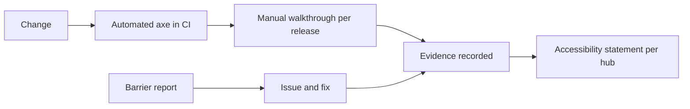

# Accessibility

Module code `ACC`. Status: the design system's accessible components on React Aria, tokens and the web app's axe checks in the browser suite are **Live**; the design-system axe suite exists but is not gated until CI-001; manual audits, screen-reader walkthroughs per release, accessible PDFs, an accessibility statement per hub and the brand-overlay contrast check are **Proposed**. Target **WCAG 2.2 AA** (a target, not a conformance claim). Packages: DS-001 (done), CI-001, A11Y-001, CNT-003, INTL-005, INTL-006, HUBC-006. Narrative: [Accessibility and responsive acceptance](../../quality/accessibility.md), [Design system](../../design/system/README.md), [accessibility evidence](../../design/system/accessibility-evidence.md).

## Purpose

Keyboard, screen readers, small screens, zoom, reduced motion, slow networks and every script are first-class. Accessibility is part of done for every module, and no automated zero is called full acceptance.

## Who uses it

Everyone; especially people using screen readers, keyboard only, magnification, voice control, people with low vision on sunny sites, and readers of right-to-left and complex scripts.

## User stories

| # | Story | Status |
|---|---|---|
| ACC-S1 | As a screen-reader user, I want to compare quotes in a table with proper headers on a phone | Proposed |
| ACC-S2 | As a keyboard user, I want the assistant overlay to open, trap focus only when modal, close with Escape and return focus to the launcher | Demo |
| ACC-S3 | As a reader with low vision, I want the magazine PDF to have a correct reading order and tags | Designed |
| ACC-S4 | As a hub operator, I want to know that my brand colours pass contrast before launch | Proposed |

## Functional requirements

| ID | Requirement | Status | Packages |
|---|---|---|---|
| ACC-F01 | Semantic structure, accessible names, visible focus, focus not obscured, status announcements, clear errors and recovery, contrast, reflow at 320 CSS px and 400% zoom, reduced motion | Live (design system); Demo (pages) | DS-001, WEB-001 |
| ACC-F02 | Never colour alone for status (quote state, reputation, badges, check results) | Live (rule) | DS-001 |
| ACC-F03 | Authentication accessible: password managers and paste allowed; no memory puzzles; second factor alternatives | Live (passwords); Proposed (second factor) | BE-001, BE-004 |
| ACC-F04 | Overlay and dialogs: modal only when modal, Escape to close, focus restored; non-modal overlay keeps logical keyboard order | Demo | WEB-001 |
| ACC-F05 | Tables (quotes, comparisons, registrations) have accessible headers and a usable small-screen form | Proposed | WEB-002 |
| ACC-F06 | Design-system axe suite gated in CI; web axe checks in the browser job | Live (web); Proposed (gate) | CI-001 |
| ACC-F07 | Manual walkthroughs per release with a screen reader (VoiceOver or NVDA), keyboard only, 200% text zoom, reduced motion; results recorded with device, steps, evidence, issues and reviewer | Proposed | A11Y-001 |
| ACC-F08 | Accessible magazine PDF: tagged structure, reading order, alternative text, language marked | Designed | CNT-003 |
| ACC-F09 | Right-to-left and complex-script support (bidi isolation, logical properties, typography) | Proposed | INTL-005, INTL-006 |
| ACC-F10 | Accessibility statement per hub generated from recorded evidence, with a contact for barriers | Proposed | A11Y-001 |
| ACC-F11 | The brand overlay's contrast and lettering are checked as a launch gate | Proposed | HUB-001, HUBC-006 |
| ACC-F12 | Captions and transcripts for videos in courses and event recordings where the author provides them; the authoring tools prompt for them | Proposed | LRN-001, EVT-001 |
| ACC-F13 | Agent conversations are accessible: messages announced politely, decisions reachable by keyboard, no time limits on confirmations except where security requires | Proposed | AGT-018 |

## Agent capabilities

The agent can read pages aloud only through the person's own assistive technology; it offers plain-language summaries of complex screens (`core.explain_screen`, read) on request.

## Interface surfaces

Every surface; accessibility statement page per hub; console accessibility section.

## Hub console settings

Brand contrast check, automated results, manual checklist and statement ([console operations: accessibility](../hub-console/operations.md#accessibility)).

## Data entities

Evidence records of accessibility checks in the operations module; no participant data.

## Country and jurisdiction variations

Legal duties differ (the European Accessibility Act applying to many services in the EU from 2025, ADA expectations in the US, national standards elsewhere); the target stays WCAG 2.2 AA everywhere.

## Privacy rules

No detection or storage of disability; preferences (high contrast, reduced motion, large targets) are stored as ordinary preferences.

## Metrics

Automated check results per release, manual walkthrough issues open and closed, barrier reports and response times.

## Edge cases

| Case | Behaviour |
|---|---|
| A hub's brand colour fails contrast | Launch gate fails with the measured ratio and suggestions |
| User content without alt text | Authoring prompts; published images without alt text are marked for authors |
| Long agent operations | Progress announced; no spinner-only states |

## Flow

## Open points

Who performs the first manual audit and with which assistive technologies.
