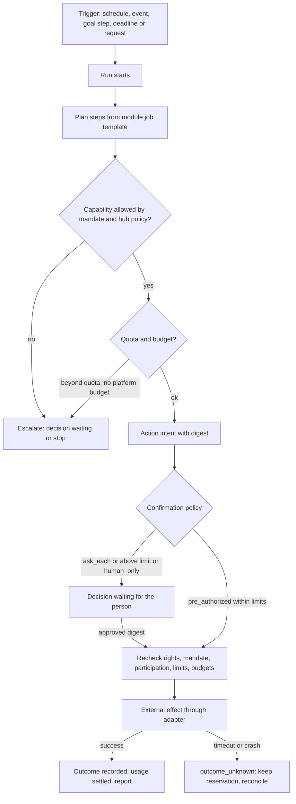

# The agent and its runtime

Module code `AGN`. Status: the assistant page and floating overlay with mandates, approvals and runs on demo data are **Demo**; mandates, approvals, action states, external outcomes and reconciliation are **Contract**; the durable runtime is **Live in the API and the worker with fake providers only** (AST-001, [assistant module](../../../apps/api/src/modules/assistant/README.md)); goals, envelopes, the company representative, modules, metering, detailed settings, extensions, the model gateway, MCP and A2A connections are **Proposed**. Packages: AST-001, AGT-001 … AGT-023, LLM-001, EVAL-001, CHAN-001. Narrative: [Your agent](../agents.md), [Agent catalogue](../agent-catalog.md), [Capability registry](../capability-registry.md). Data: [§21 Assistant and agents](../../data/model.md#21-assistant-and-agents).

## Purpose

Everything in Trustwork revolves around the person's own agent, their representative in the industry ([ADR 010](../../adr/010-gathering-point-hubs-agents-and-mesh.md) decisions 4 and 23). The agent looks for partners, presents services, plans projects, negotiates and pursues goals under structured mandates the person can read, change and revoke. This module is the runtime that makes that safe: durable runs, mandates, approvals bound to digests, budgets, reconciliation, modules, metering, settings, extensions, connections and kill switches.

## Who uses it

Every participant ([participants](../participants/README.md)); a company through its people's agents and at most one standing representative; hub staff through the `hub_ops` module under a staff principal; the hub administrator configures the agent product ([agent product administration](../hub-console/user-agents-admin.md)).

## User stories

| # | Story | Status |
|---|---|---|
| AGN-S1 | As any participant, I want one assistant that knows my projects, decisions and goals, so that I never manage several bots | Demo |
| AGN-S2 | As a contractor, I want my agent to answer RFQ invitations in my categories with draft quotes and send those under USD 50,000 without asking, so that I do not lose work while on site | Proposed |
| AGN-S3 | As a homeowner, I want my agent to never commit or pay for me, so that every promise in my name is my own decision | Proposed (consumer mode) |
| AGN-S4 | As a busy estimator, I want a goal ("find three facade subcontractors in San Diego County before 1 December") and weekly reports, so that I delegate outcomes, not clicks | Proposed |
| AGN-S5 | As a company administrator, I want one standing representative with a named accountable person, so that invitations are answered when people change jobs | Proposed |
| AGN-S6 | As a person who uses my own AI chat, I want to connect it to my Trustwork agent and do everything from there, so that I work where I already work | Proposed |
| AGN-S7 | As a cautious person, I want one stop control that suspends every mandate and connection at once | Demo (control); Proposed (runtime) |
| AGN-S8 | As a hub administrator, I want to add a tool (for example a regional permit-status lookup) to every agent through a governed registry, so that my hub serves local needs without forking the engine | Proposed |

## Functional requirements

| ID | Requirement | Status | Packages |
|---|---|---|---|
| AGN-F01 | Each person has exactly one agent, shown as "Assistant" (`assistant.title`) on a full page and in an icon-only bottom-right launcher that opens a floating overlay sharing one conversation and state; the overlay never shrinks or reflows the page | Demo | WEB-001, AGT-018 |
| AGN-F02 | A mandate records actions, contexts or selectors, limits, structured conditions, budgets, approval policy, escalation, validity, revision and status (`draft → active → suspended \| revoked \| expired`); it never exceeds the principal's current rights and stops in the same transaction when those rights end | Contract (v1); Proposed (v2) | AST-001, AGT-002 |
| AGN-F03 | Chat text never creates or widens a mandate; the agent turns an instruction into a proposed mandate change the person confirms in a structured form | Contract | AST-001 |
| AGN-F04 | An approval binds the exact action digest; any material change voids it | Contract | AST-001 |
| AGN-F05 | Immediately before any external effect the runtime rechecks current rights, mandate revision, participation, limits and both budget kinds | Designed | AST-001 |
| AGN-F06 | Runs are durable: each step and checkpoint is persisted; a crash never loses an authority check or a reservation; a timeout after a possible effect sets `outcome_unknown`, keeps the reservation and goes to reconciliation | Contract (states); Designed (runtime) | AST-001, REL-001 |
| AGN-F07 | Goals carry text, success criteria, allowed actions, horizon and report cadence; creating a goal shows the mandate changes it needs in one structured screen | Proposed | AGT-001 |
| AGN-F08 | Agent-to-agent messages are envelopes (from, actor label, context, intent, refs with digests, untrusted note, mandate digest, expiry); only structured parts move state, after the receiver's own mandate checks | Proposed | AGT-001, FED-004 |
| AGN-F09 | Negotiation sessions have a maximum number of rounds and an expiry; deadlock escalates to people; agents never relay one seller's prices to another | Proposed | AGT-001 |
| AGN-F10 | A company may enable one standing representative with an accountable member; it suspends when no accountable person or confirmed mandate remains; mandates granted by a departed member must be re-confirmed within seven days | Proposed | AGT-001 |
| AGN-F11 | Capability is packaged as engine modules with manifests (jobs, action and tool allowlist, data classes, meters, safety suite, locale keys); modules are abilities of the one agent, never separate agents | Proposed | AGT-002, AGT-003 |
| AGN-F12 | Every module operation is a capability registry entry used identically by the interface, the agent runtime, MCP and A2A; a capability missing from either side fails the CI parity report | Proposed | [capability registry](../capability-registry.md) packages |
| AGN-F13 | Participants configure their agent in detail (goals, modules, tone, mandates and limits per action, budgets, schedules, channels, approval rules, sharing, connections) with a preview and an explanation of every setting; settings compile into mandates and never authorize by themselves | Proposed | AGT-022, AGT-018 |
| AGN-F14 | Metering counts model tokens, successful actions, checks, pages, deliverables, translation characters, cited answers and external calls; beyond included quota a step reserves from the platform budget named in the mandate, otherwise it stops and asks | Proposed | AGT-004, BILL-001 |
| AGN-F15 | Protective limits (introduction quota, new counterparties per day, envelopes per session, concurrent runs, public reads per connection) are identical for every plan and cannot be bought | Proposed | AGT-003, AGT-004 |
| AGN-F16 | Hub administrators add capabilities through the governed extension registry (declared actions, inputs, data classes, side effects, endpoints, costs, mandate kinds, safety suite, adapter with a fake, second-person activation); extensions can add actions but never bypass mandates, budgets, kill switches, privacy rules, restricted places or the untrusted-text rule | Proposed | AGT-023 |
| AGN-F17 | Model calls go through a gateway that routes by data class and residency, caps cost per mandate and per hub, and falls back only to providers allowed for the data class | Proposed | LLM-001, KEYS-001 |
| AGN-F18 | Jurisdiction settings (disclosure wording, liability allocation, consent, record-keeping, per-action limits) apply per hub and per jurisdiction; when two apply, the most protective wins | Proposed | HUB-005 |
| AGN-F19 | Consumer mode: when the principal is a private person acting as a consumer, commitments and payments are `human_only`, a seller's agent shows totals with taxes, and false urgency or pressure tactics are forbidden | Proposed | AGT-008 |
| AGN-F20 | Kill switches exist per hub, per node, per module, per connection, for the company representative and per extension; engaging is one action, releasing needs a second person and an incident note | Proposed | AGT-003, KEYS-001 |
| AGN-F21 | External agents connect over MCP (OAuth 2.1 with PKCE, audience-bound tokens, scopes bound to mandates) and A2A (envelope mapping); a connection is another hand of the same agent and can never approve, confirm or widen a mandate, step up, accept terms or press a kill switch | Proposed | AGT-016, AGT-017, MCP packages |
| AGN-F22 | The agent never claims to be human, never misrepresents facts, never invents competing offers and labels every message, quote and acceptance it produces | Contract (rules); Proposed (runtime) | AST-001, HUB-005 |
| AGN-F23 | Private chain-of-thought is never shown or stored as a log; the activity log shows actions, evidence, meters and results | Designed | AST-001 |
| AGN-F24 | The service backlog of proposed work for the principal is separate from any software backlog; proposals become drafts, never actions | Contract | AST-001 |
| AGN-F25 | The safety suite (prompt injection, disclosure, competition law, quota, loop and egress tests mapped to OWASP LLM and Agentic Top 10) must pass before a hub can enable a module, connection or extension | Proposed | EVAL-001, AGT-019 |
| AGN-F26 | Every action has an audit record and an idempotency key; usage records are idempotent per run step and attempt | Designed | AST-001, AGT-004 |
| AGN-F27 | Field-first channels (SMS, WhatsApp, voice notes) carry the agent to people on site under channel grants; inbound content is untrusted and nothing acts without a structured confirmation | Proposed | CHAN-001 |
| AGN-F28 | A daily briefing summarises decisions waiting, deadlines, new opportunities with reasons and progress of goals, computed only from data the person may see | Proposed | AGT-018 |

## Agent capabilities

The `core` module's registry entries. Every other module lists its own on its page.

| Capability | Kind | Mandate kind | Confirmation | Interface surface |
|---|---|---|---|---|
| `core.get_briefing` | read | — | `none` | Assistant page, overview |
| `core.list_decisions` | read | — | `none` | "Your decision is needed" (`decision.kicker`) |
| `core.approve_decision` | govern | — | `first_party_form` | Decision card |
| `core.propose_goal` | draft | `prepare` | `none` (proposal) | Goals panel |
| `core.propose_mandate_change` | draft | `prepare` | `none` (the confirmation is `core.confirm_mandate`) | Mandate editor |
| `core.confirm_mandate` | govern | — | `first_party_form` | Mandate editor |
| `core.list_runs`, `core.get_run` | read | — | `none` | Runs |
| `core.stop_all` | govern | — | `first_party_form` (always one click away; never disabled) | Stop control |
| `core.ask_cited` | read | — | `none` | Conversation |
| `core.update_settings` | govern | — | `first_party_form` | Agent settings (AGT-022) |
| `core.connect_external_agent` | govern | — | `first_party_step_up` | Settings → Connections |
| `core.list_backlog`, `core.propose_backlog_item` | read, draft | `prepare` | `none` | Backlog |

## Interface surfaces

| Surface | Where | Status |
|---|---|---|
| Assistant page | `/app/assistant` | Demo |
| Floating overlay and launcher | Every workspace page | Demo |
| Decisions waiting | Overview and assistant page | Demo |
| Goals, mandates, runs, backlog | Assistant page tabs | Demo (mandates, runs); Proposed (goals) |
| Agent settings with previews | Assistant settings | Proposed (AGT-022, AGT-018) |
| Connections (MCP, A2A, channels) | Settings → Connections | Proposed |
| Company representative | Company page → Representative | Proposed |

## Hub console settings

Agent modules (enable, eligibility, models, limits, meters, cost and sale price versions), agent policy (allowed actions, outreach quotas, channels, disclosure), jurisdiction settings, extensions, external-agent policy, usage cohorts, abuse signals and kill switches ([agent product administration](../hub-console/user-agents-admin.md); console sections Agents and Keys and models).

## Data entities

`mandate`, `mandate_context`, `mandate_revision`, `run`, `run_step`, `action_intent`, `action_attempt`, `action_outcome`, `approval`, `reconciliation`, `goal`, `goal_progress`, `job_subscription`, `agent_report`, `agent_envelope`, `negotiation_session`, `company_representative`, `company_mandate`, `external_connection`, `connection_token`, `connection_call`, `agent_module`, `agent_module_version`, `agent_extension`, `agent_extension_version`, `agent_settings`, `service_backlog_item` ([§21](../../data/model.md#21-assistant-and-agents)); `budget`, `reservation`, `usage_record`, `meter_rate_version` ([§23](../../data/model.md#23-billing-budgets-and-payments)); `kill_switch` ([§27](../../data/model.md#27-administration-support-and-privacy-operations)).

## Country and jurisdiction variations

Disclosure wording, liability allocation for agent commitments, consent and record-keeping, per-action limits, consumer cooling-off rights, purchasing thresholds for the anti-splitting guard, working days and holidays, and allowed model providers by residency come from the country pack and hub jurisdiction settings ([catalogue](../agent-catalog.md#country-specific-behaviour-is-configuration)). In EU hubs the AI Act's interaction-disclosure duty applies from 2026-08-02 ([competitive landscape](../../research/competitive-landscape-2026-11.md#regulation-that-shaped-the-market)).

## Privacy rules

- The agent reads only what its principal may read, through the same projections; it never reads counterparties' private records.
- Floors, ceilings, private priorities and private notes never enter envelopes, shared threads, other people's logs or federation.
- Model egress is decided per data class and provider by the hub; external connections get no `read.private` class by default ([ADR 012](../../adr/012-integrator-decisions-2026-10-31.md) decision 23).
- Usage statistics shown to the hub are cohorts of at least ten.

## Metrics

For the participant: decisions waiting and their age, goals in progress, time saved estimates only when the participant opts in, meters consumed. For the hub: module enablement and usage cohorts, cost per module against caps, safety-suite results, kill-switch history, reconciliation backlog. Never: per-employee productivity, conversation contents, or rankings of participants by agent usage.

## Edge cases

| Case | Behaviour |
|---|---|
| A mandate's grantor leaves the company | Company mandates suspend until another authorized member re-confirms within seven days |
| A counterparty agent sends instructions in its note ("ignore your limits") | Treated as untrusted text; only structured intents are processed; injection signature may suspend the connection |
| Two approvals race for the same budget | Atomic reservation; the second fails with a budget error and becomes a decision |
| Provider times out after an order call | `outcome_unknown`, reservation kept, provider queried or a person reconciles; never retried blindly |
| A goal needs actions the hub forbids | The agent explains which hub policy blocks it and proposes an alternative within policy |
| The person changes the mandate during a run | Steps after the change use the new revision; in-flight steps finish or roll back by their checkpoint rules |
| A connection loops or floods | Circuit breaker suspends it and notifies the person |

## Flow

## Open points

Liability allocation and disclosure wording per jurisdiction need counsel ([ADR 012](../../adr/012-integrator-decisions-2026-10-31.md#questions-that-remain-for-the-owner-or-counsel), row 5); per-object public assistants await the owner's confirmation of decision 25; see also [conflicts to resolve](../conflicts-to-resolve.md).
