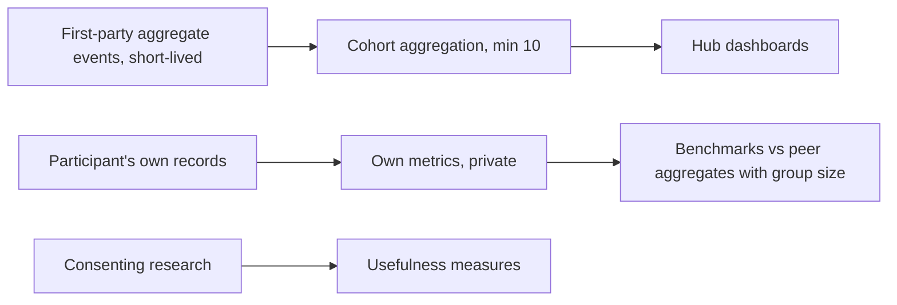

# Analytics

Module code `ANL`. Status: **Proposed**. Today no analytics are collected anywhere in the engine, and no readership or usage number is claimed. Packages: ANL-001, BENCH-001, AGT-004, HUBC-005, HUBC-006, AGT-020 (blocked research). Narrative: [How we will know it works](../vision.md#how-we-will-know-it-works), [Statistics without surveillance](../hub-console/user-agents-admin.md#statistics-without-surveillance), [Measuring without surveillance](../partners-and-matching.md#measuring-without-surveillance).

## Purpose

Let people and hubs learn whether the gathering point helps, without surveillance: participants see their own results, companies see their own metrics against privacy-safe peer aggregates, hubs see cohorts and operational counts, and the project learns from consenting research, never from tracking.

## Who uses it

Participants (own data), companies (own metrics and benchmarks), hub owners and staff (cohorts and operations), editors (content performance as cohorts), the owner and researchers (consenting studies).

## User stories

| # | Story | Status |
|---|---|---|
| ANL-S1 | As a contractor, I want my own response time, win rate and on-time delivery over time | Proposed |
| ANL-S2 | As a company, I want to compare with peers in my category and region only when the group is large enough | Proposed |
| ANL-S3 | As an editor, I want to know which rubrics people read, without tracking individuals | Proposed |
| ANL-S4 | As a hub owner, I want funnel cohorts (signed up, verified, completed first plan, booked first consultation) to improve onboarding | Proposed |
| ANL-S5 | As a person, I want no "who viewed your profile" and no advertising profile built about me | Live (absence, rule) |

## Functional requirements

| ID | Requirement | Status | Packages |
|---|---|---|---|
| ANL-F01 | Participant analytics are computed only from records the participant may see and shown only to them | Proposed | ANL-001 |
| ANL-F02 | Company metrics are company-level, never per employee; no productivity dashboards | Proposed | BENCH-001 |
| ANL-F03 | Peer benchmarks use minimum group sizes and noise where needed; method, period and group size shown beside every comparison; no pooled private prices | Proposed | BENCH-001 |
| ANL-F04 | Hub statistics about participants are cohorts; every count under ten is suppressed | Proposed | ANL-001, HUBC-000 |
| ANL-F05 | Product analytics events are first-party, aggregate, without third-party trackers, advertising identifiers or cross-site cookies; raw events expire quickly and only aggregates are kept | Proposed | ANL-001 |
| ANL-F06 | Readership counts for publications and the magazine are aggregate counts with a stated method; no invented or estimated readership is ever published | Proposed | ANL-001 |
| ANL-F07 | Measures of usefulness follow the specification: personal relief, perceived control, confidence, useful completion, interruption burden and willingness to return, from voluntary research with consent | Proposed (blocked research) | AGT-020 |
| ANL-F08 | Agent usage statistics are cohorts per module; cost and revenue per module for the hub | Proposed | AGT-004 |
| ANL-F09 | Respect Global Privacy Control and opt-outs in any analytics that could count as sale or sharing under applicable law | Proposed | PRV-001, ANL-001 |
| ANL-F10 | Analytics never feed ranking, matching or reputation except where a module's published method uses the participant's own platform response history | Proposed | MATCH-001 |

## Agent capabilities

| Capability | Kind | Mandate kind | Confirmation | Interface surface |
|---|---|---|---|---|
| `core.my_metrics` | read | — | `none` | My page, company page |
| `core.company_benchmarks` | read | — | `none` | Company → Benchmarks |
| `core.weekly_report` | read | — | `none` | Assistant reports |

## Interface surfaces

Own metrics on My page and the company workspace; benchmarks; console overview cohorts and module usage; editorial desk cohorts. All **Proposed**.

## Hub console settings

Minimum cohort size (never below ten), retention of raw events, whether aggregate readership counts are shown publicly.

## Data entities

Aggregates are derived and stored as cohort tables owned by ANL-001; `usage_record` for agent meters ([§23](../../data/model.md#23-billing-budgets-and-payments)).

## Country and jurisdiction variations

Cookie and tracking consent rules (ePrivacy in the EU), opt-out of sale or sharing in US states, and research-ethics rules for studies come from packs and hub settings.

## Privacy rules

No per-person behaviour analytics for staff; no third-party trackers; no profile-view lists; cohorts of at least ten; participants' own data only for themselves.

## Metrics

This module defines them.

## Edge cases

| Case | Behaviour |
|---|---|
| A cohort is small in a new hub | Suppressed; shown as "not enough data" |
| A company asks for employee-level metrics | Refused by design; company-level only |
| A sponsor asks for course usage by person | Refused; aggregate only |

## Flow

## Open points

The practitioner interview programme (O01, AGT-020 blocked).
