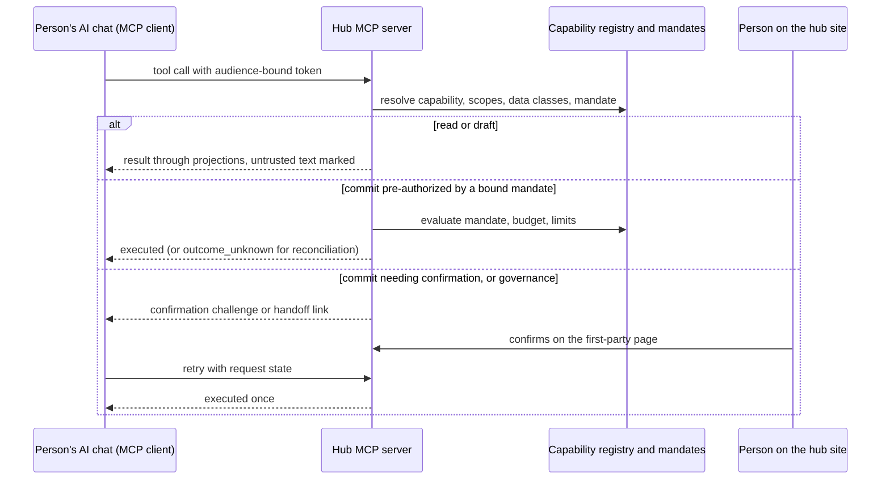

# API and MCP

Module code `API`. Status: the first-party HTTP API under `/v1/*` for identity, people, companies, memberships and projects is **Live** (contract-first, strict schemas, idempotency, projections); the OpenAPI document for implemented routes exists but its route list is hand-written; every other route in the [API conventions](../../architecture/api.md) is **Contract** only; the generated API reference, the public API with OAuth clients and webhooks, the MCP server for the person's own AI chat and the A2A gateway are **Proposed**. Packages: BE-001 (done), DOC-002, INTEG-001, AGT-016 (umbrella of the MCP server packages), AGT-017, AGT-019, FED-004. Narrative: [API conventions](../../architecture/api.md), [Connect your own agent](../agent-catalog.md#connect-your-own-agent-mcp-and-a2a), [The capability registry](../capability-registry.md); the MCP server design (ADR 013) is in review at the time of writing.

## Purpose

Give every surface of the engine one contract: the first-party web app, a documented public API for integrations, an MCP server through which a person uses the whole system from their own AI chat under the same mandates, and an A2A gateway for other people's agents, all projecting the same capability registry and the same projections, so that no door is wider than another.

## Who uses it

The web app (first party); developers and companies integrating their tools (public API, webhooks); every participant who connects their own AI chat or agent (MCP); other participants' agents (A2A); hub staff through an admin MCP surface that a hub may enable (off by default, as the MCP design proposes).

## User stories

| # | Story | Status |
|---|---|---|
| API-S1 | As a developer, I want a generated, versioned API reference whose routes match exactly what the server registers | Proposed (DOC-002) |
| API-S2 | As a person, I want to connect my AI chat to my Trustwork agent, choose which domains and private data classes it may see, and revoke it in one click | Proposed |
| API-S3 | As a person, I want my AI chat to propose an order that I confirm on the Trustwork site, never by typing "yes" in the chat | Proposed |
| API-S4 | As a company, I want signed webhooks when an RFQ invitation arrives, to feed my ERP | Proposed |
| API-S5 | As a supplier with my own agent elsewhere, I want it to exchange structured proposals with Trustwork agents under the same envelope rules | Proposed |

## Functional requirements

| ID | Requirement | Status | Packages |
|---|---|---|---|
| API-F01 | One public origin; `/v1/*` on the same origin; `__Host-` cookies; mutation header and fetch-metadata checks; GET never mutates | Live | BE-001 |
| API-F02 | Every command, query and read model is a Zod strict object in `packages/contracts`; JSON Schema and OpenAPI are generated, never hand-maintained | Live (contracts); Proposed (generated reference) | FND-002, DOC-002 |
| API-F03 | Stable English error codes mapped to localized messages; HTTP status fixed per code; the disclosure rule returns "not found" for unknown existence | Live | BE-001 |
| API-F04 | Idempotency keys scoped to principal, action and context; expected revisions on versioned edits; durable commands answer with accepted states, never implying the external effect happened | Live | BE-001 |
| API-F05 | Pagination with opaque, audience-checked cursors and no unrestricted totals | Contract | FND-002 |
| API-F06 | A generated API reference from the registered routes and the contracts, with a CI drift check | Proposed | DOC-002, CI-001 |
| API-F07 | Public API scopes map to projections; OAuth clients per participant and per hub; rate limits and metered external costs shown to the hub | Proposed | INTEG-001 |
| API-F08 | Signed webhooks with replay protection and per-subscriber delivery logs | Proposed | INTEG-001 |
| API-F09 | Every MCP tool is a projection of exactly one capability registry entry; a participant capability without interface or agent surface is a parity gap and a capability exposed to MCP without exactly one tool is a coverage gap; CI reports both | Proposed | MCP server packages under AGT-016 |
| API-F10 | Three MCP surfaces per hub, each its own protected resource: participants (signed in), public (anonymous, read-only public projections, low rate limits), admin (staff, off by default, no staff commits) | Proposed | AGT-016 |
| API-F11 | Streamable HTTP transport with pinned protocol versions and a compatibility window; no session identifiers minted; cross-call state in opaque server-side handles | Proposed | AGT-016 |
| API-F12 | The hub runs its own authorization server: OAuth 2.1 with PKCE (S256), resource indicators equal to one surface's canonical URI, issuer identification, revocation; client ID metadata documents preferred, dynamic registration behind a hub switch | Proposed | AGT-016 |
| API-F13 | Opaque access tokens of at most 15 minutes stored as hashes, audience-bound, rotating refresh tokens with reuse detection, sender-constrained where supported; session cookies never authorize MCP and MCP tokens never authorize the first-party API; no token passthrough | Proposed | AGT-016 |
| API-F14 | Consent per client on the hub's own page after step-up: scopes, toolsets, private data classes off by default and opted in one by one with a residency warning, optional mandate bindings, expiry, rate limits; progressive scope requests | Proposed | AGT-016 |
| API-F15 | Commitments from a connection execute at once only under a bound, pre-authorizing mandate; otherwise a confirmation challenge bound to the person, connection, capability version and action digest sends the person to the first-party confirmation page; chat text never authorizes | Proposed | AGT-016 |
| API-F16 | Governance capabilities are reachable from MCP only as handoff tools that open the exact first-party page; connections can never approve, confirm or widen mandates, step up, change credentials, memberships or roles, accept prices or terms, request case grants, export in bulk or press kill switches | Contract (forbidden list); Proposed (server) | AGT-002, AGT-016 |
| API-F17 | Untrusted text in tool results is marked with its origin; values from untrusted text never feed a commit without confirmation | Proposed | AGT-016 |
| API-F18 | Tool output passes the projection serializers, then the connection's data-class filter; redacted fields are listed | Proposed | AGT-016 |
| API-F19 | Tool names derive from capability ids; compatible changes raise versions; deprecated tools carry sunset dates for at least 180 days | Proposed | AGT-016 |
| API-F20 | A person's client talks only to their home hub; actions involving other nodes go through federation rules | Proposed | AGT-016, FED-004 |
| API-F21 | Every call writes a `connection_call` audit row with an argument digest; rate limits per connection and tool class; circuit breaker; kill switches take effect before the next call | Proposed | AGT-016 |
| API-F22 | A2A: Agent Cards only for public, opted-in profiles; state-moving tasks only from Trustwork principals (connection tokens or peer node signatures at `deal-routing`); tasks map to envelopes, text to untrusted notes, files quarantined | Proposed | AGT-017 |
| API-F23 | Everything a person reads through MCP flows (consent, confirmation pages, error messages) comes from locale files in their language; tool names and schemas are English | Proposed | AGT-016 |
| API-F24 | The safety evaluation covers connections (injection, exfiltration, confused deputy, scope escalation) before a hub enables them | Proposed | AGT-019 |

## Agent capabilities

The API and MCP are doors to the capabilities listed on every module page; they add no capabilities of their own except connection management, which is governance (`core.connect_external_agent`, [agent module](agent.md#agent-capabilities)).

## Interface surfaces

| Surface | Where | Status |
|---|---|---|
| First-party API | `/v1/*` | Live (identity, people, companies, memberships, projects) |
| OpenAPI document | `apps/api/openapi/openapi.json` | Live (hand-listed routes); Proposed (generated) |
| API reference page | Documentation | Proposed (DOC-002) |
| MCP endpoints | `/mcp`, `/mcp/public`, `/mcp/admin` on each hub origin | Proposed |
| Consent and confirmation pages | Hub origin | Proposed |
| Connections settings | Settings → Connections | Proposed |

## Hub console settings

External agents policy: MCP surfaces on or off, public answers on or off, dynamic registration, listed clients, rate limits, maximum connections per person, toolsets, kill switches ([agent product administration: external agents](../hub-console/user-agents-admin.md#external-agents-mcp-and-a2a)); OAuth clients and webhooks for the public API.

## Data entities

`external_connection`, `connection_token`, `connection_call` ([§21](../../data/model.md#21-assistant-and-agents)); `idempotency_record`, `inbox_receipt` ([§2](../../data/model.md#2-platform-kernel)); integration clients and webhook subscriptions added by INTEG-001.

## Country and jurisdiction variations

AI disclosure duties apply to agents reached over MCP as to the built-in agent; data residency limits which private classes a person may opt to send to an external client (the consent screen warns); consumer rules raise confirmations.

## Privacy rules

Private data classes are off by default for every connection; projections apply before data-class filters; tokens never appear in logs; staff see connection calls only through a case grant.

## Metrics

Hub cohorts: connections by client type, calls by tool class, denials and their reasons, confirmation challenges completed, circuit-breaker trips; public API usage and webhook delivery success.

## Edge cases

| Case | Behaviour |
|---|---|
| A client replays an old refresh token | The whole token family is revoked |
| A tool result contains "transfer the deposit to this account" from a supplier's message | Marked untrusted; any commit using that value needs confirmation on the site |
| The person narrows scopes while the client is mid-task | Scopes are looked up per call; the next call is denied with the exact missing scope |
| A hub turns MCP off | Kill switch: every surface answers with a stable error before the next call |

## Flow

## Open points

The owner questions of the MCP server design (admin surface, public answers, dynamic registration default, listed clients, pre-authorized commits through connections).
