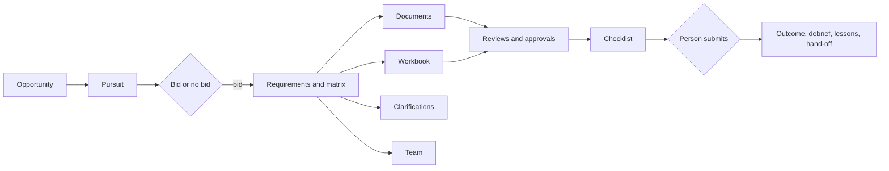

# Bid desk (supplier side of tenders)

Module code `BID`. Status: **Proposed** throughout (owner request of 2026-11-01; requirement R74). It reuses **Live** and **Contract** pieces: RFQ and quote versions with digests (COM-001, COM-002), approval routes (PRC-001), the reputation builder (REP-001), context threads (COMMS-001), the screening engine (SANC-003), the mandate v2 vocabulary and the registry contract (AGT-002). Packages: BID-000 … BID-009, AGT-025, WEB-013, WEB-014, CTRY-004, with PROC-001, PROC-002, PREQ-001, PRC-005, PRC-006, PRC-017, MATCH-001, CONS-001 and SANC-004. Narrative and full design: [The supplier bid desk](../tender-desk.md). Screens: [Workspace: tender desk](../../design/screen-contracts/workspace/tender-desk.md). Data: [§18b Supplier bid desk](../../data/model.md#18b-supplier-bid-desk).

## Purpose

Give every supplier, contractor, manufacturer and design office the tools to find public and private tenders, decide whether to bid, understand exactly what the buyer asks for, assemble a compliant offer in the buyer's format and language, price it without leaking its margin, ask questions in time, team without colluding, get it reviewed and submit it as a person, through its own agent and through the interface alike.

## Who uses it

Contractors and subcontractors, suppliers and distributors, manufacturers, design offices and consultants that bid; their estimators, bid writers, managers and approvers; independent professionals who bid on small public work; experts who advise bidders (consultations); the `bid_desk` agent module (AGT-025) with `opportunity_watch`, `compliance_checker`, `quoting`, `negotiation` and `translation`.

## User stories

| # | Story | Status |
|---|---|---|
| BID-S1 | As a roofing contractor in San Diego, I want alerts for public roofing bids in my counties with the reasons they match, at the same moment as everyone else | Proposed |
| BID-S2 | As an estimator, I want a bid/no-bid recommendation with the gates I fail and the evidence for each score, so that we decide quickly and for stated reasons | Proposed |
| BID-S3 | As a bid writer, I want every requirement of a 300-page solicitation in a compliance matrix with the page it comes from, so that nothing mandatory is missed | Proposed |
| BID-S4 | As a manager, I want our licences, insurance, references and method statements in one library that tells me what expires before the deadline | Proposed |
| BID-S5 | As an estimator, I want a workbook that warns me when a price falls below our floor and guarantees that our margins never reach the buyer's file | Proposed |
| BID-S6 | As a bid writer, I want questions to the buyer sent through the official channel before the question deadline, and answers to update our matrix | Proposed |
| BID-S7 | As a prime, I want subcontractors for a scope I cannot cover, found with explanations, without exposing our price | Proposed |
| BID-S8 | As the person accountable, I want to confirm the submission myself after a checklist proves it is complete | Proposed |
| BID-S9 | As a bidder that lost, I want the debrief deadline tracked and the lessons kept for next time | Proposed |
| BID-S10 | As a first-time bidder in a new procedure, I want the desk to suggest a real expert and book a consultation I choose | Proposed |
| BID-S11 | As a supplier who prefers my own AI chat, I want every bid desk function there too, with commitments confirmed on the site | Proposed |

## Functional requirements

| ID | Requirement | Status | Packages |
|---|---|---|---|
| BID-F01 | Opportunities come from imported public notices, platform RFQ invitations, open needs and manual or uploaded tenders; each pursuit points to exactly one source and is labelled with it | Proposed | BID-001, PROC-001, PROC-002 |
| BID-F02 | Alert profiles from the capability profile (categories, classification codes from packs, regions, value, set-asides held as credentials, languages); alerts dispatched in the same batch for every plan | Proposed | BID-001, AGT-007 |
| BID-F03 | Opportunities with a buyer, place of performance or delivery in a restricted place are never imported, matched or shown | Proposed | PROC-002, BID-001 |
| BID-F04 | Match explanations show scope fit, licences and registrations, prequalification, set-asides, capacity, track record, location and time, each with pass, fail or unknown and evidence; unknown is not failure | Proposed | BID-001, REP-001, PREQ-001, REG-001 |
| BID-F05 | No screen, API or agent tool reveals who else follows, views, asks about or bids on an opportunity | Proposed | BID-001, BID-006 |
| BID-F06 | Bid/no-bid scorecards: hard gates, company-weighted criteria with cited evidence, a recommendation (`bid`, `bid_with_conditions`, `resolve_first`, `no_bid`) with reasons; the decision is human through the approval route subject kind `bid_decision` | Proposed | BID-001, BID-000, PRC-001 |
| BID-F07 | Tender documents are stored as untrusted versioned files with digests; text in them never changes deadlines, channels, recipients, mandates or tool calls | Proposed | BID-002 |
| BID-F08 | Documents that appear to be another bidder's proposal or the buyer's source selection material are quarantined for a person's decision and never extracted | Proposed | BID-002 |
| BID-F09 | Extraction produces requirements with kind, obligation, exact quote, summary, citation (document, version digest, page, region) and confidence; only accepted requirements enter the matrix | Proposed | BID-002, PRC-005 |
| BID-F10 | Addenda and published answers flag affected requirements stale and require review | Proposed | BID-002, BID-005 |
| BID-F11 | The compliance matrix maps each requirement to responses, owners, evidence and status; non-compliance needs a deviation note; published evaluation criteria are shown, never invented | Proposed | BID-002 |
| BID-F12 | The content library keeps company profile, credentials, insurance, references, method statements, CVs, standard answers and templates with owners, review cycles and expiry, reading credentials and passport sections from their sources of truth | Proposed | BID-003, REP-001, PREQ-001 |
| BID-F13 | CVs are used only with the person's recorded consent; the person sees every use | Proposed | BID-003, PPL-001 |
| BID-F14 | The document builder assembles response versions in the buyer's outline, formats and file rules; versions freeze with a digest; exports strip metadata, hidden sheets and cells and list what was removed | Proposed | BID-003 |
| BID-F15 | Translations of bid content are drafts labelled machine-assisted until a named reviewer approves them; certified translations are flagged, never simulated | Proposed | BID-003, PROV-001 |
| BID-F16 | Specification checks classify each technical requirement as exact, equivalent by rule (PRC-006, with basis), substitution proposed, missing or non-compliant; equivalent is never approved by the desk | Proposed | BID-004, PRC-006 |
| BID-F17 | The pricing workbook builds costs from quantities, rates with sources, escalation from index series and allowances; it is `negotiation_constraints` and never leaves the company | Proposed | BID-004, PRC-017 |
| BID-F18 | The margin guard checks floors, arithmetic, unbalanced pricing, coverage and consistency deterministically | Proposed | BID-004 |
| BID-F19 | The price schedule sent to the buyer is a separate schema with no cost, margin, floor or note field by construction | Proposed | BID-004, BID-000 |
| BID-F20 | Bid security is recorded as a reference to a licensed provider's instrument; no funds pass through Trustwork | Proposed | BID-004 |
| BID-F21 | Clarifications go through the official channel from structured notice data or the RFQ (`rfq_clarification`); deadlines tracked in the buyer's and the person's time zones; quiet periods respected | Proposed | BID-005, COMMS-001 |
| BID-F22 | Partner requests from gaps; candidates from payment-blind matching; double-opt-in introductions within quota; scope packages share only the partner's scope | Proposed | BID-006, MATCH-001 |
| BID-F23 | Teaming agreements bind only by both parties' step-up confirmation after screening both (fails closed); potential-competitor teaming carries the competition-law note and a recorded reason | Proposed | BID-006, SANC-004 |
| BID-F24 | The agent refuses collusive goals and mandates; the guard blocks attaching workbooks to partner threads and warns on own price or margin in messages | Proposed | BID-006, AGT-025 |
| BID-F25 | Review rounds bind response and workbook digests; approval route subject kind `bid_submission`; segregation of duties between the price writer and the approver above a threshold | Proposed | BID-007, PRC-001 |
| BID-F26 | The submission checklist is computed (completeness, format, pricing, eligibility, integrity, accessibility, screening, time) and blocks on failures | Proposed | BID-007 |
| BID-F27 | Platform submission is a COM-002 quote version sent with `person_each_step_up`; portal submission is done by the person on the portal and recorded with receipt and file digests; no stored portal credentials | Proposed | BID-007, COM-002 |
| BID-F28 | Unknown submission outcomes are reconciled, never retried blindly | Proposed | BID-007 |
| BID-F29 | Outcomes, debrief windows from pack facts, debrief records and lessons; awards become sourced portfolio lines by identifier | Proposed | BID-008, PROC-001, REP-001 |
| BID-F30 | Wins hand off to execution: platform agreements to EXE-001; off-platform contracts to a private external contract record with obligations drafted into a company project | Proposed | BID-008, EXE-001, PLAN-001 |
| BID-F31 | Expert suggestions with reasons, payment-blind; booking through CONS-001 with a scope chosen item by item; conflict check declines privately | Proposed | BID-005, CONS-001 |
| BID-F32 | Every operation is a registry capability with a web route and an agent tool calling one use case; the parity report shows no gap | Proposed | BID-009, AGT-025, WEB-013, WEB-014 |
| BID-F33 | Country specifics (notice standards, supplier registrations, self-declaration forms, submission rules, bid security, debrief and standstill windows, integrity forms, automated access terms, retention, classification schemes) are pack facts | Proposed | CTRY-004 |
| BID-F34 | Metrics are company-level with a self-view; no person is ranked | Proposed | BID-008 |

## Agent capabilities

The full table with interface flows is in the design's [agent parity section](../tender-desk.md#agent-parity-every-operation-is-a-capability). Summary:

| Capability | Kind | Mandate kind | Confirmation | Interface surface |
|---|---|---|---|---|
| `bid_desk.list_opportunities`, `bid_desk.read_pursuit`, `bid_desk.find_partners`, `bid_desk.suggest_experts` | read | — | `none` | Lists and pursuit tabs |
| `bid_desk.create_pursuit`, `bid_desk.draft_scorecard`, `bid_desk.attach_documents`, `bid_desk.extract_requirements`, `bid_desk.draft_sections`, `bid_desk.translate_sections`, `bid_desk.check_specification`, `bid_desk.edit_workbook`, `bid_desk.draft_clarification`, `bid_desk.comment_review`, `bid_desk.generate_checklist`, `bid_desk.capture_lessons` | draft | `prepare` | `none` | Pursuit tabs |
| `bid_desk.maintain_alerts`, `bid_desk.update_matrix`, `bid_desk.maintain_library` | commit | `maintain_records` | `mandate` (`ask_first(5)`) | Settings, matrix, library |
| `bid_desk.review_requirements`, `bid_desk.review_translation`, `bid_desk.hand_off` | commit | `maintain_records` | `person_each` | Matrix, builder, outcome |
| `bid_desk.record_outcome` | commit | `maintain_records` | `mandate` (`ask_each`) | Outcome |
| `bid_desk.send_clarification`, `bid_desk.share_scope`, `bid_desk.request_debrief` | commit | `communicate` | `person_each` | Clarifications, team, outcome |
| `bid_desk.request_review` | commit | `communicate` | `mandate` (`ask_first(5)`) | Reviews |
| `bid_desk.request_introduction` | commit | `introduce` | `mandate` (`ask_first(3)`) | Team |
| `bid_desk.propose_teaming` | commit | `negotiate` | `person_each` | Team |
| `bid_desk.accept_teaming` | commit | `accept_order` | `person_each_step_up` | Agreement card |
| `bid_desk.record_portal_message`, `bid_desk.record_bid_security` | commit | `record_evidence` | `person_each` | Clarifications, checklist |
| `bid_desk.record_portal_submission` | commit | `record_evidence` | `person_each_step_up` | Submission |
| `bid_desk.submit_platform_bid`, `bid_desk.withdraw_bid` | commit | `send_quote` | `person_each_step_up` | Submission |
| `bid_desk.decide_bid`, `bid_desk.decide_approval` | govern | — | `first_party_form` | Decision cards |

## Interface surfaces

| Surface | Where | Status |
|---|---|---|
| Bid desk dashboard | `/app/sales/tenders` | Proposed (WEB-013) |
| Opportunities | `/app/sales/tenders/opportunities` | Proposed (WEB-013) |
| Pursuit with bid/no-bid, requirements, documents | `/app/sales/tenders/[pursuit]`, `/requirements`, `/documents` | Proposed (WEB-013) |
| Content library | `/app/sales/tenders/library` | Proposed (WEB-013) |
| Pricing, clarifications, team, reviews, submission | `/app/sales/tenders/[pursuit]/pricing`, `/clarifications`, `/team`, `/reviews`, `/submission` | Proposed (WEB-014) |
| Outcomes and debriefs | `/app/sales/tenders/outcomes` | Proposed (WEB-014) |
| Decisions waiting | Overview and the assistant | Proposed |

## Hub console settings

Module enablement per participant type and plan, tender sources with recorded terms, extraction routes and meters, scorecard, review and teaming templates, approval route templates for `bid_decision` and `bid_submission`, the competition-law note per country, retention classes and the confidentiality default for bid-related consultations ([design: hub console coverage](../tender-desk.md#hub-console-coverage), HUBC-011).

## Data entities

`pursuit`, `alert_profile`, `bid_scorecard_version`, `tender_document`, `bid_requirement`, `compliance_matrix_version`, `library_item`, `library_item_version`, `personal_content_consent`, `bid_response_version`, `export_record`, `pricing_workbook_version`, `bid_price_schedule`, `bid_security_reference`, `spec_check`, `bid_clarification`, `partner_request`, `scope_package`, `review_round`, `submission_checklist`, `submission_record`, `bid_outcome`, `debrief_record`, `external_contract_record` ([§18b](../../data/model.md#18b-supplier-bid-desk)); `agreement` with proposed `terms_kind = teaming` ([§18](../../data/model.md#18-transactions)); `approval_request` with proposed subject kinds `bid_decision` and `bid_submission` ([§18a](../../data/model.md#18a-procurement-and-supply)).

## Country and jurisdiction variations

Portals and their reuse and automated-access terms, notice standards (OCDS, eForms), supplier registration systems (SAM.gov, the UK Central Digital Platform, South Africa's CSD as a candidate), self-declaration forms (ESPD), submission rules and signature strength, bid security forms and provider registers, debrief and standstill windows, integrity certificates, classification schemes and record retention come from country packs and layers (CTRY-004) and from jurisdiction settings (HUB-005).

## Privacy rules

Pursuits, scorecards, matrices, library items, workbooks, lessons and sub-quotes are private to the supplier company and to members with the right; the price schedule reaches the buyer only on submission; scope packages reach one partner; consultation scopes reach one expert. `negotiation_constraints` has no default egress allow rule. No record of the desk reaches search, notifications to others, exports of others, federation or hub statistics except cohort counts.

## Metrics

Own pipeline, win rate by category and buyer type, reasons for no-bid and losses, requirements caught, checklist failures caught before submission, library health, cycle times; each person's own queue. Hub cohorts of at least ten companies. Never a ranking of people.

## Edge cases

| Case | Behaviour |
|---|---|
| A portal is down near the deadline | The checklist shows the time left; recording a submission accepts a later receipt with both times; the desk never retries on the person's behalf |
| An addendum arrives after the final review | Affected rows become stale; the pursuit returns to preparing; the submission confirmation lists the changes |
| The buyer's schedule template contains formulas or hidden sheets | The export fills the template, recalculates, removes hidden content the supplier added and lists what was removed; the person checks the result |
| A partner is also a potential prime for the same opportunity | Competition-law note, recorded reason, exclusivity flagged; the desk never says whether the partner is bidding elsewhere |
| A credential expires between submission and award | The library shows it; the pack's rules decide whether the buyer must be told; the desk suggests renewal |
| Extraction confidence is low for a scanned document | Rows are highlighted; the company may require that every mandatory row be touched by a person |
| The person loses the right to submit (membership ended) during review | Pending confirmations are void; the approval route reassigns |

## Flow

## Open points

The design's [open questions](../tender-desk.md#open-questions-for-the-owner) and [questions for counsel](../tender-desk.md#questions-for-counsel); proposed contract extensions (`bid_decision` and `bid_submission` subject kinds, `teaming` terms kind, `pursuit` context kind) need integrator review in BID-000.
