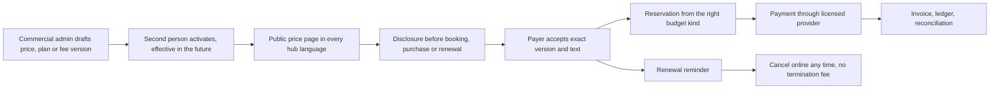

# Billing and commissions

Module code `BIL`. Status: billing state in settings is **Demo**; the BILL-001 service/database foundation implements entitlements, immutable price acceptance, budgets, reservations and a balanced ledger. BILL-003 implements scoped fee governance, partial public pricing and exact consultation/task fee bindings; other readers, marketplace mapping and referral authority remain incomplete. The BIZ-001 business-model playbook and public pricing screen design are **Accepted design**. Payment providers, invoices/tax and complete agent metering remain **Proposed**; only licensed providers may handle funds ([ADR 010](../../adr/010-gathering-point-hubs-agents-and-mesh.md) decisions 20 and 21; R19, R20, R46, R47). Packages: BIZ-001, BILL-001, BILL-002, BILL-003, BILL-004, PAY-001, AGT-004. Narrative: [Billing, plans and budgets](../billing.md). Data: [§23 Billing, budgets and payments](../../data/model.md#23-billing-budgets-and-payments).

## Purpose

Let a hub earn money fairly from things that cost money or create clear value (agent capacity, deliverables, marketplace fees on tickets, courses, consultations and tasks, verification at cost) while participation stays free at a minimum floor for both commercial sides, every price is versioned and disclosed, subscriptions are as easy to leave as to join, and money never buys ranking, matching, recommendations, reputation or badges.

## Who uses it

Payers (persons and companies), company administrators who allocate budgets, hub commercial administrators and a second approver, the hub's finance staff; every module that charges through billing.

## User stories

| # | Story | Status |
|---|---|---|
| BIL-S1 | As a company administrator, I want to give an estimator a transaction budget for one project without letting them spend on platform services | Contract |
| BIL-S2 | As a participant, I want to see every price, fee and commission of the hub on one public page in my language before I pay anything | Proposed |
| BIL-S3 | As a payer, I want a renewal reminder before my plan renews, online cancellation in as few steps as joining, and no early-termination fee | Proposed |
| BIL-S4 | As a payer, I want a price increase announced in advance, applied only from my next renewal | Proposed |
| BIL-S5 | As a hub administrator, I want a commission on consultations that a second person activates and that is disclosed before every booking | Proposed |
| BIL-S6 | As an expert, I want to know that paying the hub nothing does not lower me in any list | Designed (rule) |

## Functional requirements

| ID | Requirement | Status | Packages |
|---|---|---|---|
| BIL-F01 | Free minimum participation for both commercial sides and for readers and authors: reading, a profile, publishing under hub rules, responding to RFQs and tasks, basic company presence, and the agent's free floor; a hub may be more generous, never less | Designed | BILL-001, AGT-004 |
| BIL-F02 | Two budget kinds, `transaction` and `platform`; one never implies the other; reservations are atomic and settle or release only from evidence; budgets never go negative under concurrency | Contract | BILL-001 |
| BIL-F03 | Offers, subscription plan versions and price versions are separate records; a price version is drafted by one person and activated by another, never back-dated, never overlapping another active version of the same offer | Contract | BILL-001 |
| BIL-F04 | Customers accept a specific price version with a specific acceptance-text version; acceptances are immutable | Contract | BILL-001 |
| BIL-F05 | Entitlements are separate from roles; personal and company payers are both supported | Designed | BILL-001 |
| BIL-F06 | Commissions and fees (consultations, tasks, marketplace categories, tickets, courses, agent capacity) are versioned hub price records with category scope, amount or percentage, effective date and second-person activation; the same for every participant in a category; zero allowed | Proposed | BILL-003 |
| BIL-F07 | Every active price, fee and commission is listed on the hub's public price page in every hub language and shown to both sides before a booking or acceptance; the booking records the version shown | Accepted design; partial public pricing and consultation/task binding implementation | BILL-003, BIZ-001 |
| BIL-F08 | No hidden fees, no per-lead fees, no purchasable introduction quotas and no outcome-based fees for agent work | Proposed | BILL-003 |
| BIL-F09 | Payment, entitlements, fees and commissions never change ranking, matching, recommendations, reputation or badges; tests compare behaviour with and without paid entitlements | Designed | BILL-003, MATCH-001, REC-001 |
| BIL-F10 | Fair subscription controls: recurring price shown before purchase; renewal reminder ahead of each term; online cancellation in no more steps than joining; no early-termination fees; price increases announced with notice and applied only from the next renewal; the engine refuses plan versions that break these rules | Proposed | BILL-004 |
| BIL-F11 | No negative-option offers: a low-cost trial never converts to a recurring charge without a separate, explicit acceptance | Proposed | BILL-004 |
| BIL-F12 | No credits that expire silently; prepaid credit packs show validity before purchase and are refundable per the hub's published policy | Proposed | BILL-004 |
| BIL-F13 | Agent metering (model tokens, successful actions, checks, pages, deliverables, translation characters, cited answers, external calls) with agent plan and meter rate versions; no surprise overage | Proposed | AGT-004 |
| BIL-F14 | Invoices and e-invoices for platform fees and marketplace sales with reproducible per-jurisdiction tax; refunds and payouts through providers | Proposed | BILL-002, PRC-012 |
| BIL-F15 | Verification at cost is a pass-through fee, the same for everyone, available independently of any plan and waivable by the hub | Proposed | BILL-003, HUB-003 |
| BIL-F16 | Credits for goodwill or corrections are capped per staff role and audited; never a hidden refund | Designed | BILL-001 |
| BIL-F17 | A participant's plan never appears in any projection other than their own billing view | Designed | BILL-001 |
| BIL-F18 | The business-model playbook documents acceptable and unacceptable revenue options for hubs and the public price-transparency page | Accepted design | BIZ-001 |

## Agent capabilities

| Capability | Kind | Mandate kind | Confirmation | Interface surface |
|---|---|---|---|---|
| `core.get_my_billing` | read | — | `none` | Settings → Billing |
| `core.estimate_cost` | read | — | `none` | Before an expensive run |
| `core.list_public_prices` | read | — | `none` | Public price page |
| `core.accept_price_version` | govern | — | `first_party_form` | Checkout |
| `core.cancel_subscription` | govern | — | `first_party_form` (always available; never harder than joining) | Settings → Billing |
| `core.propose_budget` | draft | `prepare` | `none` (proposal) | Company → Budgets |
| `core.grant_budget` | govern | — | `first_party_form` | Company → Budgets |

## Interface surfaces

| Surface | Where | Status |
|---|---|---|
| Billing state in settings | `/app/settings` | Demo |
| Public price page | `/pricing` | Accepted BIZ-001 design; partial BILL-003 implementation |
| Checkout with price and fee disclosure | Booking, ticket, course, plan dialogs | Proposed |
| Company budgets | `/app/company` → Budgets | Proposed |
| Renewal reminders and cancellation | Settings → Billing | Proposed |

## Hub console settings

Offers and plan versions, trials and free minimum, price and metered price versions (cost beside sale price), commissions, invoices, payouts, credits within role caps, refund policy versions, tax treatment of the hub's own fees ([console: billing](../hub-console/README.md#hub-console-section-map), [cost and sale prices](../hub-console/user-agents-admin.md#cost-price-and-sale-price)).

## Data entities

`billing_account`, `offer`, `subscription_plan_version`, `price_version`, `price_acceptance`, `subscription`, `entitlement`, `meter`, `meter_rate_version`, `marketplace_fee_version`, `usage_record`, `budget`, `reservation`, `ledger_entry`, `invoice`, `invoice_line`, `payment`, `refund`, `payout_account`, `payout`, `credit_grant` ([§23](../../data/model.md#23-billing-budgets-and-payments)).

## Country and jurisdiction variations

Tax on the hub's own fees and on marketplace sales (state sales tax in the US, VAT and the EU's marketplace rules, GST elsewhere), automatic-renewal and cancellation laws (US state auto-renewal statutes and the FTC's enforcement under the Restore Online Shoppers' Confidence Act; Australian Consumer Law), price display rules (all-in pricing), invoice formats and e-invoicing duties come from packs and adapters.

## Privacy rules

Plans, budgets and usage are private to the payer and their authorized administrators; hub staff see invoice states and aggregates, never transaction contents of participants' deals.

## Metrics

Hub cohorts: revenue by offer category, refunds and their reasons, cancellations and their median steps, trial conversions with explicit acceptance. Payer: own usage against quota.

## Edge cases

| Case | Behaviour |
|---|---|
| Two price versions would overlap | Activation refused |
| A payer's renewal falls inside a price change notice period | Old price applies until the next renewal after the notice ends |
| A company member leaves with an active personal plan funded by the company | Company funding stops with membership; the person is notified and may continue personally |
| Usage replay after a crash | Usage records are idempotent per run step and attempt |

## Flow

## Open points

Prices, trials, tiers and commission levels for the reference hub (ADR 012 question 7, O03).
