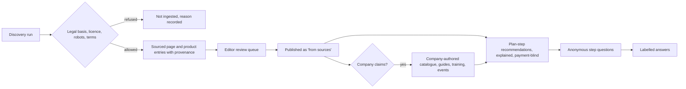

# Catalogue and manufacturer knowledge

Module code `CAT`. Status: catalogue offering versions are **Contract** inside commerce; the company catalogue and public catalogue fields are **Designed** (COM-001); sourced manufacturer and supplier pages, product entries, learning resources, the free manufacturer knowledge feed and step questions are **Proposed** ([ADR 010](../../adr/010-gathering-point-hubs-agents-and-mesh.md) decision 19). Packages: COM-001, MAT-001, CLM-001, PIPE-001, EDIT-001, REC-001, AGT-021, BIM-001. Narrative: [The catalogue](../commerce.md#the-catalogue), [Manufacturer and supplier sources](../publishing.md#manufacturer-and-supplier-sources-proposed), [Manufacturer and supplier knowledge](../search-and-knowledge.md#manufacturer-and-supplier-knowledge-proposed), [autonomous editorial office §11](../hub-console/autonomous-editorial.md#11-manufacturer-and-supplier-knowledge-adr-010-decision-19). Data: [§15 Catalogue](../../data/model.md#15-catalogue), [§13 Learning](../../data/model.md#13-learning).

## Purpose

Give every company a reusable, versioned description of what it sells (goods, works, services, bundles), and give every plan step access to manufacturers' and suppliers' practical knowledge: products, installation guides, data sheets, warranties, training, technical articles and events, sourced lawfully and labelled honestly until the company claims its page.

## Who uses it

Suppliers, distributors and manufacturers; contractors and design offices that sell services; homeowners and professionals who need the right product and guide for a step; editors of the editorial office; the `profile_keeper`, `quoting` and `plan_step_companion` agent modules.

## User stories

| # | Story | Status |
|---|---|---|
| CAT-S1 | As a supplier, I want a versioned catalogue whose public fields I choose, so that quotes cite exact versions and my private cost basis stays private | Contract (versions); Designed (catalogue) |
| CAT-S2 | As a manufacturer, I want to claim the page the hub built from my public site and publish my installation guides and training myself, free | Proposed |
| CAT-S3 | As a homeowner framing a house, I want the connectors suited to my county's wind requirements and the manufacturer's installation guide on that plan step, with why they fit | Proposed |
| CAT-S4 | As a homeowner, I want to ask a manufacturer a question about my step without revealing my project, address or budget | Proposed |
| CAT-S5 | As a designer, I want product data with standard classifications (ETIM, IFC) and environmental product declarations where they exist | Proposed |
| CAT-S6 | As a manufacturer, I want aggregate signals about which plan steps my guides help, never who the readers are | Proposed |

## Functional requirements

| ID | Requirement | Status | Packages |
|---|---|---|---|
| CAT-F01 | Offerings are reusable and versioned (goods, works, services, bundles, rentals, surplus) with specifications, options, availability, capacity and scope; a published offering version is immutable | Contract | COM-001 |
| CAT-F02 | Public offering fields are an explicit allowlist; private commercial knowledge (cost basis, floors, supplier terms) lives in a separate record | Contract | COM-001 |
| CAT-F03 | Complex systems are presented as kits per building with components, because price depends on the specific project | Designed | COM-001 |
| CAT-F04 | The editorial office discovers manufacturers and suppliers within the hub's legal basis, each site's robots rules and terms, and builds sourced company pages with per-field provenance | Proposed | MAT-001, PIPE-001 |
| CAT-F05 | Product entries and learning resources (installation guides, data sheets, warranty conditions, training, technical articles, events) are indexed with plan-step terms; facts and links are stored, full texts only where the licence allows | Proposed | MAT-001 |
| CAT-F06 | Sourced pages are labelled "from sources" until the company claims them (CLM-001); being sourced or recommended never permits bulk outreach | Proposed | MAT-001, CLM-001 |
| CAT-F07 | After claiming, the company publishes catalogues, guides, training and events as company-authored publications under an explicit licence through a free structured feed (upload, form, or machine-readable feed); corrections of sourced fields keep provenance | Proposed | MAT-001 |
| CAT-F08 | A takedown request removes the item and propagates tombstones to indexes and peers | Proposed | MAT-001, FED-002 |
| CAT-F09 | Step questions from plan owners reach the manufacturer anonymously by default, showing only the step and the fields the owner chose; answers cite the company's documents and are labelled as from a party with a commercial interest | Proposed | AGT-021, MAT-001 |
| CAT-F10 | Recommendations of products and guides per plan step are explained and payment-blind; sponsored content (off by default) appears only in a separate labelled slot | Proposed | REC-001 |
| CAT-F11 | Manufacturers receive only aggregate signals (cohorts of at least ten): views and saves per guide, steps where their resources were recommended; never "who specified your product" | Proposed | MAT-001, ANL-001 |
| CAT-F12 | Classification crosswalks (ETIM classes, IFC entities) are optional fields; proprietary classifications (for example MasterFormat or Uniclass) are licensed hub data | Proposed | MAT-001, PLAN-000 |
| CAT-F13 | Environmental product declarations, test reports and certificates are documents with issuer, validity and source; their presence is shown, their claims are not re-scored | Proposed | MAT-001, PRC-020 |
| CAT-F14 | Product data can be exported and imported in open BIM formats (IFC property sets) for design tools through an adapter | Proposed | BIM-001 |
| CAT-F15 | "Approved equal" suggestions always require the designer's or specifier's approval; the engine never asserts equivalence | Proposed | PRC-006 |
| CAT-F16 | Catalogue changes never change sent quotes, accepted agreements or published knowledge that cited a previous version | Contract | COM-001 |

## Agent capabilities

| Capability | Kind | Mandate kind | Confirmation | Interface surface |
|---|---|---|---|---|
| `discovery.search_catalogue` | read | — | `none` | Company page, plan step |
| `profile_keeper.draft_offering` | draft | `prepare` | `none` | Catalogue editor |
| `profile_keeper.publish_offering_version` | commit | `publish` | `mandate` (`ask_each`) | Catalogue editor |
| `profile_keeper.import_price_list` | draft | `prepare` | `none` | Catalogue → Import |
| `profile_keeper.publish_knowledge_resource` | commit | `publish` | `mandate` (`ask_each`) | Company → Knowledge |
| `plan_step_companion.answer_step_question` | commit | `communicate` | `mandate` (`ask_first(5)`) | Company → Step questions |
| `plan_step_companion.ask_manufacturer` | commit | `communicate` | `mandate` (`ask_each`) | Plan item → Ask the manufacturer |
| `plan_step_companion.list_product_recommendations` | read | — | `none` | Plan item → Recommendations |

## Interface surfaces

| Surface | Where | Status |
|---|---|---|
| Company catalogue (public fields) | `/companies/[slug]` | Demo (page); Designed (catalogue) |
| Catalogue editor and price lists | `/app/company` → Catalogue | Designed |
| Sourced manufacturer page with provenance per field | `/companies/[slug]` with "from sources" label | Proposed |
| Knowledge feed for claimed companies | Company → Knowledge | Proposed |
| Step questions inbox | Company → Step questions | Proposed |

## Hub console settings

Manufacturer and supplier sources with legal basis, licence and robots checks; crawl policy and schedule; review queues; takedown handling; sponsored-content switch (off by default); recommendation methods ([console: sources, discovery, recommendations](../hub-console/autonomous-editorial.md), [data](../hub-console/README.md#hub-console-section-map)).

## Data entities

`offering`, `offering_version`, `bundle_component`, `offering_version_private`, `product_entry` ([§15](../../data/model.md#15-catalogue)); `learning_resource` ([§13](../../data/model.md#13-learning)); `source`, `crawl_policy`, `source_item`, `sourced_record_field` ([§24](../../data/model.md#24-hubs-sources-and-verification)); `recommendation`, `sponsored_placement` ([§14](../../data/model.md#14-partners-and-matching)).

## Country and jurisdiction variations

Database and copyright rights over product data (stronger in the EU through the database right), text-and-data-mining exceptions and opt-outs, the Construction Products Regulation and CE marking in the EU, US product certification marks, environmental declaration programmes, and units come from packs and the hub's legal basis per source.

## Privacy rules

Step questions are anonymous by default; manufacturers never see the asker's project, address or budget unless the asker chooses an introduction. Manufacturer analytics are cohorts. Sourced pages hold company facts, not personal data of employees beyond what the source publishes for business contact, and people data from sources is off by default.

## Metrics

Hub cohorts: sourced pages and claim rate, resources indexed per plan-step term, step questions answered and median answer time, takedowns. Manufacturer: aggregate views and saves of its own resources.

## Edge cases

| Case | Behaviour |
|---|---|
| A site's robots rules change to disallow crawling | Next run stops; existing facts stay with their observed date; full texts not licensed are removed |
| A claimed company wants to delete a correct sourced fact | Sourced facts with a lawful basis stay, labelled with source and date; the company may add a public note |
| Two manufacturers sell the same product under different brands | Separate product entries; links, never merges |
| A manufacturer answers a step question with an advertisement | Labelled commercial; repeated abuse opens a moderation case |

## Flow

## Open points

Licensing of proprietary classification crosswalks per hub; whether the reference hub enables manufacturer crawling before counsel review of US terms-of-service practice.
