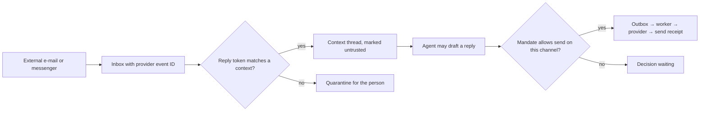

# Communications and notifications

Module code `MSG`. Status: the notifications page and bell are **Demo** (`/app/notifications`); transactional mail is **Live** through the outbox and the worker (MAIL-001: localized templates, SMTP adapter and fake, suppression, receipts; not connected to a mail server in any deployment yet); context threads, channel grants and templates are **Designed** (COMMS-001); messenger and SMS channels, voice notes, hub sender identities and digests are **Proposed** (R08). Packages: MAIL-001, COMMS-001, CHAN-001, OPS-001. Narrative: [Communications](../communications.md). Data: [§22 Communications](../../data/model.md#22-communications).

## Purpose

Keep conversations where the work is (an RFQ, a quote, an agreement, an introduction, a project, a consultation, an event registration, a support case) instead of a generic inbox; deliver short actionable notifications; connect e-mail and messengers through scoped, revocable grants; send every template in every hub language.

## Who uses it

Everyone; hub editors who edit templates; operations staff who activate them and watch deliverability; the `channels` agent module.

## User stories

| # | Story | Status |
|---|---|---|
| MSG-S1 | As a buyer, I want the conversation about a quote next to the quote versions it discusses | Designed |
| MSG-S2 | As a contractor, I want to answer from my e-mail and have the reply land in the right context | Designed |
| MSG-S3 | As a foreman, I want my agent on WhatsApp or SMS with voice notes, and nothing to happen without my structured confirmation | Proposed |
| MSG-S4 | As a person, I want to choose the frequency of each notification category while security notices always arrive | Designed |
| MSG-S5 | As a Polish-speaking reader, I want every e-mail in Polish; a missing translation must block sending rather than fall back silently | Designed |

## Functional requirements

| ID | Requirement | Status | Packages |
|---|---|---|---|
| MSG-F01 | There is no generic inbox; every message belongs to a context; whoever may see the context sees its thread and nobody else | Designed | COMMS-001 |
| MSG-F02 | Messages record direction, author (person, agent on behalf of a person, or system), body, attachments and source time; message links connect messages to the object versions they discuss | Designed | COMMS-001 |
| MSG-F03 | Channel grants name provider, account and scopes and are revocable; the platform never takes over a mailbox and never deletes or moves mail | Designed | COMMS-001 |
| MSG-F04 | Inbound messages match contexts by reply tokens; provider event IDs make duplicates harmless | Designed | COMMS-001 |
| MSG-F05 | Inbound content is untrusted: it informs drafts and never authorizes an action or sends to extracted addresses | Designed | COMMS-001, AST-001 |
| MSG-F06 | Notifications are short, actionable signals with a link and carry no private content beyond what the recipient may see; frequency per category; security and legal notices cannot be turned off | Demo (bell); Designed | COMMS-001 |
| MSG-F07 | Templates are versioned per language, edited by editors, activated by operations staff, previewed with synthetic data; a missing translation blocks activation | Designed | COMMS-001, MAIL-001 |
| MSG-F08 | Transactional mail goes through the outbox and the worker with localized templates and an SMTP adapter with a fake | Live | MAIL-001 |
| MSG-F09 | A hub configures sending domains (SPF, DKIM, DMARC), reply-to addresses and registered SMS sender IDs; deliverability and bounces are counts, never per-person tracking | Proposed | COMMS-001, CHAN-001 |
| MSG-F10 | SMS, WhatsApp and other messengers popular in the territory are channels where their terms allow business use and registration rules are met (for example 10DLC and consent rules in the US) | Proposed | CHAN-001 |
| MSG-F11 | Voice notes are transcribed through a provider allowed for the data class; transcripts are untrusted input | Proposed | CHAN-001 |
| MSG-F12 | No marketing message is sent without a recorded lawful basis; suppression lists are honoured | Designed | COMMS-001 |
| MSG-F13 | Digests (daily or weekly) bundle notifications by context, in the person's language and time zone | Proposed | COMMS-001 |
| MSG-F14 | Agent-written messages are labelled "sent by Anna's agent on her behalf" | Designed | COMMS-001, AST-001 |
| MSG-F15 | Reading translations of messages are available on request and labelled as machine translations | Proposed | COMMS-001, AGT-014 |
| MSG-F16 | Video and chat sessions for consultations run through communication adapters with fakes; recording only with consent | Proposed | CONS-001, COMMS-001 |

## Agent capabilities

| Capability | Kind | Mandate kind | Confirmation | Interface surface |
|---|---|---|---|---|
| `core.read_thread` | read | — | `none` | Context thread |
| `core.draft_reply` | draft | `prepare` | `none` | Context thread |
| `channels.send_message` | commit | `communicate` | `mandate` (per the mandate's contexts and channels) | Context thread |
| `core.list` | read | — | `none` | `/app/notifications` |
| `core.set_notification_preferences` | govern | — | `first_party_form` | Settings → Notifications |
| `channels.connect` | govern | — | `first_party_step_up` | Settings → Connections |
| `channels.revoke` | govern | — | `first_party_form` (always allowed) | Settings → Connections |

## Interface surfaces

| Surface | Route | Status |
|---|---|---|
| Notifications page and bell | `/app/notifications`, header | Demo |
| Context threads inside RFQs, quotes, agreements, introductions, projects, consultations | Context pages | Designed |
| Notification preferences | `/app/settings` | Designed |
| Channel connections | Settings → Connections | Proposed |

## Hub console settings

Senders (domains, authentication state, SMS registration), templates per language with preview, deliverability counts, announcements to people who opted in and legal notices ([console: communications](../hub-console/modules.md#communications)).

## Data entities

`context_thread`, `message`, `message_link`, `reply_token`, `channel_grant`, `send_receipt`, `notification`, `notification_preference`, `message_template`, `template_version`, `delivery`, `sender_identity`, `suppression_entry` ([§22](../../data/model.md#22-communications)).

## Country and jurisdiction variations

Anti-spam and consent law (CAN-SPAM, TCPA and 10DLC in the US; ePrivacy rules in the EU; national SMS sender registration), messenger availability and business terms, recording consent, and language requirements for notices come from packs and hub settings.

## Privacy rules

Threads follow their context's access; notifications never contain values the recipient may not read; no tracking pixels; deliverability is aggregate.

## Metrics

Hub cohorts: notifications sent per category, bounce and complaint rates per template and channel, template completeness per language.

## Edge cases

| Case | Behaviour |
|---|---|
| The same inbound e-mail delivered twice | Deduplicated by provider event ID |
| A reply token arrives for a context the sender lost access to | Message quarantined; sender told the context is closed to them |
| A messenger message asks the agent to pay an invoice | Untrusted input; becomes a draft or decision at most; never an action |
| A template exists in English only | Activation blocked for the hub's other languages |

## Flow

## Open points

Which messenger channels the reference hub enables first; default digest cadence.
