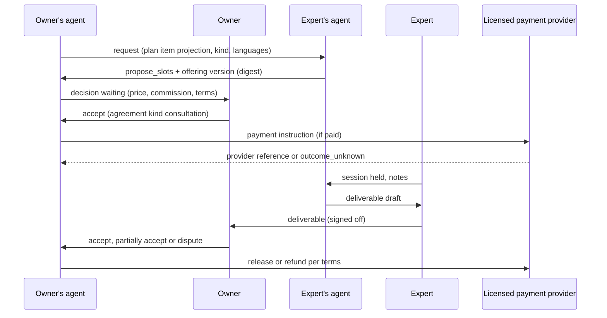

# Consultations

Module code `CNS`. Status: **Proposed** throughout ([ADR 010](../../adr/010-gathering-point-hubs-agents-and-mesh.md) decision 17; requirement R42). Booking terms reuse the **Contract** digest and agreement rules of commerce (`terms_kind = consultation`, ADR 012 decision 19). Packages: CONS-001, CONS-002, COM-002, COMMS-001, PAY-001, BILL-003, AGT-010, WEB-007. Narrative: [Consultation](../agent-catalog.md#consultation), [Projects](../projects.md#consultations-and-tasks-from-plan-items-proposed). Data: [§8 Consultations, tasks and mentoring](../../data/model.md#8-consultations-tasks-and-mentoring).

## Purpose

Let people who know share what they know, and earn reputation and income for it: advice sessions, reviews of drawings or quotes, site visits and mentoring sessions, booked from a plan item or directly, delivered with a deliverable the client accepts.

## Who uses it

Experts and mentors (engineers, architects, estimators, experienced tradespeople, building-science specialists), homeowners and clients, companies that need a second opinion, design offices; the `consultation` agent module on both sides.

## User stories

| # | Story | Status |
|---|---|---|
| CNS-S1 | As a homeowner, I want a structural engineer to review my framing drawings before I hire a framer, and get marked-up drawings back | Proposed |
| CNS-S2 | As an expert, I want to publish fixed-price, hourly and free consultation offerings and have my agent propose slots from my calendar | Proposed |
| CNS-S3 | As a client, I want a second opinion on three quotes, shared only with that expert | Proposed |
| CNS-S4 | As an expert, I want my licence shown only when the hub checked it, so that clients trust what it says | Proposed |
| CNS-S5 | As a client, I want to pay through a licensed provider, see the hub's commission before booking, and get a refund under clear terms if the expert does not deliver | Proposed |
| CNS-S6 | As an expert, I want my delivered and accepted consultations to count in my reputation, not the number of stars someone clicked | Proposed |

## Functional requirements

| ID | Requirement | Status | Packages |
|---|---|---|---|
| CNS-F01 | Consultation kinds: advice session, review of drawings, review of quotes, site visit, mentoring session; each with a deliverable kind (advice note, marked-up drawings with findings, comparison note, visit report with photographs, session notes) | Proposed | CONS-001 |
| CNS-F02 | Experts publish consultation offerings as catalogue offering versions with scope, languages, region, delivery channel and price version (fixed, per hour or free) | Proposed | CONS-001, COM-001 |
| CNS-F03 | Availability windows in the expert's time zone; slots proposed by the expert's agent (`propose_slots`) and accepted by the client | Proposed | CONS-001 |
| CNS-F04 | A booking is an agreement of kind `consultation` pinning the exact offering and price versions by digest; acceptance events are separate per side | Proposed | CONS-001, COM-002 |
| CNS-F05 | Requests may come from a plan item (pre-filled with the item's shared fields) or directly from an expert's offering | Proposed | CONS-001, PLAN-001 |
| CNS-F06 | Files for review are shared with that expert only, under a share scoped to the booking; quotes shared for review never reach the quoting sellers | Proposed | CONS-001 |
| CNS-F07 | The site address is revealed only after the booking is accepted | Proposed | CONS-001, PLAN-001 |
| CNS-F08 | Sessions run in the consultation context: chat, video through a communications adapter with a fake, or phone through a channel grant; recording only with both parties' consent and stored in the context | Proposed | CONS-001, COMMS-001 |
| CNS-F09 | The expert delivers a deliverable; the client accepts, partially accepts or disputes it; acceptance is the basis for reputation and for releasing payment where the provider holds it | Proposed | CONS-001, EXE-001 |
| CNS-F10 | Paid bookings charge only through the hub's licensed payment provider, captured at booking or held until delivery where the provider supports it; Trustwork never holds the money | Proposed | CONS-002, PAY-001 |
| CNS-F11 | The hub commission is a versioned price record per category, the same for every expert, shown to both sides before booking and recorded on the booking | Proposed | BILL-003 |
| CNS-F12 | Cancellation and refund terms are part of the offering version and shown before booking; no negative-option memberships or auto-renewing subscriptions for consultations | Proposed | CONS-002, BILL-004 |
| CNS-F13 | Credentials shown on an expert card are those the hub checked ("licensed professional engineer in California, checked on date by hub X"); advice that legally requires a licence is offered only by experts whose check passed | Proposed | CLM-001, REP-001 |
| CNS-F14 | Reviews of consultations are tied to the booking, its deliverable and acceptance; unconfirmed reviews are labelled and excluded from aggregates; timeliness (session held, deliverable on time) is a factual observation | Proposed | REP-001, REV-001 |
| CNS-F15 | The deliverable is the expert's own work product: the agent may draft from session notes; the expert signs off before delivery | Proposed | CONS-001 |
| CNS-F16 | Free consultations use the same flow without payment and count in reputation the same way | Proposed | CONS-001 |
| CNS-F17 | Consultation requests are ranked for the client by fit with the payment-blind matching method; commissions never change which experts are suggested | Proposed | MATCH-001, REC-001 |
| CNS-F18 | Disputes over a deliverable produce an evidence package and may be referred to mediation; the platform never arbitrates | Proposed | DISP-001 |

## Agent capabilities

| Capability | Kind | Mandate kind | Confirmation | Interface surface |
|---|---|---|---|---|
| `consultation.search_offerings` | read | — | `none` | Find an expert |
| `consultation.request` | commit | `communicate` | `mandate` (`ask_each`) | Plan item → Get advice |
| `consultation.propose_slots` | commit | `schedule` | `mandate` (`pre_authorized`; propose) | Expert inbox in context |
| `consultation.accept_booking` | commit | `place_order` (client) or `accept_order` (expert) | `mandate` (`ask_each`; expert `ask_first(5)`); `person_each` for a consumer client | Booking card |
| `consultation.quote_custom` | commit | `send_quote` | `mandate` (`ask_above(amount)`) | Request card |
| `consultation.draft_deliverable` | draft | `prepare` | `none` | Session → Deliverable |
| `consultation.deliver` | commit | `record_evidence` | `person_each` (the expert signs off) | Session → Deliverable |
| `consultation.accept_deliverable` | commit | `confirm_execution` | `person_each` | Deliverable card |
| `consultation.publish_offering` | commit | `publish` | `mandate` (`ask_each`) | My offerings |

## Interface surfaces

| Surface | Where | Status |
|---|---|---|
| Expert offerings on profile and company page | `/people/[slug]`, `/companies/[slug]` | Proposed |
| Consultations workspace (requests, bookings, sessions, deliverables) | `/app/consultations` | Proposed (WEB-007) |
| Booking dialog with commission disclosure | Plan item and expert card | Proposed |
| Session room (chat, video link, notes) | Consultation context | Proposed |

## Hub console settings

Consultation categories, who may offer each (verification level, licence checks), commission price versions, refund policy versions, payment provider and capture mode, recording policy, dispute routing ([console: consultation and task marketplace](../hub-console/modules.md#consultation-and-task-marketplace)).

## Data entities

`consultation_offering`, `availability_window`, `consultation_request`, `consultation_booking`, `consultation_session`, `consultation_deliverable`, `mentoring_relationship` ([§8](../../data/model.md#8-consultations-tasks-and-mentoring)); `agreement` with `terms_kind = consultation` ([§18](../../data/model.md#18-transactions)); `marketplace_fee_version`, `payment`, `refund`, `payout` ([§23](../../data/model.md#23-billing-budgets-and-payments)).

## Country and jurisdiction variations

Which advice is reserved to licensed professionals (for example stamped structural drawings, legal advice), consumer cancellation rights for services booked online, tax on consultation fees and on the hub's commission, invoicing duties of the expert, recording consent rules (one-party or all-party consent by US state), and payout rails come from country packs, jurisdiction settings and payment adapters.

## Privacy rules

Request contents are visible to the client and the chosen expert only; the hub sees cohort counts. Files shared for review are scoped to the booking and expire with it unless the client keeps them. Recordings need both parties' consent. The expert's calendar is never shown, only proposed slots.

## Metrics

Expert: requests, bookings, acceptance rate of deliverables, on-time delivery, earnings (own data). Hub cohorts: bookings by category, share of free consultations, refunds and disputes by category, median time to first slot. Never a public leaderboard of experts by earnings.

## Edge cases

| Case | Behaviour |
|---|---|
| Expert's licence check expires before a booked session that requires it | The client is told; the booking may be cancelled with full refund under the offering terms |
| Video provider fails mid-session | Session can move to chat or be rescheduled; payment capture waits for delivery where held |
| Payment outcome unknown after booking | Booking stays `pending_payment`; reconciliation, never a second charge |
| Client shares quotes from sellers who forbade sharing | The share dialog warns that quotes are shared under the client's responsibility; sellers' private constraints are never part of a quote projection |
| Time zones across hubs | Slots stored in UTC with the expert's zone; shown in each party's zone and language |

## Flow

## Open points

Commission levels for the reference hub (owner, ADR 012 question 7); recording consent defaults per US state (counsel).
