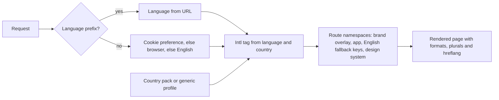

# Country packs and localization

Module code `LOC`. Status: country packs v1 for Uzbekistan, Georgia, Armenia and Azerbaijan, restricted places, any non-restricted country through a generic profile, six interface languages (en, ru, uz-Latn, ka, hy, az-Latn) with localized demo content, request-scoped locale, CLDR plurals and country-aware formats are **Live** in the web app; the pack v2 schema with facets, subdivisions, verification levels and the unit catalogue is a **Contract** (CTRY-002); the sourced United States v2 pack (INTL-US) is **Live** as pack data; sourced v2 facts for the other packs, configuration over code, Spanish, locale namespaces, review-status metadata, right-to-left and CJK/Devanagari typography, eleven more languages, the EU layer and fourteen more packs are **Proposed** (R38, R40, R51). Packages: INTL-001 … INTL-007, INTL-UZ/GE/AM/AZ (done), CTRY-002 (done), INTL-US (done), CTRY-003, CTRY-EU, CTRY-CA … CTRY-AU, CFG-001, LANG-ES … LANG-JA, DEMO-US, WEB-005. Narrative: [Countries and languages](../localization.md), [Country specifics](../country-specifics.md), [How to add a country](../../country-packs/how-to-add-a-country.md).

## Purpose

Trustwork is international by default: anyone configures it for any country and city without code, and everyone reads it in their own language, with dates, numbers, currencies and units in their own formats. Country differences are reviewed, sourced data (packs and shared layers) or an adapter; hub decisions are versioned configuration.

## Who uses it

Every reader and participant; hub operators choosing a pack or the generic profile; pack contributors and reviewers (people who know a country's law and registers); translators and native-speaker reviewers.

## User stories

| # | Story | Status |
|---|---|---|
| LOC-S1 | As a visitor, I want to choose a country and, independently, a language, and keep them in links I share | Live |
| LOC-S2 | As a Spanish-speaking reader in San Diego, I want the interface in Spanish with US formats (`es-US`) | Proposed (LANG-ES) |
| LOC-S3 | As an operator in Germany, I want the EU layer's facts (GDPR, eIDAS, VAT, Eurocodes, procurement directives, SEPA) inherited by my German pack | Proposed |
| LOC-S4 | As a native speaker, I want to review a machine-drafted translation and have the review status shown honestly in the language picker | Proposed (INTL-007) |
| LOC-S5 | As an Arabic reader in the UAE, I want a right-to-left interface with mirrored icons and correct bidirectional text | Proposed |
| LOC-S6 | As a pack contributor, I want every fact to cite a source and state its verification level, so that hubs know what to trust | Live (v1); Proposed (v2) |

## Functional requirements

| ID | Requirement | Status | Packages |
|---|---|---|---|
| LOC-F01 | A visitor chooses a country and a language independently; choices persist in `trustwork.country` and `trustwork.locale` cookies on the base path and can travel in query parameters | Live | INTL-002 |
| LOC-F02 | Any non-restricted country works through a generic profile from the ISO dataset; packs add regions, identifiers, currency, legal facts and suggested languages | Live | INTL-001 |
| LOC-F03 | Restricted places (RU, UA-43, UA-40, UA-14, UA-09, CU, IR, KP) are never offered, hosted, served or federated; the list is code | Live | INTL-SAN |
| LOC-F04 | Every visible string comes from locale dictionaries; English is the reference key set; tests fail on missing keys and placeholder words | Live | INTL-002, INTL-003 |
| LOC-F05 | Locale files per feature namespace; a feature adds its namespace in every engine language and never edits another feature's file | Proposed | INTL-004 |
| LOC-F06 | Formats through `Intl` with a tag computed from language and country; plurals are ICU messages with categories from `Intl.PluralRules` | Live | INTL-003 |
| LOC-F07 | One language per request; no dictionary shared between requests; client bundles carry only the route's namespaces | Live | INTL-003 |
| LOC-F08 | English URLs have no prefix; other languages use `/<lang>/` with `hreflang` alternates and a canonical URL; the country is never in a public URL | Decided; Proposed (implementation) | WEB-005 |
| LOC-F09 | Every locale carries a review status (reference, machine draft, community reviewed, native reviewed) shown in the picker and docs; raised only by a named reviewer | Proposed | INTL-007 |
| LOC-F10 | Pack v2 facets: companies and registers, construction licensing, codes and standards, public procurement, tax and invoicing, electronic identity and signatures, electronic documents, payments, money and units, calendar and time, languages and scripts, addresses and geography, privacy and data, content and consumer law, sanctions, communications; several time zones and identifiers; subdivisions | Contract (schema); Proposed (sourced facts per pack) | CTRY-002 |
| LOC-F11 | Every pack fact cites a source and states its verification level ("pending official confirmation" where only secondary sources exist) | Live (v1); Contract (v2 schema); Proposed (v2 facts) | CTRY-002 (done), CTRY-003 |
| LOC-F12 | Shared layers (the EU first) are sourced once and inherited by member packs; a member pack may override with its own source | Proposed | CTRY-EU |
| LOC-F13 | Configuration over code: runtime country packs, languages, defaults and brand; the engine has no default country of its own (ADR 012 decision 11); a deployment may set one for visitors who have not chosen (`TRUSTWORK_DEFAULT_COUNTRY`, used by the reference hub with `US`, decision 31); the setup wizard requires a country for every hub | Live (deployment default); Proposed (runtime packs, wizard) | CFG-001 |
| LOC-F14 | The United States pack: states and territories, EIN and state registrations, entity forms, state contractor licensing, state sales tax, SAM.gov, ESIGN and UETA, card and ACH, state privacy laws, federal holidays, US customary units alongside metric | Live (pack data; per-state gaps and candidate facts labelled) | INTL-US |
| LOC-F15 | Spanish is the seventh engine language, then Portuguese, French, German, Italian, Polish, Ukrainian, Turkish, Arabic, Chinese (Simplified), Hindi and Japanese, and any language a contributor brings | Proposed | LANG-ES … LANG-JA |
| LOC-F16 | Right-to-left support: direction per locale, logical CSS properties, mirrored icons where meaningful, bidirectional isolation of user content | Proposed | INTL-005 |
| LOC-F17 | CJK and Devanagari typography: font fallbacks, line breaking, no forced uppercase | Proposed | INTL-006 |
| LOC-F18 | Demo content resolves per string (locale, then English, then base); no Russian reaches readers of other languages | Live | INTL-002 |
| LOC-F19 | Real content uses linked language editions with honest machine-translation labels | Proposed | CNT-001 |
| LOC-F20 | Brand: Trustwork in every language; only the Russian interface shows the Russian-language name through the overlay in `apps/web/brand`; a deployment can turn it off | Live | WEB-001 |
| LOC-F21 | Local additions made in a hub console can be exported as a proposed pack change for review in the repository | Proposed | HUB-001 |
| LOC-F22 | Units of measure come from a unit catalogue with conversion rules and local names; quantities stay exact decimals with their unit | Proposed | DATA-003, CTRY-002 |

## Agent capabilities

| Capability | Kind | Mandate kind | Confirmation | Interface surface |
|---|---|---|---|---|
| `core.set_locale_preferences` | govern | — | `first_party_form` | Language and country switcher |
| `translation.translate_for_reading` | read | — | `none` | Any text |
| `core.explain_fact` | read | — | `none` | Any field backed by a pack fact (source and verification level) |

## Interface surfaces

| Surface | Where | Status |
|---|---|---|
| First-visit country and language window; header switcher | Every page | Live |
| Language picker with review status | Header | Proposed (INTL-007) |
| Prefixed language URLs with hreflang | Public pages | Proposed (WEB-005) |
| Country base in the console | `/admin/hubs/[hub]/hub/country` | Proposed |
| Locale completeness in the console | `/admin/hubs/[hub]/ops/locales` | Proposed |

## Hub console settings

Country pack binding or generic profile, languages and default language, currency, time zone, taxonomy and units, local additions, locale completeness of strings, templates and legal documents ([console: hub identity, country base, locales](../hub-console/README.md#hub-console-section-map)).

## Data entities

Country packs are repository data in `packages/country-packs/packs/<cc>.json`; at runtime `jurisdiction`, `unit`, `unit_conversion_rule`, `taxonomy_term` and `exchange_rate_snapshot` ([§2](../../data/model.md#2-platform-kernel)); `hub_config_version` ([§24](../../data/model.md#24-hubs-sources-and-verification)).

## Country and jurisdiction variations

This module is where variations live. The worked example is the United States reference hub; existing examples are Uzbekistan, Georgia, Armenia and Azerbaijan; planned packs are Canada, Mexico, Brazil, the United Kingdom, Germany, France, Spain, Italy, Poland (through the EU layer), Ukraine (government-controlled territory only), Türkiye, the United Arab Emirates, India and Australia ([roadmap](../roadmap.md#languages-and-country-packs)).

## Privacy rules

Country and language cookies are preferences, not tracking; residency notes in packs inform the hub's residency decision; no country is inferred from IP for anything beyond a suggestion.

## Metrics

Locale completeness per namespace and language; pack fact counts by verification level; review-status changes with reviewer names (public credit with consent).

## Edge cases

| Case | Behaviour |
|---|---|
| A visitor's browser language is not offered and no country chosen | English (default) with a neutral country choice |
| A pack fact conflicts with a newer official source | Contributors update the fact with the new source; hubs see the pack version change |
| Two languages share a script with different plural rules | Each language has its own messages; plural categories from `Intl` |
| A country splits identifiers by region | Pack v2 supports several identifiers with scopes |

## Flow

## Open points

Native reviewers for Uzbek, Georgian, Armenian and Azerbaijani; primary sources for facts that cite only secondary sources.
