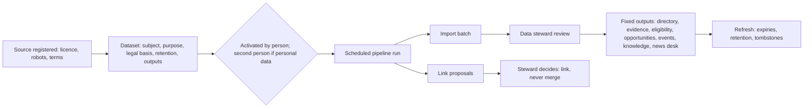

# Data mining and sources

Module code `DMS`. Status: the console contracts `DatasetSchema`, `HubSourceSchema`, `LinkProposalSchema` and `PipelineVersionSchema` in `hub.ts` are a **Contract** (frozen as version 1.0.0 by HUBC-000); everything else is **Proposed**. Packages: SRC-001, PIPE-001, MINE-001, REG-001, PRMT-001, PROC-001, PROC-002, MAT-001, EDIT-001, PRV-002, HUBC-003, HUBC-008. Narrative: [Local data mining](../hub-console/data-mining.md), [Automation and scheduling](../hub-console/automation-and-scheduling.md), [Hub sources](../publishing.md#hub-sources-proposed). Data: [§24 Hubs, sources and verification](../../data/model.md#24-hubs-sources-and-verification).

## Purpose

Make a hub useful by knowing its local industry (companies and their status, licences, open tenders, events, practical knowledge) from public and licensed sources, with recorded legal basis, licence, purpose and retention for every dataset, links instead of merges, people reviewing what goes live, and fixed purposes for every output.

## Who uses it

Compliance officers and data stewards who register sources and datasets, editors who receive items, trust reviewers who use evidence, the privacy officer who handles objections; participants see the results as sourced records.

## User stories

| # | Story | Status |
|---|---|---|
| DMS-S1 | As a data steward of the US hub, I want to import a state licence board's public data weekly, see new, changed and conflicting records, and activate a batch after review | Proposed |
| DMS-S2 | As a compliance officer, I want every dataset to state its legal basis, purpose, personal-data categories, retention and outputs before it can be activated | Proposed |
| DMS-S3 | As a contractor, I want my licence's expiry reflected and a reminder sent, not a silent downgrade | Proposed |
| DMS-S4 | As a person found in a register, I want to object to a use of my data and have a privacy officer decide | Proposed |
| DMS-S5 | As an editor, I want public tenders to arrive as labelled opportunities, never as bids | Proposed |

## Functional requirements

| ID | Requirement | Status | Packages |
|---|---|---|---|
| DMS-F01 | Sources are registered with kind, licence and allowed uses (display headline and link, summary, full text, index, model egress, syndication), attribution template, takedown contact, cadence, observed-at semantics, robots and terms checks | Proposed | SRC-001 |
| DMS-F02 | Datasets declare subject (`companies`, `licences_permits`, `court_cases`, `debts_tax_arrears`, `procurement_notices`, `events`, `articles`, `people`), sources, purpose, legal basis, personal-data categories, impact assessment, retention, outputs, public display, subject notice and schedule | Proposed | MINE-001 |
| DMS-F03 | Dataset lifecycle `proposed → in_review → active → paused → retired`; activation by a person, by a second person when personal data is present | Proposed | MINE-001 |
| DMS-F04 | Court and debt datasets are off by default in every hub; enabling one needs an impact assessment and a recorded legal basis; about natural persons they are never displayed, only reviewed verification evidence | Proposed | MINE-001 |
| DMS-F05 | People datasets never create public profiles; used only to verify a person's own claims or suggest linking their own account when they confirm | Proposed | MINE-001 |
| DMS-F06 | Outputs are fixed: directory sourced records, verification evidence, matching eligibility, opportunities board, events calendar, knowledge base, news desk; every output goes through the receiving module's use cases | Proposed | MINE-001 |
| DMS-F07 | No dataset feeds reputation scores; a court case or lien can become evidence in a reviewer's case with appeal rights | Proposed | MINE-001, REP-001 |
| DMS-F08 | Entity resolution creates link proposals with evidence and confidence; the effect is always a link, never a merge; links involving people need the person's confirmation or a signed statement | Proposed | MINE-001, FED-003 |
| DMS-F09 | Review queues: dataset proposals, import batches, link proposals, conflicts (claimed values stand; conflicts shown to the company), subject objections | Proposed | MINE-001, PRV-001 |
| DMS-F10 | Pipelines are versioned with steps, models, caps and schedules (cron, windows, quotas, retries, alerts, pause, resume, dry runs, backfills); no pipeline publishes | Proposed | PIPE-001 |
| DMS-F11 | Refresh re-checks expiries, downgrades eligibility facts with a re-check in the verification recipe, applies retention and emits tombstones to indexes and peers | Proposed | MINE-001, REG-001 |
| DMS-F12 | Public-register and licence-board facts are stored as sourced records with source, observed date and status; never blended into reputation; official ratings shown beside it | Proposed | REG-001 |
| DMS-F13 | Building permits and inspections become sourced project data linked to companies, never naming homeowners publicly | Proposed | PRMT-001 |
| DMS-F14 | Tender source adapters map notices through the Open Contracting Data Standard where possible | Proposed | PROC-002 |
| DMS-F15 | Data-broker readiness: before enabling people sources, the console checks whether the hub may be a data broker under applicable law, records registration, and processes deletion platforms such as California's DROP through an adapter | Proposed | PRV-002 |
| DMS-F16 | A source licensed only for display is never sent to a model provider or syndicated; non-commercial licences are refused for commercial uses | Proposed | SRC-001, KEYS-001 |
| DMS-F17 | Every field of a sourced record shows its source and date to readers | Proposed | MINE-001 |

## Agent capabilities

Staff capabilities under a staff principal; participants' agents only read the resulting sourced records through public projections.

| Capability | Kind | Mandate kind | Confirmation | Interface surface |
|---|---|---|---|---|
| `hub_ops.propose` | draft | `prepare` | `none` | Data → Datasets |
| `hub_ops.activate` | govern | — | `first_party_form` (staff; second person with personal data) | Data → Datasets |
| `hub_ops.review_summary` | read | — | `none` | Data → Import batches |
| `hub_ops.decide` | govern | — | `first_party_form` (staff) | Data → Links |
| `core.explain_sourced_field` | read | — | `none` | Any sourced record (participants) |

## Interface surfaces

Console: `/admin/hubs/[hub]/data/datasets`, `/data/batches`, `/data/links`, `/data/knowledge`, `/data/recommendations`; `/editorial/sources`, `/editorial/discovery`; `/automation/schedules`, `/automation/runs`, `/automation/alerts`. Public: "from sources" labels and per-field provenance on records. All **Proposed**.

## Hub console settings

Datasets, sources, discovery, schedules, runs and alerts as above ([data mining](../hub-console/data-mining.md), [automation](../hub-console/automation-and-scheduling.md)).

## Data entities

`source`, `crawl_policy`, `dataset`, `pipeline`, `pipeline_version`, `pipeline_schedule`, `pipeline_run`, `import_batch`, `source_item`, `sourced_record_field`, `record_link_proposal` ([§24](../../data/model.md#24-hubs-sources-and-verification)); `data_broker_registration` ([§27](../../data/model.md#27-administration-support-and-privacy-operations)).

## Country and jurisdiction variations

Which registers exist and their reuse terms (US state licence boards and SAM.gov; South Africa's CIDB register; Kenya's NCA register; Japan's MLIT licensed-business search; EU business registers and the database right), text-and-data-mining exceptions and opt-outs, data-broker laws (California Delete Act and other states), and court-record rules come from packs and each source's recorded legal basis.

## Privacy rules

Personal data in registers is minimised to the declared categories; sole proprietors are people; subjects can object; retention is enforced by refresh pipelines; nothing sourced becomes a member or a review.

## Metrics

Hub cohorts: datasets active, batch sizes and conflicts, link proposals accepted and rejected, objections and outcomes, pipeline cost against caps, freshness per dataset.

## Edge cases

| Case | Behaviour |
|---|---|
| A register's terms forbid commercial reuse | Dataset refused for commercial outputs; licence flags enforce it |
| A sourced company disputes a field | Claimed value stands after claim; conflict shown; source value kept with provenance |
| A refresh finds a record removed from the register | Record retired, tombstones emitted, dependent eligibility facts become unknown |
| A dataset would identify natural persons in debt lists | Blocked unless impact assessment and legal basis recorded; never displayed publicly |

## Flow

## Open points

Whether importing people data makes the US reference hub a data broker in some states (counsel, ADR 012 question 10).
