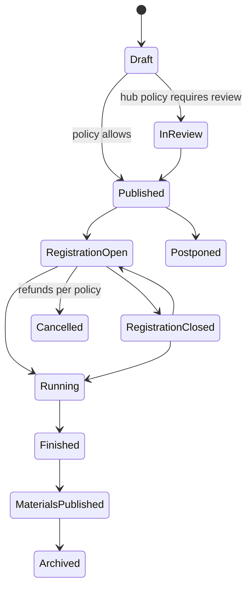

# Events

Module code `EVT`. Status: event list with filters, event page, registration, ticket, demo payment and calendar file are **Demo** (`/events`, `/events/[slug]`, `/events/[slug]/register`, `/events/[slug]/ticket`, `/events/[slug]/pay`); hosting, organizer tools, check-in, payouts, partner meetings, hosted-buyer meetings and federated calendars are **Proposed** (R32). Packages: EVT-001, EVT-002, PAY-001, BILL-002, AGT-014, FED-002, FED-006. Narrative: [Events: attend and host](../events.md). Data: [§12 Events](../../data/model.md#12-events).

## Purpose

The industry meets in person and online: conferences, exhibitions, site visits, open days, trainings, meetups. Events turn readers into a community and are where partnerships start. Everyone can attend; anyone the hub allows can host, with tickets, check-in, materials and purposeful partner meetings.

## Who uses it

Attendees (every participant), organizers (hub editorial team, companies, associations, individuals), speakers, sponsors and exhibitors (labelled), organizer staff at check-in; the `event_networking` and `organizer_desk` agent modules.

## User stories

| # | Story | Status |
|---|---|---|
| EVT-S1 | As a professional, I want to find events by date, type, format, topic and city and register in a minute | Demo |
| EVT-S2 | As a meetup organizer without a company, I want to host a free evening event under the hub's hosting policy | Proposed |
| EVT-S3 | As a manufacturer, I want to run installer training with paid tickets and issue attendance certificates | Proposed |
| EVT-S4 | As an attendee, I want to publish what I offer and look for and book meetings in slots, and never learn who declined me | Proposed |
| EVT-S5 | As organizer staff, I want to scan tickets offline at the door in bright sunlight | Proposed |
| EVT-S6 | As a city hub, I want my meetups to appear in the national calendar with my hub named as home | Proposed |

## Functional requirements

| ID | Requirement | Status | Packages |
|---|---|---|---|
| EVT-F01 | Events have type (`conference`, `exhibition`, `webinar`, `meetup`, `training`, `site_visit`, `open_day`, `competition`, `other`), format (`offline`, `online`, `hybrid`), times in UTC with the event time zone, place with accessibility notes, organizer, programme, speakers, tickets, capacity, topics and related publications | Demo (reading); Proposed (model) | EVT-001 |
| EVT-F02 | Lifecycle `draft → in_review → published → registration_open ⇄ registration_closed → running → finished → materials_published → archived`, with `postponed` and `cancelled` (refunds per policy) | Proposed | EVT-001 |
| EVT-F03 | Hosting policy per hub: editorial only; verified companies and editorial; any signed-in person with review; any signed-in person without review | Proposed | EVT-001 |
| EVT-F04 | Speakers appear with a profile link only with their consent; otherwise a name and role line they approved | Proposed | EVT-001 |
| EVT-F05 | Ticket types with quotas and sales windows; ticket price versions immutable once a ticket is sold; quotas and capacity hold under concurrent registrations | Proposed | EVT-001 |
| EVT-F06 | Registration names attendees (one person may register colleagues), answers the organizer's questions and records consent to the data-sharing notice | Demo (form); Proposed (storage) | EVT-001 |
| EVT-F07 | Paid tickets charge through the hub's licensed payment provider; the hub's fee is a published price version; payouts to organizers through the provider; refunds per the organizer's terms shown before payment | Demo (imitation); Proposed | EVT-001, PAY-001, BILL-002 |
| EVT-F08 | Tickets carry an opaque token in a QR code; the code is stored hashed; check-in works offline-first and syncs; duplicates are flagged; check-ins are append-only | Proposed | EVT-001 |
| EVT-F09 | Waitlists with promotion offers that expire | Proposed | EVT-001 |
| EVT-F10 | Organizers see registrations with only the fields attendees agreed to share; exports go through the same projections; no free-form mass mail to non-registrants | Proposed | EVT-001 |
| EVT-F11 | Announcements and reminders use the hub's versioned notification templates in every hub language | Proposed | EVT-001, COMMS-001 |
| EVT-F12 | Materials (recordings, slides, reports) are publications linked to the event; attendance certificates come from learning | Proposed | EVT-001, LRN-001 |
| EVT-F13 | Feedback is a private survey to the organizer; public event ratings are deliberately not built | Proposed | EVT-001 |
| EVT-F14 | Partner meetings: opt-in meeting profiles (offers, looks for, topics), requests in organizer-defined slots, private declines, a personal schedule merging sessions and meetings; organizers see only counts and room allocation | Proposed | EVT-001 |
| EVT-F15 | Hosted-buyer meetings: organizers may curate structured meetings between declared buyers and suppliers with mutual acceptance; the slot optimiser proposes a feasible personal schedule | Proposed | EVT-001 |
| EVT-F16 | After the event, a meeting becomes an introduction or RFQ invitation only with both sides' consent | Proposed | EVT-001, MATCH-001 |
| EVT-F17 | Sponsors and exhibitors are labelled and never change an event's position or the organizer's reputation; attendee lists are never sold or given to sponsors | Proposed | EVT-001 |
| EVT-F18 | Public events federate; registration and paid tickets always happen on the home node; federated sign-in where hubs peer at identity level | Proposed | FED-002, FED-005 |
| EVT-F19 | An outbound ActivityPub actor per hub announces public events | Proposed | FED-006 |
| EVT-F20 | Calendar files (`.ics`) and add-to-calendar links for every ticket and personal schedule | Demo | EVT-002 |
| EVT-F21 | Organizers of paid events are screened (ownership declaration and sanctions screening) before payouts | Proposed | EVT-001, HUB-003 |

## Agent capabilities

| Capability | Kind | Mandate kind | Confirmation | Interface surface |
|---|---|---|---|---|
| `event_networking.search` | read | — | `none` | `/events` |
| `event_networking.register` | commit | `register` | `mandate` (`pre_authorized` for free events; `ask_above(0)` for paid) | Event → Register |
| `event_networking.publish_meeting_profile` | commit | `maintain_profile` | `mandate` (`ask_each`) | Event → Meetings |
| `event_networking.request_meeting` | commit | `schedule` | `mandate` (`pre_authorized` within the organizer's cap) | Event → Meetings |
| `event_networking.accept_meeting` | commit | `schedule` | `mandate` (`ask_each`) | Meeting card |
| `organizer_desk.draft_event` | draft | `prepare` | `none` | Organizer editor |
| `organizer_desk.publish_event` | commit | `publish` | `mandate` (`ask_each`) | Organizer editor |
| `organizer_desk.send_announcement` | commit | `communicate` | `mandate` (`ask_each`; registrants via templates only) | Organizer → Communications |
| `organizer_desk.check_in` | commit | `record_evidence` | `mandate` (`pre_authorized` for the organizer's staff on the check-in page) | Check-in page |

## Interface surfaces

| Surface | Route | Status |
|---|---|---|
| Events list and event page | `/events`, `/events/[slug]` | Demo |
| Registration, payment, ticket | `/events/[slug]/register`, `/events/[slug]/pay`, `/events/[slug]/ticket` | Demo |
| Organizer workspace: editor, programme, tickets, registrations, communications, materials | Workspace | Proposed (EVT-002) |
| Check-in page for phones (offline-first) | Organizer workspace | Proposed |
| Meetings: profile, requests, schedule | Event page | Proposed |

## Hub console settings

Hosting policy, event review, ticketing and fee versions, check-in, refunds and payouts, organizer screening ([console: events](../hub-console/modules.md#events)).

## Data entities

`event`, `event_co_organizer`, `event_session`, `event_speaker`, `event_sponsor`, `ticket_type`, `ticket_price_version`, `registration_question`, `registration`, `ticket`, `check_in`, `waitlist_entry`, `meeting_profile`, `meeting_slot`, `meeting_request`, `event_material`, `event_feedback` ([§12](../../data/model.md#12-events)).

## Country and jurisdiction variations

Ticket taxes (sales tax or VAT and place-of-supply rules), consumer rights for event tickets (often excluded from cooling-off when dated), accessibility obligations for venues, continuing-education credit schemes, data protection for attendee lists, and public holidays come from packs.

## Privacy rules

Online links and attendee lists are never public; organizers see only the fields attendees agreed to share; declines of meeting requests are private; sponsors never receive attendee data.

## Metrics

Organizer: registrations, check-ins, materials published (own events). Hub cohorts: events per type, cancellation and refund rates, meeting requests accepted. Never public attendance claims that were not measured.

## Edge cases

| Case | Behaviour |
|---|---|
| Last ticket bought by two people at once | Row lock or serializable transaction; one succeeds, the other is offered the waitlist |
| Organizer cancels | Automatic refunds through the provider; unknown outcomes reconciled |
| Check-in phones offline all day | Local scans sync later; duplicates flagged at sync |
| Speaker withdraws consent | Profile link removed; name shown as approved or removed |
| Event in a restricted place | Cannot be created or federated |

## Flow

## Open points

Default hosting policy for the reference hub; whether public event listings show registered counts.
