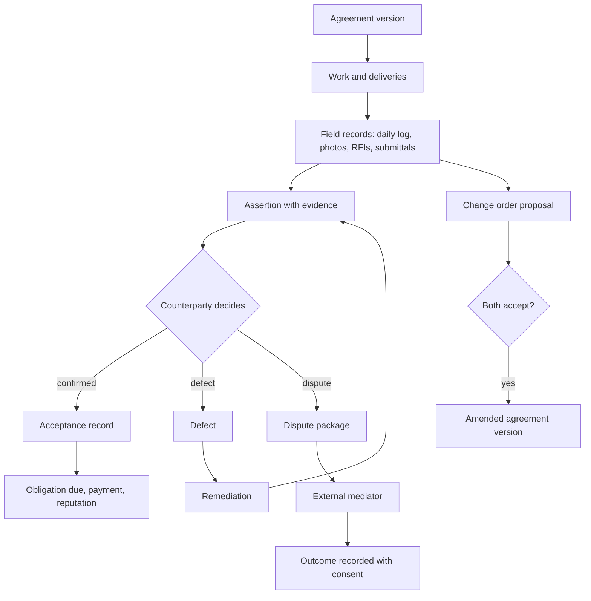

# Execution and field evidence

Module code `EXE`. Status: project updates and published milestones are **Demo**; delivery claims, acceptance records and assertions are **Contract**; execution records, defects, remediation, obligations and disputes are **Designed** (EXE-001); field evidence objects (RFIs, submittals, change orders, daily logs, punch lists, timestamped photographs), dispute evidence packages and mediation referral are **Proposed**. Packages: EXE-001, FIELD-001, DISP-001, AGT-013, FILE-001, PERF-001. Narrative: [Execution, evidence and reputation](../execution-and-reputation.md). Data: [§19 Execution and evidence](../../data/model.md#19-execution-and-evidence).

## Purpose

Record what actually happened on site and in deliveries, separately from what anyone claims, so that acceptance, payment and reputation rest on evidence: deliveries, performed work, staged acceptance of hidden works, defects and remediation, changes with reasons, and field records that matter when people disagree.

## Who uses it

Contractors, subcontractors, suppliers, clients and their representatives, site managers and foremen, design offices answering RFIs and reviewing submittals, mediators who receive dispute packages; the `project_desk` and `execution_clerk` agent modules.

## User stories

| # | Story | Status |
|---|---|---|
| EXE-S1 | As a facade subcontractor, I want each hidden-works stage (fixings, insulation, wind barrier, rails, cladding) closed with a short act and photographs that the client confirms separately | Designed |
| EXE-S2 | As a general contractor, I want RFIs and their answers dated, so that a delay caused by a late answer is attributed correctly | Proposed |
| EXE-S3 | As a client, I want change orders accepted by both sides before work starts, bound to the agreement version | Proposed |
| EXE-S4 | As a foreman, I want a daily log that records work, weather and deliveries, never per-worker productivity | Proposed |
| EXE-S5 | As a party to a dispute, I want a package of digest-bound agreements, change orders, field records, payments and messages that both sides and a mediator can verify | Proposed |
| EXE-S6 | As a site manager without signal, I want to record evidence offline and sync later with the original capture time | Proposed |

## Functional requirements

| ID | Requirement | Status | Packages |
|---|---|---|---|
| EXE-F01 | Execution records: delivery, work record, acceptance (partial is normal), defect, remediation and obligation, each with author, time, evidence and the agreement version it belongs to | Contract (claims, acceptance); Designed (rest) | EXE-001 |
| EXE-F02 | Assertion lifecycle `claimed → evidence_attached → confirmed \| disputed → superseded \| reversed`; confirmation is the counterparty's decision | Contract | EXE-001 |
| EXE-F03 | Evidence keeps source, observed time, hash and classification; files are classified attachments accessed through the parent object with short-lived signed URLs | Designed | EXE-001, FILE-001 |
| EXE-F04 | Staged acceptance closes each stage with an act and photographs; the client's confirmation is separate from the contractor's statement | Designed | EXE-001 |
| EXE-F05 | RFIs are versioned questions with due dates and answers; late answers link to delay attribution | Proposed | FIELD-001 |
| EXE-F06 | Submittals (shop drawings, product data, samples) are versioned with review status (`approved`, `approved_as_noted`, `revise_and_resubmit`, `rejected`) by the reviewer of record | Proposed | FIELD-001 |
| EXE-F07 | Change orders are digest-bound amendments to agreement versions, accepted by both sides; they carry reason, requester and accountability and feed plan changes | Proposed | FIELD-001, PLAN-001 |
| EXE-F08 | Daily logs record work performed, weather, deliveries, visitors and incidents at crew level; per-worker productivity metrics are never computed | Proposed | FIELD-001 |
| EXE-F09 | Punch lists are defect lists with locations, severity, responsible party and remediation acceptance | Proposed | FIELD-001 |
| EXE-F10 | Photographs store capture time and optional location; public projections strip location and blur faces; private projections keep originals for parties | Proposed | FIELD-001, FILE-001 |
| EXE-F11 | Field records are immutable versions with authorship and project participation; corrections are new versions | Proposed | FIELD-001 |
| EXE-F12 | Offline capture keeps the device capture time and syncs with conflict detection; the server records both capture and receipt times | Proposed | FIELD-001, MOB-001 |
| EXE-F13 | A dispute package assembles digest-bound agreements, change orders, field records, payments, waivers and context messages with a manifest both parties can verify; referral to configured external mediators; Trustwork never decides | Proposed | DISP-001 |
| EXE-F14 | While a dispute is open, affected reputation observations are annotated; outcomes enter reputation only as consented, cited evidence | Proposed | DISP-001, REP-001 |
| EXE-F15 | Inspections (from permits or the plan) record date, inspector authority, result and evidence; a failed inspection triggers re-planning | Proposed | PRMT-001, PLAN-001 |
| EXE-F16 | Obligations (what each party owes, amount, due date) drive reminders and timeliness evidence for both sides | Designed | EXE-001, PAY-002 |
| EXE-F17 | The named performer of licensed work confirms their own work records when the pack requires it | Proposed | PERF-001 |
| EXE-F18 | Safety incidents are recorded as facts for the project's parties, never published, and never turned into scores about individual workers | Proposed | FIELD-001 |

## Agent capabilities

| Capability | Kind | Mandate kind | Confirmation | Interface surface |
|---|---|---|---|---|
| `execution_clerk.record_delivery` | commit | `record_evidence` | `mandate` (`ask_first(5)`) | Order → Deliveries |
| `execution_clerk.record_work` | commit | `record_evidence` | `mandate` (`ask_first(5)`) | Task → Milestones |
| `execution_clerk.confirm_or_dispute` | commit | `confirm_execution` | `person_each` | Decision card |
| `project_desk.draft_rfi` | draft | `prepare` | `none` | Project → RFIs |
| `project_desk.answer_rfi` | commit | `communicate` | `mandate` (`ask_each`) | Project → RFIs |
| `project_desk.submit_submittal` | commit | `record_evidence` | `mandate` (`ask_first(5)`) | Project → Submittals |
| `project_desk.review_submittal` | commit | `record_evidence` | `person_each` (reviewer of record) | Project → Submittals |
| `project_desk.propose_change_order` | draft | `prepare` | `none` (proposal) | Project → Changes |
| `project_desk.accept_change_order` | commit | `negotiate` | `mandate` (`ask_each`); `person_each` in consumer mode | Change order card |
| `project_desk.write_daily_log` | commit | `record_evidence` | `mandate` (`pre_authorized` for drafts from the foreman's notes; publish to parties `ask_each`) | Project → Daily log |
| `project_desk.manage_punch_list` | commit | `record_evidence` | `mandate` (`ask_first(5)`) | Project → Punch list |
| `execution_clerk.assemble_dispute_package` | draft | `prepare` | `none` | Dispute → Package |
| `execution_clerk.refer_to_mediator` | commit | `communicate` | `person_each` | Dispute → Referral |

## Interface surfaces

| Surface | Where | Status |
|---|---|---|
| Project updates and published milestones | `/projects/[slug]`, `/app/projects/[id]` | Demo |
| Deliveries, work records and acceptance | Order and task contexts | Designed |
| Field tabs: RFIs, submittals, changes, daily log, punch list, photos, inspections | `/app/projects/[id]` | Proposed |
| Offline capture on phones | Mobile web | Proposed |
| Dispute package and referral | Dispute context | Proposed |

## Hub console settings

Dispute routing and configured mediators, evidence retention classes, photo publication rules, deadlines for confirmation and disputes within pack bounds ([console: disputes](../hub-console/modules.md)).

## Data entities

`delivery_claim`, `work_record`, `acceptance_record`, `defect`, `remediation`, `source_record`, `assertion`, `confirmation`, `dispute_case` ([§19](../../data/model.md#19-execution-and-evidence)); `obligation` ([§18](../../data/model.md#18-transactions)); `evidence_artifact` ([§2](../../data/model.md#2-platform-kernel)); `permit_record` ([§7](../../data/model.md#7-projects-and-plans)). Field records (RFI, submittal, change order, daily log, punch item) are added by FIELD-001.

## Country and jurisdiction variations

Acceptance act forms and hidden-works rules, mandatory site documentation (site diaries required by law in some countries), inspection regimes, evidence admissibility and e-signature levels for acts, mediation and arbitration institutions (for example construction mediation rules in the US), and retention periods for construction records come from packs and hub configuration.

## Privacy rules

Field records are `shared_party` among the project's parties with grants; workers' faces and personal data are minimised; location metadata is stripped from any public projection; daily logs never record per-worker productivity; dispute packages are shared only with the parties and the chosen mediator.

## Metrics

Parties: open RFIs and their age, change orders pending, punch items open (own projects). Hub cohorts: disputes referred and resolved, median confirmation time. Never: worker productivity, individual attendance or location.

## Edge cases

| Case | Behaviour |
|---|---|
| Two parties record conflicting deliveries | Both assertions stay; the counterparty confirms one or disputes; nothing is merged |
| Photo uploaded days after capture | Both capture and receipt times shown; capture time from device metadata labelled as reported |
| A change order is accepted by one side only | It is a proposal; work under it is at the performer's risk and the record says so |
| Offline edits conflict on sync | Server keeps both versions and asks the author to resolve; nothing is overwritten |

## Flow

## Open points

Retention periods for field evidence per jurisdiction (counsel, ADR 012 question 4); default deadlines for confirmations and disputes (O07).
