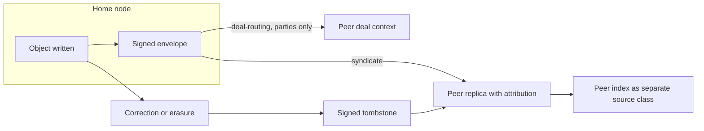

# Federation mesh

Module code `MSH`. Status: **Proposed** ([ADR 011](../../adr/011-federation-mesh.md); R39); data licences for peers are decided by the integrator under the owner's delegation (ADR 010 decision 10). Packages: FED-000 … FED-006, NET-000 … NET-004, MAP-001, HUBC-012, HUBC-013, REP-002, AGT-017. Narrative: [Federation: one worldwide mesh](../federation.md). Wire protocol (Contract, FED-000): [Mesh protocol `trustwork-mesh/1`](../federation-protocol.md). Data: [§26 Federation](../../data/model.md#26-federation).

## Purpose

Every deployment can join one worldwide network. A country hub and a city hub complement each other; public news, events and directories flow between nodes with attribution; participants on different nodes deal with each other with provably identical agreements; private data never leaves its home; restricted places can never join.

## Who uses it

Node operators and hub owners who peer; every participant indirectly (wider market, events from other hubs, cross-border deals); trust reviewers who decide link proposals from peers.

## User stories

| # | Story | Status |
|---|---|---|
| MSH-S1 | As the San Diego city hub, I want our meetups in a US national calendar and the national magazine for our readers | Proposed |
| MSH-S2 | As a client in San Diego, I want to send an RFQ to a supplier registered on a hub in Tijuana or anywhere in Mexico and hold an agreement both nodes can verify | Proposed |
| MSH-S3 | As a person on one hub, I want to register for an event on a peered hub without a second account | Proposed |
| MSH-S4 | As a company verified on its home hub, I want peers to show my badge as "verified by hub X", not re-verify or rescore me | Proposed |
| MSH-S5 | As a reader on the fediverse, I want to follow a hub's publications and public events | Proposed |
| MSH-S6 | As a hub operator, I want to see every listed hub in the world on a map and in an accessible list, and ask the right ones to connect | Proposed |
| MSH-S7 | As a hub operator, I want to decide per peer what we share and receive, which modules interoperate and whether cross-hub requests are allowed, with a second person for anything that widens the flow | Proposed |
| MSH-S8 | As a hub operator, I want a signed channel to other hubs' operators for incidents, abuse reports and coordinated takedowns, without passing anyone's private data | Proposed |

## Functional requirements

| ID | Requirement | Status | Packages |
|---|---|---|---|
| MSH-F01 | Node identity: keys, a manifest (territories, languages, peering policy, licences), signatures and key rotation with published history | Proposed | FED-001 |
| MSH-F02 | Global identifiers for objects; the home node is the only writer; other nodes hold read-only replicas | Proposed | FED-000, FED-002 |
| MSH-F03 | Signed envelopes for everything that crosses nodes; inbox with idempotent processing | Proposed | FED-000, FED-001 |
| MSH-F04 | Bilateral peering levels `syndicate`, `trust-verifications`, `deal-routing`, `identity`; raising to `deal-routing` or `identity` needs a second approver; either side can lower or end peering | Proposed | FED-001 |
| MSH-F05 | Defederation stops feeds and new deliveries; history is not rewritten; deals in progress finish under accepted terms | Proposed | FED-001 |
| MSH-F06 | Only the public projection federates by default; `shared_party` data travels only between the nodes of a deal's parties | Proposed | FED-002, FED-004 |
| MSH-F07 | Default data licences per class (directory facts open with attribution; person profiles redisplay inside the mesh only; editorial publications CC BY 4.0; people's and companies' publications headline and link unless the author chose otherwise; imported source items follow their source licence; reviews not syndicated; reputation snapshots redisplayed unchanged; certificates as verification records) | Decided (integrator) | FED-002 |
| MSH-F08 | Entity links, never merges; link proposals from peers are decided by the local data steward | Proposed | FED-003 |
| MSH-F09 | Authority stays home: reputation is computed only by the subject's home node; badges and credentials are shown with the granting node; nobody recomputes another node's reputation | Proposed | FED-003, REP-002 |
| MSH-F10 | Cross-node deals: RFQs, quotes, agreements and agent envelopes route to the counterparty's home node; both nodes store digest-identical agreement terms | Proposed | FED-004 |
| MSH-F11 | Each node screens counterparties before the first commercial message across nodes | Proposed | FED-004, HUB-003 |
| MSH-F12 | Agent envelopes across nodes are labelled, rate-limited per peering agreement and untrusted for the receiving node | Proposed | FED-004, AGT-017 |
| MSH-F13 | Federated sign-in at `identity` level keeps one home identity and a linked identity on the peer | Proposed | FED-005 |
| MSH-F14 | Corrections, deletions, unpublications and erasures are signed tombstones applied by peers within the period in the peering agreement (for example 72 hours) and purged from indexes, caches and saved answers | Proposed | FED-002 |
| MSH-F15 | An outbound-only ActivityPub actor per hub for publications, magazine issues and public events; no ingestion of fediverse replies in the first version | Proposed | FED-006 |
| MSH-F16 | Nodes and peers in restricted places cannot exist or federate; operators are screened before peering | Proposed | FED-001, INTL-SAN |
| MSH-F17 | A community-run mesh directory may list nodes that ask to be listed; nothing depends on it | Proposed | FED-001 |
| MSH-F18 | Search across the mesh indexes public replicas as a separate source class with licence flags; private queries never forwarded | Proposed | FED-002, RAG-201 |
| MSH-F19 | The merge algorithm for links, tombstones and replica conflicts carries a method version from the first release (`trustwork-merge-1`) | Contract | FED-000 |
| MSH-F20 | Protocol conformance tests let a node call itself compatible; conformance never certifies data quality or legal compliance | Contract (vectors and schema tests in `tests/federation/protocol`) | FED-000 |
| MSH-F21 | Opt-in hub listings, signed by the node, in directory services that admit them through the SANC-008 `hub_directory` check and never list or serve restricted places; directories may federate and each re-verifies and re-admits ([The hub network](../hub-network.md#6-hub-directory-and-world-map)) | Proposed | NET-000, NET-001 |
| MSH-F22 | A world map of hubs with an equal accessible list, the same filters and no third-party tiles in the console | Proposed | MAP-001, HUBC-012 |
| MSH-F23 | Peering requests are double opt-in: each side admits the other and a person accepts; renewal re-runs admission on manifest or attestation change and suspends on refusal or expiry | Proposed | FED-001, NET-002 |
| MSH-F24 | Per-peer interaction settings can only narrow the level and agreed licences; widening needs a second person bound to the exact change; narrowing, suspension and defederation are immediate with a reason | Proposed | NET-000, NET-002, HUBC-012 |
| MSH-F25 | Defederation and long suspension purge a peer's personal-data replicas within the agreed tombstone hours; deal replicas stay for the parties | Proposed | FED-002, NET-002 |
| MSH-F26 | A signed, typed, audited operator channel between hubs that never carries participants' private data except under a counsel-approved case grant (off by default) | Proposed | NET-000, NET-003 |
| MSH-F27 | Network announcements are pulled, signature-verified, retractable and never self-executing | Proposed | NET-003 |
| MSH-F28 | Network statistics: per-peer federation health as node-level aggregates; opt-in published hub statistics as buckets with a delay; peering graph with an adjacency table; nothing about people below ten | Proposed | NET-004 |

## Agent capabilities

| Capability | Kind | Mandate kind | Confirmation | Interface surface |
|---|---|---|---|---|
| `core.search_mesh` | read | — | `none` | Search with home-hub labels |
| `negotiation.send_cross_node_envelope` | commit | `introduce`, `send_quote` or `negotiate` (per intent) | `mandate` (per the mandate's policy) | Deal contexts |
| `hub_ops.request_peering` | govern | — | `first_party_form` (staff; second person for deal-routing and identity) | Console → Federation |
| `hub_ops.draft_operator_message` | draft | — | `first_party_form` (staff send it; an operator agent may only draft) | Console → Network → Messages |

## Interface surfaces

| Surface | Where | Status |
|---|---|---|
| Home-hub labels on replicas ("from the national hub", "verified by hub X") | Every public card | Proposed |
| Federation console: peers, licences, tombstones, incoming links | `/admin/hubs/[hub]/federation` | Proposed (HUBC-006, HUBC-010) |
| Node identity and keys | `/admin/node/identity` | Proposed |
| Network area: map and list, directory listing, peers and requests, interaction settings, messages, announcements, statistics | `/admin/hubs/[hub]/network` | Proposed (HUBC-012, HUBC-013) |
| Directory service (nodes running the directory module) | `/admin/node/directory` | Proposed (HUBC-006, HUBC-010, NET-001) |

## Hub console settings

Peering agreements and levels, data licences per class in the manifest (stricter allowed), tombstone compliance, incoming link proposals, defederation list ([console: federation](../hub-console/modules.md#federation)).

## Data entities

`node`, `node_key`, `peer_node`, `peering_agreement`, `feed_cursor`, `replica`, `federation_inbox_item`, `federation_delivery`, `entity_link`, `federated_identity_link`, `federation_tombstone`, `tombstone_application`, `takedown_notice` ([§26](../../data/model.md#26-federation)).

## Country and jurisdiction variations

Cross-border data transfer rules (for example GDPR transfer bases, data-residency laws), export controls and sanctions screening of peers, and content law differences (defamation, which is why reviews are not syndicated) shape peering decisions; each node remains responsible for its own compliance.

## Privacy rules

Private data never federates; person profiles redisplay only inside the mesh with attribution and no bulk export or model training; tombstones within the agreed period; replicas never presented as verified or authored by the receiving node.

## Metrics

Per node: peers by level, feed lag, tombstone application time, rejected envelopes, link proposals decided.

## Edge cases

| Case | Behaviour |
|---|---|
| A peer ignores tombstones | Compliance flag in the console; peering lowered or ended |
| Key compromise at a node | Key rotation with revocation published; signatures after the compromise window rejected |
| Two nodes claim the same company | Links with provenance; canonical display by strongest claim status; no merge |
| A cross-node deal's counterparty node defederates mid-deal | The deal finishes under accepted terms; new deliveries stop |

## Flow

## Open points

Open questions in [Federation](../federation.md#open-questions) and [ADR 011](../../adr/011-federation-mesh.md).
