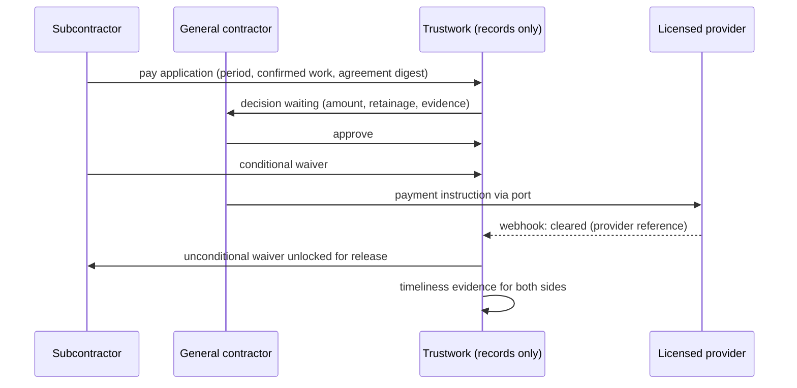

# Getting paid

Module code `PAY`. Status: **Partial implementation (PAY-001); not accepted or operational** ([ADR 010](../../adr/010-gathering-point-hubs-agents-and-mesh.md) decision 20; R46). BILL-001 budgets, reservations and the ledger are implemented; PAY-001 reuses the owning commercial order reservation. Packages: PAY-001, PAY-002, BILL-002, EXE-001, INTL-US, HOME-001, FIN-001, DISP-001. Narrative: [Trustwork never holds money](../billing.md#trustwork-never-holds-money), [market scan: getting paid](../../research/market-and-ideas-2026-10.md#4-missing-high-value-capabilities). Data: [§23 Billing, budgets and payments](../../data/model.md#23-billing-budgets-and-payments), [§18 Transactions](../../data/model.md#18-transactions).

## Purpose

Help the people who build get paid fairly and on time, on construction terms (milestones, pay applications, retainage, lien waivers, prompt-payment rules), with funds handled only by licensed payment providers configured per hub, and with payment behaviour of both sides recorded as fair, explainable evidence.

## Who uses it

Contractors, subcontractors, suppliers, consultants and experts who are paid; clients, developers and general contractors who pay; homeowners in consumer mode; the `execution_clerk`, `procurement` and `order_desk` agent modules; hub billing staff for payouts of marketplace fees.

## User stories

| # | Story | Status |
|---|---|---|
| PAY-S1 | As a subcontractor, I want to submit a pay application for work completed this period, bound to the agreement version and the confirmed work, so that the GC approves from evidence | Proposed |
| PAY-S2 | As a subcontractor, I want my unconditional lien waiver released only after the payment cleared | Proposed |
| PAY-S3 | As a homeowner, I want progress payments by milestone with the deposit limit my state allows, so that I never pay far ahead of the work | Proposed |
| PAY-S4 | As a supplier, I want prompt-payment reminders based on my jurisdiction's rules, sent as information, not legal threats | Proposed |
| PAY-S5 | As a GC, I want my payment discipline towards subcontractors to count in my reputation, so that good payers are visible | Proposed |
| PAY-S6 | As a small contractor, I want to see licensed financing partners for working capital, labelled with any referral fee, without it affecting who wins work | Proposed |

## Functional requirements

| ID | Requirement | Status | Packages |
|---|---|---|---|
| PAY-F01 | Trustwork and hub operators never hold, pool or move participants' funds; payments, escrow, retainage and payouts go only through licensed providers configured per hub | Proposed | PAY-001 |
| PAY-F02 | A provider-neutral payment port (create intent, confirm, refund, payout through the provider's connected accounts, look up outcome) with a deterministic fake; PAY-001 refuses configurations routing funds through an operator account | Proposed | PAY-001 |
| PAY-F03 | Webhooks arrive through an idempotent inbox; unknown outcomes are reconciled, never retried blindly; provider references are stored, card and bank data never | Proposed | PAY-001 |
| PAY-F04 | Payment milestones are part of agreements; a pay application for a period cites confirmed work records and the agreement version by digest | Proposed | PAY-002 |
| PAY-F05 | Retainage is tracked in a ledger per agreement with release conditions (substantial completion, punch list closed, period elapsed) from the agreement and pack facts | Proposed | PAY-002 |
| PAY-F06 | Lien waivers (conditional or unconditional, progress or final) use statutory templates stored as reviewed pack data per state; an unconditional waiver is released only against cleared-payment evidence | Proposed | PAY-002, INTL-US |
| PAY-F07 | Prompt-payment reminders use due dates from agreements and pack facts; they are information, never legal advice or automatic claims | Proposed | PAY-002 |
| PAY-F08 | Due and paid dates are timeliness evidence for both payer and payee | Proposed | PAY-002, REP-001 |
| PAY-F09 | Milestone payment templates for private clients apply deposit limits and cancellation rights from the pack (for example state home-improvement rules in the US) | Proposed | HOME-001, PAY-002 |
| PAY-F10 | Holding funds until delivery is offered only where the configured provider is licensed to do so; otherwise the platform records obligations and evidence while money moves outside it | Proposed | PAY-001 |
| PAY-F11 | Payouts to organizers, authors and experts go through the provider's connected accounts after payee screening; payout fees come from a published price version | Proposed | BILL-002 |
| PAY-F12 | Payee protection: changes of bank details are verified out of band and delayed; payment instructions arriving by e-mail or message are untrusted and never executed | Proposed | PRC-011, PAY-001 |
| PAY-F13 | Financing partner referrals: licensed trade-credit and project-finance partners listed per hub, labelled, referral fees disclosed, never influencing ranking or matching; no consumer lending unless the partner is licensed for it | Proposed | FIN-001 |
| PAY-F14 | Joint checks and direct payments to sub-tier parties are recorded as payment events with evidence, when the provider and agreement support them | Proposed | PAY-002 |
| PAY-F15 | In the demo, card, ACH and sales-tax flows run only through fake providers labelled "demo: no money moves" | Proposed | PAY-001, DEMO-US |
| PAY-F16 | Restricted places, sanctioned banks and Russian payment rails are never integrated | Live (rule in packs and compliance) | INTL-SAN, PAY-001 |

## Agent capabilities

| Capability | Kind | Mandate kind | Confirmation | Interface surface |
|---|---|---|---|---|
| `execution_clerk.draft_pay_application` | draft | `prepare` | `none` | Agreement → Pay applications |
| `execution_clerk.submit_pay_application` | commit | `record_evidence` | `mandate` (`ask_each`) | Pay application |
| `execution_clerk.approve_pay_application` | commit | `place_order` | `mandate` (`ask_above(amount)`); `person_each` in consumer mode | Pay application |
| `execution_clerk.initiate_payment` | commit | `place_order` | `mandate` (`ask_above(amount)`); `person_each` in consumer mode | Payment card |
| `execution_clerk.release_waiver` | commit | `confirm_execution` | `person_each`; unconditional only after cleared payment | Waivers |
| `execution_clerk.send_payment_reminder` | commit | `communicate` | `mandate` (`pre_authorized` within limits) | Obligation card |
| `execution_clerk.reconcile_unknown` | commit | `record_evidence` | `person_each` | Reconciliation queue |
| `execution_clerk.list_obligations` | read | — | `none` | Money overview |

## Interface surfaces

| Surface | Where | Status |
|---|---|---|
| Money overview (obligations due, received, retainage held) | Workspace | Proposed |
| Pay applications and waivers per agreement | Agreement context | Proposed |
| Milestone payments for homeowners | Task assignment | Proposed |
| Payment checkout through the provider | Provider-hosted or embedded fields | Proposed (fake in demo) |

## Hub console settings

Payment providers per capability with second-person activation, capture modes, payout fees, retainage and waiver templates from the pack, reconciliation queue, financing partners list with disclosures ([console: billing, payouts](../hub-console/README.md#hub-console-section-map), [providers](../hub-console/providers-and-models.md)).

## Data entities

`payment`, `refund`, `payout_account`, `payout`, `ledger_entry`, `reservation`, `invoice` ([§23](../../data/model.md#23-billing-budgets-and-payments)); `agreement`, `obligation` ([§18](../../data/model.md#18-transactions)); `inbox_receipt` ([§2](../../data/model.md#2-platform-kernel)). Pay applications, retainage ledgers and lien waivers are added by PAY-002.

## Country and jurisdiction variations

Lien and prompt-payment laws and statutory waiver forms (US states), retainage caps, construction trust or adjudication regimes (for example statutory adjudication of payment disputes in the UK and Australian states), money-transmission and escrow licensing, payment rails (ACH and cards in the US, SEPA in the EU, Pix in Brazil, UPI in India), e-invoicing as a payment prerequisite, and consumer deposit limits come from packs and adapters. Every legal template is unverified until the hub's counsel reviews it.

## Privacy rules

Payment amounts are visible to the parties only; providers receive the minimum data for the payment; no card or bank data is stored; payees are screened; timeliness evidence shows dates, not amounts, in public reputation.

## Metrics

Parties: obligations due and overdue, days to payment (own). Hub cohorts: share of payments through providers, reconciliation backlog, payout failures. Never: individual payment histories outside the parties and a dispute case.

## Edge cases

| Case | Behaviour |
|---|---|
| Provider confirms payment after a timeout | Reconciliation matches the provider reference; no second charge |
| A waiver is requested before payment cleared | Only a conditional waiver can be released; the unconditional stays locked |
| Bank details change by e-mail | Treated as untrusted; out-of-band verification and delay before use |
| Provider not available in a hub's country | The hub records obligations and evidence only; the agreement states that payment happens outside the platform |
| Payee fails screening | Payout blocked pending human review; the payer is told the payout is on hold without the reason category beyond what law allows |

## Flow

## Open points

Counsel review of statutory waiver templates per state before any live use; which providers the reference hub uses (ADR 012 question 12).

## PAY-001 implementation checkpoint

The participant API accepts an agreement and its existing transaction budget, never a caller-selected party, hub, country, amount, provider or payout destination. The worker persists a stable operation before dispatch, rechecks current authority while holding its database locks through the adapter call, and only queries that operation after an unknown outcome. Verified evidence is bound to the original amount, currency, connected account and provider; the authoritative connected-account country is separately checked against restricted places and configured support. Delivery deduplication and conflicting semantic outcomes are separate; immutable receipts cannot double-settle the BILL-001 ledger. A synthetic success is labelled `synthetic_no_money_moves`.

See the [API and worker boundary](../../../apps/api/src/modules/payments/README.md) for commands and recovery. The payment port includes create, confirm, full refund, connected-account verification, connected-account payout and lookup. The deterministic fake makes no network call. A bounded raw HTTP ingress authenticates bytes before accepting evidence; recurring lookup jobs handle unresolved outcomes and phone/QR waits. A customer-action deadline never proves non-payment or permits another charge. No card or bank details, currency conversion, operator balance, ranking or reputation dependency is introduced.

This is not full PAY-001 acceptance. Owning modules do not yet publish authoritative collecting/home hubs, party countries and connected-account bindings; no operational source or rail is seeded. Task/consultation owning projections and two-sided remote screening remain unavailable and fail closed. The implemented positive integration tests use explicitly synthetic fixtures, real agreement/quote/order HTTP flows, current hub/provider configuration, restricted PostgreSQL roles and the actual worker. Production licensed providers, approved rails, legal eligibility and operator policies remain UNKNOWN. No account registration or provider SDK is included.
