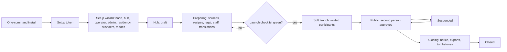

# Hubs and the hub console

Module code `HBC`. Status: country selection, packs and localization are **Live** and **Demo**; the hub console contracts in `packages/contracts/src/hub.ts` are a **Contract**, frozen as version 1.0.0 (HUBC-000); hubs, territories, versioned configuration, jurisdiction settings, the setup wizard, one-command installation, the node console and every console section are **Proposed**; platform administration is **Designed** (ADM-001); the United States reference hub (Railway in a US region, operated by Contribuda, demo-only until QA-002, counsel review and the owner's switch) is **decided and not deployed** (R36, R37, R40). Packages: HUBC-000 (done), HUB-001, HUB-002 (umbrella), HUB-003, HUB-004, HUB-005, ADM-001, ADM-002, HUBC-002 … HUBC-010, KEYS-001, SUP-001, PRV-001, OPS-004, INST-001, DOC-001. Narrative: [Hubs](../hubs.md), [Hub administration](../hub-administration.md), [The hub console](../hub-console/README.md). Data: [§24 Hubs, sources and verification](../../data/model.md#24-hubs-sources-and-verification), [§27 Administration](../../data/model.md#27-administration-support-and-privacy-operations).

## Purpose

Let anyone (an association, a trade publisher, a chamber of commerce, a university, one determined engineer) run Trustwork for a country, a region or a city without writing code: install, configure the territory, connect keys and models, switch modules on, let an AI-assisted editorial office fill the hub with sourced content, mine public registers lawfully, price the agent product, serve users lawfully and keep the system healthy, with guard rails no console can switch off.

## Who uses it

Node operators (node console), hub owners and hub staff with scoped roles (hub owner, staff admin, compliance officer, data steward, trust reviewer, editor-in-chief and editors, moderator, commercial admin, privacy officer, support agent and lead, ops engineer, auditor), the installer holding the one-time setup token; the `hub_ops` agent module under a staff principal.

## User stories

| # | Story | Status |
|---|---|---|
| HBC-S1 | As an association in Kenya, I want to install the engine with one command and complete a setup wizard that requires a country, languages, currency, operator entity and a first admin with a second factor | Proposed |
| HBC-S2 | As a hub owner, I want a launch checklist that refuses to go public until legal documents, counsel approval, residency, staff, sources, verification, screening, translations, backups and accessibility are proven | Proposed |
| HBC-S3 | As a compliance officer, I want every sensitive change (prices, providers, legal documents, residency, peering) activated by a second person and audited | Proposed |
| HBC-S4 | As a support agent, I want to help a person without logging in as them and without reading private data unless a second person grants a 72-hour case | Proposed |
| HBC-S5 | As the San Diego reference hub, I want to complement a national US hub if one opens: my meetups in their calendar, their magazine for my readers | Proposed |
| HBC-S6 | As a hub owner, I want one-click kill switches for agents, modules, connections and providers | Proposed |

## Functional requirements

| ID | Requirement | Status | Packages |
|---|---|---|---|
| HBC-F01 | A node is one installation; a hub is a community for a territory on a node; a node may host several hubs; territories are ISO 3166-1/3166-2 codes and pack places, descriptive and never exclusive | Proposed | HUB-001 |
| HBC-F02 | A hub can never declare a restricted place; the engine refuses to start a hub whose country is restricted; the list is code | Live (list); Proposed (hub check) | INTL-SAN, HUB-001 |
| HBC-F03 | Hub lifecycle `draft → preparing → soft_launch → public → suspended → closing → closed`; closing notifies participants in advance, offers exports and sends tombstones or a handover notice to peers | Proposed | HUB-001 |
| HBC-F04 | Hub configuration is versioned: every change is a version with a reason, activated (by a second person for sensitive domains) and superseded later; never edited in place | Proposed | HUB-001 |
| HBC-F05 | Staff roles are scoped to the platform, a node or a hub; separation of duties with reduced mode for small staff; conflict-of-interest declarations | Proposed | HUB-001, DATA-002 |
| HBC-F06 | Two people (the second with a different role) for sensitive actions: sensitive roles, price activation, erasure, sanction level 4, enabling non-fake providers, legal document activation, residency change, raising peering to `deal-routing` or `identity` | Proposed | HUB-001, ADM-001 |
| HBC-F07 | Guard rails no console can switch off: no access widening, no ranking controls, no impersonation, no raw database or unrestricted export, restricted places are code, baseline sanctions screening stays on, no surveillance dashboards, no pipeline publishes, secrets are write-only, participant statistics are cohorts of at least ten | Contract (human gates, cohort minimum in `hub.ts`); Proposed (enforcement) | HUBC-000 (done), HUB-002 |
| HBC-F08 | Setup wizard on a fresh node: install check, node identity, hub identity (country pack or generic profile, territory, languages, currency, brand), operator legal entity, first administrator with a second factor, storage and residency, providers, modes, review; a one-time setup token | Live as an API and wired wizard, not deployed (HUB-004: token, ordered resumable steps, restricted places, founding administrator, attestation, draft hub); Proposed (one-command installer printing the token: INST-001; node signing key: KEYS-001) | HUB-004, INST-001 |
| HBC-F09 | One-command installation with Docker Compose (PostgreSQL, object storage, API, web, worker), generated secrets, platform guides (Railway, Fly.io, Kubernetes), upgrades and uninstall | Proposed | INST-001, OPS-002 |
| HBC-F10 | Launch checklist gates: operator entity screened; legal documents with counsel approval; residency recorded; two staff with distinct roles and second factors; editorial team and policy; community rules in every hub language; a source with licence flags; a verification recipe; sanctions screening; complete templates and dictionaries; a backup restore exercised; brand accessibility check | Proposed | HUB-001, HUB-002 |
| HBC-F11 | Jurisdiction settings (agent disclosure, liability allocation, consent, record-keeping, per-action limits) per hub and per jurisdiction with sourced pack defaults; stricter allowed, weaker never; most protective wins across jurisdictions | Proposed | HUB-005 |
| HBC-F12 | Provider connections for every capability (models, embeddings, images, translation, speech, mail, SMS, payments, maps, registers, e-signature, tax, e-invoicing) with modes `fake`, `manual`, `live`; secrets never shown back; connection tests; model routing per job with fallbacks; egress matrix by data class and residency; spending caps; kill switches; usage and cost dashboards | Proposed | KEYS-001, HUBC-002 |
| HBC-F13 | Console sections: home (overview, approvals, help), hub (identity and territory, modes, modules, legal, residency, country base, taxonomy, launch), participants, support, editorial office, data, modules, trust and safety, agents, billing, keys and models, automation, communications, federation, privacy, staff and audit, operations; plus the node console | Proposed | ADM-002, HUBC-002 … HUBC-010 |
| HBC-F14 | The console is entered from the avatar menu only by staff, after step-up and a second factor (elevated session); it has its own shell and no hub switcher | Proposed | ADM-002, BE-004 |
| HBC-F15 | Support workspace: lookup, account and company cards, sessions, second factor, recovery escalations, memberships, entitlements, exports, deletions, consents, communications history, support cases with case grants and an access explainer; no impersonation | Proposed | SUP-001 |
| HBC-F16 | Case access grants: scoped, at most 72 hours, approved by a second person, every read logged | Contract | ADM-001 |
| HBC-F17 | Modules can be switched on per hub with dependencies and prerequisites shown | Proposed | HUB-001, HUBC-005 |
| HBC-F18 | System modes: lifecycle stage, demo or live data, registration (closed, invite only, open), moderation strictness, automation level per domain, search-engine indexing, maintenance | Proposed | HUB-001 |
| HBC-F19 | Country base binding: a country pack version or the generic profile, with local additions exportable as pack changes | Proposed | HUB-001, CFG-001 |
| HBC-F20 | Hub-level privacy settings: notices, consent categories, opt-out of sale or sharing, Global Privacy Control, cookie policy, breach contacts | Proposed | PRV-001 |
| HBC-F21 | Every console action calls a domain use case with a staff principal, a reason and an audit record; the administration module never writes another module's tables | Proposed | ADM-001 |
| HBC-F22 | Console usable on a phone at 375 px for overview, approvals, queues and kill switches; WCAG 2.2 AA; every string in every hub language | Proposed | ADM-002 |
| HBC-F23 | The reference hub is a hub setting away from real sign-ups: demo-only with synthetic data until QA-002, counsel review and the owner's switch | Decided | QA-002, DEMO-US |

## Agent capabilities

Staff capabilities run under a staff principal and are never available to participants' agents.

| Capability | Kind | Mandate kind | Confirmation | Interface surface |
|---|---|---|---|---|
| `hub_ops.summarise_queues` | read | — | `none` | Console overview |
| `hub_ops.draft_decision` | draft | `prepare` | `none` | Any queue |
| `hub_ops.prepare_launch_evidence` | draft | `prepare` | `none` | Launch checklist |
| `hub_ops.activate_config_version` | govern | — | `first_party_form` (staff; second person where sensitive) | Settings pages |
| `hub_ops.engage_kill_switch` | govern | — | `first_party_form` (staff; release needs a second person) | Kill switches |

## Interface surfaces

Routes under `/admin` as designed in the [console section map](../hub-console/README.md#hub-console-section-map) and the [screens](../hub-console/screens.md): `/admin/setup/[step]`, `/admin/node/...`, `/admin/hubs/[hub]/...`. All **Proposed**.

## Hub console settings

This module *is* the console; every other module page lists its own console sections.

## Data entities

`hub`, `hub_territory`, `hub_config_version`, `legal_document_version`, `counsel_approval`, `legal_acceptance`, `launch_gate`, `provider_credential_ref`, `model_route`, `provider_cost_budget`, `peering_agreement` ([§24](../../data/model.md#24-hubs-sources-and-verification)); `staff_role_definition_version`, `staff_role_assignment`, `staff_conflict_declaration`, `session_elevation`, `second_person_approval`, `case_access_grant`, `admin_audit_event`, `access_log_entry`, `support_case`, `kill_switch`, `feature_flag`, `maintenance_window`, `incident` ([§27](../../data/model.md#27-administration-support-and-privacy-operations)); console mapping in the [data model view](../hub-console/data-model.md).

## Country and jurisdiction variations

Everything country-specific in the console is pack data or hub configuration: identifiers, registers, licensing, tax, signatures, payments, holidays, residency rules, privacy settings, legal texts and their counsel approval. The [US and Samarkand examples](../hub-console/README.md) show the same screens configuring very different places.

## Privacy rules

Staff never read private objects without a case grant; support has no impersonation; statistics about participants are cohorts; audit and access logs are immutable and exportable signed for auditors.

## Metrics

Launch gate status, queue ages, approvals waiting, spend against caps, kill-switch history, incident counts, locale completeness, backup drill evidence. Never per-person behaviour analytics.

## Edge cases

| Case | Behaviour |
|---|---|
| A hub has one staff member | Reduced separation-of-duties mode allows only actor ≠ approver where a second person exists; the launch checklist requires two staff before public |
| A legal order requires suspension | `suspended`: read-only with a banner; exports remain available |
| A provider key leaks | Rotate in the console (write-only), engage the provider kill switch, record an incident |
| Two hubs on one node need different residency | Residency is per hub; providers are filtered by each hub's egress matrix |

## Flow

## Open points

Questions for the owner in the [console README](../hub-console/README.md#open-questions-for-the-owner); counsel review of US legal templates before the reference hub accepts real users.
