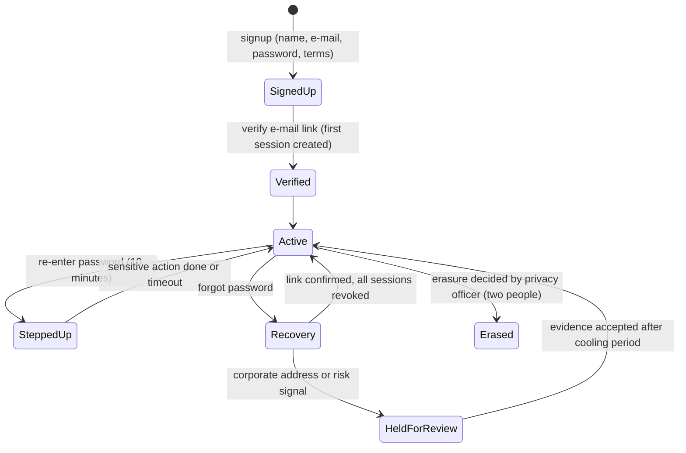

# Identity and accounts

Module code `IDN`. Status: sign-up with e-mail verification, login, logout, recovery, step-up, sessions, password and e-mail change, Google and Apple linking are **Live** in the API (mail only through an in-memory fake until MAIL-001); the screens are **Demo**; Microsoft and generic OIDC are **Designed**; public handles with redirects are **Live** (BE-003); second factor, recovery codes, elevated sessions, passkeys and wallet-based identity are **Proposed**. Packages: BE-001 (done), BE-003 (done), BE-002, BE-004, MAIL-001, FED-005, IDV-001. Narrative: [People and companies](../people-and-companies.md#a-person-is-one-human-for-life), [ADR 002](../../adr/002-identity-and-access.md). Data: [§3 Identity and sessions](../../data/model.md#3-identity-and-sessions).

## Purpose

Give every human one lifelong identity in the industry, independent of any employer, with secure sign-in that does not leak who is registered, recovery that survives losing a corporate mailbox, and step-up for anything sensitive.

## Who uses it

Everyone. Support staff service accounts without impersonation ([support workspace](../hub-console/support.md)); the privacy officer handles erasure.

## User stories

| # | Story | Status |
|---|---|---|
| IDN-S1 | As a newcomer, I want to sign up with one name field, e-mail and password, so that I start without company paperwork | Live (API), Demo (screens) |
| IDN-S2 | As a site engineer who changes employer, I want to keep my account when my corporate e-mail disappears, so that my publications and reputation stay mine | Live (personal account); Proposed (recovery review UI) |
| IDN-S3 | As a person, I want to see every session and revoke the others, so that a lost phone does not stay signed in | Live |
| IDN-S4 | As a person, I want a second factor and recovery codes, so that my agent's mandates cannot be hijacked | Proposed |
| IDN-S5 | As a person in the EU, I want to prove my identity with my European Digital Identity Wallet, so that I can be verified without uploading documents | Proposed |
| IDN-S6 | As a person on two peered hubs, I want to use one identity on both | Proposed |

## Functional requirements

| ID | Requirement | Status | Packages |
|---|---|---|---|
| IDN-F01 | Sign-up asks for one name field, e-mail, password and acceptance of terms; nothing else is mandatory | Live | BE-001 |
| IDN-F02 | No session exists before the e-mail is verified; the verification step creates the first session | Live | BE-001 |
| IDN-F03 | Responses to sign-up, login and recovery are identical whether an e-mail exists or not | Live | BE-001 |
| IDN-F04 | Passwords are hashed with Argon2id; minimum length 15 by default; policy values are configuration | Live | BE-001 |
| IDN-F05 | Sessions are opaque random tokens stored only as hashes; a person lists sessions and revokes one or all others | Live | BE-001 |
| IDN-F06 | Step-up (re-entering the password within ten minutes) is required for password and e-mail change, company invitations, project transfer and other sensitive actions | Live | BE-001 |
| IDN-F07 | Provider identities are `(provider, subject)` pairs; linking needs a recently re-authenticated session or mailbox proof; nothing is auto-linked by e-mail | Live (Google, Apple with fake) | BE-001 |
| IDN-F08 | Microsoft and generic OIDC providers plug into the same adapter | Designed | BE-002 |
| IDN-F09 | Recovery to a corporate address can be held for review; support-assisted rebinding requires evidence and a cooling period | Live (hold); Proposed (support flow) | BE-001, SUP-001 |
| IDN-F10 | Transactional mail (verification, recovery, invitations, security notices) is sent through the outbox by the worker with localized templates | Proposed | MAIL-001 |
| IDN-F11 | A second factor (TOTP and passkeys), single-use recovery codes and elevated sessions for staff and setup | Proposed | BE-004 |
| IDN-F12 | Password change, account recovery and a "sign out everywhere" revoke all sessions, agent connections and connection tokens | Live (sessions); Proposed (connections) | BE-001, AGT-016 |
| IDN-F13 | People, companies and projects receive public handles; a changed handle leaves a redirect and is never reused for another subject | Live (API) | BE-003 (done) |
| IDN-F14 | Identity verification levels (`email_verified`, `document_checked`, `wallet_verified`, `in_person`) are evidence records with issuer and date, never a single opaque badge | Proposed | IDV-001, CLM-001 |
| IDN-F15 | Wallet-based identity and attribute presentation (EU Digital Identity Wallet, ISO mobile driver's licence where a hub enables it) through an adapter with a fake; the engine stores the verification result and attribute claims, never the raw credential | Proposed | IDV-001 |
| IDN-F16 | National electronic identity sign-in (for example where a hub's country runs one) through the same provider adapter, per country pack | Proposed | IDV-001, CTRY packs |
| IDN-F17 | Federated sign-in between peered nodes keeps one home identity and creates a linked guest identity on the peer | Proposed | FED-005 |
| IDN-F18 | Lockout and rate limits per account and per source protect against credential stuffing; failures are audited without storing the attempted password | Live | BE-001, BE-002 |
| IDN-F19 | Account deletion and erasure follow privacy operations: personal data redacted or pseudonymized, accepted terms that others rely on preserved as lawful evidence, an erasure ledger outside the restorable snapshot | Designed | PRV-001 |
| IDN-F20 | Identity audits (sign-up, login, recovery, provider events) are written in the same transaction as the change they record | Proposed | BE-002 |

## Agent capabilities

Identity operations are deliberately first-party: an agent can explain and prepare, never execute them.

| Capability | Kind | Mandate kind | Confirmation | Interface surface |
|---|---|---|---|---|
| `core.list_sessions` | read | — | `none` | Settings → Security |
| `core.revoke_session` | govern | — | `first_party_form` | Settings → Security |
| `core.explain_security_state` | read | — | `none` | Assistant |
| `core.start_wallet_verification` | govern | — | `first_party_form` | Settings → Identity |
| `core.change_password`, `core.change_email`, `core.manage_second_factor` | govern | — | `first_party_step_up` | Settings → Security |

## Interface surfaces

| Surface | Route | Status |
|---|---|---|
| Sign up, log in, recover | `/signup`, `/login`, `/recover`, `/recover/[token]` | Demo (screens), Live (API) |
| Onboarding (optional, skippable) | `/onboarding`, `/onboarding/goals`, `/onboarding/interests`, `/onboarding/profile`, `/onboarding/done` | Demo |
| Security settings: sessions, password, e-mail, providers | `/app/settings` | Demo |
| Second factor, recovery codes, passkeys | `/app/settings` | Proposed |
| Identity verification (wallet, documents) | `/app/settings` | Proposed |

## Hub console settings

Allowed sign-in providers per hub (with second-person activation), password and session policy within engine minimums, recovery review rules, registration mode (closed, invite only, open), wallet and national eID adapters per country, sender identity for transactional mail ([setup wizard](../hub-console/setup-wizard.md), [support](../hub-console/support.md)).

## Data entities

`person`, `email_binding`, `credential`, `session`, `auth_token`, `login_failure`, `recovery_review`, `identity_provider_config` ([§3](../../data/model.md#3-identity-and-sessions)); `session_elevation` ([§27](../../data/model.md#27-administration-support-and-privacy-operations)); `federated_identity_link` ([§26](../../data/model.md#26-federation)).

## Country and jurisdiction variations

Available national eID and wallet schemes, legal age and minors policy (open, O06), data residency for identity data, electronic signature levels that a sign-in may or may not satisfy, and e-mail and SMS sender registration rules come from the country pack and hub configuration. Examples: EU Digital Identity Wallets (member states must offer them by late 2026), US state mobile driver's licences, India's national identity services only through licensed intermediaries if a hub chooses them.

## Privacy rules

E-mail bindings, provider identities, sessions, token hashes and login failures never appear in any non-owner projection. Support sees a diagnostic account card, never a password, token or second-factor secret, and never logs in as the person. Identity verification results show categories ("identity confirmed by wallet on date"), never documents.

## Metrics

Hub cohorts: sign-ups verified within 24 hours, recovery holds and their age, second-factor adoption, lockouts. Never per-person login histories outside the person's own security page and support cases with a grant.

## Edge cases

| Case | Behaviour |
|---|---|
| Someone signs up with another person's e-mail | No session until the mailbox owner verifies; the real owner can claim the address |
| Corporate mailbox deleted after leaving | Recovery held for review; personal e-mail binding encouraged at onboarding; support rebinding with evidence and cooling period |
| Provider returns an e-mail that matches an existing account | No automatic linking; the person must sign in and link |
| Concurrent password change and login | Session epoch bump revokes sessions created before the change |
| Wallet presentation for a person in a restricted place | Refused; restricted places are never served |

## Flow

## Open points

Final password, session and lockout values; the default for residual access to company history after employment ends (O04); minors (O06).
