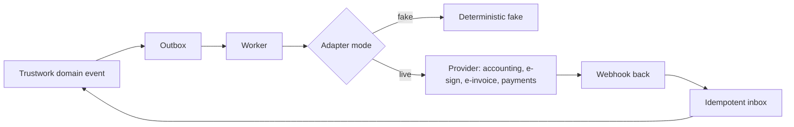

# Integrations

Module code `INT`. Status: **Proposed** throughout; adapters with fakes are the rule for every external system (ADR 004). Packages: INTEG-001, ESIG-001, BIM-001, PRC-012, PRC-013, PAY-001, BILL-002, HUB-003, KEYS-001, AGT-016, PRC-011, PRC-012, PRC-013. Narrative: [market scan: integrations](../../research/market-and-ideas-2026-10.md#4-missing-high-value-capabilities), [Country specifics](../country-specifics.md), [Keys, providers and models](../hub-console/providers-and-models.md). Data: integrations tables added by INTEG-001; providers in [§24](../../data/model.md#24-hubs-sources-and-verification).

## Purpose

Connect Trustwork to the tools people and companies already use (accounting and ERP, project and field tools, BIM and design tools, e-signature, payments, e-invoicing networks, calendars, registers) without ever weakening projections, mandates or the rule that untrusted input never issues commands; and let hubs choose providers per country through configuration, not code.

## Who uses it

Companies (accounting, ERP, project tools, BIM), professionals (calendars, e-signature), hub operators (payment, e-signature, e-invoicing, register, mail and model providers), developers building on the public API.

## User stories

| # | Story | Status |
|---|---|---|
| INT-S1 | As a small contractor, I want accepted agreements and invoices to flow into my accounting software as drafts, so that I do not retype them | Proposed |
| INT-S2 | As a German supplier, I want to issue invoices in an EN 16931 format (XRechnung or ZUGFeRD) and receive them, because the law requires it | Proposed |
| INT-S3 | As a homeowner, I want to sign an agreement with a legally valid electronic signature from my phone | Proposed |
| INT-S4 | As a design office, I want to import product data into my BIM tool as IFC property sets | Proposed |
| INT-S5 | As a company, I want signed webhooks when an RFQ invitation arrives, to feed my ERP | Proposed |
| INT-S6 | As a professional, I want my consultations and site visits in my calendar | Proposed |

## Functional requirements

| ID | Requirement | Status | Packages |
|---|---|---|---|
| INT-F01 | Every external system is reached through an adapter with a deterministic fake; no external call in tests; modes `fake`, `manual`, `live` visible in the console | Designed (rule) | KEYS-001 |
| INT-F02 | Public API over the public projection and a participant's own data, with OAuth clients per participant and per hub and scopes mapped to projections | Proposed | INTEG-001 |
| INT-F03 | Signed webhooks with replay protection and per-subscriber delivery logs | Proposed | INTEG-001 |
| INT-F04 | CSV import of one's own contacts and projects creates private records of the importer, never directory members or claims | Proposed | INTEG-001 |
| INT-F05 | Calendar feeds (iCalendar) for tickets, bookings, site visits and personal schedules; two-way calendar adapters only with explicit grants | Demo (`.ics` for events); Proposed | INTEG-001, EVT-002 |
| INT-F06 | Accounting and ERP adapters (for example QuickBooks Online, Xero, DATEV-format export, generic ERP through webhooks and the API) create drafts in the target system; amounts and parties come from accepted agreements and invoices | Proposed | INTEG-001, PRC-013 |
| INT-F07 | Project-tool import of one's own projects (for example from a project-management suite's API) as private projects; no scraping | Proposed | INTEG-001 |
| INT-F08 | E-signature adapters per country (ESIGN and UETA-compliant providers in the US; eIDAS advanced and qualified signatures in the EU; national schemes elsewhere); the signed document's hash binds to the agreement digest | Proposed | ESIG-001 |
| INT-F09 | E-invoicing: EN 16931 formats (UBL and CII, XRechnung, ZUGFeRD), Peppol access through a certified access point adapter, and national formats (for example Mexico's CFDI, Brazil's NF-e, India's e-invoice IRN) as later adapters | Proposed | PRC-012, BILL-002 |
| INT-F10 | Payment providers through the payment port; licensed providers only; refuse configurations that route funds through an operator account | Proposed | PAY-001 |
| INT-F11 | Tax determination through pack rules or a tax adapter (for example a US sales-tax service) with rule references stored | Proposed | BILL-002 |
| INT-F12 | Register and verification providers per country through the verification adapter (business registers, licence boards, sanctions lists) | Proposed | HUB-003, REG-001 |
| INT-F13 | BIM: IFC property-set export and import for product entries and plan items; BCF for issues in a later step; no proprietary BIM format shipped in the repository | Proposed | BIM-001 |
| INT-F14 | Mail, SMS, messenger, maps, translation, speech, model and embedding providers through the provider registry with egress by data class | Proposed | KEYS-001, CHAN-001, LLM-001 |
| INT-F15 | External API usage costs are metered and shown to the hub; rate limits per client | Proposed | INTEG-001 |
| INT-F16 | Inbound data from integrations is untrusted content: it can create drafts and proposals, never commitments | Proposed | INTEG-001, AST-001 |
| INT-F17 | A company may connect one system (for example an ERP) to its standing representative, approved by an administrator and the accountable person, bound only to company mandates | Proposed | AGT-016 |

## Agent capabilities

| Capability | Kind | Mandate kind | Confirmation | Interface surface |
|---|---|---|---|---|
| `core.connect_integration` | govern | — | `first_party_step_up` | Settings → Integrations |
| `connections.export_to_accounting` | commit | `communicate` | `mandate` (`ask_each`; drafts in the target system) | Agreement or invoice |
| `connections.import_csv` | draft | `prepare` | `none` | Import dialog |
| `order_desk.request_signature` | commit | `communicate` | `mandate` (`ask_each`) | Agreement |
| `order_desk.issue_einvoice` | commit | `record_evidence` | `mandate` (`ask_each`) | Invoice |

## Interface surfaces

Settings → Integrations (participants and companies); console Keys and models → Providers; developer documentation for the public API and webhooks (DOC-002). All **Proposed**.

## Hub console settings

Providers per capability with modes and second-person activation for live providers; egress matrix; spending caps; OAuth client policy; webhook limits ([providers and models](../hub-console/providers-and-models.md)).

## Data entities

`provider_credential_ref`, `verification_provider` ([§24](../../data/model.md#24-hubs-sources-and-verification)); `inbox_receipt` ([§2](../../data/model.md#2-platform-kernel)); `external_connection` ([§21](../../data/model.md#21-assistant-and-agents)); integration clients, webhook subscriptions and deliveries added by INTEG-001.

## Country and jurisdiction variations

E-signature levels and their legal effect, e-invoicing mandates and formats, payment rails, tax engines, accounting formats (for example national standard audit files), and which registers expose APIs come from packs and adapters.

## Privacy rules

Integrations read only what the connecting principal may read; tokens stored as hashes; data sent to a third-party tool is shown before connection; no integration receives counterparties' private fields.

## Metrics

Hub cohorts: connected clients by type, webhook delivery success, API error rates, external costs against caps.

## Edge cases

| Case | Behaviour |
|---|---|
| Accounting system rejects a draft | Shown to the person with the system's message; nothing retried blindly |
| Webhook endpoint down | Exponential backoff, dead letters, subscriber can replay from the delivery log |
| E-signature provider returns an unknown outcome | Reconciliation by provider reference; the agreement stays unsigned until confirmed |
| A CSV contains people who are not users | Stays private to the importer; never published or contacted in bulk |

## Flow

## Open points

Which accounting and e-signature providers the reference hub uses (ADR 012 question 12).
