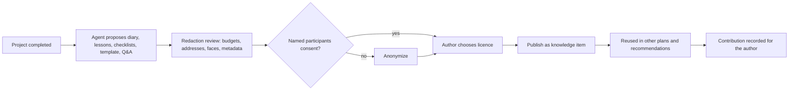

# Knowledge sharing

Module code `KNW`. Status: **Proposed** (ADR 010 decision 17; R43). Knowledge items are publications and reuse the **Contract** publication model (versions, corrections). Packages: KNOW-001, CNT-001, CNT-003, PLAN-001, PPL-001, PROV-001, REP-001. Narrative: [Knowledge sharing](../agent-catalog.md#knowledge-sharing), [Shared knowledge](../publishing.md#shared-knowledge-from-completed-projects-proposed). Data: [§9 Knowledge sharing](../../data/model.md#9-knowledge-sharing).

## Purpose

Trustwork is a place where people teach each other. With the owner's consent, a completed project becomes a diary, lessons learned, checklists, a reusable plan template and questions with expert answers, under a licence the author chooses, with private data removed. Experts and practitioners earn reputation from knowledge that others actually reused.

## Who uses it

Project owners after completion, practitioners and experts who answer questions, readers and future project owners, editors who review, the `knowledge_sharing`, `content_writer` and `plan_step_companion` agent modules.

## User stories

| # | Story | Status |
|---|---|---|
| KNW-S1 | As a homeowner who finished building a house, I want my agent to propose a diary and a checklist from my project, which I review field by field before anything is published | Proposed |
| KNW-S2 | As a future owner, I want to start my plan from a template someone published after a similar project in my region | Proposed |
| KNW-S3 | As a framer named in a diary, I want to be asked before my name appears, or be anonymized | Proposed |
| KNW-S4 | As an expert, I want my answer on framing inspections to count when others confirm it helped their own project | Proposed |
| KNW-S5 | As a reader, I want to know whether a lesson was written by a homeowner, a contractor or a manufacturer with a commercial interest | Proposed |

## Functional requirements

| ID | Requirement | Status | Packages |
|---|---|---|---|
| KNW-F01 | Knowledge formats are publication formats `diary`, `lesson`, `checklist`, `template` and expert `answer`, linked to the source plan version and plan items | Proposed | KNOW-001 |
| KNW-F02 | Nothing becomes knowledge without the project owner's consent, recorded per item and per field | Proposed | KNOW-001 |
| KNW-F03 | Each named participant consents or is anonymized; withdrawing consent unpublishes or re-anonymizes the item and propagates to replicas | Proposed | KNOW-001, FED-002 |
| KNW-F04 | A redaction review strips budgets, prices (unless the owner keeps ranges), addresses, faces, licence plates, counterparties' private data and location metadata from photographs before publication | Proposed | KNOW-001, FILE-001 |
| KNW-F05 | The author chooses a licence (for example CC BY 4.0, CC BY-SA 4.0 or all rights reserved); the licence travels with every copy and federated replica | Proposed | KNOW-001 |
| KNW-F06 | A plan template is derived from a plan version with private fields removed; derivations record their source (`template_derivation`) so reuse can be credited | Proposed | KNOW-001, PLAN-001 |
| KNW-F07 | Lessons learned become cited risks in other people's plans, always with a link to the lesson | Proposed | KNOW-001, AGT-010 |
| KNW-F08 | Questions and expert answers are publications with authorship, corrections and the author's credentials as checked by the hub | Proposed | KNOW-001, CNT-001 |
| KNW-F09 | Usefulness is recorded only through structured feedback tied to the reader's own project ("this checklist was used in plan item X"), never by votes alone or by volume | Proposed | REP-001 |
| KNW-F10 | Content from a party with a commercial interest (manufacturer, supplier, contractor marketing) is labelled as such | Proposed | KNOW-001, MAT-001 |
| KNW-F11 | AI-assisted drafts are labelled; the author reviews and publishes; nothing is published by the agent alone | Proposed | PROV-001 |
| KNW-F12 | Knowledge is free to publish and to read on the free floor; it is never paywalled | Proposed | BILL-003 |
| KNW-F13 | Knowledge items appear in plan-step recommendations, search and topic feeds, ranked by fit and evidence of reuse, never by payment | Proposed | REC-001, RAG-301 |
| KNW-F14 | Comments under knowledge items follow the hub's community rules (off by default) | Proposed | CNT-001 |

## Agent capabilities

| Capability | Kind | Mandate kind | Confirmation | Interface surface |
|---|---|---|---|---|
| `knowledge_sharing.propose_from_project` | draft | `prepare` | `none` | Project → Share the experience |
| `knowledge_sharing.redact_preview` | read | — | `none` | Redaction review |
| `knowledge_sharing.request_participant_consent` | commit | `communicate` | `mandate` (`ask_each`) | Consent list |
| `knowledge_sharing.publish` | commit | `publish` | `mandate` (`ask_each`, field by field) | Redaction review → Publish |
| `knowledge_sharing.search` | read | — | `none` | Knowledge, plan items |
| `knowledge_sharing.record_reuse` | commit | `record_evidence` | `mandate` (`ask_each`) | Plan item → "Used this" |
| `knowledge_sharing.answer_question` | commit | `publish` | `mandate` (`ask_each`) | Q&A |

## Interface surfaces

| Surface | Where | Status |
|---|---|---|
| "Share the experience" wizard with redaction review | Completed project | Proposed |
| Knowledge pages (diary series, lesson, checklist, template, Q&A) | Public site under articles and topics | Proposed |
| Template gallery | Plan → Start from a template | Proposed |
| Q&A | Public site and workspace | Proposed |

## Hub console settings

Review policy per knowledge format, redaction checklist, allowed licences, comment policy, consent queue monitoring ([console: shared knowledge](../hub-console/modules.md#plan-to-people)).

## Data entities

`knowledge_item`, `knowledge_consent`, `template_derivation` ([§9](../../data/model.md#9-knowledge-sharing)); `publication`, `publication_version`, `correction` ([§10](../../data/model.md#10-content)); `contribution_record` ([§20](../../data/model.md#20-reputation)).

## Country and jurisdiction variations

Copyright and moral-rights rules for licences, image rights of people in photographs (consent rules differ by country), defamation thresholds, and building-code citation rules (codes may be cited and linked but not reproduced without a licence) come from packs and hub legal settings.

## Privacy rules

Projects stay private until consent; the redaction review is mandatory; location metadata is stripped from published photographs; named participants consent or are anonymized; withdrawal propagates to replicas and indexes.

## Metrics

Hub cohorts: knowledge items published per format, consent completion rate, reuse records per item, corrections. Authors: their own reuse counts.

## Edge cases

| Case | Behaviour |
|---|---|
| A participant withdraws consent after publication | Item re-anonymized or unpublished; tombstones to replicas; reuse records stay as counts |
| A template contains a step that later proved dangerous | Correction with a visible note; derived plans get a notice on the affected item |
| A manufacturer publishes "lessons" that are marketing | Labelled commercial; editors may require a format change under the editorial policy |
| A diary reveals a dispute with a named contractor | Redaction review flags it; publication requires the contractor's consent or anonymization; disputes are handled through dispute cases, not diaries |

## Flow

## Open points

Default licence proposal for knowledge items per hub; whether lessons from disputes may ever be published (editorial policy).
