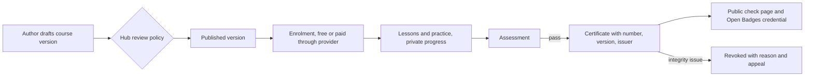

# Learning and certificates

Module code `LRN`. Status: courses, reading progress, bookmarks and certificates on "My page" (`me.title`) and the public certificate check (`/certificates/[id]`) are **Demo**; course authoring, assessments, paid courses, accreditation records, Open Badges credentials and federated verification are **Proposed** (R33). Packages: LRN-001, REP-002, CRED-001, BILL-002, AGT-014, FED-002. Narrative: [Learning and certificates](../learning.md). Data: [§13 Learning](../../data/model.md#13-learning).

## Purpose

Raise the quality of construction by making short, practical learning easy to find, author and prove: courses tied to real work, assessments, certificates anyone can check by number and carry as verifiable credentials, and honesty about what a platform certificate does and does not mean.

## Who uses it

Learners (professionals, installers, newcomers, homeowners), course authors (experts, hub editors, companies and manufacturers teaching their systems), reviewers, accreditation bodies recorded by the hub; the `learning_coach` and `course_studio` agent modules.

## User stories

| # | Story | Status |
|---|---|---|
| LRN-S1 | As an installer, I want a short course on hidden-works acceptance with a practical assessment and a certificate I can show anyone | Demo (certificate check); Proposed (courses) |
| LRN-S2 | As a manufacturer, I want to publish installer training for my system, labelled as company-authored | Proposed |
| LRN-S3 | As a learner, I want my progress private, with no employer dashboard | Demo (private progress) |
| LRN-S4 | As a client, I want to check a certificate number and see the course version, date and whether it is valid, expired or revoked | Demo |
| LRN-S5 | As a professional, I want certificates as Open Badges in my passport and wallet | Proposed |
| LRN-S6 | As a hub, I want to record that a professional body accepts a course for continuing-education points, with source and validity | Proposed |

## Functional requirements

| ID | Requirement | Status | Packages |
|---|---|---|---|
| LRN-F01 | Courses have modules and lessons (text, images, short videos, checklists, templates), practice tasks, an assessment with a pass threshold, topics, author, language editions and versions | Proposed | LRN-001 |
| LRN-F02 | Changing a course creates a new version; certificates name the version they were earned on | Proposed | LRN-001 |
| LRN-F03 | Assessments are graded automatically or by a reviewer; attempts are recorded; integrity problems lead to revocation with a reason | Proposed | LRN-001 |
| LRN-F04 | Progress, reading progress and bookmarks are private to the learner; no employer view exists | Demo | LRN-001 |
| LRN-F05 | Certificates have a public check page by number showing holder card (or chosen name), course and version, date, optional score with consent, issuer, status (`valid`, `expired`, `revoked` with reason category) and accreditation only if recorded | Demo | LRN-001 |
| LRN-F06 | A platform certificate is not a state qualification or licence and says so; accreditations are recorded by the hub with source and validity | Proposed | LRN-001 |
| LRN-F07 | Certificates are also issued as Open Badges 3.0 / W3C Verifiable Credentials signed with the node key, revocable through status lists, importable into the passport | Proposed | REP-002 |
| LRN-F08 | Courses can be free or paid; paid courses use price versions and the hub's licensed provider; author revenue share is a hub setting | Proposed | LRN-001, BILL-002 |
| LRN-F09 | Companies may sponsor free access for customers or employees; sponsorship is labelled and the sponsor never sees who used it or how | Proposed | LRN-001 |
| LRN-F10 | Authoring in the workspace with the hub's review policy; manufacturer courses labelled company-authored | Proposed | LRN-001 |
| LRN-F11 | Indexed learning resources from manufacturers' public pages appear on plan steps with their source and licence | Proposed | MAT-001, REC-001 |
| LRN-F12 | Certificates of attendance come from events | Proposed | EVT-001, LRN-001 |
| LRN-F13 | Certificates verify across nodes through signed public envelopes; a node never re-issues another node's certificate | Proposed | FED-002 |
| LRN-F14 | Worker credential cards may include completed trainings as holder-presented credentials | Proposed | CRED-001 |
| LRN-F15 | Course content and assessments exist in every language the course offers; machine-assisted translations are labelled until reviewed | Proposed | LRN-001, PROV-001 |

## Agent capabilities

| Capability | Kind | Mandate kind | Confirmation | Interface surface |
|---|---|---|---|---|
| `learning_coach.search_courses` | read | — | `none` | Courses |
| `learning_coach.enrol` | commit | `register` | `mandate` (`pre_authorized` for free courses; `ask_above(0)` for paid) | Course page |
| `learning_coach.suggest_courses_for_goal` | read | — | `none` | Learning coach |
| `course_studio.draft_course` | draft | `prepare` | `none` | Course studio |
| `course_studio.publish_course_version` | commit | `publish` | `mandate` (`ask_each`) | Course studio |
| `learning_coach.verify_certificate` | read | — | `none` | `/certificates/[id]` |
| `learning_coach.export_badge` | commit | `maintain_profile` | `person_each` | My page → Learning |

## Interface surfaces

| Surface | Route | Status |
|---|---|---|
| Learning on My page (courses, progress, bookmarks, certificates) | `/app/me` | Demo |
| Public certificate check | `/certificates/[id]` | Demo |
| Course catalogue and course pages | Public site | Proposed |
| Course player and assessments | Workspace | Proposed |
| Course studio for authors | Workspace | Proposed |

## Hub console settings

Course review policy, certificates and revocations, accreditation records with sources, price and revenue-share versions ([console: learning](../hub-console/modules.md#learning)).

## Data entities

`course`, `course_version`, `course_lesson`, `assessment`, `course_price_version`, `enrollment`, `lesson_progress`, `assessment_attempt`, `certificate`, `accreditation`, `learning_resource` ([§13](../../data/model.md#13-learning)); `passport_credential` ([§20](../../data/model.md#20-reputation)).

## Country and jurisdiction variations

Which professions require state-issued qualifications, continuing-education schemes and their recognised providers, mandatory safety training schemes (for example US OSHA outreach training cards or national site-safety cards), consumer rules for online courses, and tax on courses come from packs and accreditation records.

## Privacy rules

Progress and scores are private unless the holder chooses to show a score on a certificate; there is no employer view; sponsors never see usage by person.

## Metrics

Learner: own progress. Author: enrolments, completions, pass rates (cohorts). Hub cohorts: courses published, certificates issued and revoked.

## Edge cases

| Case | Behaviour |
|---|---|
| A course is corrected after certificates were issued | Existing certificates keep their version; a note links to the corrected version |
| Assessment leak discovered | Affected attempts reviewed; certificates revoked with reason category; holders notified with an appeal path |
| A learner's profile is private | Certificate shows only the name the learner chose for it |

## Flow

## Open points

Which accreditation bodies the reference hub records first; revenue-share defaults for authors.
