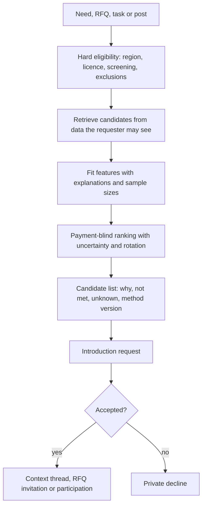

# Matching and partners

Module code `MCH`. Status: directories with filters are **Demo**; discovery candidates and eligibility are **Contract** inside procurement; capability profiles, the needs board, explainable matching, introductions, lead honesty, public opportunities, benchmarking and request receipts are **Proposed** (R34). Packages: MATCH-001, MATCH-002, WEB-010, PROC-001, PROC-002, BENCH-001, AGT-007, RANK-001. Narrative: [Partners and matching](../partners-and-matching.md). Data: [§14 Partners and matching](../../data/model.md#14-partners-and-matching).

## Purpose

Help the right people find each other (a client and a good contractor, a contractor and a reliable supplier, two firms that together can bid for a bigger job) with matching that explains why, shows what is unknown, never sells positions, and connects people only by double opt-in.

## Who uses it

Everyone with a need or an offer: clients, contractors, suppliers, manufacturers, design offices, professionals looking for engagements; event attendees; the `discovery`, `opportunity_watch`, `introductions` and `engagements` agent modules.

## User stories

| # | Story | Status |
|---|---|---|
| MCH-S1 | As a client, I want candidates for my need with "why this match", criteria not met and unknowns, so that I understand the suggestion | Proposed |
| MCH-S2 | As a new company with no reviews, I want to be labelled "new, no reviews yet" rather than pushed to the bottom | Proposed |
| MCH-S3 | As a homeowner, I want my request to reach only the pros I chose, and to see exactly who received it | Proposed |
| MCH-S4 | As a contractor, I want alerts for public tenders and open needs in my categories at the same moment as everyone else | Proposed |
| MCH-S5 | As a company, I want to request an introduction with a stated purpose, and share contact details only after acceptance | Proposed |
| MCH-S6 | As a company, I want to compare my response time and win rate with peer aggregates without anyone seeing my data | Proposed |

## Functional requirements

| ID | Requirement | Status | Packages |
|---|---|---|---|
| MCH-F01 | Capability profiles are structured: taxonomy categories, works and materials, regions served (ISO 3166-2 and places), capacity ranges, typical project sizes, checked licences and certificates, languages, availability; public per field by the owner's choice | Proposed | MATCH-001 |
| MCH-F02 | Demand objects: open needs, RFQs, partner requests, task requests and event meeting profiles; supply objects: capability profiles, catalogue offerings, partner offers, consultation offerings | Proposed | MATCH-001 |
| MCH-F03 | Hard eligibility rules (region, required licence, sanctions screening clear, requester exclusions) are shown as passed, failed or unknown | Proposed | MATCH-001 |
| MCH-F04 | Candidate retrieval uses only data the requester may see; private quotes, budgets and floors never feed matching | Proposed | MATCH-001 |
| MCH-F05 | Fit features (category overlap, similar past projects, capacity, distance, availability, platform response history, reputation dimensions with sample sizes) each carry a value and an explanation | Proposed | MATCH-001 |
| MCH-F06 | Ranking is a published, versioned method with uncertainty; unknown is not bad; ties rotate; the requester may tune weights for their own search | Proposed | MATCH-001 |
| MCH-F07 | Payment, plan, sponsorship, advertising and staff preference never influence matching; tests compare rankings with and without paid entitlements | Proposed | MATCH-001, BILL-003 |
| MCH-F08 | A ranking statement per ranked surface (directory, matching, needs board, search, recommendations, event listings) states the main parameters and that payment has no influence, regenerated from configuration | Proposed | RANK-001 |
| MCH-F09 | The needs board lists public open needs per hub with filters; interested parties express interest, request an introduction or answer an RFQ; needs close with an outcome (`filled`, `cancelled`, `postponed`) | Proposed | MATCH-001, WEB-010 |
| MCH-F10 | Introductions are double opt-in (`requested → accepted \| declined \| expired`); declines are private; contacts and a context thread open only after acceptance | Proposed | MATCH-001 |
| MCH-F11 | Introduction quotas are rolling per person, shared with their agent, lowered temporarily after repeated declines, and never purchasable | Proposed | MATCH-001, AGT-004 |
| MCH-F12 | Lead honesty: a private client's need reaches only chosen or consented professionals up to a hub cap; no per-lead charging; a request receipt shows the client who received it and why, and shows each recipient how many others did | Proposed | MATCH-002 |
| MCH-F13 | External sourced candidates are labelled and never contacted in bulk; contact goes through a lawful channel a person chooses within the country's direct-marketing law | Proposed | MATCH-001 |
| MCH-F14 | Alerts with reasons and frequency control; dispatched in the same batch for every plan | Proposed | MATCH-001, AGT-007 |
| MCH-F15 | Public opportunities: imported tenders become read-only open needs labelled "from a public source"; awards become sourced track records; a bid calendar per person; followed opportunities become pursuits in the supplier [bid desk](bid-desk.md) | Proposed | PROC-001, BID-001 |
| MCH-F16 | Tender source adapters per country, Open Contracting Data Standard first (SAM.gov, UK Central Digital Platform and Find a Tender, TED, PNCP, Mercado Publico, GeM and others), each with licence flags | Proposed | PROC-002 |
| MCH-F17 | Privacy-safe benchmarking: a company sees its own metrics against peer aggregates with minimum group sizes; no pooled private prices | Proposed | BENCH-001 |
| MCH-F18 | Cross-hub matching: needs marked for cross-border interest federate at `syndicate` peering; introductions and RFQs travel to the counterparty's home node; each node screens before the first commercial message | Proposed | FED-003, FED-004 |
| MCH-F19 | Engagements for individuals: open needs that want a person (site engineer, estimator, crew) can be answered with availability as an introduction; no staffing or employment brokerage | Proposed | AGT-007 |

## Agent capabilities

| Capability | Kind | Mandate kind | Confirmation | Interface surface |
|---|---|---|---|---|
| `discovery.run_match` | read | — | `none` | Need → Find candidates |
| `discovery.explain_candidate` | read | — | `none` | Candidate card |
| `need_intake.publish_need` | commit | `publish` | `mandate` (`ask_each`) | Needs board editor |
| `introductions.express_interest` | commit | `introduce` | `mandate` (`ask_first(3)`) | Need card |
| `introductions.request_introduction` | commit | `introduce` | `mandate` (`ask_first(3)`) | Candidate card |
| `introductions.answer_introduction` | commit | `introduce` | `mandate` (`ask_each`) | Introduction card |
| `opportunity_watch.subscribe_alerts` | commit | `maintain_profile` | `mandate` (`pre_authorized`) | Alerts settings |
| `opportunity_watch.list_opportunities` | read | — | `none` | Opportunities |
| `need_intake.get_request_receipt` | read | — | `none` | Need → Receipt |
| `discovery.view_benchmarks` | read | — | `none` | Company → Benchmarks |

## Interface surfaces

| Surface | Route | Status |
|---|---|---|
| People and companies directories with filters | `/people`, `/companies` | Demo |
| Needs board and partner posts | `/app/needs` (workspace) and a public board | Proposed (WEB-010) |
| Candidate list with explanations | Need → Candidates | Proposed |
| Introductions | Context cards and threads | Proposed |
| Opportunities and bid calendar | Workspace | Proposed |
| Request receipt | Need → Receipt | Proposed |

## Hub console settings

Needs board policy, introduction quotas, fan-out cap for private clients, matching method versions, tender sources and their licences, benchmark minimum group size ([console: matching](../hub-console/modules.md)).

## Data entities

`capability_profile`, `open_need`, `need_interest`, `partner_post`, `match_method_version`, `match_run`, `match_candidate`, `introduction`, `outreach_quota`, `alert_subscription` ([§14](../../data/model.md#14-partners-and-matching)); `supplier_candidate`, `evaluation` ([§16](../../data/model.md#16-procurement)).

## Country and jurisdiction variations

Licence requirements per trade and region, direct-marketing law for contacting sourced companies (opt-in or opt-out regimes), public procurement portals and their reuse terms, competition-law limits on benchmarking, and the P2B ranking-transparency duty in the EU come from packs and hub configuration.

## Privacy rules

Matching never uses data the requester may not see. Nobody gets a list of who viewed whose profile. Declines are private. Benchmarks are aggregates above the minimum group size and never include private prices.

## Metrics

Hub cohorts: needs published, introductions requested and accepted, needs filled, median time to first accepted introduction, rotation fairness of top positions. Participant: own introductions and outcomes.

## Edge cases

| Case | Behaviour |
|---|---|
| Very few candidates in a region | Shows "few candidates" and offers widening the region; never pads with fake or irrelevant results |
| A candidate is under sanctions review | Eligibility shows "unknown, screening in review"; no introduction until cleared |
| An agent floods introductions | Quota and decline-based throttling; repeated reports open a moderation case |
| A sourced company receives an introduction request | Delivered only through a lawful channel; if none exists, the requester is told to contact the company directly |

## Flow

## Open points

Fan-out cap default for private clients; whether the needs board is public by default in the reference hub.
