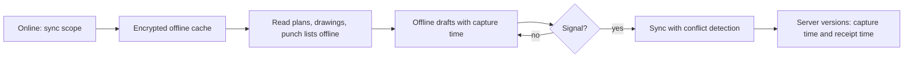

# Mobile and offline

Module code `MOB`. Status: the public site and workspace are responsive and tested at desktop, tablet and phone widths (**Demo**); offline-capable mobile web, field-first channels, installable web app, offline check-in and offline evidence capture are **Proposed**. Packages: CHAN-001, MOB-001, EVT-001, FIELD-001, WEB-005. Narrative: [Communications](../communications.md), [Events](../events.md#organizer-tools), [market scan: field-first access](../../research/market-and-ideas-2026-10.md#executive-summary-the-15-most-valuable-ideas).

## Purpose

Construction happens on sites, in trucks and at trade shows, often with gloves on, in bright sunlight and without signal. Trustwork works on a phone first: readable plans, punch lists and schedules offline, evidence captured offline with honest timestamps, check-in at the door without network, and the agent reachable by SMS or messenger with voice notes.

## Who uses it

Foremen, installers, site managers, homeowners on site, event organizers at the door, anyone on a slow network.

## User stories

| # | Story | Status |
|---|---|---|
| MOB-S1 | As a foreman, I want today's plan items, punch list and drawings available offline | Proposed |
| MOB-S2 | As an installer, I want to photograph a completed stage offline and have it sync with the capture time when I have signal | Proposed |
| MOB-S3 | As an organizer, I want to scan tickets offline and sync later | Proposed |
| MOB-S4 | As a crew lead who prefers messages, I want to ask my agent by WhatsApp or SMS and confirm actions with a structured reply | Proposed |
| MOB-S5 | As a reader on a slow network, I want light, cacheable public pages | Proposed (WEB-005) |

## Functional requirements

| ID | Requirement | Status | Packages |
|---|---|---|---|
| MOB-F01 | Every public and workspace screen works at 320 CSS px width with targets of at least 24 CSS px (larger preferred) and no horizontal scrolling | Demo (tested widths) | WEB-001 |
| MOB-F02 | Installable web app (manifest, icons, offline shell) without app-store dependence; native apps are not required | Proposed | MOB-001 |
| MOB-F03 | Offline cache for reading assigned plan items, drawings attached to them, punch lists, schedules and tickets, encrypted at rest on the device where the platform allows and cleared on sign-out | Proposed | CHAN-001, MOB-001 |
| MOB-F04 | Offline drafts (evidence, daily log entries, punch updates, notes) sync with conflict detection; nothing is overwritten; device capture time and server receipt time both kept | Proposed | CHAN-001, FIELD-001 |
| MOB-F05 | Offline check-in with local duplicate detection and later sync | Proposed | EVT-001 |
| MOB-F06 | SMS, WhatsApp and other messengers as channels to the person's own agent under grants; voice notes transcribed as untrusted input; actions need structured confirmation | Proposed | CHAN-001 |
| MOB-F07 | Camera capture strips location from any public projection; faces blurred where published | Proposed | FIELD-001 |
| MOB-F08 | Low-data mode: images on demand, compressed uploads, text-first pages | Proposed | MOB-001, WEB-005 |
| MOB-F09 | High-contrast, sunlight-readable theme and large-target mode as user preferences | Proposed | MOB-001, A11Y-001 |
| MOB-F10 | Push notifications through web push only with explicit permission per category; quiet hours respected | Proposed | MOB-001, COMMS-001 |

## Agent capabilities

Same registry entries as on the web; on channels, every `commit` capability requires a structured confirmation reply (for example a one-time code or a numbered choice), never free text.

## Interface surfaces

Mobile web for every screen; check-in page; offline indicator and sync queue; channel conversation in the person's messenger.

## Hub console settings

Allowed channels and sender registration; offline cache scope limits; push notification categories.

## Data entities

Offline drafts reuse the target entities (`work_record`, field records, `check_in`) with device capture metadata; `channel_grant` ([§22](../../data/model.md#22-communications)).

## Country and jurisdiction variations

Messenger availability and business terms, SMS registration (for example 10DLC in the US), data-at-rest rules for devices, and photo consent rules come from packs and hub settings.

## Privacy rules

Offline caches hold only what the person may read and are cleared on sign-out or revocation at next sync; channels never receive private data the person did not choose to route there.

## Metrics

Sync failures and conflicts (cohorts), offline sessions, channel usage per type. Never location tracking.

## Edge cases

| Case | Behaviour |
|---|---|
| Access revoked while offline | Cached data stays until next sync, then is cleared; drafts for revoked contexts are rejected with an explanation |
| Device clock wrong | Capture time labelled "reported by device"; server receipt time authoritative for ordering |
| Two people edit the same punch item offline | Both versions kept; the second to sync resolves |

## Flow

## Open points

Whether any hub needs native apps; device encryption guarantees differ by platform.
