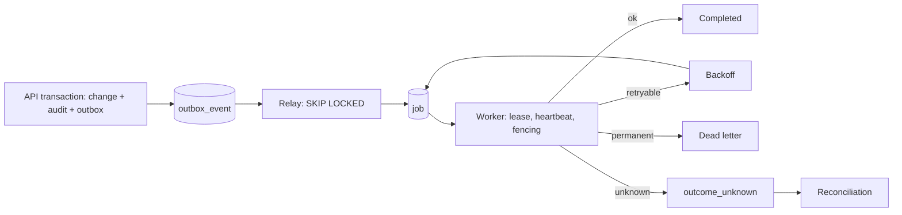

# Operations

Module code `OPR`. Status: the worker's outbox relay, durable jobs (lease, heartbeat, fencing token, backoff, dead letters, `outcome_unknown` parking, reconciliation command), scheduled sweeps, monthly partitions and Prometheus metrics are **Live** (REL-001); the production runtime baseline is **Proposed** and in review (OPS-001); containers, a full local stack, backups and restore drills, the operations console, one-command installation and update flows are **Proposed**. Recovery targets for the reference demo: RPO 24 hours, RTO 8 hours (ADR 012 decision 26). Packages: REL-001 (done), OPS-001, OPS-002, OPS-003, OPS-004, INST-001, CI-001, QA-002, DOC-001. Narrative: [Operations runbook](../../operations/runbook.md), [Console operations](../hub-console/operations.md), [Installation](../hub-console/installation.md), [Architecture: data and reliability](../architecture.md#data-and-reliability).

## Purpose

Keep every node healthy and recoverable with little staff: reliable background work, observability, backups that are proven by drills, safe updates and migrations, feature flags that never widen access, maintenance and incident handling, and locale and accessibility completeness tracked like any other health signal.

## Who uses it

Node operators, ops engineers, hub owners (overview), auditors; contributors who run the stack locally.

## User stories

| # | Story | Status |
|---|---|---|
| OPR-S1 | As an operator, I want outbox events relayed and jobs retried with backoff, dead-lettered when hopeless and parked when the outcome is unknown | Live |
| OPR-S2 | As an operator, I want a full local stack and container images with same-origin routing | Proposed |
| OPR-S3 | As a hub owner, I want backups scheduled and a restore drill with evidence before going public | Proposed |
| OPR-S4 | As an operator, I want to apply an engine update with a backup before migrations and a maintenance banner | Proposed |
| OPR-S5 | As an ops engineer, I want readiness, queue depth, outbox age, unknown outcomes and provider states on one health page | Live (metrics); Proposed (console) |

## Functional requirements

| ID | Requirement | Status | Packages |
|---|---|---|---|
| OPR-F01 | Aggregate change, audit event and outbox intent in one transaction; the worker claims outbox rows with `FOR UPDATE SKIP LOCKED` | Live (memberships, projects, grants, worker); Proposed (identity audits) | REL-001, BE-002 |
| OPR-F02 | Durable jobs with leases, heartbeats, fencing tokens, backoff from the contract retry policy, dead letters and `outcome_unknown` parking; reconciliation command with audit rows | Live | REL-001 |
| OPR-F03 | Scheduler with database-clock slots for sweeps, lease expiry and monthly partitions; graceful shutdown releases or parks in-flight work | Live | REL-001 |
| OPR-F04 | Prometheus metrics: outbox age, queue depth, lease expirations, unknown outcomes, counters | Live | REL-001 |
| OPR-F05 | Production configuration guard, structured logs, readiness endpoints, telemetry and security headers | Proposed | OPS-001 |
| OPR-F06 | Container images and a full local stack (PostgreSQL, object storage, API, web, worker, proxy) with same-origin routing | Proposed | OPS-002 |
| OPR-F07 | Backups (base and write-ahead log archiving) to encrypted off-host targets; point-in-time restore into an isolated network with providers disabled; erasure tombstones replayed; queued jobs reconciled without re-sending effects | Proposed | OPS-003 |
| OPR-F08 | Retention of audit and outbox partitions per configuration within country-pack bounds; partitions detached and archived rather than deleted row by row | Proposed | OPS-003 |
| OPR-F09 | Console operations: backup records and drills, update checks, migration status with backup-before-apply, two-person restore and production migrations, health aggregates | Proposed | OPS-004 |
| OPR-F10 | Feature flags never widen access; maintenance mode is read-only with a banner | Proposed | OPS-004 |
| OPR-F11 | Incidents link kill switches, index taints, content holds and account freezes; break-glass roles expire within hours; post-incident review | Proposed | OPS-004 |
| OPR-F12 | One-command installation with Docker Compose and the setup token; platform guides; sizing guidance labelled unmeasured until measured | Proposed | INST-001 |
| OPR-F13 | Locale completeness and accessibility evidence are health signals in the console | Proposed | OPS-004 |
| OPR-F14 | Release candidate verification on a deployable stack before any deployment proposal; deployment itself needs the owner | Proposed | QA-002, QA-001 |
| OPR-F15 | Status page and planned-maintenance notices for participants in every hub language | Proposed | OPS-004 |

## Agent capabilities

Staff only, under a staff principal: `ops.summarise_health` (read), `ops.draft_incident_note` (draft). Participants' agents have none.

## Interface surfaces

Console: `/admin/hubs/[hub]/ops/health`, `/ops/jobs`, `/ops/flags`, `/ops/maintenance`, `/ops/incidents`, `/ops/locales`, `/ops/accessibility`; node console updates, backups, identity and kill switches. All **Proposed**. Metrics endpoint of the worker is **Live**.

## Hub console settings

Backup schedule and targets, retention classes, maintenance windows, feature flags, incident contacts.

## Data entities

`outbox_event`, `job`, `idempotency_record`, `inbox_receipt`, `migration_ledger` ([§2](../../data/model.md#2-platform-kernel)); `incident`, `kill_switch`, `feature_flag`, `maintenance_window` ([§27](../../data/model.md#27-administration-support-and-privacy-operations)).

## Country and jurisdiction variations

Data residency for backups and logs, retention periods, breach notification deadlines and hosting restrictions (no hosting in restricted places) come from packs and hub settings.

## Privacy rules

Logs and metrics are pseudonymous and aggregate; backups are encrypted; restores never resurrect erased data.

## Metrics

Outbox age, queue depth, dead letters, unknown outcomes, backup age, restore drill duration against RPO and RTO, error rates, readiness.

## Edge cases

| Case | Behaviour |
|---|---|
| Worker killed mid-job | Lease expires; fencing token prevents a stale worker from completing; job retried or parked |
| Clock skew between workers | Database clock is authoritative for leases and schedules |
| Migration fails mid-way | Forward-only migrations in transactions where possible; restore from the pre-apply backup |
| Restore without tombstone replay | Blocked: restored data does not serve until replay completes |

## Flow

## Open points

Hosting providers and regions beyond the reference hub; tightening of RPO and RTO after measurement (OPS-003).
