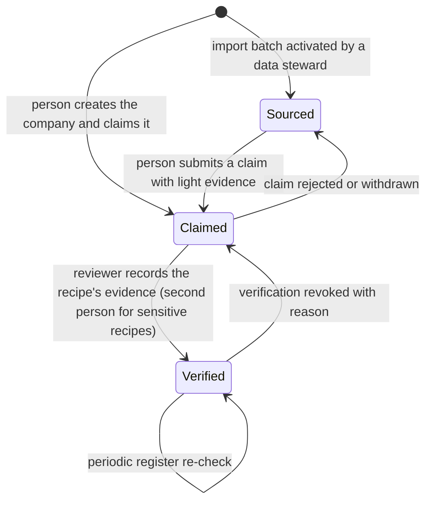

# People and companies

Module code `PCO`. Status: public reads of people and companies, company memberships (invite, accept, change, end, one active employer), company creation with a founding administrator, public handles with redirects and keyset-paginated people, company and project directories are **Live** in the API (BE-003); directories, profiles, the company page and "My page" with the public profile editor are **Demo**; company legal identifiers from country packs are **Contract**; profiles with consent and portraits, claims, registrations, licences, credentials, branches and statutory partner checks are **Proposed**. Packages: BE-001 (done), BE-003 (done), PPL-001, CLM-001, HUB-003, REG-001, PREQ-001, AGT-005. Narrative: [People and companies](../people-and-companies.md). Data: [§4 People and profiles](../../data/model.md#4-people-and-profiles), [§5 Companies](../../data/model.md#5-companies).

## Purpose

Make every professional findable through a profile that belongs to them for life, and every company findable through one honest page its people share, where sourced, claimed and verified facts always look different.

## Who uses it

Every person; company administrators and members; trust reviewers who decide claims; data stewards who import sourced records; the agent's `profile_keeper` and `compliance_checker` modules.

## User stories

| # | Story | Status |
|---|---|---|
| PCO-S1 | As a professional, I want a public profile I edit with a live preview and can switch off, so that I control what the industry sees | Demo |
| PCO-S2 | As a company owner, I want to create my company, invite colleagues and remain the last administrator, so that the page is never orphaned | Live (memberships); Proposed (creation) |
| PCO-S3 | As a supplier, I want to claim the sourced page the hub built from public records and get it verified, so that my real company is not confused with impostors | Proposed |
| PCO-S4 | As a client, I want to see which facts about a contractor came from a state licence board, which the contractor claims and which the hub verified, each with a date | Proposed |
| PCO-S5 | As a person who leaves a company, I want to keep my identity, publications and portfolio while losing company authority immediately | Live (authority); Proposed (portfolio) |
| PCO-S6 | As a subcontractor, I want my insurance certificates and licences to remind me before they expire | Proposed |
| PCO-S7 | As a company with branches in two countries, I want one legal entity with linked records on both hubs | Proposed |

## Functional requirements

| ID | Requirement | Status | Packages |
|---|---|---|---|
| PCO-F01 | A person can read and publish without belonging to any company; profile, publications, learning record and authorship survive every change of employer | Live (identity); Demo (profile) | BE-001, PPL-001 |
| PCO-F02 | "My page" (`me.title`) separates the private view (decisions, projects by role, mandates, publications, learning) from the public profile, edited with a live preview | Demo | PPL-001, WEB-004 |
| PCO-F03 | A public profile can be hidden entirely (`profileVisibility`); a hidden profile is not found in directories, search and federation | Live (reads); Demo (setting) | BE-001, PPL-001 |
| PCO-F04 | Portraits require consent and a media licence record; the engine ships no photographs; withdrawing consent unpublishes | Proposed | PPL-001 |
| PCO-F05 | Experience entries, professional credentials and portfolio entries belong to the person and can be shown independently of the current employer | Proposed | PPL-001, REP-001 |
| PCO-F06 | A person has at most one active ordinary employer; membership lifecycle `invited → active → ended` (or `declined \| expired \| withdrawn`); invitation, change and end need step-up; the last administrator cannot be removed | Live | BE-001 |
| PCO-F07 | Ending a membership revokes company-derived permissions, cached decisions and every active mandate relying on company authority in the same transaction | Live (permissions); Proposed (mandates) | BE-001, AGT-001 |
| PCO-F08 | Membership never implies commercial authority; spending and signing authority are separate proofs (`authority_proof`) | Contract | CLM-001, AST-001 |
| PCO-F09 | A person can create a company with a legal name, country and optional identifiers and becomes its founding administrator; creation registers the company unclaimed and never verified | Live (API) | BE-003 (done) |
| PCO-F10 | Company legal identifiers carry a kind code from the country pack (for example `US-EIN`, `UZ-STIR`) with format validation; an identifier never upgrades a badge | Contract | INTL-001, CLM-001 |
| PCO-F11 | Directory records exist in three visible states: **from sources**, **claimed**, **verified**; verified shows the date and the categories checked, never the documents, and never means "good" | Demo (labels); Proposed (flows) | CLM-001, HUB-003 |
| PCO-F12 | A claim answers two questions with evidence from the hub's verification recipe: who the claimant is, and what ties them to the company (domain code, register match fetched by the reviewer, signed authority letter, call-back to the registered phone) | Proposed | CLM-001, HUB-003 |
| PCO-F13 | Verification can be revoked with a reason; members are notified and every derived projection and federated replica updates | Proposed | CLM-001, FED-003 |
| PCO-F14 | Company registrations, licences and tax registrations are records with issuer, number, scope, validity and source; imported register facts stay labelled as sourced with their observed date | Proposed | CLM-001, REG-001 |
| PCO-F15 | Credentials (licences, insurance certificates, professional certificates) track expiry and remind the holder before it | Proposed | REP-001, AGT-005 |
| PCO-F16 | The statutory partner-check pack of the country (for example tax and pension status, insurance, registration that a client must check before contracting) is listed in the pack, collected once and shared per client by consent with expiry | Proposed | PREQ-001, CTRY packs |
| PCO-F17 | Company branches in several hubs are one legal entity with linked records; links never merge records | Proposed | FED-003 |
| PCO-F18 | People appear in the people directory only with a public profile; people mentioned by companies or publications appear only with consent | Live (API: public, keyset-paginated directories); Demo (screens); Proposed (consent) | BE-003 (done), PPL-001 |
| PCO-F19 | The company page shows details, wall, people who chose to appear, catalogue, projects, reputation and the external website; editing is permission-scoped | Demo | BE-003, WEB-004 |
| PCO-F20 | Follow a person or a company; following shapes feeds and notifications and is never sold or shown as a public count of followers' identities | Proposed | PPL-001 |
| PCO-F21 | Badge wording is a fixed, counsel-reviewed vocabulary; the words "certified", "licensed", "guaranteed" or "approved" appear only when bound to a register fact or a recorded accreditation | Proposed | WORD-001, CLM-001 |
| PCO-F22 | No "who viewed your profile" feature exists | Live (absence, rule) | — |

## Agent capabilities

| Capability | Kind | Mandate kind | Confirmation | Interface surface |
|---|---|---|---|---|
| `profile_keeper.get_my_profile` | read | — | `none` | My page |
| `profile_keeper.propose_profile_edit` | draft | `prepare` | `none` | My page editor |
| `profile_keeper.apply_profile_edit` | commit | `maintain_profile` | `mandate` (`ask_each` for public fields; `pre_authorized` for private fields) | My page editor |
| `profile_keeper.get_company_card` | read | — | `none` | Company page |
| `profile_keeper.propose_company_edit` | draft | `prepare` | `none` | Company page editor |
| `core.invite_member` | govern | — | `first_party_step_up` | Company → People |
| `core.accept_invitation` | govern | — | `first_party_form` | Invitation card |
| `profile_keeper.prepare_claim` | draft | `prepare` | `none` (proposal) | Company claim flow |
| `profile_keeper.submit_claim` | commit | `communicate` | `person_each` | Company claim flow |
| `compliance_checker.list_expiring` | read | — | `none` | My page → Credentials |
| `compliance_checker.prepare_renewal_evidence` | draft | `prepare` | `none` | Credentials |
| `discovery.search_people`, `discovery.search_companies` | read | — | `none` | `/people`, `/companies` |

## Interface surfaces

| Surface | Route | Status |
|---|---|---|
| People directory and profile | `/people`, `/people/[slug]` | Demo |
| Companies directory and company page | `/companies`, `/companies/[slug]` | Demo |
| My page and public profile editor | `/app/me` | Demo |
| Company workspace (details, people, representative) | `/app/company` | Demo |
| Claim and verification flow | Company page → "Claim this company" | Proposed |
| Credentials and partner-check pack | My page and Company → Compliance | Proposed |

## Hub console settings

Verification recipes and check providers (fake, manual, live), claim queue and evidence review, screening lists, credential types the hub verifies, consent and portrait records ([console: participants](../hub-console/README.md#hub-console-section-map), [hub administration](../hub-administration.md#counterparty-verification)).

## Data entities

`person_profile`, `person_preference`, `consent_record`, `media_licence`, `portrait`, `experience_entry`, `portfolio_entry`, `professional_credential`, `follow`, `bookmark`, `reading_progress` ([§4](../../data/model.md#4-people-and-profiles)); `company`, `company_private`, `company_profile`, `company_identifier`, `company_registration`, `tax_registration`, `company_branch`, `company_claim`, `company_verification`, `membership`, `authority_proof`, `ownership_declaration` ([§5](../../data/model.md#5-companies)); `verification_check`, `verification_recipe_version` ([§24](../../data/model.md#24-hubs-sources-and-verification)).

## Country and jurisdiction variations

| Facet | United States reference hub | Other examples |
|---|---|---|
| Company identifier | EIN; state entity numbers | Germany: commercial register number and VAT ID; Brazil: CNPJ; India: GSTIN and CIN; Kenya: KRA PIN |
| Company forms | LLC, corporation, partnership, sole proprietorship | GmbH, SARL, Ltda, Pvt Ltd |
| Licence registers | State contractor licence boards, state engineering boards | South Africa CIDB grades; Kenya NCA register; Japan MLIT licence search; Australia state licence checks |
| Statutory partner checks | Certificates of insurance, W-9 practice | Finland Contractor's Obligations Act reports; UK Common Assessment Standard answers |
| Claim evidence | Register officer match, domain code, signed authority letter | Qualified electronic signature on an authority letter in EU countries |

## Privacy rules

Sole proprietors are people: their records follow personal-data rules even when shown as companies. Directory imports carry a legal basis per hub; people data from sources is off by default and may make a hub a data broker in some US states (PRV-002). Documents behind a badge are never public; only categories and dates are.

## Metrics

Hub cohorts: claims submitted, decided and their age; verification revocations by reason; share of sourced pages claimed; expired credentials reminded. Participant: own profile completeness and evidence gaps.

## Edge cases

| Case | Behaviour |
|---|---|
| Two people claim the same company | Both claims queue; the reviewer decides by evidence; the losing claimant is told the outcome category, not the other claimant's identity |
| A director listed in the register is the claimant's namesake | Register match alone is insufficient; the recipe requires a second tie |
| The last administrator leaves | Blocked until another administrator is appointed; the company page stays readable |
| A sourced record is wrong | The company claims and corrects; the sourced value keeps its provenance and the correction is labelled |
| Licence expires while an agreement is running | Holder and counterparties with a legitimate interest get a status notice; existing agreements are not cancelled by the engine |

## Flow

## Open points

Default residual access to company history after employment ends (O04); signing authority as a separate proof (O05, O12); claim recipes for countries without packs.
