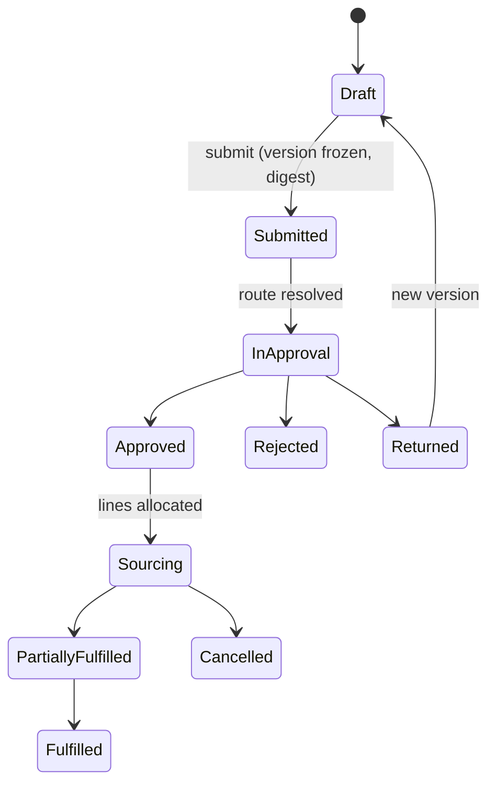

# Procurement and supply (requisition to pay)

Module code `PRC`. Status: procurement and sales lists and the decisions panel are **Demo** (`/app/procurement`); RFQ and quote versions, digests, staleness, agreements, acceptance and comparison are **Contract**; the needs-to-orders flow is **Designed** (COM-001, COM-002); the company-side procurement and supply suite (requisitions, approval routes, supplier base, sourcing events and levelling, AI document intake, equivalents, budgets and cost control, orders and call-offs, receiving, site stock, trade invoices with three-way match, payment proposals with payee protection, documents and e-invoicing networks, analytics, plan to procurement, the supply agent modules) is **Proposed** (requirement R53). Packages: COM-001, COM-002, PRC-000 … PRC-023, WEB-011, WEB-012, HUBC-011, AGT-024, PAY-001, PREQ-001. Narrative and full design: [Procurement and supply](../procurement-and-supply.md), [Buying and selling](../commerce.md). Data: [§16 Procurement](../../data/model.md#16-procurement), [§18 Transactions](../../data/model.md#18-transactions); the suite's entities are outlined in the [design's data model](../procurement-and-supply.md#data-model-and-contracts-outline) and frozen by PRC-000.

## Purpose

Give buyers one honest path from a plan step or a site request to a payment executed by a licensed provider: requisitions approved by the right people, competitive sourcing with immutable versions, documents from suppliers outside the platform turned into reviewed drafts, deliveries received offline at a muddy gate, invoices matched against what was ordered and received, payments protected against fraud, budgets that show planned, committed, actual and paid, and analytics that never rank individual employees.

## Who uses it

Homeowners and small owners (only the simple path: plan items become RFQs or tasks directly), small contractors (requisitions without routes), general contractors and developers with several sites (the full suite), public clients, suppliers on the other side; site engineers, foremen, storekeepers, buyers, approvers, accounts-payable staff; the supply agent modules (requisition desk, sourcing desk, intake, receiving clerk, payables desk; AGT-024) and the `need_intake`, `procurement` and `public_tender_desk` modules.

## User stories

| # | Story | Status |
|---|---|---|
| PRC-S1 | As a foreman, I want to photograph a handwritten list of materials and have it become a requisition draft I confirm | Proposed |
| PRC-S2 | As a project manager, I want requisitions above USD 25,000 to need the commercial director's approval, and nothing approved by silence | Proposed |
| PRC-S3 | As a buyer, I want to merge three requisitions into one RFQ, invite eligible suppliers, level the bids exactly with exclusions visible, and award by line | Proposed (RFQ and quote versions Contract) |
| PRC-S4 | As a buyer, I want a supplier's PDF quote turned into a captured quote with confidence per field, which I review before it counts | Proposed |
| PRC-S5 | As a storekeeper without signal, I want to record a partial delivery with photos offline | Proposed |
| PRC-S6 | As accounts payable, I want invoices matched against orders and receipts, duplicates caught, and payments to changed bank details held | Proposed |
| PRC-S7 | As a project owner, I want my budget to show planned, committed, actual and paid per cost code | Proposed |
| PRC-S8 | As a supplier, I want to see when my invoice is approved and when it will be paid | Proposed |
| PRC-S9 | As a buyer of a public body, I want the anti-splitting guard to stop me from dividing a purchase below a threshold | Proposed |

## Functional requirements

| ID | Requirement | Status | Packages |
|---|---|---|---|
| PRC-F01 | Needs are clarified (scope, quantity, unit, location, schedule, acceptance) with evidence from files, e-mail or conversation before solicitation; parsing never grants authority or contacts anyone | Designed | COM-001, AGT-008 |
| PRC-F02 | RFQs have immutable published versions with digests; buyer-private constraints are separate; invitations pin the exact version; amendments flag earlier invitations and quotes stale | Contract | COM-001 |
| PRC-F03 | Comparison shows exclusions and non-comparable scope, pins quotes to the current RFQ version, uses dated exchange-rate snapshots for mixed currencies, and shows no ranking in historical mode | Contract | COM-002 |
| PRC-F04 | Agreements pin quote and RFQ versions by digest; buyer and seller acceptances are separate events; orders need authority and an atomic transaction-budget reservation | Contract | COM-002 |
| PRC-F05 | Plan to procurement: plan steps of kind material or purchase produce takeoffs (estimates until confirmed), demand schedules from plan dates minus known lead times, and requisitions keeping plan-item keys and step terms; approved plan changes flag linked requisitions, RFQs and orders `stale_reason: plan_changed` | Proposed | PRC-015 |
| PRC-F06 | Requisitions are versioned internal requests (form, spreadsheet template, photo or voice note through the agent, takeoff, reorder suggestion) with lines, priority, needed-by date, location, cost code and plan item; lifecycle `draft → submitted → in_approval → approved \| rejected \| returned`, then `sourcing → partially_fulfilled → fulfilled \| cancelled` | Proposed | PRC-002 |
| PRC-F07 | Allocation of approved lines to stock transfers, framework call-offs, new or existing RFQs, or direct orders from agreed offerings; merges keep line-level traceability for the requester | Proposed | PRC-002 |
| PRC-F08 | Approval routes per company: subject kinds (requisition, award, order, order change, trade invoice, payment proposal, document, substitution, budget change, payee change, supplier status), ordered or parallel steps with conditions and selectors, quorum, delegation within one's rights, escalation on timeout; nothing approved by silence | Proposed | PRC-001 |
| PRC-F09 | Segregation of duties no route can switch off: the requester never approves their own subject; whoever changed payee details never approves a payment to that payee; the receiver never alone approves the matching invoice above a threshold; a proposal's preparer never alone approves it; one-person companies get a warning and an audit flag | Proposed | PRC-001 |
| PRC-F10 | Every approval request binds the subject version and digest; decisions are append-only; a material change supersedes the request | Proposed | PRC-001 |
| PRC-F11 | A private supplier base: records linked to platform companies, sourced records or external counterparties; statuses, notes, assessments and blocks never reach the supplier, search, reputation, federation or statistics | Proposed | PRC-003 |
| PRC-F12 | Supplier onboarding checklists from country-pack document types; prequalification passport sections shared by consent; expiry can block payment where the route says so | Proposed | PRC-003, PREQ-001 |
| PRC-F13 | Sourcing events: invitation lists from the supplier base, matching and opted-in broadcast with eligibility pass, fail, unknown; optional sealed bids until the deadline (part of the published version) | Proposed | PRC-004 |
| PRC-F14 | Bid levelling sheets are buyer-private, versioned, exact; buyer adjustments are labelled estimates and never alter a quote; stale versions are non-comparable; split awards by line through the approval route | Proposed | PRC-004 |
| PRC-F15 | Outcome notices to every invitee; with the buyer's opt-in, not-awarded suppliers see a band and a reason category after award, never another bidder's name or price | Proposed | PRC-004 |
| PRC-F16 | AI document intake: arrival from upload, forwarded mail, e-document networks, photos or the API; deduplication before extraction; deterministic parsing of structured e-documents; extraction with confidence and locator per field; egress only as the hub allows; line matching; unit normalization with cited conversions; discrepancies; human review; no threshold lets intake approve, pay, order or change anything | Proposed | PRC-005 |
| PRC-F17 | Equivalence rules cite their basis; equivalent is not approved; substitutions need evidence and the approval route, and the designer of record where one exists; approved equals carry scope and expiry | Proposed | PRC-006 |
| PRC-F18 | Project budgets per cost code show planned, committed, actual, forecast (labelled estimate) and paid; warnings at configurable thresholds; the hard stop stays the atomic reservation; budget increases go through the route | Proposed | PRC-007 |
| PRC-F19 | Framework agreements with call-offs that cannot exceed the remaining quantity or value; external orders for off-platform suppliers that never count as platform transactions or reputation | Proposed | PRC-002 |
| PRC-F20 | Goods receipts per line (received, accepted, rejected, discrepancy type, photos), partial deliveries, offline capture with device and server times, receipts distinct from quality acceptance | Proposed | PRC-008 |
| PRC-F21 | Delivery coordination: site logistics profiles revealed only to suppliers with accepted orders, delivery slots, site resource booking without double booking, just-in-time call-offs | Proposed | PRC-016 |
| PRC-F22 | Site stock: locations, items, append-only movements, transfers that can satisfy requisitions, reorder points that only draft; no per-person loss reports | Proposed | PRC-009 |
| PRC-F23 | Trade invoices with immutable issued versions, credit notes, tax determinations; two-, three- and four-way match with versioned tolerances; exceptions to people; duplicate detection before match; supplier-visible status and dates | Proposed | PRC-010 |
| PRC-F24 | Payment proposals approved by digest become instructions executed only through a licensed provider or recorded as paid outside with evidence; never above the open amount; the engine never holds funds | Proposed | PRC-011, PAY-001 |
| PRC-F25 | Payee protection: provider tokens instead of bank data; payee changes only by the supplier's verified company with a second factor; out-of-band callback; cooling-off; separation; risk signals that block approval until cleared; business-email-compromise warnings; payment release never pre-authorizable for a recently changed payee | Proposed | PRC-011 |
| PRC-F26 | Document types and requirement sets are country-pack data; completeness can gate approvals; e-document exchange through network adapters with a neutral UBL 2.1 serializer and a fake access point | Proposed | PRC-012 |
| PRC-F27 | Accounting, ERP and project-tool exports and imports through adapters with fakes; imports create private records only; unknown export outcomes reconciled | Proposed | PRC-013, INTEG-001 |
| PRC-F28 | Analytics from the company's own records only; team-level throughput with a minimum group size; "my work" visible only to the person; no individual rankings | Proposed | PRC-014 |
| PRC-F29 | Ideas: price indices and escalation alerts; warranty registration flowing into the home passport; anonymized price benchmarks and lead-time signals (opt-in, off by default, counsel sign-off); embodied carbon from EPDs; surplus and returns exchange; opt-in demand pooling (purchasing only) | Proposed | PRC-017 … PRC-022 |
| PRC-F30 | Every operation is a capability registry entry with interface and agent paths; approvals, acceptance of delivered goods and clearing payment risk signals are confirmed by a person each time | Proposed | PRC-023, AGT-024 |
| PRC-F31 | Public clients: market sounding, specification drafts, equal-treatment clarifications and the anti-splitting guard; submission to an official portal and award decisions stay with people | Proposed | AGT-009, PROC-001 |
| PRC-F32 | A homeowner never sees requisitions or approval routes; their plan items become RFQs or tasks directly | Proposed | PLAN-001, TASK-001 |

## Agent capabilities

Contract-valid identifiers (`<module>.<operation>`) for the operations listed in the design's [agent parity table](../procurement-and-supply.md#agent-parity-every-operation-is-an-agent-capability); the design's dotted names map one to one (see [conflicts to resolve](../conflicts-to-resolve.md), C15).

| Capability | Kind | Mandate kind | Confirmation | Interface surface |
|---|---|---|---|---|
| `procurement.list_documents` | read | — | `none` | Lists and detail pages |
| `requisition_desk.draft_requisition` | draft | `prepare` | `none` | Requisition form |
| `requisition_desk.submit_requisition` | commit | `communicate` | `mandate` (`ask_first(5)`) | Submit |
| `procurement.decide_approval` | commit | `approve` (proposed verb) | `person_each` | Decision card |
| `requisition_desk.allocate_requisition` | commit | `maintain_records` (proposed verb) | `mandate` (`ask_first(5)`) | Sourcing board |
| `procurement.maintain_supplier` | commit | `maintain_records` (proposed verb) | `mandate` (`ask_first(5)`; blocking `ask_each`) | Supplier base |
| `sourcing_desk.draft_rfq` | draft | `prepare` | `none` | Sourcing event editor |
| `sourcing_desk.publish_rfq` | commit | `publish` | `mandate` (`ask_each`) | Publish |
| `sourcing_desk.remind_suppliers` | commit | `communicate` | `mandate` (`pre_authorized` within quota, template wording) | Event page |
| `sourcing_desk.level_bids` | draft | `prepare` | `none` | Levelling sheet |
| `sourcing_desk.propose_award` | commit | `prepare` | `mandate` (`ask_each`) | Award form |
| `sourcing_desk.execute_award` | commit | `place_order` | `mandate` (`ask_above(amount)`; budget reservation) | Execute award |
| `document_intake.submit_document` | draft | `prepare` | `none` | Intake inbox |
| `document_intake.accept_review` | commit | `maintain_records` (proposed verb) | `person_each` for quotes and invoices; `mandate` (`ask_first(5)`) for delivery notes | Review queue |
| `procurement.place_order` | commit | `place_order` | `mandate` (`ask_above(amount)`; budget reservation) | Order form |
| `receiving_clerk.record_receipt` | commit | `record_evidence` | `mandate` (`ask_first(5)`) | Receiving (offline) |
| `receiving_clerk.accept_delivered_goods` | commit | `confirm_execution` | `person_each` | Acceptance form |
| `receiving_clerk.move_stock` | commit | `maintain_records` (proposed verb) | `mandate` (`ask_first(5)`; write-offs `ask_each`) | Stock page |
| `payables_desk.clear_risk_signal` | commit | `approve` (proposed verb) | `person_each` | Risk panel |
| `payables_desk.prepare_payment_proposal` | draft | `prepare` | `none` | Payments page |
| `payables_desk.release_payments` | commit | `release_payment` (proposed verb) | `mandate` (`ask_each`) | Release |
| `core.change_payee` | govern | — | `first_party_step_up` (supplier side, second factor) | Company billing settings |

## Interface surfaces

| Surface | Route | Status |
|---|---|---|
| Procurement list and decisions | `/app/procurement` | Demo |
| Requisitions, approvals, supplier base, sourcing and levelling | `/app/requisitions`, `/app/approvals`, `/app/suppliers`, `/app/sourcing` | Proposed (WEB-011) |
| Receiving (mobile, offline), stock, invoices, payments, budgets, analytics | `/app/receiving`, `/app/stock`, `/app/invoices`, `/app/payments`, budgets and analytics pages | Proposed (WEB-012) |
| Console procurement settings | `/admin/hubs/[hub]/modules/procurement` | Proposed (HUBC-011) |

## Hub console settings

Route templates, document types and requirement-set templates per country, extraction adapters and model routes per data class, confidence and tolerance defaults, e-invoicing network connections, benchmark and pooling switches with counsel sign-off, cooling-off defaults ([design: hub console coverage](../procurement-and-supply.md#hub-console-coverage)).

## Data entities

`need`, `need_line`, `rfq`, `rfq_version`, `rfq_private_constraint`, `rfq_invitation`, `rfq_clarification`, `supplier_candidate`, `evaluation` ([§16](../../data/model.md#16-procurement)); `agreement`, `order`, `order_change`, `obligation` ([§18](../../data/model.md#18-transactions)); the suite adds requisitions, approval routes and decisions, supplier records, levelling sheets, intake documents, equivalence rules, budget lines and cost entries, receipts, stock, trade invoices, payment proposals and instructions, risk signals and documents ([outline](../procurement-and-supply.md#data-model-and-contracts-outline), PRC-000).

## Country and jurisdiction variations

Document types (US vendor tax forms, certificates of insurance, lien waivers; EU declarations of performance; Mexico's CFDI; Brazil's NF-e; India's e-invoice registration and e-way bills), e-invoicing mandates and networks, public procurement thresholds for the anti-splitting guard, tax determination, payment rails and retention of procurement records come from packs; every fact is sourced and carries its verification level.

## Privacy rules

Budgets, ceilings, cost codes, levelling sheets, award reasons, supplier notes, blocks, stock and invoices never reach other parties, staff without a case grant, search, notifications, exports, other hubs, federation or other agents. Suppliers see only their own invoices' status and dates. Analytics never rank individuals.

## Metrics

Company's own: cycle times, spend against budget, on-time receipt rates, match exceptions, invoice cycle; team-level throughput above a minimum group size; "my work" for each person privately.

## Edge cases

| Case | Behaviour |
|---|---|
| A supplier's invoice asks to pay a new account | Untrusted text; a bank-detail change warning; only the supplier's verified company can change payee details |
| Two call-offs race against the last framework quantity | Serialized like budget reservations; the second fails and becomes a decision |
| A receipt syncs a day late | Both device and server times shown; timing evidence uses the server time unless a person confirms the device time |
| An approver leaves the company mid-route | Delegations end with membership; the step escalates to the next selector |
| An external supplier later joins and claims its page | The buyer may link the record; nothing private moves into the public projection |

## Flow

See the [suite at a glance](../procurement-and-supply.md#the-suite-at-a-glance) diagram; the requisition lifecycle:

## Open points

The design's [open questions](../procurement-and-supply.md#open-questions-for-the-owner); proposed mandate verbs and capability naming ([conflicts to resolve](../conflicts-to-resolve.md), C13 and C15).
