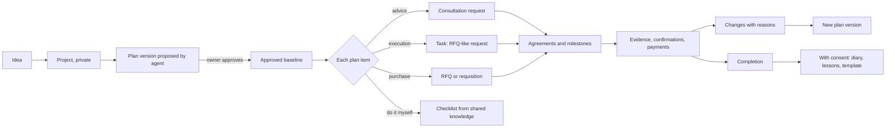

# Projects and plans (from plan to people)

Module code `PLN`. Status: create, read, leader, publish, ownership transfer with consent and participants are **Live** in the API; public project pages and the workspace project view with a plan tab (baseline and changes) are **Demo**; baselines, plan changes and dependencies are **Designed**; versioned plans, plan items, sharing per item, the open plan-step taxonomy, permits, diaries, templates and the planner agent are **Proposed** ([ADR 010](../../adr/010-gathering-point-hubs-agents-and-mesh.md) decision 17). Packages: BE-001 (done), PLAN-000, PLAN-001, PLAN-003, PRMT-001, AGT-010, AGT-021, WEB-007, HOME-001. Narrative: [Projects](../projects.md), [flagship journey](../agent-catalog.md#flagship-journey-from-plan-to-people). Data: [§7 Projects and plans](../../data/model.md#7-projects-and-plans); states in [lifecycles](../../data/lifecycles.md#plans-and-plan-items).

## Purpose

A project is where work happens, and a plan is what turns an idea into requests to people. Anyone launches a project (a house, a roof, a school facade); their agent drafts a clear plan in plain language; the owner approves versions; plan items become consultations with experts, scoped tasks for trades, RFQs or do-it-yourself checklists; progress and changes are recorded with reasons so that nobody is blamed retroactively.

## Who uses it

Homeowners and clients (private, company and public), developers, general contractors, design offices, project leaders and participants; experts and trades invited to items; the `project_planner`, `plan_step_companion`, `project_desk` and `execution_clerk` agent modules; hub editors who curate planner templates.

## User stories

| # | Story | Status |
|---|---|---|
| PLN-S1 | As a homeowner, I want to own a renovation project personally and invite a contractor's company and an independent engineer, so that the project stays mine whoever I hire | Live |
| PLN-S2 | As a homeowner in San Diego County, I want my agent to draft a plan for building a 2,000 sq ft house with phases, trades, permits, budget ranges, risks and decisions, so that I understand what lies ahead | Proposed |
| PLN-S3 | As an owner, I want to approve plan versions and never see an approved version silently edited | Proposed |
| PLN-S4 | As an owner, I want to share one plan item with invited contractors, showing scope and drawings but not my budget or address | Proposed |
| PLN-S5 | As a contractor, I want a client-caused change recorded with its reason, so that my timing reputation is fair | Designed |
| PLN-S6 | As a public client, I want to publish selected milestones and open needs of a project without exposing budgets | Demo (milestones); Proposed (needs) |
| PLN-S7 | As a homeowner, I want the plan to tell me which permits and inspections my county usually requires, and to say "ask your building department" when it does not know | Proposed |
| PLN-S8 | As a small developer, I want to start from a plan template another owner shared after completing a similar project | Proposed |

## Functional requirements

| ID | Requirement | Status | Packages |
|---|---|---|---|
| PLN-F01 | A project has exactly one owner, a person or a company (database XOR); creator and leader are distinct from the owner | Live | BE-001 |
| PLN-F02 | A new project is private; participants see it by participation (capabilities, side, audience, validity); revocation takes effect immediately | Live | BE-001 |
| PLN-F03 | Publishing creates an allowlisted public projection chosen field by field; budgets, quotes, agreements, files and correspondence are never public | Live | BE-001 |
| PLN-F04 | Ownership transfer is consented and audited (`proposed → accepted_by_recipient → effective`, or `rejected \| expired \| withdrawn`); every step needs step-up and an idempotency key | Live | BE-001 |
| PLN-F05 | Participants see shared milestones without budgets; the budget tab exists only for the owner | Live (projection); Demo (tab) | BE-001 |
| PLN-F06 | A project has at most one plan; a plan has versions `draft → proposed → approved → superseded`; a proposed version is frozen and digest-bound; only the owner or a person the owner authorized approves; an agent proposes only under a mandate | Proposed | PLAN-001 |
| PLN-F07 | Plan items have a kind (`phase`, `task`, `milestone`, `consultation`, `purchase`, `material`, `permit`, `inspection`, `decision`, `risk`, `self`), a stable key across versions and plan-step taxonomy terms | Proposed | PLAN-001 |
| PLN-F08 | The plan-step taxonomy is open data under CC0 1.0 with predecessor relations and crosswalk slots to IFC and ETIM; proprietary classifications are licensed hub data and never ship in the repository | Proposed | PLAN-000 |
| PLN-F09 | Item execution state (`proposed`, `accepted`, `requested`, `in_progress`, `done`, `blocked`, `cancelled`, `skipped`) lives beside the frozen version; linking a request never edits the plan | Proposed | PLAN-001 |
| PLN-F10 | Dependencies (finish-to-start, start-to-start, finish-to-finish, start-to-finish, with lags) stay acyclic | Designed | PLAN-001 |
| PLN-F11 | A plan change records what changed, why, who asked, which agreement covers it and who is accountable; timing reputation measures against the plan as agreed at the time | Designed | PLAN-001, EXE-001 |
| PLN-F12 | Plan sharing is per item and per audience (`public`, `invited`, `after_acceptance`) listing exact fields; address, contact and site-access notes only after acceptance | Proposed | PLAN-001 |
| PLN-F13 | Budget ranges name their basis and use only cost data the hub licensed for display and model use, plus the owner's own quotes; never other participants' private quotes | Proposed | PLAN-001, AGT-010 |
| PLN-F14 | Permits and inspections usually required in the jurisdiction come from country-pack facets and hub configuration; unknown stays unknown; the engine never files permits | Proposed | PLAN-001, PRMT-001 |
| PLN-F15 | Permit records keep type, authority, number, dates and inspection results; public permit data imported as sourced records links to companies, never names homeowners | Proposed | PRMT-001 |
| PLN-F16 | From a plan item the owner creates a consultation request, a task, an RFQ, a purchase requisition or a do-it-yourself checklist; each pre-fills from the item and shows the projection before it leaves | Proposed | CONS-001, TASK-001, COM-001, procurement suite, KNOW-001 |
| PLN-F17 | The plan is advice, not professional engineering or legal advice, and says so; where a licensed professional is legally required the plan creates a consultation or task for one | Proposed | AGT-010 |
| PLN-F18 | A private project diary is kept while the project runs; it reaches shared knowledge only by the owner's consent at the end, field by field | Proposed | PLAN-001, KNOW-001 |
| PLN-F19 | Planner templates per project type and country are curated hub content with expert authors and reviewers; owners may start from a template | Proposed | PLAN-003 |
| PLN-F20 | Re-planning is triggered by recorded changes, received quotes and failed inspections, producing a new draft version for the owner | Proposed | AGT-010 |
| PLN-F21 | A published project can announce open needs that feed matching; a need links to an RFQ only when the owner publishes one | Proposed | MATCH-001 |
| PLN-F22 | Portfolio participation: a participant shows the project in a portfolio with the owner's consent and keeps that line after the project ends | Proposed | REP-001 |
| PLN-F23 | Site location and cadastral reference are optional and owner-private; the public page shows only region or city | Proposed | PLAN-001 |
| PLN-F24 | Subsidy and incentive programmes that apply to a step (for example energy-renovation programmes) appear as country-pack facts with source and date, never as eligibility decisions | Proposed | CTRY packs, REC-001 |
| PLN-F25 | A home passport records what was installed, by whom, with which warranty and maintenance reminders, and can be transferred to a new owner with consent | Proposed | HOME-001 |
| PLN-F26 | Milestone payment templates propose progress payments by milestone with deposit limits and cancellation rights from the country or state pack | Proposed | HOME-001, PAY-002 |

## Agent capabilities

| Capability | Kind | Mandate kind | Confirmation | Interface surface |
|---|---|---|---|---|
| `project_planner.create_project` | commit | `prepare` | `mandate` (`ask_each`) | Projects → New |
| `project_planner.get_project` | read | — | `none` | `/app/projects/[id]` |
| `project_planner.publish_projection` | commit | `publish` | `mandate` (`ask_each`) | Project → Publish |
| `project_planner.grant_participation` | govern | — | `first_party_form` | Project → Participants |
| `project_planner.propose_transfer` | govern | — | `first_party_step_up` | Project → Ownership |
| `project_planner.draft_plan` | draft | `prepare` | `none` | Project → Plan |
| `project_planner.propose_version` | draft | `prepare` | `none` (proposal) | Plan → Versions |
| `project_planner.approve_version` | govern | — | `first_party_form` | Plan → Versions |
| `project_planner.record_change` | commit | `record_evidence` | `mandate` (`ask_each`) | Plan → Changes |
| `project_planner.share_item` | commit | `publish` | `mandate` (`ask_each`; `ask_first(3)` once trusted) | Plan item → Share |
| `project_planner.create_request_from_item` | draft | `prepare` | `none` | Plan item → "Get help" |
| `plan_step_companion.list_step_recommendations` | read | — | `none` | Plan item → Recommendations |
| `project_planner.update_item_state` | commit | `record_evidence` | `mandate` (`pre_authorized` for reminders and state; `ask_each` for `done` on consumer projects) | Plan board |

## Interface surfaces

| Surface | Route | Status |
|---|---|---|
| Public projects directory and project page | `/projects`, `/projects/[slug]` | Demo |
| Workspace projects list and project view | `/app/projects`, `/app/projects/[id]` | Demo |
| Plan tab: versions, items board, timeline, budget (owner only), changes | `/app/projects/[id]/plan` | Demo (tab); Proposed (editor, WEB-007) |
| Plan item drawer: share, get help, recommendations, diary | Plan → item | Proposed |
| Planner templates gallery | Plan → "Start from a template" | Proposed |

## Hub console settings

Project publication policy, transfer and dispute queues, planner templates per country and project type with expert authors and reviewers, plan-step category extensions, consultation and task marketplace categories ([console: projects, planner, marketplace](../hub-console/modules.md#plan-to-people)).

## Data entities

`project`, `ownership_transfer`, `leadership_assignment`, `project_location`, `plan`, `plan_version`, `plan_item`, `plan_dependency`, `plan_item_state`, `plan_change`, `plan_share`, `permit_record`, `project_diary_entry`, `project_public_participant`, `project_template` ([§7](../../data/model.md#7-projects-and-plans)); `taxonomy_term`, `step_term_relation`, `taxonomy_release` ([§2](../../data/model.md#2-platform-kernel)); `object_participation` ([§6](../../data/model.md#6-access)).

## Country and jurisdiction variations

Permit types and authorities (US county and city building departments; German Bauamt procedures; India's municipal approvals), typical inspections and their order, units (US customary alongside metric), climate and seismic facets, holidays for timelines, consumer rules for home-improvement contracts (deposit caps, cancellation rights), cadastral identifier formats and subsidy programmes come from country packs and hub configuration. Unknown values stay unknown.

## Privacy rules

Projects and plans are `owner_private` by default; budgets never reach participants, invitees, staff without a case grant, search, notifications, exports, other hubs or agents of other parties. Each request leaving a plan is a projection the owner reviews. Diaries stay private until consent. Addresses never appear publicly.

## Metrics

Owner: plan progress, decisions due, budget against ranges (private). Hub cohorts: plans created and approved, items turned into requests by kind, share of consultations and tasks completed, template reuse. Never: individual owners' budgets or addresses in any aggregate below the cohort minimum.

## Edge cases

| Case | Behaviour |
|---|---|
| The owner edits while a version is proposed | Edits create a new draft; the proposed version stays frozen |
| A dependency would create a cycle | Rejected with the cycle path explained |
| An invited contractor forwards a shared item | Projections limit what was shared; the share can be revoked; forwarded copies are outside the platform and the owner is told so before sharing |
| The owner sells the house mid-project | Ownership transfer with recipient consent; the home passport transfers only with consent; agreements stay with their parties |
| Budget data licence expires | Ranges based on it are marked stale and recomputed only from still-licensed data |
| The planner proposes a step that requires a licence the hub cannot check | The item says "licensed professional required; check status unknown in this hub" |

## Flow

## Open points

Budget-range data sources per hub (licensing); how far permit facets can be sourced per country; see [conflicts to resolve](../conflicts-to-resolve.md) for the requisition entry point shared with the procurement suite.
