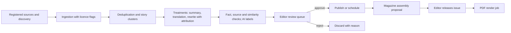

# News, articles, magazine and the autonomous editorial office

Module code `PUB`. Status: news and articles with sources, rubrics, topics and RSS feeds, the magazine with numbered issues, reader, archive and rubric pages are **Demo**; the publication model, versions, authorship, corrections and the issue model are **Contract**; the editorial workflow and the magazine PDF pipeline are **Designed**; the hub source registry, the autonomous editorial office with story clusters, AI provenance labels, multilingual linked editions, community features, cross-hub digests and the ActivityPub bridge are **Proposed** (R15–R18, R45). Packages: CNT-001, CNT-003, SRC-001, PIPE-001, EDIT-001, PROV-001, MAT-001, KNOW-001, FED-006, HUBC-003. Narrative: [News, articles and walls](../publishing.md), [The weekly magazine](../magazine.md), [Autonomous editorial office](../hub-console/autonomous-editorial.md), [The editorial office](../editorial-office.md) (complete design, including the editorial agent team; packages SRC-002, TRN-001, CNT-004, CNT-005, MEDIA-001, EDIT-002, HUBC-012). Data: [§10 Content](../../data/model.md#10-content), [§11 Magazine](../../data/model.md#11-magazine).

## Purpose

Content is what brings people back every day. The engine treats it with the discipline of a good newsroom (named sources, honest dates, visible corrections, authorship separate from editing rights) and lets a small hub run a credible desk with an AI-assisted editorial office in which no pipeline ever publishes by itself.

## Who uses it

Readers (everyone), authors (practitioners, experts, companies), editors and the editor-in-chief, moderators, the hub's editorial office; the `content_writer`, `editorial_desk` and `translation` agent modules.

## User stories

| # | Story | Status |
|---|---|---|
| PUB-S1 | As a reader, I want every news item to name its source and both the event time and the publication time | Demo |
| PUB-S2 | As a reader, I want corrections shown on every wall and magazine issue that references the corrected article | Contract |
| PUB-S3 | As an editor-in-chief of a small hub, I want the editorial office to discover sources, draft summaries with attribution, translate and assemble the weekly issue, while I approve everything | Proposed |
| PUB-S4 | As a reader, I want to download the weekly magazine as a properly laid-out PDF | Designed |
| PUB-S5 | As an author, I want my publications to stay mine when I change employer | Live (identity); Contract (authorship) |
| PUB-S6 | As a reader in a Spanish-speaking household in San Diego, I want the Spanish edition when it exists and a clear "original in English" label otherwise | Proposed |
| PUB-S7 | As a reader, I want to know whether text, a translation or an image was produced with AI | Proposed |

## Functional requirements

| ID | Requirement | Status | Packages |
|---|---|---|---|
| PUB-F01 | One store for all publications (news, articles, posts, announcements, knowledge formats) with format, article format (rubric), topics, entity links, authorship, editors and immutable versions | Contract | CNT-001 |
| PUB-F02 | News names its source (name, link, type) and keeps event time and publication time separately | Demo | CNT-001 |
| PUB-F03 | Walls reference publication versions, never copies; corrections propagate as notices everywhere | Contract | CNT-001 |
| PUB-F04 | Lifecycle `draft → in_review (when policy requires) → scheduled \| published → corrected \| retracted`; corrections create versions with a reader-visible note; retraction keeps an explanatory record | Contract | CNT-001 |
| PUB-F05 | Editorial workflow: board by state, review and return, schedule and embargo, correct, retract (editor-in-chief), hold pending moderation (case required), fix topics and entity links without touching the body | Designed | CNT-001, HUBC-003 |
| PUB-F06 | Authorship credit and editing rights are separate records | Contract | CNT-001 |
| PUB-F07 | Magazine issues have number, date, theme, cover, editor's letter and ordered items pinned to publication versions in rubric and service sections; released issues are frozen; corrections create issue revisions with a banner | Contract (model); Demo (reading) | CNT-001, CNT-003 |
| PUB-F08 | The PDF is a separate artifact with its own layout produced by a render job from a released revision, with recorded hash and source revision | Designed | CNT-003 |
| PUB-F09 | RSS or Atom feeds for news, articles and the magazine | Demo | CNT-003 |
| PUB-F10 | Hub source registry with kind, licence and allowed uses (headline and link, summary, full text, index, model egress, syndication), attribution template, takedown contact, cadence and observed-at semantics | Proposed | SRC-001 |
| PUB-F11 | Imported items arrive as drafts in a review queue and are never published automatically; an agent may draft a summary, an editor publishes | Proposed | SRC-001, EDIT-001 |
| PUB-F12 | The autonomous editorial office: source discovery with licence, robots and terms checks; ingestion; deduplication; story clusters; translation; rewriting with attribution and plagiarism safeguards (similarity thresholds); fact and source checks; labelled AI images; calendar; magazine assembly proposals; per-source and per-pipeline costs and caps | Proposed | EDIT-001, PIPE-001 |
| PUB-F13 | No pipeline publishes; publication, source activation and price activation are human gates at every automation level | Proposed | EDIT-001, HUBC-000 |
| PUB-F14 | AI provenance: text, translations and images produced or assisted by a model carry a visible label and machine-readable provenance (for example C2PA for images) | Proposed | PROV-001 |
| PUB-F15 | Multilingual linked editions with their own versions and translator credit; machine-assisted translations are labelled drafts until a person reviews them | Proposed | CNT-001, EDIT-001 |
| PUB-F16 | Follow authors, companies, topics and regions; save and reading progress; comments off by default and under community rules; expert answers as publications | Proposed (follow, comments); Demo (saves, progress) | CNT-001, PPL-001 |
| PUB-F17 | Cross-hub digests reference items from other hubs' released issues, pinned to home node, version and licence; items not licensed for redisplay appear as headline and link | Proposed | FED-002 |
| PUB-F18 | An outbound-only ActivityPub actor per hub publishes publications, magazine issues and public events; no inbound social content in the first version | Proposed | FED-006 |
| PUB-F19 | A source licensed only for display is never sent to a model provider or syndicated | Proposed | SRC-001 |
| PUB-F20 | Sponsored content, if a hub enables it (off by default), is labelled and kept out of ranking, matching, recommendations and the magazine's editorial sections | Proposed | EDIT-001, REC-001 |
| PUB-F21 | The personalized intelligence journal stays an open opportunity until the owner decides audience, sources, cadence, sample policy and billing; it never monitors employees | Open (O02) | — |
| PUB-F22 | Takedown requests remove items and propagate tombstones to indexes and peers | Proposed | SRC-001, FED-002 |

## Agent capabilities

| Capability | Kind | Mandate kind | Confirmation | Interface surface |
|---|---|---|---|---|
| `core.search_content` | read | — | `none` | `/news`, `/articles`, `/search` |
| `content_writer.draft_publication` | draft | `prepare` | `none` | `/app/publications` |
| `content_writer.submit_for_review` | commit | `publish` | `mandate` (`ask_each`) | Publication editor |
| `content_writer.publish` | commit | `publish` | `mandate` (`ask_each`; hubs may forbid pre-authorization per format) | Publication editor |
| `content_writer.propose_correction` | draft | `prepare` | `none` | Publication |
| `translation.draft_translation` | draft | `prepare` | `none` | Translations |
| `core.follow` | commit | `maintain_profile` | `mandate` (`pre_authorized`) | Follow buttons |
| `editorial_desk.triage_source_items` | draft | `prepare` | `none` | Editorial review |
| `editorial_desk.propose_issue_assembly` | draft | `prepare` | `none` | Magazine |

## Interface surfaces

| Surface | Route | Status |
|---|---|---|
| Home feed, news, articles, rubric and topic filters | `/`, `/news`, `/news/[slug]`, `/articles`, `/articles/[slug]` | Demo |
| Magazine home, issue, reader, archive, rubric pages | `/magazine`, `/magazine/[issue]`, `/magazine/[issue]/read`, `/magazine/archive`, `/magazine/rubric/[key]` | Demo |
| Author workspace | `/app/publications` | Demo |
| Editorial office (desk, sources, discovery, pipelines, review, calendar, magazine, translations, policy) | `/admin/hubs/[hub]/editorial` | Proposed (HUBC-003) |
| PDF download | Issue page | Designed |

## Hub console settings

Editorial policy, review rules per format and author type, AI-assistance and AI-image labelling, similarity thresholds, source registry, discovery, pipelines with models and caps, review queue, calendar, magazine release checklist and PDF renders, translations queue ([editorial office](../hub-console/autonomous-editorial.md)).

## Data entities

`publication`, `publication_version`, `publication_authorship`, `correction`, `publication_topic`, `entity_link`, `edition_link`, `wall_reference`, `comment` ([§10](../../data/model.md#10-content)); `issue`, `issue_revision`, `issue_item`, `render_artifact`, `magazine_digest` ([§11](../../data/model.md#11-magazine)); `source`, `pipeline`, `pipeline_run`, `import_batch`, `source_item` ([§24](../../data/model.md#24-hubs-sources-and-verification)).

## Country and jurisdiction variations

Copyright and quotation rules, press and media law (right of reply, imprint duties), AI-content labelling duties (EU AI Act Article 50; emerging US state laws), text-and-data-mining opt-outs, defamation thresholds, building-code citation rules and languages per hub come from packs and hub legal settings.

## Privacy rules

People named in publications follow consent rules; comments are signed-in only; reading progress and follows are private; no tracking pixels in shares or feeds.

## Metrics

Hub cohorts: items published per format, time from import to decision, corrections, pipeline cost per published item, similarity flags. Never invented readership numbers; measured readership only where the hub enables privacy-preserving counts.

## Edge cases

| Case | Behaviour |
|---|---|
| Two sources report the same event differently | Story cluster with both sources; the editor writes one item citing both |
| A model draft exceeds the similarity threshold | Blocked from review until rewritten; reason shown |
| A licence changes after import | Allowed uses update; items using now-forbidden uses are withdrawn from those uses |
| A correction to an article in a released issue | New issue revision with a banner; the old PDF stays traceable |

## Flow

## Open points

The personalized journal (O02); default comment policy for the reference hub.
