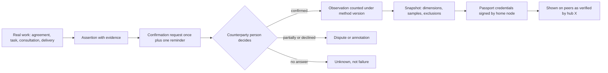

# Reputation builder and passport

Module code `REP`. Status: assertions and confirmations are **Contract**; reviews, disputes and explainable reputation snapshots are **Designed** (EXE-001); credentials, the evidence portfolio, confirmation requests, contributions, timeliness and automated limitations with appeals are **Live** in the API (REP-001; no public score, no interface yet); coaching, the portable passport, review-integrity controls and the worker credential card are **Proposed** ([ADR 010](../../adr/010-gathering-point-hubs-agents-and-mesh.md) decision 18; R44). Packages: EXE-001, REP-001, REP-002, AGT-005, WEB-008, CLM-001, REV-001, CRED-001, DISP-001. Narrative: [Execution, evidence and reputation](../execution-and-reputation.md), [Build and confirm your own reputation](../agent-catalog.md#flagship-build-and-confirm-your-own-reputation). Data: [§20 Reputation](../../data/model.md#20-reputation).

## Purpose

Reputation is not the platform watching people; it is a toolkit every participant uses to build and confirm their own reputation from evidence of what actually happened, explained, portable across hubs as verifiable credentials, and never for sale.

## Who uses it

Every participant type: workers, professionals, experts, companies, suppliers, clients (clients have reputations too), authors and organizers; trust reviewers who release methods and decide disputes; the `reputation_builder` module.

## User stories

| # | Story | Status |
|---|---|---|
| REP-S1 | As an installer, I want my confirmed work stages with photographs in my portfolio, labelled "client confirmed", so that my skill is visible without anyone vouching blindly | Proposed |
| REP-S2 | As a contractor, I want to see exactly how my timing score is computed: method version, sample sizes, what was excluded and why | Designed |
| REP-S3 | As a supplier, I want a confirmation request sent automatically when a delivery was accepted but not yet confirmed, once and with one reminder | Proposed |
| REP-S4 | As an engineer moving to another country's hub, I want to carry my licence checks and confirmed projects as verifiable credentials | Proposed |
| REP-S5 | As a homeowner, I want to know that a contractor cannot buy a better score | Designed (rule) |
| REP-S6 | As a professional, I want to respond publicly to a fair negative review and dispute an unfair one with evidence | Designed |
| REP-S7 | As a site worker, I want a credential card on my phone that a gate or a client can verify offline, without anyone tracking where I go | Proposed |

## Functional requirements

| ID | Requirement | Status | Packages |
|---|---|---|---|
| REP-F01 | An assertion is a claim (delivered, performed, accepted, paid) with evidence; confirmation is a recorded decision of an authorized counterparty; importing a document is not confirmation | Contract | EXE-001 |
| REP-F02 | Disputed observations are excluded or annotated until resolved; supersession and reversal append history | Contract | EXE-001 |
| REP-F03 | A reputation snapshot has dimensions (timing, quality, payment discipline, cooperation, reviews) each with method version, samples, exclusions with reasons, missing data as unknown and an appeal path | Designed | EXE-001 |
| REP-F04 | A minimum-sample rule shows "not enough data" until reached; nothing is ranked publicly until the owner decides weights, windows and minimums (O07) | Designed | EXE-001, REP-001 |
| REP-F05 | Method versions are proposed by trust reviewers, reviewed, released by the hub owner role and announced publicly; snapshots recompute in the background | Designed | EXE-001 |
| REP-F06 | Credentials (identity, licences, insurance, professional and platform certificates) record the hub's check ("checked on date by hub X") and expiry; documents are never public | Live (API) | REP-001, CLM-001 |
| REP-F07 | Portfolio entries link to execution records; "client confirmed" only when the owner or client confirmed, otherwise "self-reported"; shown only with the project owner's consent; the address never | Live (API) | REP-001 |
| REP-F08 | Confirmation requests are tied to a real agreement, task, consultation or project; answered `confirmed`, `declined` or `partially` by the counterparty's person; sent once plus one reminder; never with an incentive | Live (API) | REP-001 |
| REP-F09 | Contributions (publications, accepted answers, consultations given, mentoring, courses taught, talks, reviews of documents, reused knowledge) are counted by outcome, never by volume | Live (API) | REP-001, KNOW-001 |
| REP-F10 | Timeliness observations (response, delivery, payment, milestone) are computed by the home node against the plan as agreed, with attribution; client-caused changes excluded | Live (API) | REP-001 |
| REP-F11 | Reviews must be tied to a real interaction; authors are people; unconfirmed reviews are labelled and excluded from aggregates; reviews can be appealed and corrected | Designed | EXE-001 |
| REP-F12 | Review integrity: no incentives or sentiment gating, no suppression, no insider reviews without disclosure, spike locks route new reviews to "unconfirmed", a public review policy page, and an internal log of the reasonable and proportionate steps taken | Proposed | REV-001 |
| REP-F13 | A participant may respond publicly to a review and dispute it with evidence; they cannot remove a fair negative observation | Designed | EXE-001 |
| REP-F14 | Appeals are decided by a different person than the original decider | Designed | EXE-001 |
| REP-F15 | No payment, plan, sponsorship, commission or staff action changes a score, badge, credential or position; staff can only confirm or dispute observations with evidence, exclude pending resolution, or release a method version | Designed | EXE-001, BILL-003 |
| REP-F16 | The reputation passport issues W3C Verifiable Credentials 2.0 (Open Badges 3.0 compatible) signed with the home node key, with status lists for revocation; the holder chooses what to include; issuance is free | Proposed | REP-002 |
| REP-F17 | Credential kinds: identity verified (categories), licence checked, certificate earned, project contribution, consultation delivered, reputation snapshot (valid until the next snapshot) | Proposed | REP-002 |
| REP-F18 | Peers show passport credentials as "verified by hub X"; nobody re-issues or recomputes another hub's credentials | Proposed | REP-002, FED-001 |
| REP-F19 | Coaching suggests only legitimate actions (missing evidence, expiring checks, pending confirmations); never review swaps, incentives, work splitting or asking non-counterparties | Proposed | AGT-005 |
| REP-F20 | Review rings and confirmation swaps open a case for a person; never automatic sanctions or silent score changes | Proposed | REV-001 |
| REP-F21 | Worker credential card: a holder-presented, QR-verifiable credential (identity level, trainings, licences) that verifies offline against the issuer's key and status list; verification is not logged as attendance or location by the engine | Proposed | CRED-001 |
| REP-F22 | Imported official ratings and grades (for example a state contractor rating or a CIDB grade) are shown as sourced facts beside, never blended into, Trustwork reputation | Proposed | REG-001 |
| REP-F23 | Open Badges and verifiable credentials issued elsewhere (for example a trade body's digital badge) can be imported and shown as "issued by X, verified on date" | Proposed | REP-002 |

## Agent capabilities

| Capability | Kind | Mandate kind | Confirmation | Interface surface |
|---|---|---|---|---|
| `reputation_builder.explain_my_reputation` | read | — | `none` | My page → Reputation |
| `reputation_builder.list_evidence_gaps` | read | — | `none` | Reputation builder |
| `reputation_builder.draft_portfolio_entry` | draft | `prepare` | `none` | Portfolio |
| `reputation_builder.publish_portfolio_entry` | commit | `publish` | `mandate` (`ask_each`) | Portfolio |
| `reputation_builder.send_confirmation_request` | commit | `communicate` | `mandate` (`pre_authorized`; once plus one reminder) | Confirmations |
| `reputation_builder.answer_confirmation_request` | commit | `confirm_execution` | `person_each` | Confirmation card |
| `reputation_builder.draft_dispute` | draft | `prepare` | `none` | Observation → Dispute |
| `reputation_builder.submit_dispute` | commit | `record_evidence` | `person_each` | Observation → Dispute |
| `reputation_builder.issue_passport` | commit | `maintain_profile` | `person_each` | Passport |
| `reputation_builder.present_credential` | commit | `communicate` | `person_each` | Credential card (QR) |
| `reputation_builder.write_review` | commit | `publish` | `person_each` (a reputation signal) | Completed interaction |
| `reputation_builder.respond_to_review` | commit | `publish` | `mandate` (`ask_each`) | Review card |

## Interface surfaces

| Surface | Where | Status |
|---|---|---|
| Reputation on company and person pages with method explanation | `/companies/[slug]`, `/people/[slug]` | Demo (placeholders); Designed |
| Reputation builder | `/app/me/reputation` | Proposed (WEB-008) |
| Confirmation requests and answers | Decisions waiting and context cards | Proposed |
| Passport and credential cards (QR) | My page → Passport | Proposed |
| Public review policy page | Public site | Proposed |

## Hub console settings

Reputation method versions with local parameters within bounds, explanation texts, release; credential types the hub verifies; confirmation abuse controls; review policy; appeals queue; status list publication ([console: trust and reputation](../hub-console/modules.md#reputation-building-credentials-confirmations-methods-and-appeals)).

## Data entities

`review`, `review_appeal`, `performance_observation`, `reputation_method_version`, `reputation_exclusion`, `reputation_snapshot`, `confirmation_request`, `confirmation_response`, `contribution_record`, `timeliness_observation`, `reputation_passport`, `passport_credential`, `credential_status_list` ([§20](../../data/model.md#20-reputation)); `assertion`, `confirmation`, `dispute_case` ([§19](../../data/model.md#19-execution-and-evidence)); `professional_credential`, `portfolio_entry` ([§4](../../data/model.md#4-people-and-profiles)).

## Country and jurisdiction variations

Review law (the US FTC Consumer Reviews and Testimonials Rule effective 2024-10-21; the UK DMCC Act fake-review ban from 2025-04-06; EU unfair commercial practices rules), defamation thresholds, whether showing a reviewer's name is required or forbidden, FCRA-type limits where history is used for decisions about individuals, official contractor ratings and grades, and credential schemes come from packs ([competitive landscape](../../research/competitive-landscape-2026-11.md#regulation-that-shaped-the-market)).

## Privacy rules

Reputation is computed only by the home node; amounts, private projects and negotiations never appear in credentials; counterparties' names appear only with consent; credential verification uses whole status lists so the issuer does not learn who checks whom; the credential card is presented by the holder and never logged as location.

## Metrics

Participant: own evidence completeness, confirmations pending and answered. Hub cohorts: confirmation response rates, disputes and appeals by outcome, method releases, review spike locks. Never a public leaderboard across the whole directory.

## Edge cases

| Case | Behaviour |
|---|---|
| A counterparty never answers a confirmation request | The observation stays unconfirmed (unknown), never counted as failure |
| A client disputes after a long delay | Deadlines are hub settings within pack bounds; late disputes are annotated, not ignored |
| The node key rotates | Old credentials verify against the published key history; status lists continue |
| A reviewer was paid by the reviewed company | Review removed under the policy after a case decision; the company may face sanctions under the ladder |
| A method change would drop many scores | New method version announced publicly with an explanation before recomputation |

## Flow

## Open points

Weights, windows, minimum samples and deadlines (O07); counterparty-name display rules per jurisdiction.
