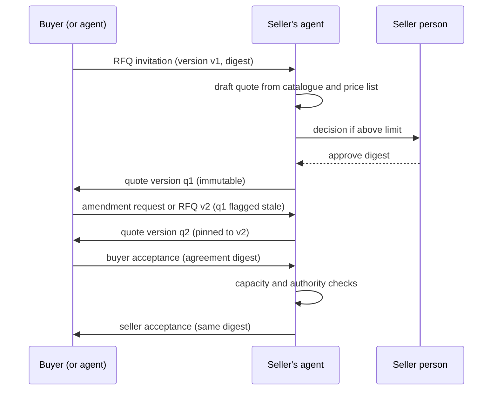

# Sales

Module code `SAL`. Status: the sales list and decisions panel are **Demo** (`/app/sales`); quote versions, digests, staleness, agreements and acceptance are **Contract**; leads, quoting, negotiation and order acceptance flows are **Designed** (COM-001, COM-002); quoting, negotiation and order-desk agent modules, joint requests and the seller side of the procurement suite are **Proposed**. Packages: COM-001, COM-002, WEB-002, AGT-008, MATCH-001, PERF-001, PRC-022. Narrative: [Buying and selling](../commerce.md#the-sales-journey). Data: [§17 Sales and negotiation](../../data/model.md#17-sales-and-negotiation), [§18 Transactions](../../data/model.md#18-transactions).

## Purpose

A company buys and sells on the same day. The sales side turns invitations, introductions and leads into honest quotes whose sent versions never change, negotiates inside private floors, accepts orders within authority and capacity, and fulfils with evidence, without an overloaded CRM navigation.

## Who uses it

Suppliers, distributors, manufacturers, contractors and subcontractors selling works, design offices selling services, individual professionals; the `quoting`, `negotiation`, `order_desk` and `representative` agent modules.

## User stories

| # | Story | Status |
|---|---|---|
| SAL-S1 | As a supplier, I want every RFQ invitation in my categories to arrive with a quote draft built from my catalogue and price list | Proposed |
| SAL-S2 | As a sales lead, I want my agent to send quotes under USD 50,000 from catalogue lines without asking, and ask me above that | Proposed |
| SAL-S3 | As a seller, I want my floor price and margin target to stay invisible to the buyer and to the buyer's agent under every circumstance | Contract |
| SAL-S4 | As a seller, I want to know immediately when the buyer amended the RFQ and which of my quotes became stale | Contract (flag); Designed (flow) |
| SAL-S5 | As an order desk, I want to accept orders within limits and flag capacity conflicts | Proposed |
| SAL-S6 | As a manufacturer, I want my standing representative to answer invitations while my team is at a trade show | Proposed |

## Functional requirements

| ID | Requirement | Status | Packages |
|---|---|---|---|
| SAL-F01 | Sales work is contextual: invitations, leads, introductions, contacts and templates live where they are used; there is no standalone CRM navigation or generic inbox | Designed | WEB-002 |
| SAL-F02 | A lead is created from an accepted introduction, an RFQ invitation, an expressed interest in an open need or a manual entry, with its source recorded | Designed | COM-001 |
| SAL-F03 | A quote answers one RFQ version; each sent quote version is an immutable, recipient-specific snapshot with lines, specifications, options and substitutions, quantities with unit basis, taxes, currency, milestones, payment terms, validity and attachments | Contract | COM-002 |
| SAL-F04 | Each quote line may cite the catalogue offering version it came from; later catalogue changes never touch the sent quote | Contract | COM-002 |
| SAL-F05 | Seller-private constraints (floors, margin targets, cost basis, notes) are a separate record never joined into the buyer's view, search, notifications, envelopes or federation | Contract | COM-002 |
| SAL-F06 | Quote lifecycle `draft → sent → superseded \| withdrawn \| expired \| accepted`; a quote cannot be sent against an RFQ version that is not current | Contract | COM-002 |
| SAL-F07 | Tax determination per line comes from the country tax facets and the parties' registrations, recorded as an append-only determination | Designed | COM-002, BILL-002 |
| SAL-F08 | Negotiation rounds propose new versions or amendment requests referencing exact lines; agents negotiate inside floors with round limits and expiry | Designed (rounds); Proposed (agents) | COM-002, AGT-001 |
| SAL-F09 | Seller acceptance of an order is a separate event bound to the agreement digest; acceptance checks the seller's authority and, for agents, the mandate and limits | Contract | COM-002, AST-001 |
| SAL-F10 | Capacity conflicts (overlapping commitments in the same period) are flagged before acceptance | Proposed | AGT-008 |
| SAL-F11 | Quote templates and price lists are company-level, versioned and private; applying them never changes sent quotes | Designed | COM-001 |
| SAL-F12 | Replying to an RFQ or a task is always free on the free floor; no plan buys visibility to buyers | Designed | BILL-001 |
| SAL-F13 | An offer naming a licensed or certified person is confirmed by that person (named-performer confirmation) | Proposed | PERF-001 |
| SAL-F14 | Opt-in demand pooling: an organizer (an association or a contractor, never the hub) forms a pool for a category and region; members commit quantities privately, one sourcing event runs, and each member signs and pays its own agreement; suppliers see total quantities only; behind a hub switch after a competition-law review | Proposed | PRC-022 |
| SAL-F15 | Sellers receive invitations from public procurement opportunities as sourced open needs; submission to an official portal is `human_only` and happens on that portal | Proposed | PROC-001, AGT-009 |
| SAL-F16 | Sales metrics are computed only from the seller's own records: win rate, response time, quote cycle time | Proposed | WEB-002 |

## Agent capabilities

| Capability | Kind | Mandate kind | Confirmation | Interface surface |
|---|---|---|---|---|
| `quoting.list_invitations` | read | — | `none` | `/app/sales` |
| `quoting.draft_quote` | draft | `prepare` | `none` | Invitation → Quote |
| `quoting.send_quote` | commit | `send_quote` | `mandate` (`ask_above(amount)` or `ask_each`) | Quote editor |
| `quoting.withdraw_quote` | commit | `send_quote` | `mandate` (`ask_each`) | Quote card |
| `quoting.revalidate_stale_quote` | draft | `prepare` | `none` | Stale quote banner |
| `negotiation.negotiate_quote` | commit | `negotiate` | `mandate` (per the mandate; round limits) | Negotiation thread |
| `order_desk.accept_order` | commit | `accept_order` | `mandate` (`ask_above(amount)`) | Order card |
| `order_desk.flag_capacity_conflict` | read | — | `none` | Order card |
| `quoting.manage_price_list` | commit | `maintain_profile` | `mandate` (`ask_each`) | Catalogue → Price lists |

## Interface surfaces

| Surface | Route | Status |
|---|---|---|
| Sales list with invitations, drafts, sent versions, decisions | `/app/sales` | Demo |
| Quote editor with catalogue lines and tax preview | Invitation → Quote | Designed (WEB-002) |
| Negotiation thread bound to versions | Quote context | Designed |
| Order acceptance with capacity check | Order card | Proposed |

## Hub console settings

Commerce category rules, flow counts, reconciliation of unknown outcomes, case-only access to deal objects; tax and e-invoicing adapters ([console: commerce](../hub-console/modules.md)).

## Data entities

`lead`, `quote`, `quote_version`, `quote_line`, `tax_determination`, `quote_private_constraint`, `negotiation_round`, `amendment_request` ([§17](../../data/model.md#17-sales-and-negotiation)); `agreement`, `agreement_seller_private`, `acceptance_event`, `order`, `order_change`, `obligation` ([§18](../../data/model.md#18-transactions)); `offering_version` ([§15](../../data/model.md#15-catalogue)).

## Country and jurisdiction variations

Sales tax versus VAT treatment of lines, tax registration evidence, e-invoicing obligations (for example Germany's EN 16931 receiving duty since 2025, Mexico's CFDI, Brazil's NF-e as later adapters), electronic agreement validity (ESIGN and UETA in the US, eIDAS in the EU), consumer rules when the buyer is a private person, and units of measure come from packs and adapters.

## Privacy rules

Buyer budgets and seller floors never cross; agents of competing sellers never exchange pricing information through the platform; the platform never relays one seller's quote to another. Quotes are visible to the buyer's participants and the seller's participants only.

## Metrics

Seller's own: response time, win rate, quote cycle time, revalidations. Hub cohorts: quotes sent per category, share of stale quotes revalidated. Never: pooled private prices across sellers.

## Edge cases

| Case | Behaviour |
|---|---|
| RFQ amended while a quote is being drafted | Draft is rebased on the new version with differences highlighted; sending against the old version fails with `commercial.stale_version` |
| Agent sends a quote and the provider of the e-signature times out | `outcome_unknown`, reconciliation; no second send |
| Two members of the seller's company edit the same quote draft | Expected-revision check; the second save is rejected with a merge view |
| The buyer is a consumer | Totals shown with taxes; no false urgency; the seller's agent obeys consumer-mode limits |

## Flow

## Open points

Electronic agreement validity per jurisdiction (O12); demand pooling needs counsel per hub before activation.
