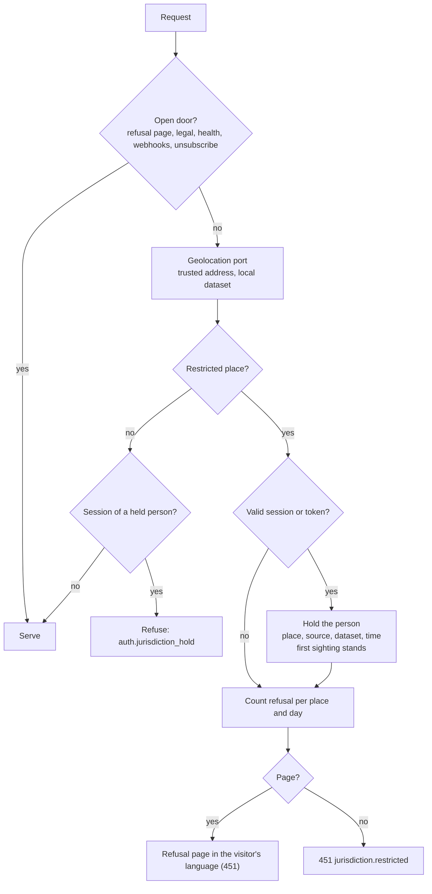
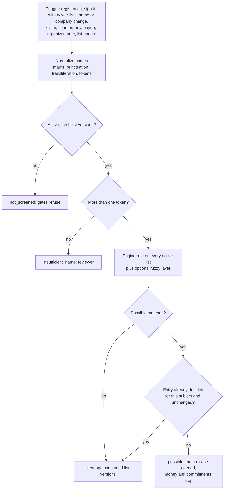
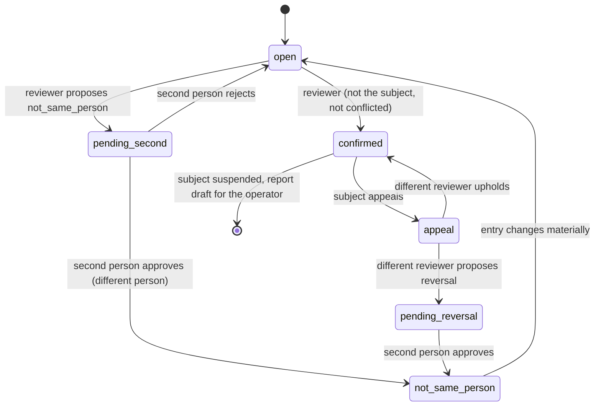
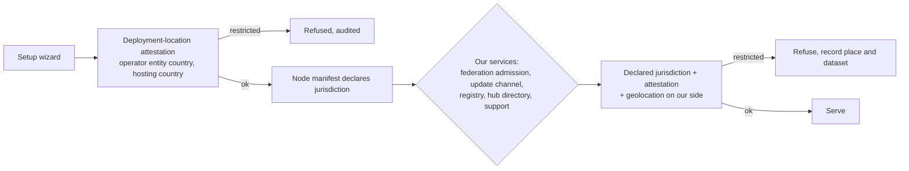

# Sanctions compliance

Module code `SNC`. Status: the restricted-places list (code, country packs, configuration, database kernel, console contracts), the ownership declaration with a screening adapter that never fakes "clear", the jurisdiction gate with holds at the web proxy and the API (SANC-001), the baseline and additional lists as immutable versions ingested by the worker with name keys and freshness (SANC-002), re-screening of every subject on each activated list version, weekly and on a compliance officer's request, idempotent per subject and list version and resumable (SANC-005, [worker](../../../apps/worker/src/rescreen/README.md)), the money and commitment gates for quotes, acceptance, orders, order changes and agent commits, with payee and payout-country helpers for PAY-001 and BILL-002 (SANC-004, [module](../../../apps/api/src/modules/screening-gates/README.md)), and the deployment-location attestation as an API (SANC-009, [module](../../../apps/api/src/modules/jurisdiction/attestation/README.md); the wizard step is HUB-004) are **Live**; everything else on this page is **Proposed** ([ADR 014](../../adr/014-sanctions-compliance-engine.md)). Packages: INTL-SAN (done), SANC-001 … SANC-009, HUB-003 (verification recipes that call this module). Narrative: [Trust, safety and privacy](../trust-safety-privacy.md#sanctions-and-export-controls), [Hub administration](../hub-administration.md#sanctions-screening-configuration). Data: [§24a Sanctions compliance](../../data/model.md#24a-sanctions-compliance). Requirement R72; owner decision [ADR 010](../../adr/010-gathering-point-hubs-agents-and-mesh.md) decision 24.

## Purpose

Keep every hub lawful under the sanctions and export-control rules that bind its operator, with the same engine everywhere and each country's lists as configuration: nobody in a restricted place is served, nobody on a sanctions list is paid, sold to or committed with until a person has reviewed the match, and every decision leaves evidence that outlives the account. The reference hub is a United States deployment, so the engine reaches at least the parity with the owner's other product, Contribuda, that ADR 014 tabulates.

## Who uses it

| Who | What they do here |
|---|---|
| Visitors and participants | Are refused kindly in a restricted place; see their own compliance status and appeal a decision |
| Companies and their representatives | Are screened at creation and change; sign the ownership declaration |
| Compliance officer (hub or node scope) | Reviews possible matches, clears holds, decides appeals as a different reviewer, watches list freshness |
| Second person (compliance permission) | Approves "not the same person" decisions and reversals |
| Hub owner, node operator | Configure lists, adapters, thresholds and service levels inside engine bounds; attest the deployment location |
| Auditor | Reads decisions and audit trails |

## User stories

| # | Story | Status |
|---|---|---|
| SNC-S1 | As a visitor in a restricted place, I want a clear, kind page that tells me why I cannot use the hub and whom to write to if my location is wrong | Proposed |
| SNC-S2 | As a participant who travelled, I want my account back after I return, without losing anything | Proposed |
| SNC-S3 | As a payee whose name resembles a listed person, I want a quick human review and a way to provide evidence, so that my payouts resume | Proposed |
| SNC-S4 | As a compliance officer, I want one queue of possible matches with the list entry and the screened names side by side, so that I decide within a day | Proposed |
| SNC-S5 | As a hub operator in another country, I want to add my national list from my country pack without changing engine code | Proposed |
| SNC-S6 | As a buyer, I want to know my supplier was screened before my order binds, without seeing anything private about them | Proposed |
| SNC-S7 | As the owner, I want our own services (federation, updates, hub directory, support) to refuse restricted places on our side, without a kill switch in the engine | Proposed |

## Functional requirements

| ID | Requirement | Status | Packages |
|---|---|---|---|
| SNC-F01 | Restricted places come only from the authoritative list in code; a hub may add places with a legal basis and a second person, never remove one; nobody is exempt | Live (list); Proposed (hub additions) | INTL-SAN, SANC-001, HUB-001 |
| SNC-F02 | The web proxy refuses a request from a restricted place before anything else: pages render `/restricted` in the visitor's language, other requests get 451 `jurisdiction.restricted`; only the refusal page, legal pages, health probes, provider webhooks and unsubscribe links stay open | Live | SANC-001 |
| SNC-F03 | The API refuses the same requests in an `onRequest` hook before any route reads a session | Live | SANC-001 |
| SNC-F04 | Geolocation is a port with `ranges_file`, `edge_header`, `upstream_gate` and `fake` adapters; the client address is read only through the trusted-proxy rules and is never logged or stored; records name the place and the dataset | Live | SANC-001 |
| SNC-F05 | A refused request that carries a valid session or connection token holds the person; an open hold refuses them on every request and at sign-in by name; their agent, connections and mandates stop; one open hold per person; the first sighting stands | Live (sessions; agents, connections and mandates when they exist: AGT-001, MCP-002) | SANC-001 |
| SNC-F06 | A hold is cleared only by a compliance reviewer with a reason and evidence category, never by the subject; the person is notified; the cleared row stays; a new sighting holds again | Live (clear and audit); Proposed (console, person notice: SANC-006, SANC-007) | SANC-001, SANC-006, SANC-007 |
| SNC-F07 | A restricted own-location declaration (residence, company places, payout country) refuses and holds; other place fields refuse only | Live (payout country through the payout helper, refused before any provider is called; the `self_declared` declaration port exists); Proposed (wiring residence and company places in the profile and ownership forms) | SANC-001, SANC-004 |
| SNC-F08 | Every hub screens against the baseline OFAC lists (SDN and consolidated non-SDN), which cannot be disabled; additional lists come from country-pack facts and adapters; the CSL adapter runs only with a key | Live (baseline seeded and unpausable, `ofac-sls-xml` adapter, CSL adapter unchanged) | SANC-002 |
| SNC-F09 | List versions are immutable with source, publication date, entry count and digest; ingestion modes `file`, `live` (second person) and `fake`; sanity bounds block a truncated version; stale baseline closes money and commitment gates | Live (versions, `file` and `fake` modes, sanity bounds, freshness and `screening_available`; `live` refuses until KEYS-001 supplies the egress fetcher and activations; the gates themselves: SANC-004) | SANC-002 |
| SNC-F10 | Names are normalized deterministically (case, marks, punctuation, transliteration tables, sorted distinct tokens); persons match individuals and companies match entities by the engine rule; one-token names give `insufficient_name`, never `clear` | Live (name keys: ICAO 9303 Cyrillic, Georgian national 2002 and CLDR Latin tables; the engine rule in `packages/compliance/src/matching`, matcher version recorded in every result) | SANC-002, SANC-003 |
| SNC-F11 | A hub may add a fuzzy layer within engine bounds that only adds possible matches; no score ever clears | Live (Jaro-Winkler, threshold 0.85 to 0.99, off by default until the owner chooses a threshold: open question 3) | SANC-003 |
| SNC-F12 | Screening runs at registration, at sign-in when lists or names changed, on name and company changes, at claims, for sellers, counterparties, payees, organizers, peers and the operator | Live (registration, sign-in when lists or names changed, person and company renames, company creation, the nightly names-digest sweep; a fresh result for both counterparties before every quote sent, terms accepted, order placed or accepted and change bound, and for payees, required by the gates: SANC-004); Proposed (screening synchronously or on demand when a gate finds a subject unscreened, claims, sellers above the threshold, organizers, peers, the operator: HUB-003, HUB-004) | SANC-003, SANC-004 |
| SNC-F13 | Results are `clear`, `possible_match`, `insufficient_name` or `not_screened`; only `clear` or a decided `not_same_person` against fresh lists lets money move or commitments bind | Live (outcomes, the clear invariant and `money_held`; the gates that read them: SANC-004) | SANC-003, SANC-004 |
| SNC-F14 | Money (payout accounts, payouts, sales) and commitments (quotes, orders, agreements, agent commits) refuse while a match is open or confirmed, the state is unknown or the baseline is stale; a gate without an answer refuses | Live (quotes, acceptance, orders, order changes, agent commits on the mandate path; read in the commitment's transaction with locks so a racing decision is never bound on a stale answer); Live as a port (payout accounts and payouts: the callers are PAY-001 and BILL-002); Proposed (ticket and course sales EVT-001, task and consultation agreements TASK-001 and CONS-001) | SANC-004, PAY-001, BILL-002 |
| SNC-F15 | Possible matches open one review case per subject, late after the hub's service level; notifications to compliance staff cannot be muted and name nobody | Live (one queue item per subject, late after the service level, an outbox notification that names nobody and cannot be muted); Proposed (console and staff mail: SANC-006, SANC-007) | SANC-003, SANC-006 |
| SNC-F16 | "Not the same person" needs two people, neither the subject nor conflicted; "confirmed" by one reviewer suspends the subject and prepares a report draft for the operator; appeals go to a different reviewer; reversals need two people | Live (backend: decisions, second person through `second_person_approval`, report drafts, appeals by another reviewer); Proposed (console: SANC-006) | SANC-003, SANC-006 |
| SNC-F17 | Every new active list version triggers a delta re-screen of every active subject; a weekly full run is the safety net; runs are idempotent per subject and list version | Live (delta runs on activation with candidates first, weekly full run, manual request by a compliance officer as a database port, resumable runs, cohort metrics and alerts; the console page and its API route: SANC-006) | SANC-005 |
| SNC-F18 | Holds, results, matches, decisions and refusal counts are append-only, kept for the pack's record-keeping period through erasure (naming the tombstone), and never contain a network address | Live (holds; screening states, results, matches, decisions and report drafts append-only or guarded); Proposed (erasure ledger: PRV-001) | SANC-001, SANC-003, PRV-001 |
| SNC-F19 | The subject is told only what the law allows; counterparties learn only that the other side cannot transact now | Live (gate refusals: the caller's own status words, one code without detail for a counterparty, projection-tested); Proposed (the compliance page and mail notices: SANC-007) | SANC-004, SANC-007 |
| SNC-F20 | Every visible string of this module is in every engine language; mail notices for holds, cleared holds and decisions | Proposed | SANC-001, SANC-007 |
| SNC-F21 | Our own services (federation admission, update channel and registry, hub directory, support, hosted services) refuse restricted places using declared jurisdiction, attestation and our own geolocation | Proposed | SANC-008, FED-001 |
| SNC-F22 | The setup wizard records a deployment-location attestation (operator entity country and region, hosting country and region, gate mode), refuses restricted places, audits it and requires renewal on change and yearly | Live as an API (wizard step Proposed) | SANC-009, HUB-004 |
| SNC-F23 | The engine contains no code that geolocates the server it runs on or disables itself by location (owner decision, ADR 014 decision 3) | Designed | — |
| SNC-F24 | Nothing in this module changes ranking, matching, recommendations or reputation; no screening outcome is public | Live (projection tests: contracts, database functions, views and policies, and sources) | SANC-003 |

## Agent capabilities

Screening decisions are staff work and never reachable by an agent or a connection. The participant-facing operations, available both through the person's agent and in the interface (ADR 010 decision 23):

| Identifier | Kind | Mandate kind | Confirmation | Surface |
|---|---|---|---|---|
| `core.compliance_status` | `read` | — | `none` | Settings → Account → Compliance (API `GET /v1/screening/me`, Live; page: SANC-007) |
| `core.appeal_compliance_decision` | `govern` | — | `first_party_step_up` | The appeal form on the compliance page (API `POST /v1/screening/me/appeal`, Live; page: SANC-007) |
| `core.explain_refusal` | `read` | — | `none` | The refusal message on a blocked payout, sale or commitment |

A confirmed match suspends the subject: a person's sessions end and every mandate they gave stops (pending agent actions revoked); they can sign in again only to read their status, appeal and sign out (every other request answers `403 auth.compliance_suspended`). A company's mandates (its people's agents acting for it and its standing representative) stop. A possible match never blocks sign-in. An agent whose principal is held, or whose action is refused by a gate, reports the refusal in the person's decisions with the same words the interface uses; it never retries around a gate.

## Interface surfaces

| Surface | Route | Status |
|---|---|---|
| Refusal page | `/restricted` (rendered in place by the proxy) | Live (SANC-001) |
| Sign-in refusal for a held account | the sign-in page, error `auth.jurisdiction_hold` | Live (SANC-001) |
| Own compliance status and appeal | `/app/settings/account/compliance` | Proposed (SANC-007) |
| Refusal notices on payouts, sales and commitments | inline on the affected forms (`error.screening.review_pending`, `error.screening.unavailable`, `error.commercial.counterparty_unavailable`) | Live on the commerce forms (SANC-004); payouts and sales with PAY-001, BILL-002 and EVT-001 |
| Console: Trust → Screening (lists, matches queue, holds, re-screen runs, geolocation table, metrics) | `/admin/hubs/[hub]/trust/screening` (HC-74) | Proposed (SANC-006) |
| Console: compliance panel on person and company pages | `/admin/hubs/[hub]/participants/people/[id]`, `/companies/[id]` | Proposed (SANC-006) |
| Setup wizard: deployment location step | `/admin/setup` (SW-4) | Proposed (SANC-009, HUB-004) |

## Hub console settings

Configured in [Hub administration](../hub-administration.md#sanctions-screening-configuration) and the [console](../hub-console/screens.md#hc-74-screening--trustscreening):

| Setting | Bounds |
|---|---|
| Additional restricted places | Add only; legal basis; second person |
| Geolocation adapter and dataset | `ranges_file`, `edge_header`, `upstream_gate`; `fake` refused in production |
| Additional lists | From country-pack `sanctions` facts with an adapter; `live` mode needs a second person |
| List cadence, warning and stale ages | Stale age at most 14 days for the baseline (engine bound) |
| Fuzzy layer | Off or a threshold between 0.85 and 0.99; adds matches only |
| Entity types screened | Individuals and entities always; vessels and aircraft optional |
| Review service level | One to five business days |
| Seller screening threshold | Any amount down to zero; payees always |
| Record-keeping period | From the pack's sanctions facts; never shorter than the pack says |
| What a subject is told | Wording from locale keys; tipping-off limits from the pack |

## Data entities

[`restricted_place`](../../data/model.md#2-platform-kernel), [`jurisdiction_hold`, `jurisdiction_refusal_count`, `geolocation_dataset`, `screening_list`, `screening_list_version`, `screening_list_entry`, `screening_subject_state`, `screening_result`, `screening_match`, `screening_decision`, `screening_report_draft`, `screening_rescreen_run`, `screening_rescreen_item`, `deployment_location_attestation`](../../data/model.md#24a-sanctions-compliance).

## Country and jurisdiction variations

- **United States (reference hub):** baseline OFAC lists; CSL with a key; record-keeping ten years (31 CFR 501.601); blocked-property and rejected-transaction reports within ten business days (31 CFR 501.603, 501.604) filed by the operator.
- **Other countries:** the pack's `sanctions` facts name the national and international lists and their adapters (UN Security Council consolidated list, EU consolidated financial sanctions list, UK sanctions list, national lists); the pack's record-keeping and tipping-off facts set retention and wording. The US baseline stays on in every hub (ADR 014 decision 10).
- **Places:** the engine-wide restricted list applies everywhere; a hub adds places its law closes.

## Privacy rules

- No network address is stored, logged or put in an outbox payload; the gate keeps a place, a dataset and a time.
- Screening records are staff-only (`SC`), visible under a compliance case; the subject sees only their status words; counterparties see only "cannot transact now".
- Screened names, list entries and decisions are evidence kept for the record-keeping period through erasure, pseudonymized where the law allows, and never exported to other hubs, search, notifications to third parties, agents of other people or federation.
- Hold and match notifications to staff name nobody; details open under the case.

## Metrics

Hub cohorts only: refusals per place and day; open holds and median time to clear; possible matches opened, decided and late; the not-same-person share; list and geolocation dataset ages; re-screen run durations; gate refusals by kind. No per-person view.

## Edge cases

| Case | What the engine does |
|---|---|
| Traveller seen in a restricted place | Refused and held there; clears after return through a reviewer |
| Geolocation error | Refused; the page gives the contact; a reviewer clears a resulting hold |
| VPN | Not detected by the address; holds, declarations, list screening and payout-country checks remain; known VPN ranges are a later adapter |
| Session sighted concurrently from two requests | One open hold (unique index); the second insert is a no-op |
| List download truncated | Sanity bounds stop activation; the previous version stays active; freshness ages keep running |
| Baseline stale | Money and commitment gates refuse with "screening temporarily unavailable"; console alert |
| One-word display name | `insufficient_name`; money waits for a reviewer or a fuller legal name |
| Same entry flagged again after "not the same person" | Not flagged again unless the entry's normalized names change (`entry_keys_digest`) |
| New baseline list version activated | Every earlier `clear` is due for re-screening: money is held (`rescreen_due`) until the subject is screened again, at sign-in or by the delta run that re-screens everyone automatically (SANC-005) |
| Display name changed by any path | The database appends `identity.name_changed` or `company.renamed` in the same transaction; the worker screens the new name; the nightly sweep catches anything missed |
| Reviewer is the subject or conflicted | Refused by the database guard |
| Gate cannot reach the screening store | Refuses; no money moves unscreened |
| Worker crashes during a re-screen run | The open batch rolls back; the run resumes from its last committed cursor without screening finished subjects again; a run that keeps failing alerts and resumes after the retry interval |
| Re-screen run while the baseline is stale | Nothing is recorded; the run waits and money stays held |
| Company representative's accountable person held | The representative suspends (ADR 010 decision 9) |
| Erasure request from a held or matched person | Account content erased; sanctions records kept and pseudonymized, naming the tombstone |
| Federation peer's server located in a restricted place | Our side refuses admission (SANC-008) |

## Flow

### A request from a restricted place

### Screening a subject

### Deciding a possible match

### Our own services and the deployment attestation

## Open points

The owner and counsel questions are listed in [ADR 014](../../adr/014-sanctions-compliance-engine.md#open-questions-owner-and-counsel): lists for the US hub beyond the baseline, the geolocation adapter for the public reference hub, matching thresholds, review service level and staffing, record-keeping and tipping-off per country, counsel wording (brand policy for forks in restricted places, export-control wording for publication, refusal and legal texts), and the re-screen cadence.
