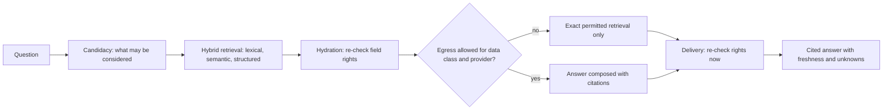

# Search and cited answers (RAG)

Module code `SCH`. Status: keyword search over public demo cards is **Demo** (`/search`); retrieval contracts (index generations, embedding configuration, citations, admission and delivery fencing) are **Contract** with deterministic fixtures; structured filters and governed hybrid retrieval with pgvector are **Designed** ([ADR 007](../../adr/007-hybrid-retrieval.md), [retrieval architecture](../../architecture/retrieval.md)); multilingual and federated retrieval and plan-step recommendations are **Proposed** (R31, R45). Packages: RAG-000 (done), RAG-101 (done), RAG-201, RAG-301, WEB-003, RAG-401, REC-001, INTL-006. Narrative: [Search and knowledge](../search-and-knowledge.md). Data: [§25 Search and knowledge](../../data/model.md#25-search-and-knowledge), [knowledge model](../../data/knowledge-model.md).

## Purpose

Answer people's and agents' questions from permitted facts with citations, never from a model's imagination and never from data the asker may not see: keyword search, exact structured filters, and cited answers over hybrid retrieval that re-checks permissions at every gate.

## Who uses it

Everyone through the search dialog and the assistant; agents of every module through the retrieval port; editors and staff for hub knowledge sources; the plan-step companion for recommendations.

## User stories

| # | Story | Status |
|---|---|---|
| SCH-S1 | As a reader, I want to search news, articles, events, companies, people and projects in my language | Demo |
| SCH-S2 | As a client, I want "who installed ventilated facades on schools in California in the last two years" answered with citations and freshness | Designed |
| SCH-S3 | As a professional, I want "what does the new standard say about anchors" answered with a citation and link, without the standard's text if the hub may not reproduce it | Designed |
| SCH-S4 | As a person, I want the agent to say what it does not know | Designed |
| SCH-S5 | As a participant in a deal, I want my private documents searchable only by me and the deal's parties | Designed |
| SCH-S6 | As a Japanese reader, I want search to work without spaces between words | Proposed |

## Functional requirements

| ID | Requirement | Status | Packages |
|---|---|---|---|
| SCH-F01 | Keyword search requires every query word in titles, ledes and labels of public cards | Demo | WEB-001 |
| SCH-F02 | Structured filters (category, region, format, date, badge, licence, capacity) are exact and complete | Designed | WEB-003, RAG-301 |
| SCH-F03 | Canonical records stay the truth; derived, versioned projections separate field audiences before anything is embedded or sent to a model | Designed | RAG-201 |
| SCH-F04 | Permissions are checked at candidacy, hydration, egress and delivery (re-checked at display); a saved answer is visible only to people who may see all its sources | Contract (fencing); Designed (runtime) | RAG-301 |
| SCH-F05 | Structured facts (amounts, dates, quantities, counts) are answered from records with exact arithmetic, never from generated text | Designed | RAG-301 |
| SCH-F06 | Answers cite exact source versions, show freshness, and say when permitted evidence is insufficient | Designed | RAG-301, WEB-003 |
| SCH-F07 | Index generations `building → validated → active → draining → retired`, plus `failed` and `tainted`; a tainted generation only retires and queries fall back to exact permitted retrieval | Contract | RAG-201 |
| SCH-F08 | Revocation, deletion and erasure produce tombstones replayed after restores; they reach indexes, caches and saved answers | Contract (shapes); Designed | RAG-201 |
| SCH-F09 | Embedding model, revision, tokenizer, normalization, metric, licence and hardware are frozen per generation; vectors from different models never mix; no model download or paid inference without authorization | Contract | RAG-201 |
| SCH-F10 | Evaluation gates (recall against an exact oracle, latency under concurrent load, citation correctness, security tests) are measured before support is claimed | Designed | RAG-401 |
| SCH-F11 | Multilingual retrieval: both scripts indexed for languages written in two scripts; per-language full-text configurations; n-gram or segmenter adapters for Chinese and Japanese; Devanagari normalization; Arabic normalization; recall measured per language before support is claimed | Proposed | WEB-003, RAG-201, INTL-006 |
| SCH-F12 | Hub knowledge sources (codes and standards the hub is licensed to index, register extracts, procurement notices, guidelines) carry licence flags; a standard that may be cited but not reproduced is answered with a citation and link only | Proposed | RAG-201, SRC-001 |
| SCH-F13 | Each node indexes public replicas from peers as a separate source class with their licence flags; results show the home hub; private queries are never forwarded to peers | Proposed | FED-002 |
| SCH-F14 | Retrieval is a port with a fake; agent runtime, matching and recommendations work on structured data before semantic recall exists (ADR 012 decision 20) | Designed | AST-001, MATCH-001, REC-001 |
| SCH-F15 | Plan-step recommendations: explained, matched on the open taxonomy and structured attributes, payment-blind, sponsored items only in a separate labelled slot, private plan never revealed to recommended parties | Proposed | REC-001 |
| SCH-F16 | Search results and answers never include profile-view data, private negotiation or anything outside the asker's projections | Designed | RAG-301 |
| SCH-F17 | A code and standards assistant beyond citation and links is deferred: answers are never presented as compliance determinations | Proposed (deferred) | — |

## Agent capabilities

| Capability | Kind | Mandate kind | Confirmation | Interface surface |
|---|---|---|---|---|
| `core.search_public` | read | — | `none` | `/search`, search dialog |
| `discovery.filter_directory` | read | — | `none` | Directories |
| `core.ask_cited` | read | — | `none` | Assistant, search dialog |
| `core.save_answer` | commit | `prepare` | `mandate` (`ask_each`) | Answer card |
| `plan_step_companion.list_for_step` | read | — | `none` | Plan item |
| `plan_step_companion.explain` | read | — | `none` | Recommendation card |

## Interface surfaces

| Surface | Route | Status |
|---|---|---|
| Search page and dialog | `/search`, header dialog | Demo |
| Cited answer card with freshness and "what I do not know" | Search and assistant | Designed (WEB-003) |
| Recommendation cards per plan step | Plan item | Proposed |

## Hub console settings

Knowledge sources and licences, index generations, evaluation summaries, recommendation rules and the sponsored-content switch ([console: data → knowledge, recommendations](../hub-console/README.md#hub-console-section-map)).

## Data entities

`knowledge_source`, `knowledge_version`, `extraction_artifact`, `knowledge_projection`, `knowledge_chunk`, `citation_locator`, `embedding_config`, `index_generation`, `chunk_embedding`, `lexical_projection`, `knowledge_edge`, `index_job`, `retrieval_tombstone`, `retrieval_receipt`, `answer_dependency`, `saved_answer` ([§25](../../data/model.md#25-search-and-knowledge)); `recommendation_method_version`, `recommendation_set`, `recommendation` ([§14](../../data/model.md#14-partners-and-matching)).

## Country and jurisdiction variations

Which codes and standards may be indexed or reproduced (often copyrighted; licences per hub), model egress and residency rules per data class, languages and scripts of the hub, and AI-disclosure duties for generated answers come from packs and hub settings.

## Privacy rules

Retrieval never widens access; every result passes the same projection serializers as an API read; private negotiation, budgets and floors are never embedded into shared indexes; model egress follows the hub's data-class matrix.

## Metrics

Hub cohorts: queries, answers with sufficient evidence, refusals for insufficient evidence, freshness lag of indexes, evaluation results per language. Never per-person query histories for staff.

## Edge cases

| Case | Behaviour |
|---|---|
| Permission revoked between retrieval and display | Delivery fencing drops the item and the answer is re-composed or withheld |
| A generation mixed public and private material | Marked tainted; retired; exact permitted retrieval until a clean generation is active |
| Restore from backup | Tombstones replayed before the restored index serves |
| Question asks for a number across many records | Answered by an exact query over records, with the method shown |

## Flow

## Open points

Embedding model choice after local evaluation; per-language support claims only after measured recall.
