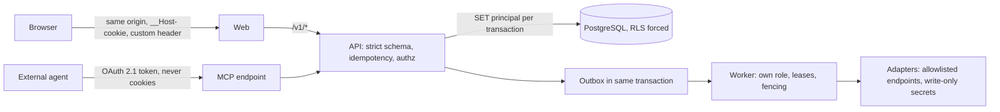

# Security architecture

Module code `SEC`. Status: password hashing with Argon2id, opaque hashed sessions, step-up, CSRF and origin checks, strict schemas, idempotency keys, expected revisions, row-level security forced on the runtime role, projection serializers, the worker's own restricted database role and fencing tokens are **Live**; configuration guard, structured logs, readiness, security headers and telemetry are **Proposed** in OPS-001 (in review); second factor, elevated sessions, CI hardening, file scanning, egress allowlists, secret store, key rotation, supply-chain controls and the agent safety suite are **Designed** or **Proposed**. Packages: BE-001 (done), REL-001 (done), BE-002, BE-004, OPS-001, CI-001, FILE-001, KEYS-001, EVAL-001, AGT-019, FED-001, OPS-003. Narrative: [Security, trust and privacy](../trust-safety-privacy.md), [Security baseline](../../quality/security.md), [Architecture](../architecture.md), [API conventions](../../architecture/api.md).

## Purpose

Make the engine safe to run by anyone, anywhere: defence in depth for multi-party data, integrity of commercial and evidence records, safe agents, safe providers and secrets, a reproducible supply chain, and recovery that never resurrects erased data. Security is a property of every module, specified here once.

## Who uses it

Contributors and reviewers (rules they must keep), node operators and ops engineers (deployment and incident), auditors; indirectly every participant.

## User stories

| # | Story | Status |
|---|---|---|
| SEC-S1 | As a participant, I want a guessed identifier to reveal nothing about other people's objects | Live |
| SEC-S2 | As a node operator, I want the API to refuse to start with unsafe production configuration | Proposed (OPS-001) |
| SEC-S3 | As a security researcher, I want a private reporting channel and coordinated disclosure | Live (SECURITY.md) |
| SEC-S4 | As a hub owner, I want provider keys stored write-only and rotated without downtime | Proposed |
| SEC-S5 | As a participant, I want my agent unable to be tricked by a document into sending my budget anywhere | Contract (rules); Proposed (suite) |

## Functional requirements

| ID | Requirement | Status | Packages |
|---|---|---|---|
| SEC-F01 | One public origin; API under `/v1/*` on the same origin; no CORS for first-party traffic | Live | BE-001 |
| SEC-F02 | `__Host-` cookies; mutations require a custom header plus `Sec-Fetch-Site` and `Origin` checks; `SameSite=Lax`; GET never mutates | Live | BE-001 |
| SEC-F03 | Strict schemas reject unknown fields; contracts are the single source of shapes | Live | FND-002 |
| SEC-F04 | Every mutation carries an idempotency key scoped to principal, action and context; versioned edits send the expected revision | Live | BE-001 |
| SEC-F05 | Passwords with Argon2id; sessions as hashed opaque tokens; step-up for sensitive actions; second factor and elevated sessions for staff and setup | Live (passwords, sessions, step-up); Proposed (second factor) | BE-001, BE-004 |
| SEC-F06 | PostgreSQL row-level security forced on a runtime role distinct from the schema owner; the principal set per transaction; security-definer functions reviewed; the worker runs under its own restricted role with no grant on party tables | Live | DATA-001, REL-001 |
| SEC-F07 | Published RFQ versions and sent quote versions immutable in the database; agreements and approvals bound by `trustwork-digest-1`; acceptance recomputes digests from stored payloads | Contract (with database rules) | FND-002, COM-001 |
| SEC-F08 | Evidence, confirmations, disputes, corrections and audit are append-only; audit and outbox tables partitioned by month | Live (audit, outbox); Contract (rest) | REL-001 |
| SEC-F09 | Production configuration guard, structured logs without secrets or personal data, readiness, telemetry and security headers (including a content security policy) | Proposed | OPS-001 |
| SEC-F10 | File uploads: size and type limits, quarantine and malware scan, isolated parsers with limits, short-lived signed URLs, classification inherited from the parent | Proposed | FILE-001 |
| SEC-F11 | Outbound requests only through adapters with allowlisted endpoints; private IP ranges and redirect bypasses blocked (SSRF) | Proposed | KEYS-001, PIPE-001 |
| SEC-F12 | Secrets are write-only in the console, stored in a secret store with key custody separate from data, rotated without downtime; no secret in logs, screenshots or exports | Proposed | KEYS-001 |
| SEC-F13 | Agent safety: tool allowlists per action, no superuser channel, untrusted-content marking, egress per data class, kill switches, the safety suite mapped to OWASP LLM and Agentic Top 10 in CI before enablement | Proposed | EVAL-001, AGT-019 |
| SEC-F14 | External agent connections: OAuth 2.1 with PKCE, audience-bound short-lived tokens stored as hashes, refresh rotation with reuse detection, sender-constrained tokens where supported; bearer tokens never authorize the first-party API and cookies never authorize MCP | Proposed | AGT-016, MCP packages |
| SEC-F15 | Supply chain: exact lockfile, reviewed upgrades, dependency audit in CI, secret scanning, DCO sign-off, pinned CI actions | Live (lockfile, DCO, secret scan); Proposed (audit gates) | CI-001 |
| SEC-F16 | Node keys for federation and verifiable credentials with rotation and published history; signatures checked on every inbound envelope | Proposed | FED-001, REP-002 |
| SEC-F17 | Backups encrypted; restore drills with evidence; erasure ledger and tombstones replayed before restored data serves | Proposed | OPS-003 |
| SEC-F18 | Rate limits and lockouts per account, source and connection; anti-scraping caps on public records | Live (auth); Proposed (rest) | BE-002, AGT-016 |
| SEC-F19 | Security review checklist in every pull request touching authorization, files, providers or agents; negative authorization and concurrency tests are part of done | Live (process) | CI-001 |
| SEC-F20 | Vulnerability reports privately through `SECURITY.md`; coordinated disclosure | Live | — |

## Agent capabilities

Security controls are not agent capabilities; the agent can explain a person's own security state (`core.explain_security_state`) and press the stop control.

## Interface surfaces

Security settings for participants (sessions, second factor, connections); console sections staff and audit, keys and models, kill switches, operations and incidents.

## Hub console settings

Provider keys (write-only), egress matrix, spending caps, kill switches, staff second factors and elevation, audit browsing and signed export.

## Data entities

`session`, `auth_token`, `credential` ([§3](../../data/model.md#3-identity-and-sessions)); `idempotency_record`, `inbox_receipt`, `principal_key`, `audit_event`, `revocation_event` ([§2](../../data/model.md#2-platform-kernel)); `provider_credential_ref` ([§24](../../data/model.md#24-hubs-sources-and-verification)); `connection_token` ([§21](../../data/model.md#21-assistant-and-agents)); `node_key` ([§26](../../data/model.md#26-federation)).

## Country and jurisdiction variations

Encryption export rules, breach notification duties, security requirements for certain sectors (for example public-sector procurement security clauses), and data-residency rules for logs and backups come from packs and hub settings.

## Privacy rules

Logs are pseudonymous, never contain secrets, full mailboxes, payment data or private model prompts; telemetry is aggregate.

## Metrics

Failed and locked logins (cohorts), dependency audit findings, safety-suite pass rates, mean time to rotate a key, restore drill durations against targets (RPO 24 hours, RTO 8 hours for the reference demo).

## Edge cases

| Case | Behaviour |
|---|---|
| Stolen session cookie | Session list shows it; revocation and step-up limit damage; sensitive actions need re-authentication |
| Compromised provider key | Kill switch, rotation, incident, unknown outcomes reconciled |
| A dependency is compromised | Lockfile and review block silent upgrades; incident procedure for affected releases |
| A malicious PDF tries to instruct the agent | Untrusted content marking; tool allowlists; the suite contains this case |

## Flow

## Open points

Exact production values for lockout, session lifetimes and password policy; content security policy details once WEB-005 splits stylesheets.
